# EDU 360 V4.0 — Deliverable 4 · Database & Technical Architecture Specification

**Edition:** V4.0 Final — Independently Validated and Corrected · 30 October 2026
**Baseline carried forward:** Corrected Document 1, edition C1, baseline V3.3 (27 Oct 2026), reproduced in full below with the V4.0 corrections marked *(V4.0)*.
**Status:** Released for engineering handover, subject to the open decisions marked B in §14.1 (OD-01, 03, 04, 09, 10, 43, 53, 58, 60) and the proposed decisions TD-01 to TD-15. A documented or tested database object is not a running application.

## V4.0 revision summary

| ID | What changed in V4.0 | Why (finding) | Evidence |
|---|---|---|---|
| V4-DB-01 | `app.fn_leave_approver_not_subject()` now also refuses (a) an approver who holds the subject's role — the Principal, Vice-Chancellor or Data Protection Contact can never be named as their own leave approver — and (b) a `REGISTRAR` / `VICE_CHANCELLOR` approver kind that points at a user without that active role. Shipped as `08_v40_rules.sql`. | V4-F-17: the go-live gate (C7) could be satisfied by naming the Principal as the Principal's approver; every request would then be blocked at decision time by K-015 (D-002, AP-04, Change Table A30). | DB-77, DB-78 pass with the migration; the same tests **fail** without it (negative control); DB-79 shows the governance-account path still works. |
| V4-DB-02 | Eight covering indexes on `ref`-schema foreign keys. | V4-F-18: AC-S4 was measured on `app`/`platform` only; 8 `ref` FKs had no covering index. | Catalogue check AC-S4 = 0 across all three schemas. |
| V4-DB-03 | 20 further executable tests, `09_tests_v40.sql` (DB-60 to DB-79). | V4-F-15: 37 of 69 catalogue rules were "implemented, not executed". | 79 / 79 at this step; 97 / 97 with V4-DB-08 (§16). |
| V4-DB-04 | Counts corrected from the live catalogue: **690** declared foreign keys (not 689); 711 FK rows in `pg_constraint` = 690 declared + 21 clones PostgreSQL creates on the 39 partitions; **1,249** CHECK constraints measured (the V3.3 log's 1,251 could not be reproduced and its query was not supplied). | V4-F-04 (was GAP-005, 689 vs 711). | `run_results.txt`, CATALOGUE lines. |
| V4-DB-05 | ER diagrams: six primary keys showed `uuid` although the column is `text`, `integer` or `bigint` (`trigger_code`, `job_type`, `safe_file_type_id`, `scope`, `data_class_code`, `reference_load_id`). | V4-F-19. | Compared with `pg_attribute`. |
| V4-DB-06 | §16.3 lists the 21 foreign keys that the §4 relationship tables do not show (18 `platform.* → platform.tenant` FKs omitted by the "excluding tenant_id" convention, and 3 composite FKs: two institution-type pins and the partition-keyed correction → entry FK). | V4-F-20: dictionary relationship tables showed 513 of 532 non-`tenant_local` FKs; 0 documented FKs are missing from the database. | Script `dbdoc_check.py` (deliverable 8 evidence). |
| V4-DB-08 | **Role roll-down** (decision V4-PD-01): `10_v40_rolldown.sql` adds `ref.role_rolldown_default` (182 default stand-in rows, loaded by `10d_v40_rolldown_ref.sql`), `app.role_rolldown_override` (changes by the level above, RLS-forced, guard trigger), `app.fn_rolldown_resolve(institution, role, action)` and `app.fn_role_has_holder`, and `app.approval_step.acting_for_role`. Additive only; rollback `10r_v40_rolldown_rollback.sql`. See §16.5. | Product Owner decision 30 Oct 2026; V4-F-31 (a standalone institution had nobody allowed to activate it). | DB-80 to DB-97, 18 / 18 pass. |
| V4-DB-07 | Execution order, rollback and the one-command runner are stated once (§16.1) and match the scripts. | V4-F-02: the SQL scripts were not part of the V4.0 package at all. | `run_all.sh` executed 30 Oct 2026. |

**Execution order (normative):** `01_schema.sql` → `02_rules.sql` → `03_bindings.sql` → `03b_fk_indexes.sql` → `08_v40_rules.sql` → `10_v40_rolldown.sql` → `05_ref_data.sql` → `10d_v40_rolldown_ref.sql` (production and every tenant database) · tests only on a throw-away database: `04_tests.sql` → `07_tests_extra.sql` (new connection) → `09_tests_v40.sql` → `11_tests_rolldown.sql` · `06_ref_checks.sql` after a reference load. Tests seed their own minimal reference rows, so they run on a database **without** `05_ref_data.sql`; `run_all.sh` therefore uses two databases.

---


# EDU 360 — Database Architecture, Logical Data Model, Data Dictionary and Migration Strategy

Corrected edition C1 · Baseline V3.3 · 27 October 2026

## 0. About this edition

This is the corrected Document 1 for EDU 360, rebuilt against **Version 3.3** (V3.1 shown where it matters). It replaces the seven-part assembled document supplied on 27 October 2026. Every table, column, constraint, policy and grant below is generated from one model that was applied to an empty PostgreSQL 16.15 database without error, then tested.

<div class="kpis">
<div class="kpi"><div class="v">206</div><div class="l">tables, all fully defined (159 app · 29 platform · 18 ref)</div></div>
<div class="kpi"><div class="v">2,798</div><div class="l">columns in the data dictionary; 0 differences from the live catalogue</div></div>
<div class="kpi"><div class="v">97</div><div class="l">database rule tests executed, all passed (59 V3.3 re-run + 38 added in V4.0)</div></div>
<div class="kpi"><div class="v">696</div><div class="l">declared foreign keys after the V4.0 roll-down migration (690 before it: 633 app · 45 platform · 12 ref), every app FK led by tenant_id; the catalogue shows 717 rows because PostgreSQL clones 21 FKs onto partitions</div></div>
</div>

**Status of this document: corrected draft for Product Owner review. It is not an approved design.** Three kinds of statement appear, and they are marked:

| Mark | Meaning |
|---|---|
| Approved source | Taken from V3.3 (main document, Action List, Permission Matrix), the Phase 1 Decision Register (PQ-01 to PQ-82), Product Owner decisions C1–C13, R-1 and PO-A1. |
| <span class="b warn">proposed</span> TD-xx / PTD-xx | A technical decision this document needs but no source makes. It is a proposal until approved. |
| <span class="b bad">open</span> OD-xx | A decision nobody has made yet. The design leaves room for it and does not guess the answer. |

**How to read the evidence.** "Tested" means a test in `04_tests.sql` or `07_tests_extra.sql` ran and passed (IDs DB-01 to DB-59). "Catalogue-checked" means a script confirmed the object exists in the live database but no test exercised it. Nothing here was run against application code: none exists, and none was written.

### 0.1 What changed from the supplied Document 1

| Area | Supplied document | This edition |
|---|---|---|
| Baseline | V3.1 (219 Phase 1 actions, 70 roles, V3.1 chains) | V3.3 (234 Phase 1 actions, 71 roles, 47 chain processes), V3.1 column kept |
| Completeness | 74 tables in prose only and 12 incomplete; corrections scattered over Parts 3–6 | 206 tables fully defined in one dictionary; corrections merged in place |
| Tenant key | `tenant_id` declared as an FK to `platform.tenant`, which sits in another database in isolated mode (N-01) | FK to `app.tenant_local` inside each tenant database |
| RLS | `current_setting(...)::uuid` errors on a reset pooled connection (N-02) | `NULLIF(...,'')::uuid`; fail-closed tested (DB-01, DB-55) |
| Fee structures | K-040 allowed edits to a LIVE structure before the session starts (F-36) | Frozen once it leaves DRAFT; tested DB-22 to DB-26 |
| Payments | No stored targets for unpaid payments; `payment_route` cited by Document 2 but absent (F-38, F-39, N-04) | Intent items, gateway order and transaction, payment route, unmatched events; PO-A1 mismatch rule tested |
| New entities | — | 26 tables added for gaps (list in §14.4) |
| FK indexes | Promised by PTD-58, not present for 126 foreign keys | Generated (`03b_fk_indexes.sql`); catalogue check AC-S4 = 0 uncovered |
| Validation | "Mermaid diagrams and SQL snippets were not machine-checked" (AS-10) | DDL applied, 59 tests, schema diff, split-deployment check, reference loads, ER diagrams rendered |

### 0.2 Companion files

| File | Content |
|---|---|
| `01_schema.sql` | Schemas, roles, tables, keys, CHECKs, partitions |
| `02_rules.sql` | Trigger functions, exclusion constraints, views, named indexes |
| `03_bindings.sql` | Trigger bindings, RLS policies, grants |
| `03b_fk_indexes.sql` | One index per otherwise uncovered foreign key |
| `04_tests.sql`, `07_tests_extra.sql` | Executed database tests |
| `05_ref_data.sql`, `06_ref_checks.sql` | V3.3 reference data and its count checks |
| `08_v40_rules.sql` *(V4.0)* | Forward migration: leave-approver hardening (V4-DB-01) and 8 reference-schema FK indexes (V4-DB-02) |
| `08r_v40_rules_rollback.sql` *(V4.0)* | Exact rollback of `08_v40_rules.sql` (tested: rollback, then re-apply) |
| `09_tests_v40.sql` *(V4.0)* | 20 further executed tests, DB-60 to DB-79 |
| `10_v40_rolldown.sql`, `10d_v40_rolldown_ref.sql`, `10r_v40_rolldown_rollback.sql` *(V4.0)* | Role roll-down (V4-DB-08): tables, resolver, guard, reference rows, rollback |
| `11_tests_rolldown.sql` *(V4.0)* | 18 roll-down tests, DB-80 to DB-97 |
| `run_all.sh`, `run_results.txt` *(V4.0)* | One-command build and test runner; output of the 30 Oct 2026 run |
| `validation_log.txt` | Output of the full validation run |
| `EDU_360_Traceability_V3.3.xlsx` | Requirement-by-requirement traceability for both documents |

## 1. Scope, sources and baseline

**In scope:** every Phase 1 capability in V3.3 that needs stored data, the platform (central) database, reference data, migrations, lifecycle, backup and the database acceptance criteria. **Out of scope and kept out:** refunds, partial payments, taxes, WhatsApp, payroll, library, placement, admissions (Phase 2) and hostel, transport, alumni, research and external API governance (Phase 3). A script searched every table, column, enum value and API path for these; the only hits are labels carried from the supplied document (`fee_head.category` HOSTEL / TRANSPORT, `notice_kind` PLACEMENT, `post_kind` PLACEMENT_NEWS, reserved student status ALUMNI), which add no module behaviour.

### 1.1 Sources used

| Source | Used for |
|---|---|
| Final Master Product Document V3.3 (change table over V3.2) | Rules, chains (§7.1), NFRs (§17), pass/fail checks (§21) |
| Action List V3.3 | 278 actions (234 Phase 1, 32 Phase 2, 12 Phase 3); 101 marked sensitive |
| Master Permission Matrix V3.3 | 71 roles × 28 feature areas = 1,988 cells |
| Phase 1 Decision Register | PQ-01 to PQ-82 |
| Product Owner decisions | C1–C13, R-1 (an action includes the reads it needs), PO-A1 (27 Oct 2026: settle only fully covered installments, in due-date order; the rest becomes credit; Accountant notified) |
| Supplied Document 1 (7 parts) | Every design decision it already made, kept unless a finding says otherwise |

### 1.2 What V3.2 and V3.3 changed for the database

| Change | Effect here |
|---|---|
| Governing Body Approver role (C6) | `user_account.user_type` adds GOVERNANCE; leave-approver settings accept Management or GBA (tested DB-08) |
| Go-live gate (C7, §21 check 22) | Institution cannot become ACTIVE without a Principal's-leave approver; tenant go-live also needs the Vice-Chancellor's approver for university tenants (DB-07 to DB-11) |
| No self-approval of the Principal's own leave (D-002) | Approval requests can be BLOCKED, never skipped or auto-approved |
| Governance chains (C2, C3, answer 1) | Policy, compliance report and accreditation approval flows (§8) |
| DPO approvals not delegable, not bulk (C12) | `ref.approval_process.allows_delegation` / `allows_bulk`; delegation guard (DB-20) |
| Mentor forward-only beyond 2 days (F-11) | Chain step `forward_only_beyond`; approval step decision FORWARDED |
| 8 new V3.2 and 8 new V3.3 actions | Syllabus, oversight reads, governance item approval and others; all mapped (§14.4) |

## 2. Database architecture

### 2.1 Engine and organisation

PostgreSQL on AWS India regions [TE-05, TE-06]. The major version is still **OD-01** <span class="b bad">open</span>; this edition was validated on PostgreSQL 16.15 and uses `NULLS NOT DISTINCT` unique indexes and `security_invoker` views, which need version 15 or later (TD-04 <span class="b warn">proposed</span>).

| Schema | Where it lives | Tables | Holds |
|---|---|---|---|
| `platform` | Central database only | 29 | Plans, tenants and their registry, entitlements, invoices, support, releases, export and deletion requests, migration tracking, payment routing, incidents |
| `app` | The tenant's own database (isolated) or the shared database (shared mode) | 159 | All tenant data |
| `ref` | Both: central and every tenant database | 18 | Action catalogue, roles, matrix, chains, templates, idempotency scopes, data classes |

The split was checked: building all three schemas, then dropping `app` from a "central" copy and `platform` from a "tenant" copy, removed no object in the surviving schemas (validation log §5: central keeps 47 tables, tenant keeps 177). This is the evidence that one DDL set serves both deployments [PQ-70].

### 2.2 Tenant key and isolation (corrected)

The supplied document made `tenant_id` an FK to `platform.tenant`. In database-per-tenant mode that table is in another database, so the FK cannot exist (N-01). This edition adds **`app.tenant_local`**, one row per tenant inside the tenant database, written at provisioning step P01. Every `app` table's `tenant_id` references it (TD-01 <span class="b warn">proposed</span>). Composite FKs then carry `tenant_id` first (K-001), and where both sides hold a non-null `institution_id` the FK also carries it, so a child cannot point at a parent in another institution of the same tenant (NEW-03, tested DB-05).

**Row-level security.** RLS is enabled and forced on all 159 `app` tables (catalogue check: 159 of 159). Each has:

```sql
CREATE POLICY p_tenant ON app.<table>
  USING      (tenant_id = NULLIF(current_setting('app.tenant_id', true), '')::uuid)
  WITH CHECK (tenant_id = NULLIF(current_setting('app.tenant_id', true), '')::uuid);
```

The `NULLIF` is a correction (N-02). Without it, a pooled connection whose setting was reset to an empty string raises "invalid input syntax for type uuid" instead of returning no rows. Tests DB-01 (reset) and DB-55 (never set) return zero rows.

**Institution boundary — <span class="b warn">proposed</span> PTD-I1, decides OD-03.** 121 tables with `institution_id` also carry a restrictive policy:

```sql
CREATE POLICY p_institution ON app.<table> AS RESTRICTIVE
  USING (institution_id IS NULL
         OR current_setting('app.institution_scope', true) = 'ALL'
         OR institution_id = ANY (string_to_array(NULLIF(current_setting('app.institution_ids', true), ''), ',')::uuid[]));
```

The application sets `app.institution_scope = 'ALL'` for tenant-wide roles (University Admin, Vice-Chancellor, Registrar, Management oversight) and `app.institution_ids` for everyone else, from the active role's assignments. If neither is set, institution-bound rows are hidden (DB-56). If the Product Owner rejects PTD-I1, the policy is dropped and the boundary falls back to composite FKs plus service checks, as in the supplied document.

**Session settings contract** (set per transaction with `set_config(name, value, true)`, never session-wide — SEC-04):

| Setting | Value | Set by |
|---|---|---|
| `app.tenant_id` | Tenant UUID from the verified token | Request filter, every transaction |
| `app.institution_scope` | `ALL` or empty | From the active role (PTD-I1) |
| `app.institution_ids` | Comma-separated institution UUIDs | From the active role's assignments (PTD-I1) |

### 2.3 Database roles and grants

| Role | Attributes | Grants |
|---|---|---|
| owner (Doc 1: `edu_migrator`) | Owns all objects; used only by the migration runner | DDL. In validation the superuser played this role |
| `edu_app` | LOGIN, NOBYPASSRLS, not superuser, owns nothing | SELECT/INSERT/UPDATE/DELETE on mutable `app` tables; SELECT/INSERT only on append-only tables; SELECT on `ref`; nothing in `platform` (DB-59) |
| `edu_report` | LOGIN, NOBYPASSRLS | SELECT on `app` (RLS still applies) and `ref` |
| `edu_retention` | LOGIN, NOBYPASSRLS | SELECT, DELETE on `student_note`; SELECT on `legal_hold` |
| `edu_shipper` | LOGIN, NOBYPASSRLS | SELECT on `audit_outbox`; UPDATE of shipping columns only |
| `edu_platform` | LOGIN, NOBYPASSRLS | `platform` and `ref` only |

Catalogue check AC-I3: no `edu_*` role is superuser or has BYPASSRLS, and none owns a table.

### 2.4 Provisioning and request context

Carried from the supplied §2.2 with two corrections: step P01 now also writes `app.tenant_local`, and step P04 seeds **65** tenant-side standard roles (71 minus the 6 platform roles), not 64.

1. The Product Owner or Platform Admin creates the tenant (state CREATED, then TRIAL) [CL-06].
2. The orchestrator creates the database (isolated) or confirms the shared database, runs migrations and seeds reference data and standard roles.
3. It writes connection details to the registry, applies entitlements and limits, creates the Keycloak realm (OD-10) and invites the first Admin.
4. Per request: the JWT tenant must match the subdomain and the path; the registry returns the datasource; `app.tenant_id` (and the PTD-I1 settings) are set transaction-locally.

Every step is idempotent and recorded in `platform.tenant_provision_step`; a failed setup is compensated in reverse order [TE-19].

### 2.5 Transactions and outbox

One business command is one transaction. The audit event (`audit_outbox`) and domain events (`outbox_event`) are written in the same transaction (PTD-11), so a rolled-back change leaves no audit row. Gap-free receipt numbers come from `next_receipt_number()`, which takes a row lock with `UPDATE … RETURNING` inside the receipt transaction (K-048, DB-40 to DB-42).

## 3. Conventions

Carried from the supplied §4.1, corrected where marked.

| Topic | Convention | Source |
|---|---|---|
| Primary key | `<table>_id uuid`, UUID v7 from the application; physical PK is `(tenant_id, <table>_id)` on `app` tables | PTD-01, PTD-03 |
| External identifiers | `text`, unique within a stated scope (`student_code` per tenant) | PQ-23; pattern OD-12 |
| Timestamps | `timestamptz` in UTC, set by the server | PTD-05 |
| Business dates | `date`, read in the tenant time zone (India by default) | TE-15 |
| Money | `numeric(14,2)`, never float; INR only; no tax columns | PTD-06, R2-22 |
| Status values | `text` + `CHECK (col IN (...))`, upper SNAKE_CASE | PTD-07 |
| Booleans | `NOT NULL` with an explicit default | PTD-16 |
| Optional text | `NULL`, never `''`; length CHECKs where a limit is known | PTD-17 |
| Delete | No hard delete where history exists; status or archive instead | PQ-09, MX-09 |
| Concurrency | `row_version integer NOT NULL DEFAULT 1`, incremented by `fn_touch()`; updates use `WHERE row_version = :expected` | PTD-08, TE-09 |
| Tenant FK (corrected) | `tenant_id` → `app.tenant_local` (was `platform.tenant`) | TD-01, N-01 |
| Cross-database references | `platform` tables hold tenant-side IDs as plain `uuid` with no FK | PTD-18 |
| FK indexes (corrected) | Every FK is covered by an index on its leading columns (126 generated) | PTD-58, AC-S4 |

**Common columns** on every `app` table: `tenant_id`, `created_at`, `created_by`, `updated_at`, `updated_by`, `row_version` (append-only tables: no `row_version` increments, no updates). They are listed once per table in the dictionary for completeness.

**Sensitivity codes** [PQ-66]: N none · P personal · F financial · H health or discipline · K secret reference (never the secret).

**Retention classes** (`ref.data_class`; durations are OD-06 <span class="b bad">open</span>): STRUCTURE, PERSON, ACADEMIC_RECORD, FINANCIAL, COMMUNICATION, STUDENT_NOTE, GOVERNANCE, APPROVAL, AUDIT, BACKUP, OPERATIONAL, BY_OWNER, TENANT_LIFETIME, REFERENCE.

## 4. Logical data model

Tables are grouped by the V3.3 module that owns them. Each module has a relationship diagram (rendered from the same model; every diagram was compiled with the Mermaid CLI) and a relationship list. Common audit columns are omitted from diagrams.

| Group | Tables | New in this edition | Completed from prose |
|---|---|---|---|
| Reference data (ref) | 18 | 0 | 0 |
| Platform services (§16) | 6 | 1 | 4 |
| Platform administration | 16 | 2 | 4 |
| Institution setup and academic structure | 22 | 1 | 12 |
| Users, roles and access | 8 | 1 | 2 |
| Approval engine | 2 | 1 | 0 |
| Approval chains | 2 | 0 | 0 |
| Staff records | 4 | 1 | 0 |
| Data import, search and IDs | 9 | 2 | 3 |
| Timetable and online classes | 3 | 1 | 1 |
| Attendance | 7 | 2 | 2 |
| Leave | 4 | 1 | 0 |
| Risk monitoring | 2 | 0 | 1 |
| Examinations | 12 | 0 | 4 |
| Results | 4 | 1 | 1 |
| Assignments, homework and study material | 6 | 0 | 3 |
| Fees | 31 | 7 | 8 |
| Communication | 12 | 0 | 8 |
| Community feed and events | 6 | 0 | 5 |
| Complaints | 2 | 0 | 1 |
| Student notes | 1 | 0 | 0 |
| Policies and documents | 3 | 0 | 2 |
| Governance and data protection | 16 | 2 | 10 |
| Privacy and legal (§22) | 2 | 2 | 0 |
| Reports and dashboards | 4 | 1 | 2 |
| Shared services (files, jobs, audit, settings) | 4 | 0 | 0 |

### 4.1 Reference data (ref)

```mermaid
erDiagram
  ref_module_catalog ||--o{ ref_feature_catalog : "module_code"
  ref_module_catalog ||--o{ ref_module_dependency : "module_code"
  ref_module_catalog ||--o{ ref_module_dependency : "requires_module_code"
  ref_standard_role ||--o{ ref_standard_role_action : "role_code"
  ref_action_catalog ||--o{ ref_standard_role_action : "action_code"
  ref_standard_role ||--o{ ref_permission_matrix_cell : "role_code"
  ref_feature_area ||--o{ ref_permission_matrix_cell : "feature_area_code"
  ref_approval_process ||--o{ ref_approval_chain_step : "process_code"
  ref_action_catalog ||--o{ ref_approval_chain_step : "action_code"
  ref_module_catalog ||--o{ ref_report_catalog : "module_code"
  ref_action_catalog ||--o{ ref_report_catalog : "required_action_code"
  ref_action_catalog |o--o{ ref_setting_definition : "owner_action_code"
  ref_notification_template {
    text trigger_code PK
  }
  ref_job_type {
    text job_type PK
  }
  ref_safe_file_type {
    integer safe_file_type_id PK
  }
  ref_idempotency_scope {
    text scope PK
  }
  ref_data_class {
    text data_class_code PK
  }
  ref_reference_load {
    bigint reference_load_id PK
  }
```

<details><summary>Relationships (12 foreign keys, excluding tenant_id)</summary>

| From | To | Optional? | Scope |
|---|---|---|---|
| `ref.feature_catalog`.`module_code` | `ref.module_catalog` | required | same module |
| `ref.module_dependency`.`module_code` | `ref.module_catalog` | required | same module |
| `ref.module_dependency`.`requires_module_code` | `ref.module_catalog` | required | same module |
| `ref.standard_role_action`.`role_code` | `ref.standard_role` | required | same module |
| `ref.standard_role_action`.`action_code` | `ref.action_catalog` | required | same module |
| `ref.permission_matrix_cell`.`role_code` | `ref.standard_role` | required | same module |
| `ref.permission_matrix_cell`.`feature_area_code` | `ref.feature_area` | required | same module |
| `ref.approval_chain_step`.`process_code` | `ref.approval_process` | required | same module |
| `ref.approval_chain_step`.`action_code` | `ref.action_catalog` | required | same module |
| `ref.report_catalog`.`module_code` | `ref.module_catalog` | required | same module |
| `ref.report_catalog`.`required_action_code` | `ref.action_catalog` | required | same module |
| `ref.setting_definition`.`owner_action_code` | `ref.action_catalog` | optional | same module |

</details>

### 4.2 Platform services (§16)

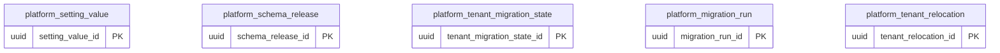

<details><summary>Relationships (5 foreign keys, excluding tenant_id)</summary>

| From | To | Optional? | Scope |
|---|---|---|---|
| `platform.setting_value`.`setting_key` | `ref.setting_definition` | required | other module |
| `platform.schema_release`.`release_id` | `platform.release` | required | other module |
| `platform.migration_run`.`release_id` | `platform.release` | required | other module |
| `app.setting_value`.`setting_key` | `ref.setting_definition` | required | other module |
| `app.setting_value`.`institution_id` | `app.institution` | optional | other module |

</details>

### 4.3 Platform administration

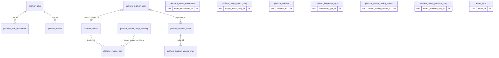

<details><summary>Relationships (11 foreign keys, excluding tenant_id)</summary>

| From | To | Optional? | Scope |
|---|---|---|---|
| `platform.plan_entitlement`.`plan_id` | `platform.plan` | required | same module |
| `platform.plan_entitlement`.`module_code` | `ref.module_catalog` | required | other module |
| `platform.plan_entitlement`.`feature_code` | `ref.feature_catalog` | optional | other module |
| `platform.tenant`.`plan_id` | `platform.plan` | required | same module |
| `platform.tenant_entitlement`.`module_code` | `ref.module_catalog` | required | other module |
| `platform.tenant_entitlement`.`feature_code` | `ref.feature_catalog` | optional | other module |
| `platform.invoice`.`discount_applied_by` | `platform.platform_user` | optional | same module |
| `platform.invoice_line`.`invoice_id` | `platform.invoice` | required | same module |
| `platform.invoice_line`.`tenant_usage_monthly_id` | `platform.tenant_usage_monthly` | optional | same module |
| `platform.support_ticket`.`assigned_to` | `platform.platform_user` | optional | same module |
| `platform.support_access_grant`.`ticket_id` | `platform.support_ticket` | required | same module |

</details>

### 4.4 Institution setup and academic structure

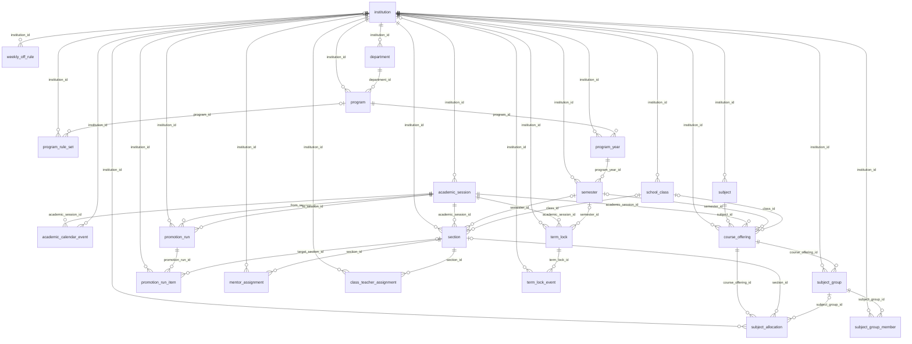

<details><summary>Relationships (55 foreign keys, excluding tenant_id)</summary>

| From | To | Optional? | Scope |
|---|---|---|---|
| `app.academic_session`.`institution_id` | `app.institution` | optional | same module |
| `app.academic_calendar_event`.`academic_session_id` | `app.academic_session` | required | same module |
| `app.academic_calendar_event`.`institution_id` | `app.institution` | optional | same module |
| `app.weekly_off_rule`.`institution_id` | `app.institution` | required | same module |
| `app.department`.`institution_id` | `app.institution` | required | same module |
| `app.department`.`hod_staff_assignment_id` | `app.staff_assignment` | optional | other module |
| `app.program`.`institution_id` | `app.institution` | required | same module |
| `app.program`.`department_id` | `app.department` | required | same module |
| `app.program_rule_set`.`institution_id` | `app.institution` | optional | same module |
| `app.program_rule_set`.`program_id` | `app.program` | optional | same module |
| `app.program_year`.`institution_id` | `app.institution` | required | same module |
| `app.program_year`.`program_id` | `app.program` | required | same module |
| `app.semester`.`institution_id` | `app.institution` | required | same module |
| `app.semester`.`program_year_id` | `app.program_year` | required | same module |
| `app.school_class`.`institution_id` | `app.institution` | required | same module |
| `app.section`.`institution_id` | `app.institution` | required | same module |
| `app.section`.`academic_session_id` | `app.academic_session` | required | same module |
| `app.section`.`semester_id` | `app.semester` | optional | same module |
| `app.section`.`class_id` | `app.school_class` | optional | same module |
| `app.subject`.`institution_id` | `app.institution` | required | same module |
| `app.course_offering`.`institution_id` | `app.institution` | required | same module |
| `app.course_offering`.`subject_id` | `app.subject` | required | same module |
| `app.course_offering`.`academic_session_id` | `app.academic_session` | required | same module |
| `app.course_offering`.`semester_id` | `app.semester` | optional | same module |
| `app.course_offering`.`class_id` | `app.school_class` | optional | same module |
| `app.subject_group`.`institution_id` | `app.institution` | required | same module |
| `app.subject_group`.`course_offering_id` | `app.course_offering` | required | same module |
| `app.subject_group_member`.`institution_id` | `app.institution` | required | same module |
| `app.subject_group_member`.`subject_group_id` | `app.subject_group` | required | same module |
| `app.subject_group_member`.`enrollment_id` | `app.student_enrollment` | required | other module |
| `app.promotion_run`.`institution_id` | `app.institution` | required | same module |
| `app.promotion_run`.`from_session_id` | `app.academic_session` | required | same module |
| `app.promotion_run`.`to_session_id` | `app.academic_session` | required | same module |
| `app.promotion_run`.`approval_request_id` | `app.approval_request` | optional | other module |
| `app.promotion_run_item`.`institution_id` | `app.institution` | required | same module |
| `app.promotion_run_item`.`promotion_run_id` | `app.promotion_run` | required | same module |
| `app.promotion_run_item`.`enrollment_id` | `app.student_enrollment` | required | other module |
| `app.promotion_run_item`.`target_section_id` | `app.section` | optional | same module |
| `app.subject_allocation`.`institution_id` | `app.institution` | required | same module |
| `app.subject_allocation`.`course_offering_id` | `app.course_offering` | required | same module |
| `app.subject_allocation`.`section_id` | `app.section` | optional | same module |
| `app.subject_allocation`.`subject_group_id` | `app.subject_group` | optional | same module |
| `app.subject_allocation`.`staff_assignment_id` | `app.staff_assignment` | required | other module |
| `app.mentor_assignment`.`institution_id` | `app.institution` | required | same module |
| `app.mentor_assignment`.`section_id` | `app.section` | required | same module |
| `app.mentor_assignment`.`staff_assignment_id` | `app.staff_assignment` | required | other module |
| `app.class_teacher_assignment`.`institution_id` | `app.institution` | required | same module |
| `app.class_teacher_assignment`.`section_id` | `app.section` | required | same module |
| `app.class_teacher_assignment`.`staff_assignment_id` | `app.staff_assignment` | required | other module |
| `app.term_lock`.`institution_id` | `app.institution` | required | same module |
| `app.term_lock`.`academic_session_id` | `app.academic_session` | required | same module |
| `app.term_lock`.`semester_id` | `app.semester` | optional | same module |
| `app.term_lock_event`.`institution_id` | `app.institution` | required | same module |
| `app.term_lock_event`.`term_lock_id` | `app.term_lock` | required | same module |
| `app.term_lock_event`.`actor_user_id` | `app.user_account` | required | other module |

</details>

### 4.5 Users, roles and access

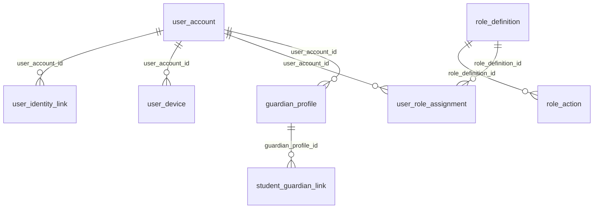

<details><summary>Relationships (13 foreign keys, excluding tenant_id)</summary>

| From | To | Optional? | Scope |
|---|---|---|---|
| `app.user_identity_link`.`user_account_id` | `app.user_account` | required | same module |
| `app.user_device`.`user_account_id` | `app.user_account` | required | same module |
| `app.role_definition`.`base_standard_role` | `ref.standard_role` | optional | other module |
| `app.role_action`.`role_definition_id` | `app.role_definition` | required | same module |
| `app.role_action`.`action_code` | `ref.action_catalog` | required | other module |
| `app.user_role_assignment`.`user_account_id` | `app.user_account` | required | same module |
| `app.user_role_assignment`.`role_definition_id` | `app.role_definition` | required | same module |
| `app.user_role_assignment`.`institution_id` | `app.institution` | optional | other module |
| `app.user_role_assignment`.`department_id` | `app.department` | optional | other module |
| `app.guardian_profile`.`user_account_id` | `app.user_account` | required | same module |
| `app.student_guardian_link`.`student_profile_id` | `app.student_profile` | required | other module |
| `app.student_guardian_link`.`guardian_profile_id` | `app.guardian_profile` | required | same module |
| `app.student_guardian_link`.`change_approval_request_id` | `app.approval_request` | optional | other module |

</details>

### 4.6 Approval engine

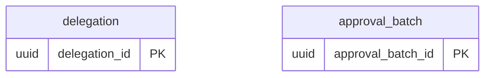

<details><summary>Relationships (4 foreign keys, excluding tenant_id)</summary>

| From | To | Optional? | Scope |
|---|---|---|---|
| `app.delegation`.`delegator_user_id` | `app.user_account` | required | other module |
| `app.delegation`.`delegate_user_id` | `app.user_account` | required | other module |
| `app.delegation`.`process_code` | `ref.approval_process` | optional | other module |
| `app.approval_batch`.`acted_by_user_id` | `app.user_account` | required | other module |

</details>

### 4.7 Approval chains

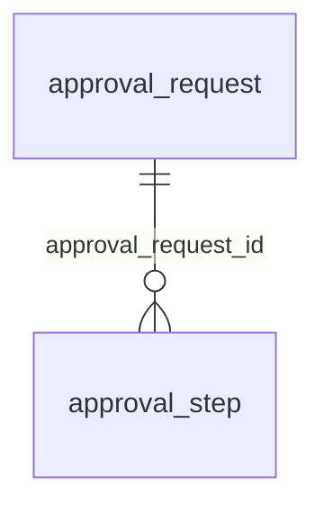

<details><summary>Relationships (8 foreign keys, excluding tenant_id)</summary>

| From | To | Optional? | Scope |
|---|---|---|---|
| `app.approval_request`.`institution_id` | `app.institution` | optional | other module |
| `app.approval_request`.`process_code` | `ref.approval_process` | required | other module |
| `app.approval_request`.`requested_by_user_id` | `app.user_account` | required | other module |
| `app.approval_step`.`approval_request_id` | `app.approval_request` | required | same module |
| `app.approval_step`.`approver_user_id` | `app.user_account` | optional | other module |
| `app.approval_step`.`acted_by_user_id` | `app.user_account` | optional | other module |
| `app.approval_step`.`acting_via_delegation_id` | `app.delegation` | optional | other module |
| `app.approval_step`.`approval_batch_id` | `app.approval_batch` | optional | other module |

</details>

### 4.8 Staff records

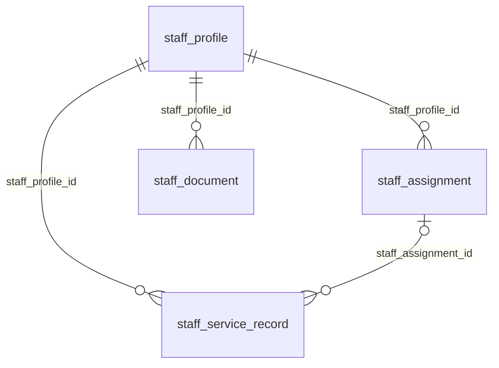

<details><summary>Relationships (10 foreign keys, excluding tenant_id)</summary>

| From | To | Optional? | Scope |
|---|---|---|---|
| `app.staff_profile`.`user_account_id` | `app.user_account` | optional | other module |
| `app.staff_profile`.`photo_file_id` | `app.file_object` | optional | other module |
| `app.staff_service_record`.`staff_profile_id` | `app.staff_profile` | required | same module |
| `app.staff_service_record`.`staff_assignment_id` | `app.staff_assignment` | optional | same module |
| `app.staff_service_record`.`document_file_id` | `app.file_object` | optional | other module |
| `app.staff_assignment`.`staff_profile_id` | `app.staff_profile` | required | same module |
| `app.staff_assignment`.`institution_id` | `app.institution` | optional | other module |
| `app.staff_assignment`.`department_id` | `app.department` | optional | other module |
| `app.staff_document`.`staff_profile_id` | `app.staff_profile` | required | same module |
| `app.staff_document`.`file_id` | `app.file_object` | required | other module |

</details>

### 4.9 Data import, search and IDs

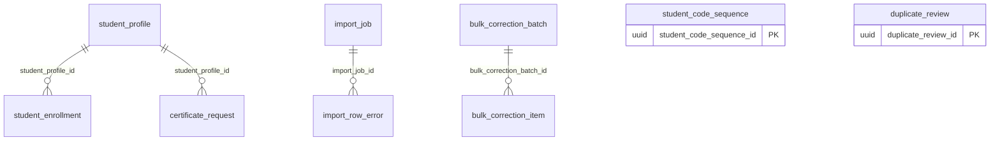

<details><summary>Relationships (25 foreign keys, excluding tenant_id)</summary>

| From | To | Optional? | Scope |
|---|---|---|---|
| `app.student_profile`.`user_account_id` | `app.user_account` | optional | other module |
| `app.student_profile`.`institution_id` | `app.institution` | required | other module |
| `app.student_profile`.`photo_file_id` | `app.file_object` | optional | other module |
| `app.student_code_sequence`.`institution_id` | `app.institution` | required | other module |
| `app.student_enrollment`.`student_profile_id` | `app.student_profile` | required | same module |
| `app.student_enrollment`.`institution_id` | `app.institution` | required | other module |
| `app.student_enrollment`.`academic_session_id` | `app.academic_session` | required | other module |
| `app.student_enrollment`.`section_id` | `app.section` | required | other module |
| `app.student_enrollment`.`promoted_from_enrollment_id` | `app.student_enrollment` | optional | same module |
| `app.import_job`.`institution_id` | `app.institution` | optional | other module |
| `app.import_job`.`uploaded_by` | `app.user_account` | required | other module |
| `app.import_job`.`source_file_id` | `app.file_object` | required | other module |
| `app.import_row_error`.`import_job_id` | `app.import_job` | required | same module |
| `app.bulk_correction_batch`.`institution_id` | `app.institution` | optional | other module |
| `app.bulk_correction_batch`.`submitted_by` | `app.user_account` | required | other module |
| `app.bulk_correction_batch`.`source_file_id` | `app.file_object` | optional | other module |
| `app.bulk_correction_item`.`bulk_correction_batch_id` | `app.bulk_correction_batch` | required | same module |
| `app.certificate_request`.`student_profile_id` | `app.student_profile` | required | same module |
| `app.certificate_request`.`institution_id` | `app.institution` | required | other module |
| `app.certificate_request`.`requested_by_user_id` | `app.user_account` | required | other module |
| `app.certificate_request`.`no_dues_override_by` | `app.user_account` | optional | other module |
| `app.certificate_request`.`approval_request_id` | `app.approval_request` | optional | other module |
| `app.certificate_request`.`prepared_by_user_id` | `app.user_account` | optional | other module |
| `app.certificate_request`.`file_id` | `app.file_object` | optional | other module |
| `app.certificate_request`.`applied_by_user_id` | `app.user_account` | optional | other module |

</details>

### 4.10 Timetable and online classes

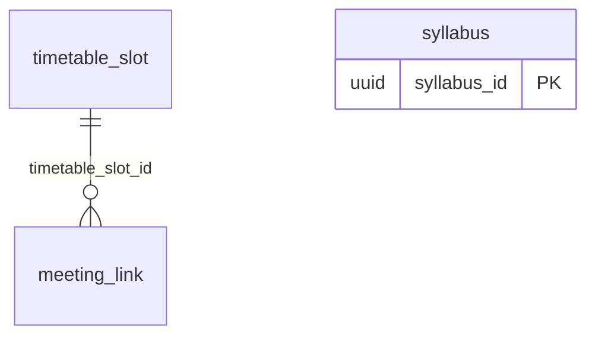

<details><summary>Relationships (12 foreign keys, excluding tenant_id)</summary>

| From | To | Optional? | Scope |
|---|---|---|---|
| `app.syllabus`.`institution_id` | `app.institution` | required | other module |
| `app.syllabus`.`subject_id` | `app.subject` | required | other module |
| `app.syllabus`.`academic_session_id` | `app.academic_session` | optional | other module |
| `app.syllabus`.`file_id` | `app.file_object` | optional | other module |
| `app.timetable_slot`.`institution_id` | `app.institution` | required | other module |
| `app.timetable_slot`.`academic_session_id` | `app.academic_session` | required | other module |
| `app.timetable_slot`.`section_id` | `app.section` | optional | other module |
| `app.timetable_slot`.`subject_group_id` | `app.subject_group` | optional | other module |
| `app.timetable_slot`.`subject_allocation_id` | `app.subject_allocation` | required | other module |
| `app.timetable_slot`.`supersedes_slot_id` | `app.timetable_slot` | optional | same module |
| `app.meeting_link`.`institution_id` | `app.institution` | required | other module |
| `app.meeting_link`.`timetable_slot_id` | `app.timetable_slot` | required | same module |

</details>

### 4.11 Attendance

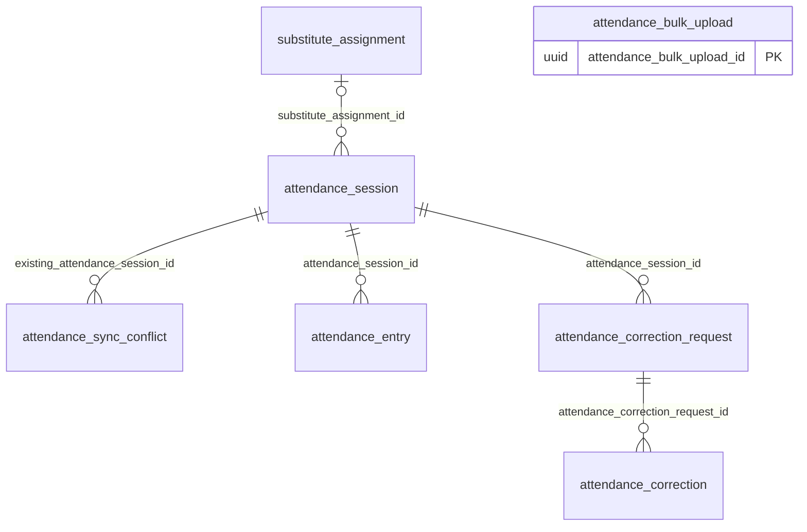

<details><summary>Relationships (29 foreign keys, excluding tenant_id)</summary>

| From | To | Optional? | Scope |
|---|---|---|---|
| `app.substitute_assignment`.`institution_id` | `app.institution` | required | other module |
| `app.substitute_assignment`.`subject_allocation_id` | `app.subject_allocation` | required | other module |
| `app.substitute_assignment`.`substitute_staff_assignment_id` | `app.staff_assignment` | required | other module |
| `app.substitute_assignment`.`leave_request_id` | `app.leave_request` | optional | other module |
| `app.attendance_session`.`institution_id` | `app.institution` | required | other module |
| `app.attendance_session`.`section_id` | `app.section` | optional | other module |
| `app.attendance_session`.`subject_group_id` | `app.subject_group` | optional | other module |
| `app.attendance_session`.`timetable_slot_id` | `app.timetable_slot` | optional | other module |
| `app.attendance_session`.`subject_allocation_id` | `app.subject_allocation` | optional | other module |
| `app.attendance_session`.`marked_by_user_id` | `app.user_account` | required | other module |
| `app.attendance_session`.`substitute_assignment_id` | `app.substitute_assignment` | optional | same module |
| `app.attendance_sync_conflict`.`institution_id` | `app.institution` | required | other module |
| `app.attendance_sync_conflict`.`existing_attendance_session_id` | `app.attendance_session` | required | same module |
| `app.attendance_sync_conflict`.`submitted_by_user_id` | `app.user_account` | required | other module |
| `app.attendance_entry`.`institution_id` | `app.institution` | required | other module |
| `app.attendance_entry`.`attendance_session_id` | `app.attendance_session` | required | same module |
| `app.attendance_entry`.`enrollment_id` | `app.student_enrollment` | required | other module |
| `app.attendance_entry`.`leave_request_id` | `app.leave_request` | optional | other module |
| `app.attendance_entry`.`recorded_by_user_id` | `app.user_account` | required | other module |
| `app.attendance_correction_request`.`institution_id` | `app.institution` | required | other module |
| `app.attendance_correction_request`.`attendance_session_id` | `app.attendance_session` | required | same module |
| `app.attendance_correction_request`.`requested_by_user_id` | `app.user_account` | required | other module |
| `app.attendance_correction_request`.`approval_request_id` | `app.approval_request` | optional | other module |
| `app.attendance_correction_request`.`bulk_correction_item_id` | `app.bulk_correction_item` | optional | other module |
| `app.attendance_correction`.`institution_id` | `app.institution` | required | other module |
| `app.attendance_correction`.`attendance_correction_request_id` | `app.attendance_correction_request` | required | same module |
| `app.attendance_bulk_upload`.`institution_id` | `app.institution` | required | other module |
| `app.attendance_bulk_upload`.`import_job_id` | `app.import_job` | required | other module |
| `app.attendance_bulk_upload`.`approval_request_id` | `app.approval_request` | optional | other module |

</details>

### 4.12 Leave

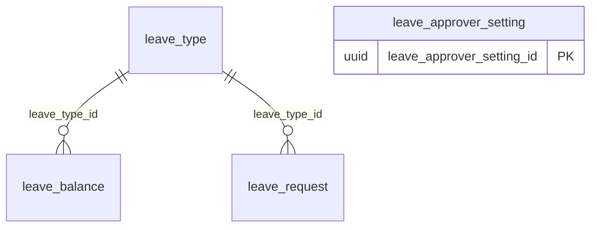

<details><summary>Relationships (14 foreign keys, excluding tenant_id)</summary>

| From | To | Optional? | Scope |
|---|---|---|---|
| `app.leave_approver_setting`.`institution_id` | `app.institution` | optional | other module |
| `app.leave_approver_setting`.`approver_user_id` | `app.user_account` | required | other module |
| `app.leave_type`.`institution_id` | `app.institution` | required | other module |
| `app.leave_balance`.`institution_id` | `app.institution` | optional | other module |
| `app.leave_balance`.`staff_profile_id` | `app.staff_profile` | required | other module |
| `app.leave_balance`.`leave_type_id` | `app.leave_type` | required | same module |
| `app.leave_request`.`institution_id` | `app.institution` | optional | other module |
| `app.leave_request`.`requested_by_user_id` | `app.user_account` | required | other module |
| `app.leave_request`.`for_enrollment_id` | `app.student_enrollment` | optional | other module |
| `app.leave_request`.`for_staff_profile_id` | `app.staff_profile` | optional | other module |
| `app.leave_request`.`leave_type_id` | `app.leave_type` | required | same module |
| `app.leave_request`.`document_file_id` | `app.file_object` | optional | other module |
| `app.leave_request`.`process_code` | `ref.approval_process` | required | other module |
| `app.leave_request`.`approval_request_id` | `app.approval_request` | optional | other module |

</details>

### 4.13 Risk monitoring

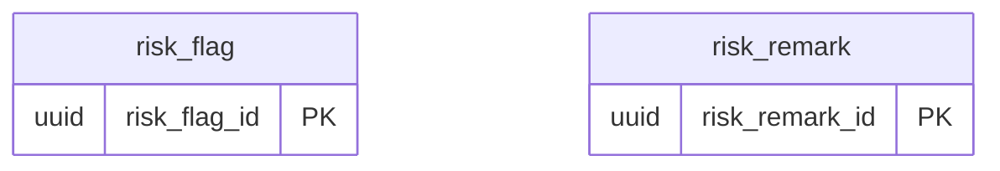

<details><summary>Relationships (4 foreign keys, excluding tenant_id)</summary>

| From | To | Optional? | Scope |
|---|---|---|---|
| `app.risk_flag`.`institution_id` | `app.institution` | required | other module |
| `app.risk_flag`.`enrollment_id` | `app.student_enrollment` | required | other module |
| `app.risk_remark`.`institution_id` | `app.institution` | required | other module |
| `app.risk_remark`.`enrollment_id` | `app.student_enrollment` | required | other module |

</details>

### 4.14 Examinations

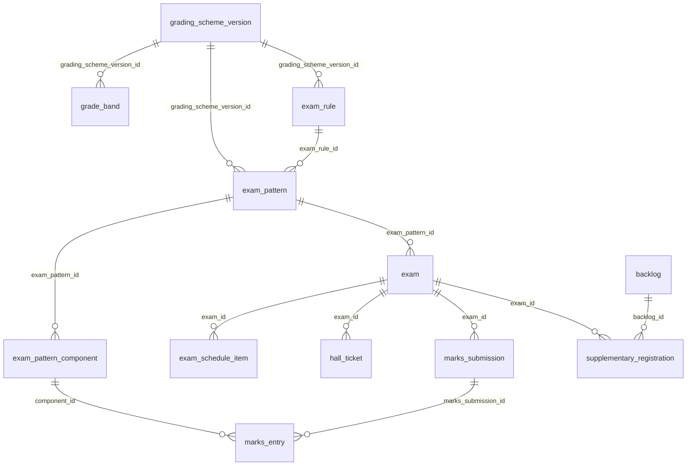

<details><summary>Relationships (45 foreign keys, excluding tenant_id)</summary>

| From | To | Optional? | Scope |
|---|---|---|---|
| `app.grading_scheme_version`.`institution_id` | `app.institution` | optional | other module |
| `app.grade_band`.`grading_scheme_version_id` | `app.grading_scheme_version` | required | same module |
| `app.exam_rule`.`institution_id` | `app.institution` | optional | other module |
| `app.exam_rule`.`grading_scheme_version_id` | `app.grading_scheme_version` | required | same module |
| `app.exam_pattern`.`institution_id` | `app.institution` | required | other module |
| `app.exam_pattern`.`exam_rule_id` | `app.exam_rule` | required | same module |
| `app.exam_pattern`.`grading_scheme_version_id` | `app.grading_scheme_version` | required | same module |
| `app.exam_pattern_component`.`institution_id` | `app.institution` | required | other module |
| `app.exam_pattern_component`.`exam_pattern_id` | `app.exam_pattern` | required | same module |
| `app.exam`.`institution_id` | `app.institution` | required | other module |
| `app.exam`.`academic_session_id` | `app.academic_session` | required | other module |
| `app.exam`.`semester_id` | `app.semester` | optional | other module |
| `app.exam`.`class_id` | `app.school_class` | optional | other module |
| `app.exam`.`exam_pattern_id` | `app.exam_pattern` | required | same module |
| `app.exam`.`schedule_approval_request_id` | `app.approval_request` | optional | other module |
| `app.exam_schedule_item`.`institution_id` | `app.institution` | required | other module |
| `app.exam_schedule_item`.`exam_id` | `app.exam` | required | same module |
| `app.exam_schedule_item`.`course_offering_id` | `app.course_offering` | required | other module |
| `app.hall_ticket`.`institution_id` | `app.institution` | required | other module |
| `app.hall_ticket`.`exam_id` | `app.exam` | required | same module |
| `app.hall_ticket`.`enrollment_id` | `app.student_enrollment` | required | other module |
| `app.hall_ticket`.`override_by_user_id` | `app.user_account` | optional | other module |
| `app.hall_ticket`.`file_id` | `app.file_object` | optional | other module |
| `app.marks_submission`.`institution_id` | `app.institution` | required | other module |
| `app.marks_submission`.`exam_id` | `app.exam` | required | same module |
| `app.marks_submission`.`course_offering_id` | `app.course_offering` | required | other module |
| `app.marks_submission`.`section_id` | `app.section` | optional | other module |
| `app.marks_submission`.`subject_group_id` | `app.subject_group` | optional | other module |
| `app.marks_submission`.`entered_by_user_id` | `app.user_account` | required | other module |
| `app.marks_submission`.`source_file_id` | `app.file_object` | optional | other module |
| `app.marks_submission`.`approval_request_id` | `app.approval_request` | optional | other module |
| `app.marks_submission`.`supersedes_submission_id` | `app.marks_submission` | optional | same module |
| `app.marks_entry`.`institution_id` | `app.institution` | required | other module |
| `app.marks_entry`.`marks_submission_id` | `app.marks_submission` | required | same module |
| `app.marks_entry`.`enrollment_id` | `app.student_enrollment` | required | other module |
| `app.marks_entry`.`component_id` | `app.exam_pattern_component` | required | same module |
| `app.backlog`.`institution_id` | `app.institution` | required | other module |
| `app.backlog`.`student_profile_id` | `app.student_profile` | required | other module |
| `app.backlog`.`subject_id` | `app.subject` | required | other module |
| `app.backlog`.`origin_result_line_id` | `app.result_line` | required | other module |
| `app.backlog`.`cleared_result_line_id` | `app.result_line` | optional | other module |
| `app.supplementary_registration`.`institution_id` | `app.institution` | required | other module |
| `app.supplementary_registration`.`backlog_id` | `app.backlog` | required | same module |
| `app.supplementary_registration`.`exam_id` | `app.exam` | required | same module |
| `app.supplementary_registration`.`registered_by` | `app.user_account` | required | other module |

</details>

### 4.15 Results

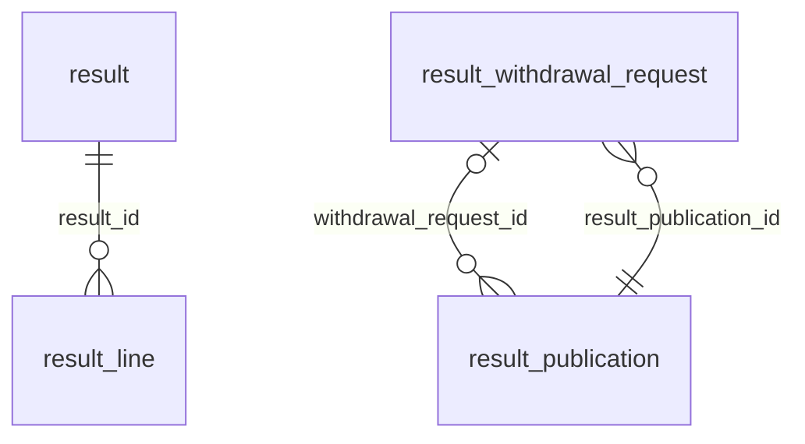

<details><summary>Relationships (16 foreign keys, excluding tenant_id)</summary>

| From | To | Optional? | Scope |
|---|---|---|---|
| `app.result`.`institution_id` | `app.institution` | required | other module |
| `app.result`.`exam_id` | `app.exam` | required | other module |
| `app.result`.`enrollment_id` | `app.student_enrollment` | required | other module |
| `app.result`.`grading_scheme_version_id` | `app.grading_scheme_version` | required | other module |
| `app.result_line`.`institution_id` | `app.institution` | required | other module |
| `app.result_line`.`result_id` | `app.result` | required | same module |
| `app.result_line`.`subject_id` | `app.subject` | required | other module |
| `app.result_publication`.`institution_id` | `app.institution` | required | other module |
| `app.result_publication`.`exam_id` | `app.exam` | required | other module |
| `app.result_publication`.`section_id` | `app.section` | optional | other module |
| `app.result_publication`.`published_by_user_id` | `app.user_account` | required | other module |
| `app.result_publication`.`withdrawal_request_id` | `app.result_withdrawal_request` | optional | same module |
| `app.result_withdrawal_request`.`institution_id` | `app.institution` | required | other module |
| `app.result_withdrawal_request`.`result_publication_id` | `app.result_publication` | required | same module |
| `app.result_withdrawal_request`.`requested_by_user_id` | `app.user_account` | required | other module |
| `app.result_withdrawal_request`.`approval_request_id` | `app.approval_request` | optional | other module |

</details>

### 4.16 Assignments, homework and study material

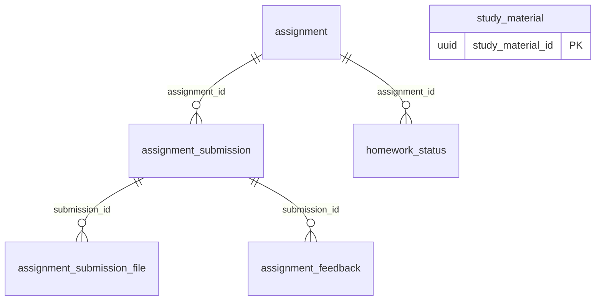

<details><summary>Relationships (24 foreign keys, excluding tenant_id)</summary>

| From | To | Optional? | Scope |
|---|---|---|---|
| `app.assignment`.`institution_id` | `app.institution` | required | other module |
| `app.assignment`.`course_offering_id` | `app.course_offering` | required | other module |
| `app.assignment`.`section_id` | `app.section` | optional | other module |
| `app.assignment`.`subject_group_id` | `app.subject_group` | optional | other module |
| `app.assignment`.`created_by_user_id` | `app.user_account` | required | other module |
| `app.assignment_submission`.`institution_id` | `app.institution` | required | other module |
| `app.assignment_submission`.`assignment_id` | `app.assignment` | required | same module |
| `app.assignment_submission`.`enrollment_id` | `app.student_enrollment` | required | other module |
| `app.assignment_submission_file`.`institution_id` | `app.institution` | required | other module |
| `app.assignment_submission_file`.`submission_id` | `app.assignment_submission` | required | same module |
| `app.assignment_submission_file`.`file_id` | `app.file_object` | required | other module |
| `app.assignment_feedback`.`institution_id` | `app.institution` | required | other module |
| `app.assignment_feedback`.`submission_id` | `app.assignment_submission` | required | same module |
| `app.assignment_feedback`.`evaluated_by` | `app.user_account` | required | other module |
| `app.homework_status`.`institution_id` | `app.institution` | required | other module |
| `app.homework_status`.`assignment_id` | `app.assignment` | required | same module |
| `app.homework_status`.`enrollment_id` | `app.student_enrollment` | required | other module |
| `app.homework_status`.`marked_by` | `app.user_account` | required | other module |
| `app.study_material`.`institution_id` | `app.institution` | required | other module |
| `app.study_material`.`course_offering_id` | `app.course_offering` | required | other module |
| `app.study_material`.`section_id` | `app.section` | optional | other module |
| `app.study_material`.`subject_group_id` | `app.subject_group` | optional | other module |
| `app.study_material`.`file_id` | `app.file_object` | required | other module |
| `app.study_material`.`uploaded_by` | `app.user_account` | required | other module |

</details>

### 4.17 Fees

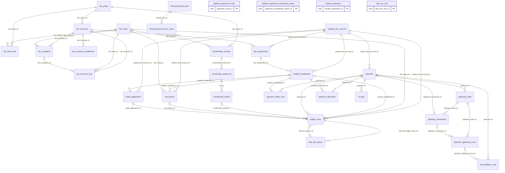

<details><summary>Relationships (95 foreign keys, excluding tenant_id)</summary>

| From | To | Optional? | Scope |
|---|---|---|---|
| `app.fee_policy`.`institution_id` | `app.institution` | optional | other module |
| `app.fee_head_rule`.`fee_policy_id` | `app.fee_policy` | required | same module |
| `app.fee_head_rule`.`fee_head_id` | `app.fee_head` | required | same module |
| `app.fee_structure`.`institution_id` | `app.institution` | required | other module |
| `app.fee_structure`.`academic_session_id` | `app.academic_session` | required | other module |
| `app.fee_structure`.`program_year_id` | `app.program_year` | optional | other module |
| `app.fee_structure`.`class_id` | `app.school_class` | optional | other module |
| `app.fee_structure`.`fee_policy_id` | `app.fee_policy` | required | same module |
| `app.fee_structure`.`approval_request_id` | `app.approval_request` | optional | other module |
| `app.fee_structure_line`.`institution_id` | `app.institution` | required | other module |
| `app.fee_structure_line`.`fee_structure_id` | `app.fee_structure` | required | same module |
| `app.fee_structure_line`.`fee_head_id` | `app.fee_head` | required | same module |
| `app.fee_structure_line`.`fee_exception_id` | `app.fee_exception` | optional | same module |
| `app.fee_structure_installment`.`institution_id` | `app.institution` | required | other module |
| `app.fee_structure_installment`.`fee_structure_id` | `app.fee_structure` | required | same module |
| `app.fee_exception`.`institution_id` | `app.institution` | required | other module |
| `app.fee_exception`.`fee_structure_id` | `app.fee_structure` | required | same module |
| `app.fee_exception`.`fee_head_id` | `app.fee_head` | required | same module |
| `app.fee_exception`.`requested_by` | `app.user_account` | required | other module |
| `app.fee_exception`.`approval_request_id` | `app.approval_request` | optional | other module |
| `app.student_fee_account`.`student_profile_id` | `app.student_profile` | required | other module |
| `app.fee_assignment`.`institution_id` | `app.institution` | required | other module |
| `app.fee_assignment`.`student_fee_account_id` | `app.student_fee_account` | required | same module |
| `app.fee_assignment`.`enrollment_id` | `app.student_enrollment` | required | other module |
| `app.fee_assignment`.`fee_structure_id` | `app.fee_structure` | required | same module |
| `app.student_installment`.`institution_id` | `app.institution` | required | other module |
| `app.student_installment`.`student_fee_account_id` | `app.student_fee_account` | required | same module |
| `app.student_installment`.`fee_assignment_id` | `app.fee_assignment` | required | same module |
| `app.ledger_entry`.`institution_id` | `app.institution` | required | other module |
| `app.ledger_entry`.`student_fee_account_id` | `app.student_fee_account` | required | same module |
| `app.ledger_entry`.`academic_session_id` | `app.academic_session` | required | other module |
| `app.ledger_entry`.`fee_head_id` | `app.fee_head` | optional | same module |
| `app.ledger_entry`.`student_installment_id` | `app.student_installment` | optional | same module |
| `app.ledger_entry`.`payment_id` | `app.payment` | optional | same module |
| `app.ledger_entry`.`scholarship_award_id` | `app.scholarship_award` | optional | same module |
| `app.ledger_entry`.`concession_id` | `app.concession` | optional | same module |
| `app.ledger_entry`.`late_fee_waiver_id` | `app.late_fee_waiver` | optional | same module |
| `app.ledger_entry`.`credit_application_id` | `app.credit_application` | optional | same module |
| `app.ledger_entry`.`reverses_entry_id` | `app.ledger_entry` | optional | same module |
| `app.payment`.`institution_id` | `app.institution` | required | other module |
| `app.payment`.`student_fee_account_id` | `app.student_fee_account` | required | same module |
| `app.payment`.`paid_by_user_id` | `app.user_account` | optional | other module |
| `app.payment`.`gateway_transaction_id` | `app.gateway_transaction` | optional | same module |
| `app.payment`.`marked_by_user_id` | `app.user_account` | optional | other module |
| `app.payment_intent_item`.`institution_id` | `app.institution` | required | other module |
| `app.payment_intent_item`.`payment_id` | `app.payment` | required | same module |
| `app.payment_intent_item`.`student_installment_id` | `app.student_installment` | required | same module |
| `app.gateway_order`.`institution_id` | `app.institution` | required | other module |
| `app.gateway_order`.`payment_id` | `app.payment` | required | same module |
| `app.gateway_transaction`.`institution_id` | `app.institution` | required | other module |
| `app.gateway_transaction`.`gateway_order_id` | `app.gateway_order` | required | same module |
| `app.payment_gateway_event`.`institution_id` | `app.institution` | optional | other module |
| `app.payment_gateway_event`.`gateway_order_id` | `app.gateway_order` | optional | same module |
| `app.payment_gateway_event`.`gateway_transaction_id` | `app.gateway_transaction` | optional | same module |
| `app.payment_allocation`.`institution_id` | `app.institution` | required | other module |
| `app.payment_allocation`.`payment_id` | `app.payment` | required | same module |
| `app.payment_allocation`.`student_installment_id` | `app.student_installment` | required | same module |
| `app.credit_application`.`institution_id` | `app.institution` | required | other module |
| `app.credit_application`.`student_fee_account_id` | `app.student_fee_account` | required | same module |
| `app.credit_application`.`student_installment_id` | `app.student_installment` | required | same module |
| `app.reconciliation_case`.`institution_id` | `app.institution` | required | other module |
| `app.reconciliation_case`.`payment_id` | `app.payment` | optional | same module |
| `app.reconciliation_case`.`payment_gateway_event_id` | `app.payment_gateway_event` | optional | same module |
| `app.reconciliation_case`.`owner_user_id` | `app.user_account` | optional | other module |
| `app.receipt_sequence`.`institution_id` | `app.institution` | required | other module |
| `app.receipt`.`institution_id` | `app.institution` | required | other module |
| `app.receipt`.`payment_id` | `app.payment` | required | same module |
| `app.receipt`.`void_approval_request_id` | `app.approval_request` | optional | other module |
| `app.receipt`.`replaced_by_receipt_id` | `app.receipt` | optional | same module |
| `app.scholarship_scheme`.`institution_id` | `app.institution` | required | other module |
| `app.scholarship_scheme`.`fee_policy_id` | `app.fee_policy` | required | same module |
| `app.scholarship_scheme`.`academic_session_id` | `app.academic_session` | required | other module |
| `app.scholarship_scheme`.`fee_head_id` | `app.fee_head` | optional | same module |
| `app.scholarship_award_list`.`institution_id` | `app.institution` | required | other module |
| `app.scholarship_award_list`.`scholarship_scheme_id` | `app.scholarship_scheme` | required | same module |
| `app.scholarship_award_list`.`approval_request_id` | `app.approval_request` | optional | other module |
| `app.scholarship_award`.`institution_id` | `app.institution` | required | other module |
| `app.scholarship_award`.`list_id` | `app.scholarship_award_list` | required | same module |
| `app.scholarship_award`.`enrollment_id` | `app.student_enrollment` | required | other module |
| `app.concession`.`institution_id` | `app.institution` | required | other module |
| `app.concession`.`student_fee_account_id` | `app.student_fee_account` | required | same module |
| `app.concession`.`student_installment_id` | `app.student_installment` | optional | same module |
| `app.concession`.`fee_head_id` | `app.fee_head` | optional | same module |
| `app.concession`.`requested_by` | `app.user_account` | required | other module |
| `app.concession`.`approval_request_id` | `app.approval_request` | optional | other module |
| `app.late_fee_rule`.`institution_id` | `app.institution` | required | other module |
| `app.late_fee_waiver`.`institution_id` | `app.institution` | required | other module |
| `app.late_fee_waiver`.`late_fee_ledger_entry_id` | `app.ledger_entry` | required | same module |
| `app.late_fee_waiver`.`requested_by` | `app.user_account` | required | other module |
| `app.late_fee_waiver`.`approval_request_id` | `app.approval_request` | optional | other module |
| `app.financial_period_lock`.`institution_id` | `app.institution` | optional | other module |
| `app.financial_period_lock`.`unlock_approval_request_id` | `app.approval_request` | optional | other module |
| `app.financial_period_lock_event`.`institution_id` | `app.institution` | optional | other module |
| `app.financial_period_lock_event`.`period_lock_id` | `app.financial_period_lock` | required | same module |
| `app.financial_period_lock_event`.`actor_user_id` | `app.user_account` | required | other module |

</details>

### 4.18 Communication

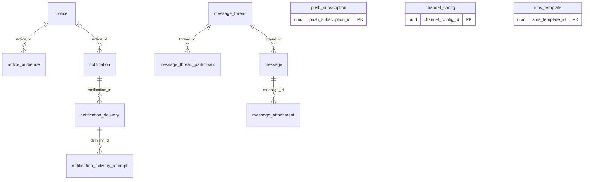

<details><summary>Relationships (35 foreign keys, excluding tenant_id)</summary>

| From | To | Optional? | Scope |
|---|---|---|---|
| `app.notice`.`institution_id` | `app.institution` | optional | other module |
| `app.notice`.`department_id` | `app.department` | optional | other module |
| `app.notice`.`section_id` | `app.section` | optional | other module |
| `app.notice`.`authored_by_user_id` | `app.user_account` | required | other module |
| `app.notice`.`approval_request_id` | `app.approval_request` | optional | other module |
| `app.notice`.`published_by_user_id` | `app.user_account` | optional | other module |
| `app.notice_audience`.`notice_id` | `app.notice` | required | same module |
| `app.notice_audience`.`role_definition_id` | `app.role_definition` | optional | other module |
| `app.message_thread`.`institution_id` | `app.institution` | required | other module |
| `app.message_thread`.`about_enrollment_id` | `app.student_enrollment` | optional | other module |
| `app.message_thread`.`broadcast_section_id` | `app.section` | optional | other module |
| `app.message_thread`.`origin_broadcast_thread_id` | `app.message_thread` | optional | same module |
| `app.message_thread`.`office_handler_user_id` | `app.user_account` | optional | other module |
| `app.message_thread_participant`.`institution_id` | `app.institution` | required | other module |
| `app.message_thread_participant`.`thread_id` | `app.message_thread` | required | same module |
| `app.message_thread_participant`.`user_account_id` | `app.user_account` | required | other module |
| `app.message`.`institution_id` | `app.institution` | required | other module |
| `app.message`.`thread_id` | `app.message_thread` | required | same module |
| `app.message`.`sender_user_id` | `app.user_account` | required | other module |
| `app.message_attachment`.`institution_id` | `app.institution` | required | other module |
| `app.message_attachment`.`message_id` | `app.message` | required | same module |
| `app.message_attachment`.`file_id` | `app.file_object` | required | other module |
| `app.notification`.`recipient_user_id` | `app.user_account` | required | other module |
| `app.notification`.`institution_id` | `app.institution` | optional | other module |
| `app.notification`.`trigger_code` | `ref.notification_template` | required | other module |
| `app.notification`.`notice_id` | `app.notice` | optional | same module |
| `app.notification`.`created_by_user_id` | `app.user_account` | optional | other module |
| `app.notification_delivery`.`institution_id` | `app.institution` | optional | other module |
| `app.notification_delivery`.`notification_id` | `app.notification` | required | same module |
| `app.notification_delivery_attempt`.`institution_id` | `app.institution` | optional | other module |
| `app.notification_delivery_attempt`.`delivery_id` | `app.notification_delivery` | required | same module |
| `app.push_subscription`.`user_device_id` | `app.user_device` | required | other module |
| `app.channel_config`.`institution_id` | `app.institution` | required | other module |
| `app.sms_template`.`institution_id` | `app.institution` | required | other module |
| `app.sms_template`.`trigger_code` | `ref.notification_template` | required | other module |

</details>

### 4.19 Community feed and events

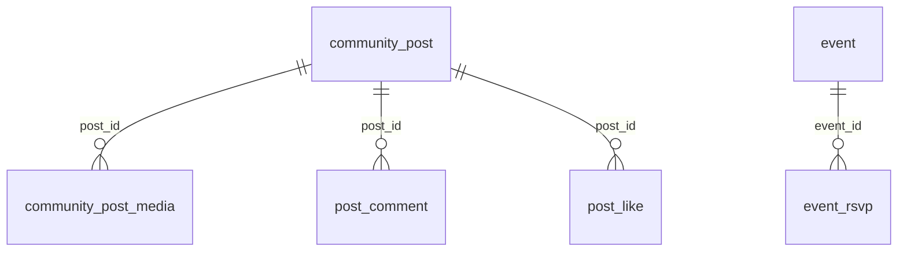

<details><summary>Relationships (16 foreign keys, excluding tenant_id)</summary>

| From | To | Optional? | Scope |
|---|---|---|---|
| `app.community_post`.`institution_id` | `app.institution` | optional | other module |
| `app.community_post`.`author_user_id` | `app.user_account` | required | other module |
| `app.community_post`.`approval_request_id` | `app.approval_request` | optional | other module |
| `app.community_post_media`.`post_id` | `app.community_post` | required | same module |
| `app.community_post_media`.`file_id` | `app.file_object` | required | other module |
| `app.post_comment`.`post_id` | `app.community_post` | required | same module |
| `app.post_comment`.`author_user_id` | `app.user_account` | required | other module |
| `app.post_comment`.`hidden_by` | `app.user_account` | optional | other module |
| `app.post_like`.`post_id` | `app.community_post` | required | same module |
| `app.post_like`.`user_account_id` | `app.user_account` | required | other module |
| `app.event`.`institution_id` | `app.institution` | required | other module |
| `app.event`.`proposed_by_user_id` | `app.user_account` | required | other module |
| `app.event`.`approval_request_id` | `app.approval_request` | required | other module |
| `app.event_rsvp`.`institution_id` | `app.institution` | required | other module |
| `app.event_rsvp`.`event_id` | `app.event` | required | same module |
| `app.event_rsvp`.`user_account_id` | `app.user_account` | required | other module |

</details>

### 4.20 Complaints

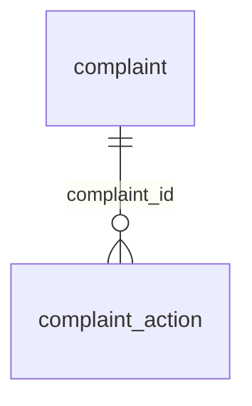

<details><summary>Relationships (8 foreign keys, excluding tenant_id)</summary>

| From | To | Optional? | Scope |
|---|---|---|---|
| `app.complaint`.`institution_id` | `app.institution` | required | other module |
| `app.complaint`.`raised_by_user_id` | `app.user_account` | required | other module |
| `app.complaint`.`about_enrollment_id` | `app.student_enrollment` | optional | other module |
| `app.complaint`.`current_owner_user_id` | `app.user_account` | optional | other module |
| `app.complaint_action`.`institution_id` | `app.institution` | required | other module |
| `app.complaint_action`.`complaint_id` | `app.complaint` | required | same module |
| `app.complaint_action`.`actor_user_id` | `app.user_account` | required | other module |
| `app.complaint_action`.`to_user_id` | `app.user_account` | optional | other module |

</details>

### 4.21 Student notes

```mermaid
erDiagram
  student_note {
    uuid student_note_id PK
  }
```

<details><summary>Relationships (4 foreign keys, excluding tenant_id)</summary>

| From | To | Optional? | Scope |
|---|---|---|---|
| `app.student_note`.`student_profile_id` | `app.student_profile` | required | other module |
| `app.student_note`.`institution_id` | `app.institution` | required | other module |
| `app.student_note`.`added_by_user_id` | `app.user_account` | required | other module |
| `app.student_note`.`corrects_note_id` | `app.student_note` | optional | same module |

</details>

### 4.22 Policies and documents

```mermaid
erDiagram
  policy ||--o{ policy_acceptance : "policy_id"
  department_document {
    uuid department_document_id PK
  }
```

<details><summary>Relationships (11 foreign keys, excluding tenant_id)</summary>

| From | To | Optional? | Scope |
|---|---|---|---|
| `app.policy`.`institution_id` | `app.institution` | optional | other module |
| `app.policy`.`body_file_id` | `app.file_object` | required | other module |
| `app.policy`.`drafted_by` | `app.user_account` | required | other module |
| `app.policy`.`approval_request_id` | `app.approval_request` | optional | other module |
| `app.policy`.`published_by` | `app.user_account` | optional | other module |
| `app.policy_acceptance`.`policy_id` | `app.policy` | required | same module |
| `app.policy_acceptance`.`user_account_id` | `app.user_account` | required | other module |
| `app.department_document`.`institution_id` | `app.institution` | required | other module |
| `app.department_document`.`department_id` | `app.department` | required | other module |
| `app.department_document`.`file_id` | `app.file_object` | required | other module |
| `app.department_document`.`uploaded_by` | `app.user_account` | required | other module |

</details>

### 4.23 Governance and data protection

```mermaid
erDiagram
  platform_export_request |o--o{ platform_deletion_request : "export_request_id"
  platform_deletion_request ||--o{ platform_deletion_certificate : "deletion_request_id"
  accreditation_document ||--o{ accreditation_evidence_map : "accreditation_document_id"
  accreditation_criterion ||--o{ accreditation_evidence_map : "criterion_id"
  data_request ||--o{ data_request_event : "data_request_id"
  platform_retention_change_request {
    uuid retention_change_request_id PK
  }
  platform_audit_outbox {
    uuid audit_outbox_id PK
  }
  parent_consent {
    uuid parent_consent_id PK
  }
  compliance_report {
    uuid compliance_report_id PK
  }
  governance_item {
    uuid governance_item_id PK
  }
  audit_finding {
    uuid audit_finding_id PK
  }
  legal_hold {
    uuid legal_hold_id PK
  }
```

<details><summary>Relationships (42 foreign keys, excluding tenant_id)</summary>

| From | To | Optional? | Scope |
|---|---|---|---|
| `platform.retention_change_request`.`data_class_code` | `ref.data_class` | required | other module |
| `platform.retention_change_request`.`requested_by` | `platform.platform_user` | required | other module |
| `platform.retention_change_request`.`decided_by` | `platform.platform_user` | optional | other module |
| `platform.export_request`.`decided_by` | `platform.platform_user` | optional | other module |
| `platform.deletion_request`.`po_confirmed_by` | `platform.platform_user` | optional | other module |
| `platform.deletion_request`.`export_request_id` | `platform.export_request` | optional | same module |
| `platform.deletion_request`.`dpo_decided_by` | `platform.platform_user` | optional | other module |
| `platform.deletion_certificate`.`deletion_request_id` | `platform.deletion_request` | required | same module |
| `platform.deletion_certificate`.`approved_by` | `platform.platform_user` | required | other module |
| `platform.audit_outbox`.`actor_user_id` | `platform.platform_user` | optional | other module |
| `platform.audit_outbox`.`action_code` | `ref.action_catalog` | optional | other module |
| `app.parent_consent`.`student_profile_id` | `app.student_profile` | required | other module |
| `app.parent_consent`.`guardian_profile_id` | `app.guardian_profile` | required | other module |
| `app.parent_consent`.`paper_file_id` | `app.file_object` | optional | other module |
| `app.compliance_report`.`institution_id` | `app.institution` | optional | other module |
| `app.compliance_report`.`file_id` | `app.file_object` | required | other module |
| `app.compliance_report`.`prepared_by` | `app.user_account` | required | other module |
| `app.compliance_report`.`approval_request_id` | `app.approval_request` | optional | other module |
| `app.compliance_report`.`approved_by` | `app.user_account` | optional | other module |
| `app.accreditation_criterion`.`institution_id` | `app.institution` | optional | other module |
| `app.accreditation_document`.`institution_id` | `app.institution` | optional | other module |
| `app.accreditation_document`.`file_id` | `app.file_object` | required | other module |
| `app.accreditation_document`.`uploaded_by` | `app.user_account` | required | other module |
| `app.accreditation_document`.`approval_request_id` | `app.approval_request` | optional | other module |
| `app.accreditation_evidence_map`.`accreditation_document_id` | `app.accreditation_document` | required | same module |
| `app.accreditation_evidence_map`.`criterion_id` | `app.accreditation_criterion` | required | same module |
| `app.accreditation_evidence_map`.`mapped_by` | `app.user_account` | required | other module |
| `app.governance_item`.`institution_id` | `app.institution` | optional | other module |
| `app.governance_item`.`submitted_by` | `app.user_account` | required | other module |
| `app.governance_item`.`approval_request_id` | `app.approval_request` | required | other module |
| `app.audit_finding`.`institution_id` | `app.institution` | optional | other module |
| `app.audit_finding`.`assigned_owner_user_id` | `app.user_account` | optional | other module |
| `app.audit_finding`.`recorded_by` | `app.user_account` | required | other module |
| `app.data_request`.`raised_by_user_id` | `app.user_account` | required | other module |
| `app.data_request`.`owner_user_id` | `app.user_account` | optional | other module |
| `app.data_request`.`identity_verified_by` | `app.user_account` | optional | other module |
| `app.data_request_event`.`data_request_id` | `app.data_request` | required | same module |
| `app.data_request_event`.`actor_user_id` | `app.user_account` | required | other module |
| `app.legal_hold`.`placed_by` | `app.user_account` | required | other module |
| `app.legal_hold`.`released_by` | `app.user_account` | optional | other module |
| `app.audit_outbox`.`institution_id` | `app.institution` | optional | other module |
| `app.audit_outbox`.`action_code` | `ref.action_catalog` | optional | other module |

</details>

### 4.24 Privacy and legal (§22)

```mermaid
erDiagram
  platform_tenant_retention_policy {
    uuid tenant_retention_policy_id PK
  }
  platform_security_incident {
    uuid security_incident_id PK
  }
```

<details><summary>Relationships (2 foreign keys, excluding tenant_id)</summary>

| From | To | Optional? | Scope |
|---|---|---|---|
| `platform.tenant_retention_policy`.`data_class_code` | `ref.data_class` | required | other module |
| `platform.security_incident`.`owner_user_id` | `platform.platform_user` | required | other module |

</details>

### 4.25 Reports and dashboards

```mermaid
erDiagram
  report_export_job {
    uuid report_export_job_id PK
  }
  saved_filter {
    uuid saved_filter_id PK
  }
  dashboard_preference {
    uuid dashboard_preference_id PK
  }
  usage_metric_daily {
    uuid usage_metric_daily_id PK
  }
```

<details><summary>Relationships (7 foreign keys, excluding tenant_id)</summary>

| From | To | Optional? | Scope |
|---|---|---|---|
| `app.report_export_job`.`requested_by_user_id` | `app.user_account` | required | other module |
| `app.report_export_job`.`report_code` | `ref.report_catalog` | required | other module |
| `app.report_export_job`.`file_id` | `app.file_object` | optional | other module |
| `app.saved_filter`.`user_account_id` | `app.user_account` | required | other module |
| `app.saved_filter`.`report_code` | `ref.report_catalog` | required | other module |
| `app.dashboard_preference`.`user_account_id` | `app.user_account` | required | other module |
| `app.usage_metric_daily`.`institution_id` | `app.institution` | optional | other module |

</details>

### 4.26 Shared services (files, jobs, audit, settings)

```mermaid
erDiagram
  file_object {
    uuid file_id PK
  }
  outbox_event {
    uuid outbox_event_id PK
  }
  background_job {
    uuid background_job_id PK
  }
  idempotency_key {
    uuid idempotency_key_id PK
  }
```

<details><summary>Relationships (6 foreign keys, excluding tenant_id)</summary>

| From | To | Optional? | Scope |
|---|---|---|---|
| `app.file_object`.`institution_id` | `app.institution` | optional | other module |
| `app.file_object`.`uploaded_by` | `app.user_account` | required | other module |
| `app.background_job`.`job_type` | `ref.job_type` | required | other module |
| `app.background_job`.`requested_by_user_id` | `app.user_account` | optional | other module |
| `app.idempotency_key`.`scope` | `ref.idempotency_scope` | required | other module |
| `app.idempotency_key`.`caller_user_id` | `app.user_account` | required | other module |

</details>

## 5. Data dictionary

One entry per table, generated from the model that produced `01_schema.sql`. An automated comparison with the live catalogue (AC-S1) found 0 differences in name, type, nullability or default presence across all 2,798 columns. Badges: <span class="b info">from Doc 1</span> carried, <span class="b warn">completed</span> was prose-only or incomplete in the supplied document, <span class="b new">new</span> added by this edition.

[[FINDER]]

### 5.1 Reference data (ref)

<div class="tblock" data-find="ref.module_catalog module_code module_name phase is_entitlement the 29 product modules and their phase; drives entitlements." markdown="1">

#### `ref.module_catalog` <span class="b info">from Doc 1</span>

The 29 product modules and their phase; drives entitlements.

<p class="tm">scope GLOBAL_REF · sensitivity N · retention REFERENCE · sources — · origin DOC1</p>

| Column | Type | Null | Default | Allowed values / rule | FK | Sens. | Meaning |
|---|---|---|---|---|---|---|---|
| `module_code` PK | text | no |  | `module_code ~ '^[A-Z][A-Z0-9_]{1,39}$'` |  | N | Module key, e.g. FEES. [§8] |
| `module_name` | text | no |  | `char_length(module_name) BETWEEN 2 AND 100` |  | N | Display name. Length 2–100. |
| `phase` | smallint | no |  | `phase BETWEEN 1 AND 3` |  | N | Release phase. [OB-02] |
| `is_entitlement` | boolean | no | `true` |  |  | N | Can be switched per plan / tenant. [PQ-01] |

</div>

<div class="tblock" data-find="ref.feature_catalog feature_code module_code description features inside a module that can be toggled (list not in the sources: od-43a)." markdown="1">

#### `ref.feature_catalog` <span class="b info">from Doc 1</span>

Features inside a module that can be toggled (list not in the sources: OD-43a).

<p class="tm">scope GLOBAL_REF · sensitivity N · retention REFERENCE · sources — · origin DOC1</p>

| Column | Type | Null | Default | Allowed values / rule | FK | Sens. | Meaning |
|---|---|---|---|---|---|---|---|
| `feature_code` PK | text | no |  | `feature_code ~ '^[A-Z][A-Z0-9_]{1,59}$'` |  | N | Feature key. |
| `module_code` | text | no |  |  | → `ref.module_catalog` | N | Owning module. |
| `description` | text | no |  | `char_length(description) BETWEEN 1 AND 300` |  | N | What the feature is. Length 1–300. |

</div>

<div class="tblock" data-find="ref.module_dependency module_dependency_id module_code requires_module_code kind declared required / optional module dependencies (pq-73). rows pending od-43." markdown="1">

#### `ref.module_dependency` <span class="b info">from Doc 1</span>

Declared required / optional module dependencies (PQ-73). Rows pending OD-43.

<p class="tm">scope GLOBAL_REF · sensitivity N · retention REFERENCE · sources — · origin DOC1</p>

| Column | Type | Null | Default | Allowed values / rule | FK | Sens. | Meaning |
|---|---|---|---|---|---|---|---|
| `module_dependency_id` PK | integer | no |  |  |  | N | Surrogate key. |
| `module_code` | text | no |  |  | → `ref.module_catalog` | N | Dependent module. |
| `requires_module_code` | text | no |  |  | → `ref.module_catalog` | N | Module it depends on. |
| `kind` | text | no |  | `REQUIRED`, `OPTIONAL` |  | N | Required blocks unsafe disabling; optional fails gracefully. [PQ-73] |

**Unique:** (module_code, requires_module_code)

**Table checks:** `module_code <> requires_module_code`

</div>

<div class="tblock" data-find="ref.feature_area feature_area_code feature_area_name display_order the 28 permission-matrix columns (tenant … integrations)." markdown="1">

#### `ref.feature_area` <span class="b info">from Doc 1</span>

The 28 permission-matrix columns (Tenant … Integrations).

<p class="tm">scope GLOBAL_REF · sensitivity N · retention REFERENCE · sources — · origin DOC1</p>

| Column | Type | Null | Default | Allowed values / rule | FK | Sens. | Meaning |
|---|---|---|---|---|---|---|---|
| `feature_area_code` PK | text | no |  |  |  | N | Area key, e.g. HR_PAYROLL. |
| `feature_area_name` | text | no |  | `char_length(feature_area_name) BETWEEN 1 AND 60` |  | N | Matrix column label. Length 1–60. |
| `display_order` | smallint | no |  | `display_order BETWEEN 1 AND 28` |  | N | Column order. |

</div>

<div class="tblock" data-find="ref.standard_role role_code role_name role_level introduced_in_version requires_two_step_login is_staff all 71 standard roles of permission matrix v3.3 (6 platform + 65 tenant-side)." markdown="1">

#### `ref.standard_role` <span class="b info">from Doc 1</span>

All 71 standard roles of Permission Matrix V3.3 (6 platform + 65 tenant-side).

<p class="tm">scope GLOBAL_REF · sensitivity N · retention REFERENCE · sources — · origin DOC1</p>

| Column | Type | Null | Default | Allowed values / rule | FK | Sens. | Meaning |
|---|---|---|---|---|---|---|---|
| `role_code` PK | text | no |  | `role_code ~ '^[A-Z][A-Z0-9_]{2,59}$'` |  | N | Role key, e.g. GOVERNING_BODY_APPROVER. |
| `role_name` | text | no |  | `char_length(role_name) BETWEEN 2 AND 100` |  | N | Display name as in the matrix. Length 2–100. |
| `role_level` | text | no |  | `PLATFORM`, `TENANT`, `UNIVERSITY`, `COLLEGE`, `SCHOOL`, `EXTERNAL` |  | N | Matrix level. |
| `introduced_in_version` | text | no |  |  |  | N | Version that added the role (e.g. 3.3 for the Governing Body Approver). [C6, C13] |
| `requires_two_step_login` | boolean | no | `false` |  |  | N | Two-step login required [NF-09, F-14, C6]. [NF-09, F-14, C6] |
| `is_staff` | boolean | no | `true` |  |  | N | Counts as "tenant staff" for staff self-service groups. False for Management and the Governing Body Approver [C9], students, parents and applicants. [C9] |

</div>

<div class="tblock" data-find="ref.standard_role_action standard_role_action_id role_code action_code limited_to role-to-action template from action list v3.3 column who can do it (1 row per pair)." markdown="1">

#### `ref.standard_role_action` <span class="b info">from Doc 1</span>

Role-to-action template from Action List V3.3 column "Who can do it" (1 row per pair).

<p class="tm">scope GLOBAL_REF · sensitivity N · retention REFERENCE · sources — · origin DOC1</p>

| Column | Type | Null | Default | Allowed values / rule | FK | Sens. | Meaning |
|---|---|---|---|---|---|---|---|
| `standard_role_action_id` PK | integer | no |  |  |  | N | Surrogate key. |
| `role_code` | text | no |  |  | → `ref.standard_role` | N | Role. |
| `action_code` | text | no |  |  | → `ref.action_catalog` | N | Action. |
| `limited_to` | text | yes |  | `char_length(limited_to) BETWEEN 0 AND 2000` |  | N | "Limited to" text of the Action List (scope rule enforced by the service). Length 0–2000. |

**Unique:** (role_code, action_code)

</div>

<div class="tblock" data-find="ref.permission_matrix_cell permission_matrix_cell_id role_code feature_area_code letter scope_note matrix v3.3 letters (71 × 28 = 1,988 cells) for the rbac mapping check." markdown="1">

#### `ref.permission_matrix_cell` <span class="b info">from Doc 1</span>

Matrix V3.3 letters (71 × 28 = 1,988 cells) for the RBAC mapping check.

<p class="tm">scope GLOBAL_REF · sensitivity N · retention REFERENCE · sources — · origin DOC1 · API: runRbacMappingCheck</p>

| Column | Type | Null | Default | Allowed values / rule | FK | Sens. | Meaning |
|---|---|---|---|---|---|---|---|
| `permission_matrix_cell_id` PK | integer | no |  |  |  | N | Surrogate key. |
| `role_code` | text | no |  |  | → `ref.standard_role` | N | Role. |
| `feature_area_code` | text | no |  |  | → `ref.feature_area` | N | Area. |
| `letter` | text | no |  | `letter ~ '^(F\|M\|C\|A\|V\|R\|N)(\+(F\|M\|C\|A\|V\|R))*$'` |  | N | Letter(s), e.g. V+A. [RL-03] |
| `scope_note` | text | yes |  | `char_length(scope_note) BETWEEN 0 AND 500` |  | N | Scoped-letter meaning (Matrix "Scoped Letters" sheet). Length 0–500. |

**Unique:** (role_code, feature_area_code)

</div>

<div class="tblock" data-find="ref.action_catalog action_code action_no module_name phase description is_approval_action sensitive_class changed_in all 278 actions of action list v3.3 (234 phase 1, 32 phase 2, 12 phase 3)." markdown="1">

#### `ref.action_catalog` <span class="b info">from Doc 1</span>

All 278 actions of Action List V3.3 (234 Phase 1, 32 Phase 2, 12 Phase 3).

<p class="tm">scope GLOBAL_REF · sensitivity N · retention REFERENCE · sources — · origin DOC1</p>

| Column | Type | Null | Default | Allowed values / rule | FK | Sens. | Meaning |
|---|---|---|---|---|---|---|---|
| `action_code` PK | text | no |  | `action_code ~ '^[A-Z][A-Z0-9_]+$'` |  | N | Action key. |
| `action_no` | smallint | no |  | `action_no BETWEEN 1 AND 999` |  | N | Action List row number (#). |
| `module_name` | text | no |  | `char_length(module_name) BETWEEN 2 AND 60` |  | N | Action List module. Length 2–60. |
| `phase` | smallint | no |  | `phase BETWEEN 1 AND 3` |  | N | Phase. |
| `description` | text | no |  | `char_length(description) BETWEEN 1 AND 300` |  | N | "What it does". Length 1–300. |
| `is_approval_action` | boolean | no | `false` |  |  | N | True for chain-step actions; act only at the step the role holds [Rule 1]. [§26.1] |
| `sensitive_class` | text | yes |  | `char_length(sensitive_class) BETWEEN 1 AND 200` |  | N | Action List "Sensitive data" value; non-NULL on 101 actions in V3.3 [PQ-66]. Length 1–200. [PQ-66, V3.3 letter gaps] |
| `changed_in` | text | yes |  | `char_length(changed_in) BETWEEN 0 AND 20` |  | N | Last version that changed the action (3.0/3.1/3.2/3.3). Length 0–20. |

</div>

<div class="tblock" data-find="ref.approval_process process_code process_name subject_type allows_bulk allows_delegation source_ref approval chains of master document §7.1 (v3.3)." markdown="1">

#### `ref.approval_process` <span class="b info">from Doc 1</span>

Approval chains of master document §7.1 (V3.3).

<p class="tm">scope GLOBAL_REF · sensitivity N · retention REFERENCE · sources — · origin DOC1</p>

| Column | Type | Null | Default | Allowed values / rule | FK | Sens. | Meaning |
|---|---|---|---|---|---|---|---|
| `process_code` PK | text | no |  |  |  | N | Chain key, e.g. FEE_STRUCTURE. |
| `process_name` | text | no |  | `char_length(process_name) BETWEEN 2 AND 150` |  | N | Name. Length 2–150. |
| `subject_type` | text | no |  | `char_length(subject_type) BETWEEN 2 AND 60` |  | N | Entity type the request is about (matches approval_request.subject_type). Length 2–60. |
| `allows_bulk` | boolean | no | `true` |  |  | N | False for chains whose approvals may never be bulk-approved. [AP-25, C12] |
| `allows_delegation` | boolean | no | `true` |  |  | N | False where delegation is forbidden (merit lists, WF-37). [WF-37, C12] |
| `source_ref` | text | no |  | `char_length(source_ref) BETWEEN 1 AND 200` |  | N | Decision IDs. Length 1–200. |

</div>

<div class="tblock" data-find="ref.approval_chain_step approval_chain_step_id process_code step_no approver_rule action_code is_optional final_when_days_lte skip_if_role_absent forward_only ordered steps of each chain." markdown="1">

#### `ref.approval_chain_step` <span class="b info">from Doc 1</span>

Ordered steps of each chain.

<p class="tm">scope GLOBAL_REF · sensitivity N · retention REFERENCE · sources — · origin DOC1</p>

| Column | Type | Null | Default | Allowed values / rule | FK | Sens. | Meaning |
|---|---|---|---|---|---|---|---|
| `approval_chain_step_id` PK | integer | no |  |  |  | N | Surrogate key. |
| `process_code` | text | no |  |  | → `ref.approval_process` | N | Chain. |
| `step_no` | smallint | no |  | `step_no BETWEEN 1 AND 10` |  | N | Order. |
| `approver_rule` | text | no |  | `char_length(approver_rule) BETWEEN 2 AND 300` |  | N | Approver role(s) or rule (e.g. "set approver: Management, else Governing Body Approver"). Length 2–300. |
| `action_code` | text | no |  |  | → `ref.action_catalog` | N | Action the approver must hold at this step. |
| `is_optional` | boolean | no | `false` |  |  | N | Step only when the institution switches it on (e.g. exam-schedule approval [Q9]). |
| `final_when_days_lte` | smallint | yes |  | `final_when_days_lte IS NULL OR final_when_days_lte >= 0` |  | N | Length-based final approver (leave). [AP-11..13] |
| `skip_if_role_absent` | boolean | no | `false` |  |  | N | Skip when the role does not exist in the institution (e.g. no Management) [R2-03]. |
| `forward_only` | boolean | no | `false` |  |  | N | Step may only forward with a remark, not reject (mentor for leave > 2 days) [F-11]. [F-11] |

**Unique:** (process_code, step_no)

</div>

<div class="tblock" data-find="ref.notification_template trigger_code title_template default_channels priority_class is_optional notification triggers of §15 with default channels." markdown="1">

#### `ref.notification_template` <span class="b info">from Doc 1</span>

Notification triggers of §15 with default channels.

<p class="tm">scope GLOBAL_REF · sensitivity N · retention REFERENCE · sources — · origin DOC1</p>

| Column | Type | Null | Default | Allowed values / rule | FK | Sens. | Meaning |
|---|---|---|---|---|---|---|---|
| `trigger_code` PK | text | no |  |  |  | N | Trigger key. |
| `title_template` | text | no |  | `char_length(title_template) BETWEEN 1 AND 200` |  | N | Heading (the only text sent by SMS [CM-15]). Length 1–200. |
| `default_channels` | text[] | no |  |  |  | N | Subset of IN_APP, PUSH, SMS, EMAIL (no WHATSAPP in v1). [PQ-54] |
| `priority_class` | text | no |  | `NORMAL`, `SECURITY`, `EMERGENCY` |  | N | Quiet-hours behaviour. [CM-02, PQ-57] |
| `is_optional` | boolean | no | `false` |  |  | N | Institution may tick it on/off [CM-16]; mandatory ones never suppressed [PQ-57]. |

</div>

<div class="tblock" data-find="ref.report_catalog report_code report_name module_code formats required_action_code sensitive_class fixed reports and statutory exports." markdown="1">

#### `ref.report_catalog` <span class="b info">from Doc 1</span>

Fixed reports and statutory exports.

<p class="tm">scope GLOBAL_REF · sensitivity N · retention REFERENCE · sources — · origin DOC1</p>

| Column | Type | Null | Default | Allowed values / rule | FK | Sens. | Meaning |
|---|---|---|---|---|---|---|---|
| `report_code` PK | text | no |  |  |  | N | Report key. |
| `report_name` | text | no |  | `char_length(report_name) BETWEEN 2 AND 150` |  | N | Name. Length 2–150. |
| `module_code` | text | no |  |  | → `ref.module_catalog` | N | Module. |
| `formats` | text[] | no |  |  |  | N | PDF, XLSX, CSV (CSV only where a template needs it, OD-48). |
| `required_action_code` | text | no |  |  | → `ref.action_catalog` | N | Action needed to run it (REPORTS_VIEW, LEDGER_VIEW, STATUTORY_EXPORT…). |
| `sensitive_class` | text | yes |  | `char_length(sensitive_class) BETWEEN 1 AND 100` |  | N | Sensitivity of the output. Length 1–100. |

</div>

<div class="tblock" data-find="ref.job_type job_type max_attempts requires_authorization_recheck is_idempotent background job types." markdown="1">

#### `ref.job_type` <span class="b info">from Doc 1</span>

Background job types.

<p class="tm">scope GLOBAL_REF · sensitivity N · retention REFERENCE · sources — · origin DOC1</p>

| Column | Type | Null | Default | Allowed values / rule | FK | Sens. | Meaning |
|---|---|---|---|---|---|---|---|
| `job_type` PK | text | no |  |  |  | N | Job key. |
| `max_attempts` | smallint | no |  | `max_attempts BETWEEN 1 AND 50` |  | N | Retry ceiling (value OD-38). <span class="b bad">OD-38</span> |
| `requires_authorization_recheck` | boolean | no | `false` |  |  | N | Re-check requester rights at run time [PQ-60]. |
| `is_idempotent` | boolean | no | `true` |  |  | N | Safe to re-run. |

</div>

<div class="tblock" data-find="ref.safe_file_type safe_file_type_id purpose extension mime_type max_size_bytes allowed upload types and limits per purpose (only message limits are in the sources: od-35)." markdown="1">

#### `ref.safe_file_type` <span class="b info">from Doc 1</span>

Allowed upload types and limits per purpose (only message limits are in the sources: OD-35).

<p class="tm">scope GLOBAL_REF · sensitivity N · retention REFERENCE · sources — · origin DOC1</p>

| Column | Type | Null | Default | Allowed values / rule | FK | Sens. | Meaning |
|---|---|---|---|---|---|---|---|
| `safe_file_type_id` PK | integer | no |  |  |  | N | Surrogate key. |
| `purpose` | text | no |  | `char_length(purpose) BETWEEN 2 AND 40` |  | N | file_object.purpose value. Length 2–40. |
| `extension` | text | no |  | `char_length(extension) BETWEEN 1 AND 10` |  | N | e.g. pdf. Length 1–10. |
| `mime_type` | text | no |  | `char_length(mime_type) BETWEEN 3 AND 100` |  | N | e.g. application/pdf. Length 3–100. |
| `max_size_bytes` | bigint | no |  | `max_size_bytes > 0` |  | N | Limit; 10 MB for message attachments [CM-06] (byte definition OD-36). <span class="b bad">OD-35, OD-36</span> |

**Unique:** (purpose, mime_type)

</div>

<div class="tblock" data-find="ref.setting_definition setting_key value_type default_value allowed_scope_levels validation owner_action_code is_overridable weakening_guard source_ref every configurable setting, its default, allowed levels and owner action (ptd-38, precedence od-08)." markdown="1">

#### `ref.setting_definition` <span class="b info">from Doc 1</span>

Every configurable setting, its default, allowed levels and owner action (PTD-38, precedence OD-08).

<p class="tm">scope GLOBAL_REF · sensitivity N · retention REFERENCE · sources — · origin DOC1</p>

| Column | Type | Null | Default | Allowed values / rule | FK | Sens. | Meaning |
|---|---|---|---|---|---|---|---|
| `setting_key` PK | text | no |  | `setting_key ~ '^[a-z][a-z0-9_.]+$'` |  | N | Key, e.g. risk.normal_min_percent. |
| `value_type` | text | no |  | `BOOLEAN`, `INTEGER`, `NUMERIC`, `TEXT`, `JSON` |  | N | Type. |
| `default_value` | jsonb | no |  |  |  | N | Platform default (JSON null when the sources give none). |
| `allowed_scope_levels` | text[] | no |  |  |  | N | PLATFORM, TENANT, INSTITUTION. |
| `validation` | jsonb | no | `'{}'::jsonb` |  |  | N | min / max / allowed values. |
| `owner_action_code` | text | yes |  |  | → `ref.action_catalog` | N | Action needed to change it; NULL = fixed. |
| `is_overridable` | boolean | no | `true` |  |  | N | False = fixed platform value (quiet hours, 3-day unlock). |
| `weakening_guard` | text | yes |  | `char_length(weakening_guard) BETWEEN 1 AND 60` |  | N | Rule name preventing security weakening [PQ-74]. Length 1–60. |
| `source_ref` | text | no |  | `char_length(source_ref) BETWEEN 1 AND 200` |  | N | Decision IDs. Length 1–200. |

</div>

<div class="tblock" data-find="ref.idempotency_scope scope operations key_class one list of idempotency scopes shared by the api and the database (replaces the 6-value check; fixes finding 40)." markdown="1">

#### `ref.idempotency_scope` <span class="b info">from Doc 1</span>

One list of idempotency scopes shared by the API and the database (replaces the 6-value CHECK; fixes finding 40).

<p class="tm">scope GLOBAL_REF · sensitivity N · retention REFERENCE · sources — · origin DOC1</p>

| Column | Type | Null | Default | Allowed values / rule | FK | Sens. | Meaning |
|---|---|---|---|---|---|---|---|
| `scope` PK | text | no |  | `scope ~ '^[A-Z][A-Z_]+$'` |  | N | Scope key. |
| `operations` | text | no |  | `char_length(operations) BETWEEN 1 AND 500` |  | N | operationIds that use it. Length 1–500. |
| `key_class` | text | no |  | `REQUIRED`, `SUPPORTED` |  | N | Whether the Idempotency-Key header is mandatory. |

</div>

<div class="tblock" data-find="ref.data_class data_class_code description fixed_rule deletion_allowed retention data classes; durations are od-06 (open item 20)." markdown="1">

#### `ref.data_class` <span class="b info">from Doc 1</span>

Retention data classes; durations are OD-06 (open item 20).

<p class="tm">scope GLOBAL_REF · sensitivity N · retention REFERENCE · sources — · origin DOC1</p>

| Column | Type | Null | Default | Allowed values / rule | FK | Sens. | Meaning |
|---|---|---|---|---|---|---|---|
| `data_class_code` PK | text | no |  |  |  | N | Class key, e.g. STUDENT_NOTE. |
| `description` | text | no |  | `char_length(description) BETWEEN 1 AND 300` |  | N | What the class covers. Length 1–300. |
| `fixed_rule` | text | yes |  |  |  | N | Rule stated by the sources, e.g. "1 year after leaving unless on hold" [MD-22]; NULL when open. |
| `deletion_allowed` | boolean | no | `false` |  |  | N | True only where the sources allow physical deletion (notes [MD-22], tenant deletion [CL-07]). |

</div>

<div class="tblock" data-find="ref.reference_load reference_load_id source_file checksum_sha256 row_counts loaded_at record of each reference-data load with checksums (ptd-53)." markdown="1">

#### `ref.reference_load` <span class="b info">from Doc 1</span>

Record of each reference-data load with checksums (PTD-53).

<p class="tm">scope GLOBAL_REF · sensitivity N · retention REFERENCE · sources — · origin DOC1</p>

| Column | Type | Null | Default | Allowed values / rule | FK | Sens. | Meaning |
|---|---|---|---|---|---|---|---|
| `reference_load_id` PK | bigint | no |  |  |  | N | Surrogate key. |
| `source_file` | text | no |  | `char_length(source_file) BETWEEN 1 AND 300` |  | N | Loaded file. Length 1–300. |
| `checksum_sha256` | char(64) | no |  |  |  | N | File checksum. |
| `row_counts` | jsonb | no |  |  |  | N | Rows per table. |
| `loaded_at` | timestamptz | no | `now()` |  |  | N | When loaded. |

</div>

### 5.2 Platform services (§16)

<div class="tblock" data-find="platform.setting_value setting_value_id setting_key value version_no status change_reason restored_from_version_no created_at created_by updated_at updated_by row_version platform defaults and the product owner security policy (security_policy_set)." markdown="1">

#### `platform.setting_value` <span class="b warn">completed</span>

Platform defaults and the Product Owner security policy (SECURITY_POLICY_SET).

<p class="tm">scope PLATFORM · sensitivity N · retention OPERATIONAL · sources PQ-74, Action SECURITY_POLICY_SET · origin DOC1 (prose → full) · API: setSecurityPolicy</p>

| Column | Type | Null | Default | Allowed values / rule | FK | Sens. | Meaning |
|---|---|---|---|---|---|---|---|
| `setting_value_id` PK | uuid | no |  |  |  | N | Primary key. UUID v7 generated by the application (PTD-01). [PQ-23] |
| `setting_key` | text | no |  |  | → `ref.setting_definition` | N | Setting. |
| `value` | jsonb | no |  |  |  | N | Validated value; weakening guard enforced [PQ-74]. |
| `version_no` | integer | no |  | `version_no >= 1` |  | N | Version. |
| `status` | text | no | `'ACTIVE'` | `ACTIVE`, `SUPERSEDED` |  | N | Lifecycle status; transitions in §4.26. |
| `change_reason` | text | yes |  | `char_length(change_reason) BETWEEN 1 AND 500` |  | N | Reason. Length 1–500. |
| `restored_from_version_no` | integer | yes |  |  |  | N | Rollback = new version copying an old one. |
| `created_at` | timestamptz | no | `now()` |  |  | N | Server time of insert (UTC). [PTD-05, PTD-09] |
| `created_by` | uuid | no |  |  |  | N | user_account_id of the actor; reserved SYSTEM user for jobs (PTD-23). No FK, so bootstrap rows can be written. [PTD-09] |
| `updated_at` | timestamptz | no | `now()` |  |  | N | Server time of last change; set by trigger trg_touch. [PTD-09] |
| `updated_by` | uuid | no |  |  |  | N | Actor of the last change. [PTD-09] |
| `row_version` | integer | no | `1` | `row_version >= 1` |  | N | Optimistic-concurrency counter; incremented by trigger trg_touch. Exposed to API clients as ETag/version. [PTD-08, TE-09] |

**Unique:** (setting_key) WHERE status = 'ACTIVE'; (setting_key, version_no)

</div>

<div class="tblock" data-find="platform.schema_release schema_release_id release_id schema_version migration_files created_at created_by updated_at updated_by row_version schema version required by an application release (ptd-50)." markdown="1">

#### `platform.schema_release` <span class="b warn">completed</span>

Schema version required by an application release (PTD-50).

<p class="tm">scope PLATFORM · sensitivity N · retention OPERATIONAL · sources PQ-72 · origin DOC1 (‡ → full)</p>

| Column | Type | Null | Default | Allowed values / rule | FK | Sens. | Meaning |
|---|---|---|---|---|---|---|---|
| `schema_release_id` PK | uuid | no |  |  |  | N | Primary key. UUID v7 generated by the application (PTD-01). [PQ-23] |
| `release_id` | uuid | no |  |  | → `platform.release` | N | Release. |
| `schema_version` | text | no |  | `char_length(schema_version) BETWEEN 1 AND 60` |  | N | Version. Length 1–60. |
| `migration_files` | text[] | no |  |  |  | N | Ordered files with checksums. |
| `created_at` | timestamptz | no | `now()` |  |  | N | Server time of insert (UTC). [PTD-05, PTD-09] |
| `created_by` | uuid | no |  |  |  | N | user_account_id of the actor; reserved SYSTEM user for jobs (PTD-23). No FK, so bootstrap rows can be written. [PTD-09] |
| `updated_at` | timestamptz | no | `now()` |  |  | N | Server time of last change; set by trigger trg_touch. [PTD-09] |
| `updated_by` | uuid | no |  |  |  | N | Actor of the last change. [PTD-09] |
| `row_version` | integer | no | `1` | `row_version >= 1` |  | N | Optimistic-concurrency counter; incremented by trigger trg_touch. Exposed to API clients as ETag/version. [PTD-08, TE-09] |

**Unique:** (release_id, schema_version)

</div>

<div class="tblock" data-find="platform.tenant_migration_state tenant_migration_state_id tenant_id schema_version status attempts last_error_code started_at finished_at created_at created_by updated_at updated_by row_version per-tenant migration progress; partial failures detected (ptd-50, pq-72)." markdown="1">

#### `platform.tenant_migration_state` <span class="b warn">completed</span>

Per-tenant migration progress; partial failures detected (PTD-50, PQ-72).

<p class="tm">scope PLATFORM · sensitivity N · retention OPERATIONAL · sources PQ-72 · origin DOC1 (‡ → full)</p>

| Column | Type | Null | Default | Allowed values / rule | FK | Sens. | Meaning |
|---|---|---|---|---|---|---|---|
| `tenant_migration_state_id` PK | uuid | no |  |  |  | N | Primary key. UUID v7 generated by the application (PTD-01). [PQ-23] |
| `tenant_id` | uuid | no |  |  | → `platform.tenant` | N | Tenant. |
| `schema_version` | text | no |  | `char_length(schema_version) BETWEEN 1 AND 60` |  | N | Current version. Length 1–60. |
| `status` | text | no | `'PENDING'` | `PENDING`, `APPLYING`, `APPLIED`, `FAILED` |  | N | Lifecycle status; transitions in §4.26. |
| `attempts` | smallint | no | `0` | `attempts >= 0` |  | N | Attempts. |
| `last_error_code` | text | yes |  | `char_length(last_error_code) BETWEEN 1 AND 60` |  | N | Error. Length 1–60. |
| `started_at` | timestamptz | yes |  |  |  | N | Start. |
| `finished_at` | timestamptz | yes |  |  |  | N | End. |
| `created_at` | timestamptz | no | `now()` |  |  | N | Server time of insert (UTC). [PTD-05, PTD-09] |
| `created_by` | uuid | no |  |  |  | N | user_account_id of the actor; reserved SYSTEM user for jobs (PTD-23). No FK, so bootstrap rows can be written. [PTD-09] |
| `updated_at` | timestamptz | no | `now()` |  |  | N | Server time of last change; set by trigger trg_touch. [PTD-09] |
| `updated_by` | uuid | no |  |  |  | N | Actor of the last change. [PTD-09] |
| `row_version` | integer | no | `1` | `row_version >= 1` |  | N | Optimistic-concurrency counter; incremented by trigger trg_touch. Exposed to API clients as ETag/version. [PTD-08, TE-09] |

</div>

<div class="tblock" data-find="platform.migration_run migration_run_id release_id tenant_id file_name checksum_sha256 started_at finished_at outcome rows_touched created_at created_by updated_at updated_by row_version one row per migration file per tenant run (ptd-50)." markdown="1">

#### `platform.migration_run` <span class="b warn">completed</span>

One row per migration file per tenant run (PTD-50).

<p class="tm">scope PLATFORM · sensitivity N · retention OPERATIONAL · immutability APPEND_ONLY · sources PQ-72 · origin DOC1 (‡ → full)</p>

| Column | Type | Null | Default | Allowed values / rule | FK | Sens. | Meaning |
|---|---|---|---|---|---|---|---|
| `migration_run_id` PK | uuid | no |  |  |  | N | Primary key. UUID v7 generated by the application (PTD-01). [PQ-23] |
| `release_id` | uuid | no |  |  | → `platform.release` | N | Release. |
| `tenant_id` | uuid | yes |  |  | → `platform.tenant` | N | Tenant (NULL for shared-database run). |
| `file_name` | text | no |  | `char_length(file_name) BETWEEN 1 AND 300` |  | N | Migration file. Length 1–300. |
| `checksum_sha256` | char(64) | no |  |  |  | N | Checksum. |
| `started_at` | timestamptz | no |  |  |  | N | Start. |
| `finished_at` | timestamptz | yes |  |  |  | N | End. |
| `outcome` | text | no |  | `SUCCEEDED`, `FAILED`, `SKIPPED` |  | N | Result. |
| `rows_touched` | bigint | yes |  | `rows_touched IS NULL OR rows_touched >= 0` |  | N | Rows. |
| `created_at` | timestamptz | no | `now()` |  |  | N | Server time of insert (UTC). [PTD-05, PTD-09] |
| `created_by` | uuid | no |  |  |  | N | user_account_id of the actor; reserved SYSTEM user for jobs (PTD-23). No FK, so bootstrap rows can be written. [PTD-09] |
| `updated_at` | timestamptz | no | `now()` |  |  | N | Server time of last change; set by trigger trg_touch. [PTD-09] |
| `updated_by` | uuid | no |  |  |  | N | Actor of the last change. [PTD-09] |
| `row_version` | integer | no | `1` | `row_version >= 1` |  | N | Optimistic-concurrency counter; incremented by trigger trg_touch. Exposed to API clients as ETag/version. [PTD-08, TE-09] |

</div>

<div class="tblock" data-find="platform.tenant_relocation tenant_relocation_id tenant_id from_mode to_mode step write_freeze_started_at verification last_error_code created_at created_by updated_at updated_by row_version shared → isolated database move, step by step (proposed procedure; od-11). fixes finding 20 structurally." markdown="1">

#### `platform.tenant_relocation` <span class="b new">new</span>

Shared → isolated database move, step by step (proposed procedure; OD-11). Fixes finding 20 structurally.

<p class="tm">scope PLATFORM · sensitivity N · retention OPERATIONAL · sources TE-01, PQ-70 · origin NEW (finding 20)</p>

| Column | Type | Null | Default | Allowed values / rule | FK | Sens. | Meaning |
|---|---|---|---|---|---|---|---|
| `tenant_relocation_id` PK | uuid | no |  |  |  | N | Primary key. UUID v7 generated by the application (PTD-01). [PQ-23] |
| `tenant_id` | uuid | no |  |  | → `platform.tenant` | N | Tenant. |
| `from_mode` | text | no |  | `SHARED` |  | N | Source mode. |
| `to_mode` | text | no |  | `ISOLATED` |  | N | Target mode. |
| `step` | text | no |  | `PLANNED`, `TARGET_CREATED`, `SCHEMA_MIGRATED`, `WRITE_FREEZE`, `COPIED`, `VERIFIED`, `CUTOVER`, `SOURCE_PURGED`, `ABORTED` |  | N | Current step. |
| `write_freeze_started_at` | timestamptz | yes |  |  |  | N | Tenant read-only window start. |
| `verification` | jsonb | yes |  |  |  | N | Per-table row counts and checksums, source vs target. |
| `last_error_code` | text | yes |  | `char_length(last_error_code) BETWEEN 1 AND 60` |  | N | Error. Length 1–60. |
| `created_at` | timestamptz | no | `now()` |  |  | N | Server time of insert (UTC). [PTD-05, PTD-09] |
| `created_by` | uuid | no |  |  |  | N | user_account_id of the actor; reserved SYSTEM user for jobs (PTD-23). No FK, so bootstrap rows can be written. [PTD-09] |
| `updated_at` | timestamptz | no | `now()` |  |  | N | Server time of last change; set by trigger trg_touch. [PTD-09] |
| `updated_by` | uuid | no |  |  |  | N | Actor of the last change. [PTD-09] |
| `row_version` | integer | no | `1` | `row_version >= 1` |  | N | Optimistic-concurrency counter; incremented by trigger trg_touch. Exposed to API clients as ETag/version. [PTD-08, TE-09] |

**Unique:** (tenant_id) WHERE step NOT IN ('SOURCE_PURGED','ABORTED')

</div>

<div class="tblock" data-find="app.setting_value tenant_id setting_value_id setting_key scope_level institution_id value version_no status effective_from change_reason restored_from_version_no created_at created_by updated_at updated_by row_version tenant / institution setting value, versioned; rollback is a new version [pq-06, pq-74] (precedence od-08)." markdown="1">

#### `app.setting_value` <span class="b info">from Doc 1</span>

Tenant / institution setting value, versioned; rollback is a new version [PQ-06, PQ-74] (precedence OD-08).

<p class="tm">scope TENANT · sensitivity N · retention STRUCTURE · sources PQ-03, PQ-06, PQ-74, Q8 · origin DOC1 · API: setAttendanceSettings, setHallTicketChecks, setHealthNoteVisibility, setLeaveSettings, setNotificationOptions, setRiskThresholds</p>

| Column | Type | Null | Default | Allowed values / rule | FK | Sens. | Meaning |
|---|---|---|---|---|---|---|---|
| `tenant_id` | uuid | no |  |  | → `app.tenant_local` | N | Owning tenant. RLS key; first column of every composite FK (PTD-02, PTD-03). Never accepted from a request body. [PQ-64, PQ-70] |
| `setting_value_id` PK | uuid | no |  |  |  | N | Primary key. UUID v7 generated by the application (PTD-01). [PQ-23] |
| `setting_key` | text | no |  |  | → `ref.setting_definition` | N | Setting. |
| `scope_level` | text | no |  | `TENANT`, `INSTITUTION` |  | N | Level. |
| `institution_id` | uuid | yes |  |  | → `app.institution` | N | Required for INSTITUTION. [§6.1] |
| `value` | jsonb | no |  |  |  | N | Validated against the definition. |
| `version_no` | integer | no |  | `version_no >= 1` |  | N | Version. |
| `status` | text | no | `'ACTIVE'` | `ACTIVE`, `SUPERSEDED` |  | N | Lifecycle status; transitions in §4.26. |
| `effective_from` | timestamptz | no | `now()` |  |  | N | Start. |
| `change_reason` | text | yes |  | `char_length(change_reason) BETWEEN 1 AND 500` |  | N | Reason. Length 1–500. |
| `restored_from_version_no` | integer | yes |  |  |  | N | Rollback source. |
| `created_at` | timestamptz | no | `now()` |  |  | N | Server time of insert (UTC). [PTD-05, PTD-09] |
| `created_by` | uuid | no |  |  |  | N | user_account_id of the actor; reserved SYSTEM user for jobs (PTD-23). No FK, so bootstrap rows can be written. [PTD-09] |
| `updated_at` | timestamptz | no | `now()` |  |  | N | Server time of last change; set by trigger trg_touch. [PTD-09] |
| `updated_by` | uuid | no |  |  |  | N | Actor of the last change. [PTD-09] |
| `row_version` | integer | no | `1` | `row_version >= 1` |  | N | Optimistic-concurrency counter; incremented by trigger trg_touch. Exposed to API clients as ETag/version. [PTD-08, TE-09] |

**Unique:** (tenant_id, setting_key, scope_level, institution_id) NULLS NOT DISTINCT WHERE status = 'ACTIVE'; (tenant_id, setting_key, scope_level, institution_id, version_no) NULLS NOT DISTINCT

**Table checks:** `(scope_level = 'INSTITUTION') = (institution_id IS NOT NULL)`

</div>

### 5.3 Platform administration

<div class="tblock" data-find="platform.platform_user platform_user_id email full_name platform_role status mfa_required identity_subject last_login_at created_at created_by updated_at updated_by row_version platform staff accounts (product owner and five platform roles)." markdown="1">

#### `platform.platform_user` <span class="b info">from Doc 1</span>

Platform staff accounts (Product Owner and five platform roles).

<p class="tm">scope PLATFORM · sensitivity P · retention OPERATIONAL · sources §6.1, F-12 · origin DOC1 · API: createPlatformUser, listPlatformUsers, updatePlatformUser</p>

| Column | Type | Null | Default | Allowed values / rule | FK | Sens. | Meaning |
|---|---|---|---|---|---|---|---|
| `platform_user_id` PK | uuid | no |  |  |  | N | Primary key. UUID v7 generated by the application (PTD-01). [PQ-23] |
| `email` | text | no |  | `email = lower(email) AND email ~ '^[^@\s]+@[^@\s]+$'` |  | P | Lower-case login email. Length 3–254. |
| `full_name` | text | no |  | `char_length(full_name) BETWEEN 1 AND 150` |  | P | Name. Length 1–150. |
| `platform_role` | text | no |  | `PRODUCT_OWNER`, `PLATFORM_ADMIN`, `BILLING_MANAGER`, `SUPPORT_MANAGER`, `RELEASE_MANAGER`, `DATA_PROTECTION_OFFICER` |  | N | Platform role. [§6.6] |
| `status` | text | no | `'ACTIVE'` | `ACTIVE`, `INACTIVE` |  | N | Created / deactivated by the Product Owner (PLATFORM_USER_MANAGE). [F-12] |
| `mfa_required` | boolean | no | `true` | `mfa_required` |  | N | Two-step login always required [NF-09]. [NF-09] |
| `identity_subject` | text | no |  | `char_length(identity_subject) BETWEEN 1 AND 255` |  | K | Identity-provider subject (OD-10). Length 1–255. <span class="b bad">OD-10</span> |
| `last_login_at` | timestamptz | yes |  |  |  | N | Last login. |
| `created_at` | timestamptz | no | `now()` |  |  | N | Server time of insert (UTC). [PTD-05, PTD-09] |
| `created_by` | uuid | no |  |  |  | N | user_account_id of the actor; reserved SYSTEM user for jobs (PTD-23). No FK, so bootstrap rows can be written. [PTD-09] |
| `updated_at` | timestamptz | no | `now()` |  |  | N | Server time of last change; set by trigger trg_touch. [PTD-09] |
| `updated_by` | uuid | no |  |  |  | N | Actor of the last change. [PTD-09] |
| `row_version` | integer | no | `1` | `row_version >= 1` |  | N | Optimistic-concurrency counter; incremented by trigger trg_touch. Exposed to API clients as ETag/version. [PTD-08, TE-09] |

</div>

<div class="tblock" data-find="platform.plan plan_id plan_name pricing_type price_amount currency_code user_limit storage_limit_gb sms_limit api_limit max_institutions status created_at created_by updated_at updated_by row_version subscription plan." markdown="1">

#### `platform.plan` <span class="b info">from Doc 1</span>

Subscription plan.

<p class="tm">scope PLATFORM · sensitivity N · retention OPERATIONAL · sources MK-03, MK-04, WF-07 · origin DOC1 · API: createPlan, listPlans, updatePlan</p>

| Column | Type | Null | Default | Allowed values / rule | FK | Sens. | Meaning |
|---|---|---|---|---|---|---|---|
| `plan_id` PK | uuid | no |  |  |  | N | Primary key. UUID v7 generated by the application (PTD-01). [PQ-23] |
| `plan_name` | text | no |  | `char_length(plan_name) BETWEEN 3 AND 100` |  | N | Name. Length 3–100. |
| `pricing_type` | text | no | `'PER_STUDENT_YEAR'` | `PER_STUDENT_YEAR`, `FLAT`, `PER_MODULE` |  | N | Pricing type [MK-03]. [MK-03] |
| `price_amount` | numeric(14,2) | no |  | `price_amount >= 0` |  | N | Price; only the Product Owner changes it (PLAN_MANAGE "not prices" for Platform Admin [F-4]). Money, INR in v1 (PTD-06). [F-4, MD-34] |
| `currency_code` | char(3) | no | `'INR'` | `currency_code = 'INR'` |  | N | ISO currency. INR only in v1; column kept so other countries can be added later (PR-01). [PTD-06, PR-01] |
| `user_limit` | integer | yes |  | `user_limit IS NULL OR user_limit > 0` |  | N | Users; warn at 90 %, block at 100 % [WF-01]. NULL = not set (PTD-19). [WF-01] |
| `storage_limit_gb` | integer | yes |  | `storage_limit_gb IS NULL OR storage_limit_gb > 0` |  | N | Storage limit. |
| `sms_limit` | integer | yes |  | `sms_limit IS NULL OR sms_limit > 0` |  | N | SMS limit per period. |
| `api_limit` | integer | yes |  | `api_limit IS NULL OR api_limit > 0` |  | N | API call limit. |
| `max_institutions` | integer | yes |  | `max_institutions IS NULL OR max_institutions > 0` |  | N | Plan limits the number of institutions [WF-14]. [WF-14] |
| `status` | text | no | `'DRAFT'` | `DRAFT`, `ACTIVE`, `RETIRED` |  | N | A retired plan keeps its tenants. |
| `created_at` | timestamptz | no | `now()` |  |  | N | Server time of insert (UTC). [PTD-05, PTD-09] |
| `created_by` | uuid | no |  |  |  | N | user_account_id of the actor; reserved SYSTEM user for jobs (PTD-23). No FK, so bootstrap rows can be written. [PTD-09] |
| `updated_at` | timestamptz | no | `now()` |  |  | N | Server time of last change; set by trigger trg_touch. [PTD-09] |
| `updated_by` | uuid | no |  |  |  | N | Actor of the last change. [PTD-09] |
| `row_version` | integer | no | `1` | `row_version >= 1` |  | N | Optimistic-concurrency counter; incremented by trigger trg_touch. Exposed to API clients as ETag/version. [PTD-08, TE-09] |

</div>

<div class="tblock" data-find="platform.plan_entitlement plan_entitlement_id plan_id module_code feature_code enabled created_at created_by updated_at updated_by row_version modules / features included in a plan." markdown="1">

#### `platform.plan_entitlement` <span class="b info">from Doc 1</span>

Modules / features included in a plan.

<p class="tm">scope PLATFORM · sensitivity N · retention OPERATIONAL · sources MK-04, PQ-01 · origin DOC1 · API: setPlanEntitlements</p>

| Column | Type | Null | Default | Allowed values / rule | FK | Sens. | Meaning |
|---|---|---|---|---|---|---|---|
| `plan_entitlement_id` PK | uuid | no |  |  |  | N | Primary key. UUID v7 generated by the application (PTD-01). [PQ-23] |
| `plan_id` | uuid | no |  |  | → `platform.plan` | N | Plan. |
| `module_code` | text | no |  |  | → `ref.module_catalog` | N | Module. |
| `feature_code` | text | yes |  |  | → `ref.feature_catalog` | N | Feature; NULL = whole module. |
| `enabled` | boolean | no | `true` |  |  | N | Included. |
| `created_at` | timestamptz | no | `now()` |  |  | N | Server time of insert (UTC). [PTD-05, PTD-09] |
| `created_by` | uuid | no |  |  |  | N | user_account_id of the actor; reserved SYSTEM user for jobs (PTD-23). No FK, so bootstrap rows can be written. [PTD-09] |
| `updated_at` | timestamptz | no | `now()` |  |  | N | Server time of last change; set by trigger trg_touch. [PTD-09] |
| `updated_by` | uuid | no |  |  |  | N | Actor of the last change. [PTD-09] |
| `row_version` | integer | no | `1` | `row_version >= 1` |  | N | Optimistic-concurrency counter; incremented by trigger trg_touch. Exposed to API clients as ETag/version. [PTD-08, TE-09] |

**Unique:** (plan_id, module_code, feature_code) NULLS NOT DISTINCT

</div>

<div class="tblock" data-find="platform.tenant tenant_id tenant_name tenant_type plan_id state isolation_mode db_connection_ref subdomain custom_domain time_zone data_region trial_ends_at user_limit storage_limit_gb sms_limit api_limit branding_logo_file_ref branding_colors keycloak_realm analytics_opt_out activated_at suspended_at archived_at deleted_at created_at created_by updated_at updated_by row_version tenant registry: the paying customer and its database route." markdown="1">

#### `platform.tenant` <span class="b info">from Doc 1</span>

Tenant registry: the paying customer and its database route.

<p class="tm">scope PLATFORM · sensitivity N · retention OPERATIONAL · sources §6.1, §7.13, CL-06 · origin DOC1 · API: activateTenant, archiveTenant, createTenant, listTenants, suspendTenant, updateTenantSettings</p>

| Column | Type | Null | Default | Allowed values / rule | FK | Sens. | Meaning |
|---|---|---|---|---|---|---|---|
| `tenant_id` PK | uuid | no |  |  |  | N | Primary key. UUID v7 generated by the application (PTD-01). [PQ-23] |
| `tenant_name` | text | no |  | `char_length(tenant_name) BETWEEN 2 AND 200` |  | N | Name. Length 2–200. |
| `tenant_type` | text | no |  | `UNIVERSITY_GROUP`, `STANDALONE_COLLEGE`, `STANDALONE_SCHOOL` |  | N | Tenant kind [PQ-08]. [PQ-08] |
| `plan_id` | uuid | no |  |  | → `platform.plan` | N | Plan. |
| `state` | text | no | `'CREATED'` | `CREATED`, `TRIAL`, `ACTIVE`, `SUSPENDED`, `ARCHIVED`, `DELETED` |  | N | Lifecycle [CL-06]; transitions §4.26.1. [CL-06] |
| `isolation_mode` | text | no | `'ISOLATED'` | `ISOLATED`, `SHARED` |  | N | Database per tenant or shared with RLS [TE-01, PQ-70]. [PQ-70] |
| `db_connection_ref` | text | yes |  | `char_length(db_connection_ref) BETWEEN 1 AND 300` |  | K | Vault reference, never a credential. Required when ISOLATED; NULL after DELETED. Length 1–300. |
| `subdomain` | text | no |  | `subdomain ~ '^[a-z0-9][a-z0-9-]{1,61}[a-z0-9]$'` |  | N | Tenant subdomain [TE-14]. [TE-14] |
| `custom_domain` | text | yes |  | `char_length(custom_domain) BETWEEN 3 AND 253` |  | N | Higher plans only [R2-14]. Length 3–253. |
| `time_zone` | text | no | `'Asia/Kolkata'` |  |  | N | IANA zone [TE-15]. [TE-15] |
| `data_region` | text | no | `'IN'` | `data_region = 'IN'` |  | N | India only [TE-06]. [TE-06] |
| `trial_ends_at` | timestamptz | yes |  |  |  | N | Trial end, 30 days [MK-05]; read-only after it until paid [R2-24]. [MK-05, R2-24] |
| `user_limit` | integer | yes |  | `user_limit IS NULL OR user_limit > 0` |  | N | Tenant override within plan; NULL = inherit. [WF-06] |
| `storage_limit_gb` | integer | yes |  | `storage_limit_gb IS NULL OR storage_limit_gb > 0` |  | N | Override. |
| `sms_limit` | integer | yes |  | `sms_limit IS NULL OR sms_limit > 0` |  | N | Override. |
| `api_limit` | integer | yes |  | `api_limit IS NULL OR api_limit > 0` |  | N | Override. |
| `branding_logo_file_ref` | uuid | yes |  |  |  | N | Logo (all plans) [R2-14]; tenant-side file id, no FK (PTD-18). |
| `branding_colors` | jsonb | yes |  |  |  | N | Higher plans only; keys validated by the API. |
| `keycloak_realm` | text | yes |  | `char_length(keycloak_realm) BETWEEN 1 AND 100` |  | N | Realm (model OD-10). Length 1–100. <span class="b bad">OD-10</span> |
| `analytics_opt_out` | boolean | no | `false` |  |  | N | Excluded from anonymous platform analytics [PV-07, F-13]. [PV-07, F-13] |
| `activated_at` | timestamptz | yes |  |  |  | N | Set on ACTIVE. |
| `suspended_at` | timestamptz | yes |  |  |  | N | Set on SUSPENDED. |
| `archived_at` | timestamptz | yes |  |  |  | N | Set on ARCHIVED. |
| `deleted_at` | timestamptz | yes |  |  |  | N | Set on DELETED. |
| `created_at` | timestamptz | no | `now()` |  |  | N | Server time of insert (UTC). [PTD-05, PTD-09] |
| `created_by` | uuid | no |  |  |  | N | user_account_id of the actor; reserved SYSTEM user for jobs (PTD-23). No FK, so bootstrap rows can be written. [PTD-09] |
| `updated_at` | timestamptz | no | `now()` |  |  | N | Server time of last change; set by trigger trg_touch. [PTD-09] |
| `updated_by` | uuid | no |  |  |  | N | Actor of the last change. [PTD-09] |
| `row_version` | integer | no | `1` | `row_version >= 1` |  | N | Optimistic-concurrency counter; incremented by trigger trg_touch. Exposed to API clients as ETag/version. [PTD-08, TE-09] |

**Table checks:** `state <> 'TRIAL' OR trial_ends_at IS NOT NULL`<br>`isolation_mode <> 'ISOLATED' OR state = 'DELETED' OR db_connection_ref IS NOT NULL`

</div>

<div class="tblock" data-find="platform.tenant_entitlement tenant_entitlement_id tenant_id module_code feature_code enabled created_at created_by updated_at updated_by row_version tenant override of plan entitlements." markdown="1">

#### `platform.tenant_entitlement` <span class="b info">from Doc 1</span>

Tenant override of plan entitlements.

<p class="tm">scope PLATFORM · sensitivity N · retention OPERATIONAL · sources FEATURE_TOGGLE, PQ-82 · origin DOC1 · API: setTenantEntitlements</p>

| Column | Type | Null | Default | Allowed values / rule | FK | Sens. | Meaning |
|---|---|---|---|---|---|---|---|
| `tenant_entitlement_id` PK | uuid | no |  |  |  | N | Primary key. UUID v7 generated by the application (PTD-01). [PQ-23] |
| `tenant_id` | uuid | no |  |  | → `platform.tenant` | N | Tenant. |
| `module_code` | text | no |  |  | → `ref.module_catalog` | N | Module. |
| `feature_code` | text | yes |  |  | → `ref.feature_catalog` | N | Feature; NULL = module. |
| `enabled` | boolean | no |  |  |  | N | Effective value = override else plan. Never selects a different app version [PQ-05]. |
| `created_at` | timestamptz | no | `now()` |  |  | N | Server time of insert (UTC). [PTD-05, PTD-09] |
| `created_by` | uuid | no |  |  |  | N | user_account_id of the actor; reserved SYSTEM user for jobs (PTD-23). No FK, so bootstrap rows can be written. [PTD-09] |
| `updated_at` | timestamptz | no | `now()` |  |  | N | Server time of last change; set by trigger trg_touch. [PTD-09] |
| `updated_by` | uuid | no |  |  |  | N | Actor of the last change. [PTD-09] |
| `row_version` | integer | no | `1` | `row_version >= 1` |  | N | Optimistic-concurrency counter; incremented by trigger trg_touch. Exposed to API clients as ETag/version. [PTD-08, TE-09] |

**Unique:** (tenant_id, module_code, feature_code) NULLS NOT DISTINCT

</div>

<div class="tblock" data-find="platform.invoice invoice_id tenant_id invoice_number period_start period_end subtotal_amount discount_amount discount_applied_by total_amount currency_code status sent_at paid_at payment_mode payment_reference overdue_flagged_at created_at created_by updated_at updated_by row_version platform invoice to a tenant (no tax, refund or credit-note columns in v1)." markdown="1">

#### `platform.invoice` <span class="b info">from Doc 1</span>

Platform invoice to a tenant (no tax, refund or credit-note columns in v1).

<p class="tm">scope PLATFORM · sensitivity F · retention OPERATIONAL · sources MK-06, MK-10, open items 4–5 · origin DOC1 · API: applyPlatformDiscount, createInvoice, flagOverdue, listInvoices, recordInvoicePayment, sendInvoice</p>

| Column | Type | Null | Default | Allowed values / rule | FK | Sens. | Meaning |
|---|---|---|---|---|---|---|---|
| `invoice_id` PK | uuid | no |  |  |  | N | Primary key. UUID v7 generated by the application (PTD-01). [PQ-23] |
| `tenant_id` | uuid | no |  |  | → `platform.tenant` | N | Tenant. |
| `invoice_number` | text | no |  | `char_length(invoice_number) BETWEEN 1 AND 40` |  | F | Number. Length 1–40. |
| `period_start` | date | no |  |  |  | N | Period start. |
| `period_end` | date | no |  |  |  | N | Period end. |
| `subtotal_amount` | numeric(14,2) | no |  | `subtotal_amount >= 0` |  | F | Sum of lines. Money, INR in v1 (PTD-06). |
| `discount_amount` | numeric(14,2) | no | `0` | `discount_amount >= 0` |  | F | Only the Product Owner gives discounts [MD-34]. Money, INR in v1 (PTD-06). |
| `discount_applied_by` | uuid | yes |  |  | → `platform.platform_user` | N | Required when discount > 0. |
| `total_amount` | numeric(14,2) | no |  | `total_amount >= 0` |  | F | = subtotal − discount. Money, INR in v1 (PTD-06). |
| `currency_code` | char(3) | no | `'INR'` | `currency_code = 'INR'` |  | N | ISO currency. INR only in v1; column kept so other countries can be added later (PR-01). [PTD-06, PR-01] |
| `status` | text | no | `'DRAFT'` | `DRAFT`, `APPROVED`, `SENT`, `PAID` |  | N | PTD-20. |
| `sent_at` | timestamptz | yes |  |  |  | N | Sent. |
| `paid_at` | timestamptz | yes |  |  |  | N | Paid. |
| `payment_mode` | text | yes |  | `GATEWAY`, `OFFLINE` |  | N | Required when PAID. |
| `payment_reference` | text | yes |  | `char_length(payment_reference) BETWEEN 1 AND 100` |  | F | Required when PAID. Length 1–100. |
| `overdue_flagged_at` | timestamptz | yes |  |  |  | N | Billing Manager flags for suspension review (OVERDUE_FLAG). |
| `created_at` | timestamptz | no | `now()` |  |  | N | Server time of insert (UTC). [PTD-05, PTD-09] |
| `created_by` | uuid | no |  |  |  | N | user_account_id of the actor; reserved SYSTEM user for jobs (PTD-23). No FK, so bootstrap rows can be written. [PTD-09] |
| `updated_at` | timestamptz | no | `now()` |  |  | N | Server time of last change; set by trigger trg_touch. [PTD-09] |
| `updated_by` | uuid | no |  |  |  | N | Actor of the last change. [PTD-09] |
| `row_version` | integer | no | `1` | `row_version >= 1` |  | N | Optimistic-concurrency counter; incremented by trigger trg_touch. Exposed to API clients as ETag/version. [PTD-08, TE-09] |

**Table checks:** `period_end >= period_start`<br>`discount_amount <= subtotal_amount`<br>`total_amount = subtotal_amount - discount_amount`<br>`discount_amount = 0 OR discount_applied_by IS NOT NULL`<br>`status <> 'PAID' OR (paid_at IS NOT NULL AND payment_mode IS NOT NULL AND payment_reference IS NOT NULL)`

</div>

<div class="tblock" data-find="platform.invoice_line invoice_line_id invoice_id line_type description quantity unit_amount line_amount tenant_usage_monthly_id created_at created_by updated_at updated_by row_version invoice line (plan, sms per message, storage) [mk-07, mk-10]." markdown="1">

#### `platform.invoice_line` <span class="b warn">completed</span>

Invoice line (plan, SMS per message, storage) [MK-07, MK-10].

<p class="tm">scope PLATFORM · sensitivity F · retention OPERATIONAL · sources MK-07, MK-10 · origin DOC1 (prose → full)</p>

| Column | Type | Null | Default | Allowed values / rule | FK | Sens. | Meaning |
|---|---|---|---|---|---|---|---|
| `invoice_line_id` PK | uuid | no |  |  |  | N | Primary key. UUID v7 generated by the application (PTD-01). [PQ-23] |
| `invoice_id` | uuid | no |  |  | → `platform.invoice` | N | Invoice; lines change only while the invoice is DRAFT (trigger). |
| `line_type` | text | no |  | `PLAN`, `SMS`, `STORAGE`, `SETUP`, `OTHER` |  | N | Line kind. |
| `description` | text | no |  | `char_length(description) BETWEEN 1 AND 300` |  | N | Text. Length 1–300. |
| `quantity` | numeric(14,2) | no |  | `quantity >= 0` |  | N | Quantity (e.g. SMS count from tenant_usage_monthly). |
| `unit_amount` | numeric(14,2) | no |  | `unit_amount >= 0` |  | F | Unit price. Money, INR in v1 (PTD-06). |
| `line_amount` | numeric(14,2) | no |  | `line_amount >= 0` |  | F | = round(quantity × unit, 2). Money, INR in v1 (PTD-06). |
| `tenant_usage_monthly_id` | uuid | yes |  |  | → `platform.tenant_usage_monthly` | N | Usage row billed (SMS / storage lines). |
| `created_at` | timestamptz | no | `now()` |  |  | N | Server time of insert (UTC). [PTD-05, PTD-09] |
| `created_by` | uuid | no |  |  |  | N | user_account_id of the actor; reserved SYSTEM user for jobs (PTD-23). No FK, so bootstrap rows can be written. [PTD-09] |
| `updated_at` | timestamptz | no | `now()` |  |  | N | Server time of last change; set by trigger trg_touch. [PTD-09] |
| `updated_by` | uuid | no |  |  |  | N | Actor of the last change. [PTD-09] |
| `row_version` | integer | no | `1` | `row_version >= 1` |  | N | Optimistic-concurrency counter; incremented by trigger trg_touch. Exposed to API clients as ETag/version. [PTD-08, TE-09] |

**Table checks:** `line_amount = round(quantity * unit_amount, 2)`

</div>

<div class="tblock" data-find="platform.tenant_usage_monthly tenant_usage_monthly_id tenant_id usage_month metric_code quantity computed_at is_final created_at created_by updated_at updated_by row_version per-tenant monthly usage used for billing (sms charged per message; storage). fixes findings 13 / 34." markdown="1">

#### `platform.tenant_usage_monthly` <span class="b new">new</span>

Per-tenant monthly usage used for billing (SMS charged per message; storage). Fixes findings 13 / 34.

<p class="tm">scope PLATFORM · sensitivity N · retention OPERATIONAL · sources MK-10, WF-07 · origin NEW (finding 13) · API: getTenantUsage</p>

| Column | Type | Null | Default | Allowed values / rule | FK | Sens. | Meaning |
|---|---|---|---|---|---|---|---|
| `tenant_usage_monthly_id` PK | uuid | no |  |  |  | N | Primary key. UUID v7 generated by the application (PTD-01). [PQ-23] |
| `tenant_id` | uuid | no |  |  | → `platform.tenant` | N | Tenant. |
| `usage_month` | date | no |  | `usage_month = date_trunc('month', usage_month)::date` |  | N | First day of month. |
| `metric_code` | text | no |  | `SMS_SENT`, `STORAGE_GB_PEAK`, `ACTIVE_USERS_PEAK`, `API_CALLS` |  | N | Metric. |
| `quantity` | numeric(14,2) | no |  | `quantity >= 0` |  | N | Value, aggregated from tenant delivery attempts / storage. |
| `computed_at` | timestamptz | no | `now()` |  |  | N | Aggregation time. |
| `is_final` | boolean | no | `false` |  |  | N | Frozen once invoiced. |
| `created_at` | timestamptz | no | `now()` |  |  | N | Server time of insert (UTC). [PTD-05, PTD-09] |
| `created_by` | uuid | no |  |  |  | N | user_account_id of the actor; reserved SYSTEM user for jobs (PTD-23). No FK, so bootstrap rows can be written. [PTD-09] |
| `updated_at` | timestamptz | no | `now()` |  |  | N | Server time of last change; set by trigger trg_touch. [PTD-09] |
| `updated_by` | uuid | no |  |  |  | N | Actor of the last change. [PTD-09] |
| `row_version` | integer | no | `1` | `row_version >= 1` |  | N | Optimistic-concurrency counter; incremented by trigger trg_touch. Exposed to API clients as ETag/version. [PTD-08, TE-09] |

**Unique:** (tenant_id, usage_month, metric_code)

</div>

<div class="tblock" data-find="platform.usage_metric_daily usage_metric_daily_id usage_date metric_code value created_at created_by updated_at updated_by row_version anonymous combined platform usage counts (logins, attendance marked, fees paid online); opted-out tenants excluded [r2-13, pv-07]." markdown="1">

#### `platform.usage_metric_daily` <span class="b info">from Doc 1</span>

Anonymous combined platform usage counts (logins, attendance marked, fees paid online); opted-out tenants excluded [R2-13, PV-07].

<p class="tm">scope PLATFORM · sensitivity N · retention OPERATIONAL · sources R2-13, PV-07 · origin DOC1 · API: getUsageCounts</p>

| Column | Type | Null | Default | Allowed values / rule | FK | Sens. | Meaning |
|---|---|---|---|---|---|---|---|
| `usage_metric_daily_id` PK | uuid | no |  |  |  | N | Primary key. UUID v7 generated by the application (PTD-01). [PQ-23] |
| `usage_date` | date | no |  |  |  | N | Day. |
| `metric_code` | text | no |  | `LOGINS`, `ATTENDANCE_MARKED`, `FEES_PAID_ONLINE` |  | N | Counter. |
| `value` | bigint | no |  | `value >= 0` |  | N | Count, no tenant id. |
| `created_at` | timestamptz | no | `now()` |  |  | N | Server time of insert (UTC). [PTD-05, PTD-09] |
| `created_by` | uuid | no |  |  |  | N | user_account_id of the actor; reserved SYSTEM user for jobs (PTD-23). No FK, so bootstrap rows can be written. [PTD-09] |
| `updated_at` | timestamptz | no | `now()` |  |  | N | Server time of last change; set by trigger trg_touch. [PTD-09] |
| `updated_by` | uuid | no |  |  |  | N | Actor of the last change. [PTD-09] |
| `row_version` | integer | no | `1` | `row_version >= 1` |  | N | Optimistic-concurrency counter; incremented by trigger trg_touch. Exposed to API clients as ETag/version. [PTD-08, TE-09] |

**Unique:** (usage_date, metric_code)

</div>

<div class="tblock" data-find="platform.support_ticket support_ticket_id tenant_id ticket_number raised_by_user_id raised_by_name subject description priority category status assigned_to escalated_at closed_at resolution_note created_at created_by updated_at updated_by row_version support ticket (raised by any user [wf-10]); no sla fields in v1 [r2-27]." markdown="1">

#### `platform.support_ticket` <span class="b info">from Doc 1</span>

Support ticket (raised by any user [WF-10]); no SLA fields in v1 [R2-27].

<p class="tm">scope PLATFORM · sensitivity P · retention OPERATIONAL · sources WF-09, WF-10, R2-27 · origin DOC1 · API: listSupportTickets, raiseSupportTicket, updateSupportTicket</p>

| Column | Type | Null | Default | Allowed values / rule | FK | Sens. | Meaning |
|---|---|---|---|---|---|---|---|
| `support_ticket_id` PK | uuid | no |  |  |  | N | Primary key. UUID v7 generated by the application (PTD-01). [PQ-23] |
| `tenant_id` | uuid | no |  |  | → `platform.tenant` | N | Tenant. |
| `ticket_number` | text | no |  | `char_length(ticket_number) BETWEEN 1 AND 30` |  | N | Number. Length 1–30. |
| `raised_by_user_id` | uuid | no |  |  |  | N | Tenant-side user_account_id (no FK, PTD-18). |
| `raised_by_name` | text | no |  | `char_length(raised_by_name) BETWEEN 1 AND 150` |  | P | Snapshot. Length 1–150. |
| `subject` | text | no |  | `char_length(subject) BETWEEN 1 AND 200` |  | N | Subject. Length 1–200. |
| `description` | text | no |  | `char_length(description) BETWEEN 1 AND 10000` |  | P | Description. Length 1–10000. |
| `priority` | text | no | `'MEDIUM'` | `LOW`, `MEDIUM`, `HIGH`, `CRITICAL` |  | N | Priority. |
| `category` | text | yes |  | `char_length(category) BETWEEN 1 AND 60` |  | N | Values OD-15. Length 1–60. <span class="b bad">OD-15</span> |
| `status` | text | no | `'NEW'` | `NEW`, `TRIAGED`, `ASSIGNED`, `ESCALATED`, `RESOLVED`, `CLOSED` |  | N | Lifecycle status; transitions in §4.26. |
| `assigned_to` | uuid | yes |  |  | → `platform.platform_user` | N | Agent. |
| `escalated_at` | timestamptz | yes |  |  |  | N | Escalation. |
| `closed_at` | timestamptz | yes |  |  |  | N | Closure. |
| `resolution_note` | text | yes |  | `char_length(resolution_note) BETWEEN 1 AND 5000` |  | N | Required when RESOLVED or CLOSED. Length 1–5000. |
| `created_at` | timestamptz | no | `now()` |  |  | N | Server time of insert (UTC). [PTD-05, PTD-09] |
| `created_by` | uuid | no |  |  |  | N | user_account_id of the actor; reserved SYSTEM user for jobs (PTD-23). No FK, so bootstrap rows can be written. [PTD-09] |
| `updated_at` | timestamptz | no | `now()` |  |  | N | Server time of last change; set by trigger trg_touch. [PTD-09] |
| `updated_by` | uuid | no |  |  |  | N | Actor of the last change. [PTD-09] |
| `row_version` | integer | no | `1` | `row_version >= 1` |  | N | Optimistic-concurrency counter; incremented by trigger trg_touch. Exposed to API clients as ETag/version. [PTD-08, TE-09] |

**Table checks:** `status NOT IN ('RESOLVED','CLOSED') OR resolution_note IS NOT NULL`

</div>

<div class="tblock" data-find="platform.support_access_grant support_access_grant_id ticket_id tenant_id granted_by_user_id institution_id granted_modules granted_at expires_at withdrawn_at created_at created_by updated_at updated_by row_version tenant-granted, read-only, ticket-bound access for 24 hours [wf-11, pq-21]." markdown="1">

#### `platform.support_access_grant` <span class="b info">from Doc 1</span>

Tenant-granted, read-only, ticket-bound access for 24 hours [WF-11, PQ-21].

<p class="tm">scope PLATFORM · sensitivity P · retention OPERATIONAL · sources WF-11, PQ-21 · origin DOC1 · API: grantSupportAccess, listSupportGrants, openSupportSession, withdrawSupportAccess</p>

| Column | Type | Null | Default | Allowed values / rule | FK | Sens. | Meaning |
|---|---|---|---|---|---|---|---|
| `support_access_grant_id` PK | uuid | no |  |  |  | N | Primary key. UUID v7 generated by the application (PTD-01). [PQ-23] |
| `ticket_id` | uuid | no |  |  | → `platform.support_ticket` | N | Ticket (one grant serves one ticket). |
| `tenant_id` | uuid | no |  |  | → `platform.tenant` | N | Must equal the ticket tenant (trigger). |
| `granted_by_user_id` | uuid | no |  |  |  | N | Tenant Admin (SUPPORT_ACCESS_GRANT). |
| `institution_id` | uuid | yes |  |  |  | N | Optional institution limit chosen by the Admin (proposed, OD-79). <span class="b bad">OD-79</span> |
| `granted_modules` | text[] | yes |  |  |  | N | Optional module limit chosen by the Admin; NULL = whole tenant read-only (proposed, OD-79). <span class="b bad">OD-79</span> |
| `granted_at` | timestamptz | no | `now()` |  |  | N | Grant time. |
| `expires_at` | timestamptz | no |  |  |  | N | ≤ granted_at + 24 h. |
| `withdrawn_at` | timestamptz | yes |  |  |  | N | Tenant may withdraw at any time. |
| `created_at` | timestamptz | no | `now()` |  |  | N | Server time of insert (UTC). [PTD-05, PTD-09] |
| `created_by` | uuid | no |  |  |  | N | user_account_id of the actor; reserved SYSTEM user for jobs (PTD-23). No FK, so bootstrap rows can be written. [PTD-09] |
| `updated_at` | timestamptz | no | `now()` |  |  | N | Server time of last change; set by trigger trg_touch. [PTD-09] |
| `updated_by` | uuid | no |  |  |  | N | Actor of the last change. [PTD-09] |
| `row_version` | integer | no | `1` | `row_version >= 1` |  | N | Optimistic-concurrency counter; incremented by trigger trg_touch. Exposed to API clients as ETag/version. [PTD-08, TE-09] |

**Table checks:** `expires_at <= granted_at + interval '24 hours'`<br>`expires_at > granted_at`

</div>

<div class="tblock" data-find="platform.release release_id version_label release_notes is_hotfix status deployed_at rolled_back_at schema_version created_at created_by updated_at updated_by row_version release record; one version for all tenants, app-only rollback [r2-26]." markdown="1">

#### `platform.release` <span class="b info">from Doc 1</span>

Release record; one version for all tenants, app-only rollback [R2-26].

<p class="tm">scope PLATFORM · sensitivity N · retention OPERATIONAL · sources R2-15, R2-26 · origin DOC1 · API: createRelease, listReleases, transitionRelease, updateRelease</p>

| Column | Type | Null | Default | Allowed values / rule | FK | Sens. | Meaning |
|---|---|---|---|---|---|---|---|
| `release_id` PK | uuid | no |  |  |  | N | Primary key. UUID v7 generated by the application (PTD-01). [PQ-23] |
| `version_label` | text | no |  | `char_length(version_label) BETWEEN 1 AND 40` |  | N | Version. Length 1–40. |
| `release_notes` | text | no |  | `char_length(release_notes) BETWEEN 1 AND 20000` |  | N | Notes. Length 1–20000. |
| `is_hotfix` | boolean | no | `false` |  |  | N | Hotfix. |
| `status` | text | no | `'UPLOADED'` | `UPLOADED`, `STAGING_TESTED`, `DEPLOYED`, `ROLLED_BACK` |  | N | Lifecycle status; transitions in §4.26. [R2-15] |
| `deployed_at` | timestamptz | yes |  |  |  | N | Deploy. |
| `rolled_back_at` | timestamptz | yes |  |  |  | N | Rollback. |
| `schema_version` | text | no |  | `char_length(schema_version) BETWEEN 1 AND 60` |  | N | Highest migration needed. Length 1–60. |
| `created_at` | timestamptz | no | `now()` |  |  | N | Server time of insert (UTC). [PTD-05, PTD-09] |
| `created_by` | uuid | no |  |  |  | N | user_account_id of the actor; reserved SYSTEM user for jobs (PTD-23). No FK, so bootstrap rows can be written. [PTD-09] |
| `updated_at` | timestamptz | no | `now()` |  |  | N | Server time of last change; set by trigger trg_touch. [PTD-09] |
| `updated_by` | uuid | no |  |  |  | N | Actor of the last change. [PTD-09] |
| `row_version` | integer | no | `1` | `row_version >= 1` |  | N | Optimistic-concurrency counter; incremented by trigger trg_touch. Exposed to API clients as ETag/version. [PTD-08, TE-09] |

</div>

<div class="tblock" data-find="platform.integration_type integration_type_id integration_type_code description status allowed_providers created_at created_by updated_at updated_by row_version allowed integration types only; never tenant keys [mx-02]." markdown="1">

#### `platform.integration_type` <span class="b warn">completed</span>

Allowed integration types only; never tenant keys [MX-02].

<p class="tm">scope PLATFORM · sensitivity N · retention OPERATIONAL · sources MX-02 · origin DOC1 (prose → full) · API: createIntegrationType, listIntegrationTypes, updateIntegrationType</p>

| Column | Type | Null | Default | Allowed values / rule | FK | Sens. | Meaning |
|---|---|---|---|---|---|---|---|
| `integration_type_id` PK | uuid | no |  |  |  | N | Primary key. UUID v7 generated by the application (PTD-01). [PQ-23] |
| `integration_type_code` | text | no |  |  |  | N | Key, e.g. SMS_DLT. |
| `description` | text | no |  | `char_length(description) BETWEEN 1 AND 300` |  | N | Text. Length 1–300. |
| `status` | text | no | `'ALLOWED'` | `ALLOWED`, `DISALLOWED` |  | N | Lifecycle status; transitions in §4.26. |
| `allowed_providers` | text[] | no | `'{}'` |  |  | N | Providers allowed. |
| `created_at` | timestamptz | no | `now()` |  |  | N | Server time of insert (UTC). [PTD-05, PTD-09] |
| `created_by` | uuid | no |  |  |  | N | user_account_id of the actor; reserved SYSTEM user for jobs (PTD-23). No FK, so bootstrap rows can be written. [PTD-09] |
| `updated_at` | timestamptz | no | `now()` |  |  | N | Server time of last change; set by trigger trg_touch. [PTD-09] |
| `updated_by` | uuid | no |  |  |  | N | Actor of the last change. [PTD-09] |
| `row_version` | integer | no | `1` | `row_version >= 1` |  | N | Optimistic-concurrency counter; incremented by trigger trg_touch. Exposed to API clients as ETag/version. [PTD-08, TE-09] |

</div>

<div class="tblock" data-find="platform.tenant_backup_status tenant_backup_status_id tenant_id last_daily_backup_at last_backup_outcome earliest_restorable_at latest_restorable_at last_restore_test_at last_restore_test_outcome created_at created_by updated_at updated_by row_version backup / pitr status per tenant; it staff see status only [wf-33]." markdown="1">

#### `platform.tenant_backup_status` <span class="b warn">completed</span>

Backup / PITR status per tenant; IT staff see status only [WF-33].

<p class="tm">scope PLATFORM · sensitivity N · retention OPERATIONAL · sources WF-33, PQ-68 · origin DOC1 (prose → full) · API: getTenantBackupStatus, listBackupStatus</p>

| Column | Type | Null | Default | Allowed values / rule | FK | Sens. | Meaning |
|---|---|---|---|---|---|---|---|
| `tenant_backup_status_id` PK | uuid | no |  |  |  | N | Primary key. UUID v7 generated by the application (PTD-01). [PQ-23] |
| `tenant_id` | uuid | no |  |  | → `platform.tenant` | N | Tenant. |
| `last_daily_backup_at` | timestamptz | yes |  |  |  | N | Last daily backup. |
| `last_backup_outcome` | text | yes |  | `SUCCESS`, `FAILED` |  | N | Outcome. |
| `earliest_restorable_at` | timestamptz | yes |  |  |  | N | PITR window start. |
| `latest_restorable_at` | timestamptz | yes |  |  |  | N | PITR window end; RPO monitor = now() − this (≤ 15 min target) [NF-10]. [NF-10] |
| `last_restore_test_at` | timestamptz | yes |  |  |  | N | Last restore test. |
| `last_restore_test_outcome` | text | yes |  | `PASSED`, `FAILED` |  | N | Outcome. |
| `created_at` | timestamptz | no | `now()` |  |  | N | Server time of insert (UTC). [PTD-05, PTD-09] |
| `created_by` | uuid | no |  |  |  | N | user_account_id of the actor; reserved SYSTEM user for jobs (PTD-23). No FK, so bootstrap rows can be written. [PTD-09] |
| `updated_at` | timestamptz | no | `now()` |  |  | N | Server time of last change; set by trigger trg_touch. [PTD-09] |
| `updated_by` | uuid | no |  |  |  | N | Actor of the last change. [PTD-09] |
| `row_version` | integer | no | `1` | `row_version >= 1` |  | N | Optimistic-concurrency counter; incremented by trigger trg_touch. Exposed to API clients as ETag/version. [PTD-08, TE-09] |

</div>

<div class="tblock" data-find="platform.tenant_provision_step tenant_provision_step_id tenant_id step_code status attempts last_error_code created_at created_by updated_at updated_by row_version resumable provisioning steps with compensation (ptd-52)." markdown="1">

#### `platform.tenant_provision_step` <span class="b warn">completed</span>

Resumable provisioning steps with compensation (PTD-52).

<p class="tm">scope PLATFORM · sensitivity N · retention OPERATIONAL · sources TE-19, CL-06 · origin DOC1 (prose → full)</p>

| Column | Type | Null | Default | Allowed values / rule | FK | Sens. | Meaning |
|---|---|---|---|---|---|---|---|
| `tenant_provision_step_id` PK | uuid | no |  |  |  | N | Primary key. UUID v7 generated by the application (PTD-01). [PQ-23] |
| `tenant_id` | uuid | no |  |  | → `platform.tenant` | N | Tenant. |
| `step_code` | text | no |  | `P01_REGISTRY`, `P02_DATABASE`, `P03_MIGRATIONS`, `P04_ROLES_SEED`, `P05_ENTITLEMENTS`, `P06_IDENTITY_REALM`, `P07_FIRST_ADMIN`, `P08_TRIAL` |  | N | Step. |
| `status` | text | no | `'PENDING'` | `PENDING`, `RUNNING`, `DONE`, `FAILED`, `COMPENSATED` |  | N | Lifecycle status; transitions in §4.26. |
| `attempts` | smallint | no | `0` | `attempts >= 0` |  | N | Attempts. |
| `last_error_code` | text | yes |  | `char_length(last_error_code) BETWEEN 1 AND 60` |  | N | Safe error code. Length 1–60. |
| `created_at` | timestamptz | no | `now()` |  |  | N | Server time of insert (UTC). [PTD-05, PTD-09] |
| `created_by` | uuid | no |  |  |  | N | user_account_id of the actor; reserved SYSTEM user for jobs (PTD-23). No FK, so bootstrap rows can be written. [PTD-09] |
| `updated_at` | timestamptz | no | `now()` |  |  | N | Server time of last change; set by trigger trg_touch. [PTD-09] |
| `updated_by` | uuid | no |  |  |  | N | Actor of the last change. [PTD-09] |
| `row_version` | integer | no | `1` | `row_version >= 1` |  | N | Optimistic-concurrency counter; incremented by trigger trg_touch. Exposed to API clients as ETag/version. [PTD-08, TE-09] |

**Unique:** (tenant_id, step_code)

</div>

<div class="tblock" data-find="app.tenant_local tenant_id tenant_type time_zone provisioned_at local anchor row for every tenant held in this database (one row in isolated mode, many in shared mode). gives tenant_id a real fk target; doc 1 pointed tenant_id at platform.tenant, which lives in another database (defect d1-01)." markdown="1">

#### `app.tenant_local` <span class="b new">new</span>

Local anchor row for every tenant held in this database (one row in isolated mode, many in shared mode). Gives tenant_id a real FK target; Doc 1 pointed tenant_id at platform.tenant, which lives in another database (defect D1-01).

<p class="tm">scope TENANT · sensitivity N · retention TENANT_LIFETIME · sources PQ-64, PQ-70 · origin NEW (defect D1-01)</p>

| Column | Type | Null | Default | Allowed values / rule | FK | Sens. | Meaning |
|---|---|---|---|---|---|---|---|
| `tenant_id` PK | uuid | no |  |  |  | N | = platform.tenant.tenant_id (copied at provisioning step P02). [PQ-70] |
| `tenant_type` | text | no |  | `UNIVERSITY_GROUP`, `STANDALONE_COLLEGE`, `STANDALONE_SCHOOL` |  | N | Copy of the registry value, used by mode-dependent rules (publisher, fee-policy owner). |
| `time_zone` | text | no | `'Asia/Kolkata'` |  |  | N | Tenant time zone for business dates and quiet hours [TE-15]. |
| `provisioned_at` | timestamptz | no | `now()` |  |  | N | Provisioning time. |

</div>

### 5.4 Institution setup and academic structure

<div class="tblock" data-find="app.institution tenant_id institution_id institution_type institution_code institution_name status external_university_mode under_university address_line city state_name postal_code principal_invite_email activated_at blocked_at archived_at created_at created_by updated_at updated_by row_version college or school inside a tenant." markdown="1">

#### `app.institution` <span class="b info">from Doc 1</span>

College or school inside a tenant.

<p class="tm">scope TENANT · sensitivity P · retention STRUCTURE · sources §6.1, WF-14..16, C7 · origin DOC1 · API: createInstitution, getInstitution, listInstitutions, requestInstitutionActivation, requestInstitutionBlock, updateInstitution</p>

| Column | Type | Null | Default | Allowed values / rule | FK | Sens. | Meaning |
|---|---|---|---|---|---|---|---|
| `tenant_id` | uuid | no |  |  | → `app.tenant_local` | N | Owning tenant. RLS key; first column of every composite FK (PTD-02, PTD-03). Never accepted from a request body. [PQ-64, PQ-70] |
| `institution_id` PK | uuid | no |  |  |  | N | Primary key. UUID v7 generated by the application (PTD-01). [PQ-23] |
| `institution_type` | text | no |  | `COLLEGE`, `SCHOOL` |  | N | Kind. |
| `institution_code` | text | no |  | `institution_code ~ '^[A-Z0-9_-]{2,20}$'` |  | N | Code, unique per tenant. |
| `institution_name` | text | no |  | `char_length(institution_name) BETWEEN 2 AND 200` |  | N | Name, unique per tenant. Length 2–200. |
| `status` | text | no | `'DRAFT'` | `DRAFT`, `ACTIVE`, `BLOCKED`, `ARCHIVED` |  | N | DRAFT → ACTIVE by Vice-Chancellor approval [WF-16]; activation refused until the Principal's-leave approver is set (trigger, C7). Block needs VC approval [WF-15]. [WF-15, WF-16, C7] |
| `external_university_mode` | boolean | no | `false` |  |  | N | College whose university is not on EDU 360: enters external marks; College Admin publishes after Principal approval [HI-10]. [HI-10] |
| `under_university` | boolean | no | `false` |  |  | N | True when the institution belongs to a university tenant (enables the D-002 approver option Registrar / VC) [C6]. [C6] |
| `address_line` | text | yes |  | `char_length(address_line) BETWEEN 1 AND 300` |  | N | Address. Length 1–300. |
| `city` | text | yes |  | `char_length(city) BETWEEN 1 AND 100` |  | N | City. Length 1–100. |
| `state_name` | text | yes |  | `char_length(state_name) BETWEEN 1 AND 100` |  | N | State. Length 1–100. |
| `postal_code` | text | yes |  | `char_length(postal_code) BETWEEN 3 AND 12` |  | N | PIN code. Length 3–12. |
| `principal_invite_email` | text | yes |  | `char_length(principal_invite_email) BETWEEN 3 AND 254` |  | P | Principal invitation; cleared once the account is active. Length 3–254. |
| `activated_at` | timestamptz | yes |  |  |  | N | Set on ACTIVE. |
| `blocked_at` | timestamptz | yes |  |  |  | N | Set on BLOCKED. |
| `archived_at` | timestamptz | yes |  |  |  | N | Set on ARCHIVED. |
| `created_at` | timestamptz | no | `now()` |  |  | N | Server time of insert (UTC). [PTD-05, PTD-09] |
| `created_by` | uuid | no |  |  |  | N | user_account_id of the actor; reserved SYSTEM user for jobs (PTD-23). No FK, so bootstrap rows can be written. [PTD-09] |
| `updated_at` | timestamptz | no | `now()` |  |  | N | Server time of last change; set by trigger trg_touch. [PTD-09] |
| `updated_by` | uuid | no |  |  |  | N | Actor of the last change. [PTD-09] |
| `row_version` | integer | no | `1` | `row_version >= 1` |  | N | Optimistic-concurrency counter; incremented by trigger trg_touch. Exposed to API clients as ETag/version. [PTD-08, TE-09] |

**Unique:** (tenant_id, institution_code); (tenant_id, institution_name); (tenant_id, institution_id, institution_type)

**Table checks:** `institution_type = 'COLLEGE' OR NOT external_university_mode`<br>`status <> 'ACTIVE' OR activated_at IS NOT NULL`

</div>

<div class="tblock" data-find="app.academic_session tenant_id academic_session_id institution_id session_label start_date end_date academic_year status created_at created_by updated_at updated_by row_version academic year; master set by the university, own session for a standalone institution [§7.12, pq-11]." markdown="1">

#### `app.academic_session` <span class="b info">from Doc 1</span>

Academic year; master set by the university, own session for a standalone institution [§7.12, PQ-11].

<p class="tm">scope TENANT · sensitivity N · retention STRUCTURE · sources FE-21, PQ-11 · origin DOC1 · API: createAcademicSession, getAcademicSession, listAcademicSessions, updateAcademicSession</p>

| Column | Type | Null | Default | Allowed values / rule | FK | Sens. | Meaning |
|---|---|---|---|---|---|---|---|
| `tenant_id` | uuid | no |  |  | → `app.tenant_local` | N | Owning tenant. RLS key; first column of every composite FK (PTD-02, PTD-03). Never accepted from a request body. [PQ-64, PQ-70] |
| `academic_session_id` PK | uuid | no |  |  |  | N | Primary key. UUID v7 generated by the application (PTD-01). [PQ-23] |
| `institution_id` | uuid | yes |  |  | → `app.institution` | N | NULL = tenant-wide master session; set = institution session. [§6.1] |
| `session_label` | text | no |  | `char_length(session_label) BETWEEN 4 AND 20` |  | N | e.g. 2026-27. Length 4–20. |
| `start_date` | date | no |  |  |  | N | Start; fee structures lock here [FE-02]. [FE-02] |
| `end_date` | date | no |  |  |  | N | End. |
| `academic_year` | smallint | no |  | `academic_year BETWEEN 2000 AND 2200` |  | N | Start year; partition key copied onto attendance rows (PTD-28). |
| `status` | text | no | `'PLANNED'` | `PLANNED`, `ACTIVE`, `CLOSED` |  | N | Lifecycle status; transitions in §4.26. |
| `created_at` | timestamptz | no | `now()` |  |  | N | Server time of insert (UTC). [PTD-05, PTD-09] |
| `created_by` | uuid | no |  |  |  | N | user_account_id of the actor; reserved SYSTEM user for jobs (PTD-23). No FK, so bootstrap rows can be written. [PTD-09] |
| `updated_at` | timestamptz | no | `now()` |  |  | N | Server time of last change; set by trigger trg_touch. [PTD-09] |
| `updated_by` | uuid | no |  |  |  | N | Actor of the last change. [PTD-09] |
| `row_version` | integer | no | `1` | `row_version >= 1` |  | N | Optimistic-concurrency counter; incremented by trigger trg_touch. Exposed to API clients as ETag/version. [PTD-08, TE-09] |

**Unique:** (tenant_id, institution_id, session_label) NULLS NOT DISTINCT

**Table checks:** `end_date > start_date`

</div>

<div class="tblock" data-find="app.academic_calendar_event tenant_id academic_calendar_event_id academic_session_id institution_id source_level event_type title start_date end_date created_at created_by updated_at updated_by row_version semester dates, holidays and events [cl-01..03]." markdown="1">

#### `app.academic_calendar_event` <span class="b info">from Doc 1</span>

Semester dates, holidays and events [CL-01..03].

<p class="tm">scope TENANT · sensitivity N · retention STRUCTURE · sources CL-01, CL-02, CL-03, PQ-35 · origin DOC1 · API: createCalendarEvent, listCalendarEvents</p>

| Column | Type | Null | Default | Allowed values / rule | FK | Sens. | Meaning |
|---|---|---|---|---|---|---|---|
| `tenant_id` | uuid | no |  |  | → `app.tenant_local` | N | Owning tenant. RLS key; first column of every composite FK (PTD-02, PTD-03). Never accepted from a request body. [PQ-64, PQ-70] |
| `academic_calendar_event_id` PK | uuid | no |  |  |  | N | Primary key. UUID v7 generated by the application (PTD-01). [PQ-23] |
| `academic_session_id` | uuid | no |  |  | → `app.academic_session` | N | Session. |
| `institution_id` | uuid | yes |  |  | → `app.institution` | N | NULL for university-level rows. [§6.1] |
| `source_level` | text | no |  | `UNIVERSITY`, `INSTITUTION` |  | N | Who set it. |
| `event_type` | text | no |  | `SEMESTER_DATES`, `UNIVERSITY_HOLIDAY`, `LOCAL_HOLIDAY`, `LOCAL_EVENT` |  | N | Kind. |
| `title` | text | no |  | `char_length(title) BETWEEN 1 AND 200` |  | N | Title. Length 1–200. |
| `start_date` | date | no |  |  |  | N | Start. |
| `end_date` | date | no |  |  |  | N | End. |
| `created_at` | timestamptz | no | `now()` |  |  | N | Server time of insert (UTC). [PTD-05, PTD-09] |
| `created_by` | uuid | no |  |  |  | N | user_account_id of the actor; reserved SYSTEM user for jobs (PTD-23). No FK, so bootstrap rows can be written. [PTD-09] |
| `updated_at` | timestamptz | no | `now()` |  |  | N | Server time of last change; set by trigger trg_touch. [PTD-09] |
| `updated_by` | uuid | no |  |  |  | N | Actor of the last change. [PTD-09] |
| `row_version` | integer | no | `1` | `row_version >= 1` |  | N | Optimistic-concurrency counter; incremented by trigger trg_touch. Exposed to API clients as ETag/version. [PTD-08, TE-09] |

**Table checks:** `end_date >= start_date`<br>`source_level <> 'UNIVERSITY' OR (institution_id IS NULL AND event_type IN ('SEMESTER_DATES','UNIVERSITY_HOLIDAY'))`<br>`source_level <> 'INSTITUTION' OR (institution_id IS NOT NULL AND event_type IN ('LOCAL_HOLIDAY','LOCAL_EVENT'))`

</div>

<div class="tblock" data-find="app.weekly_off_rule tenant_id weekly_off_rule_id institution_id day_of_week occurrence effective_from effective_to created_at created_by updated_at updated_by row_version weekly-off pattern, e.g. alternate saturdays [cl-03]." markdown="1">

#### `app.weekly_off_rule` <span class="b info">from Doc 1</span>

Weekly-off pattern, e.g. alternate Saturdays [CL-03].

<p class="tm">scope TENANT · sensitivity N · retention STRUCTURE · sources CL-03 · origin DOC1 · API: createWeeklyOffRule, listWeeklyOffRules</p>

| Column | Type | Null | Default | Allowed values / rule | FK | Sens. | Meaning |
|---|---|---|---|---|---|---|---|
| `tenant_id` | uuid | no |  |  | → `app.tenant_local` | N | Owning tenant. RLS key; first column of every composite FK (PTD-02, PTD-03). Never accepted from a request body. [PQ-64, PQ-70] |
| `weekly_off_rule_id` PK | uuid | no |  |  |  | N | Primary key. UUID v7 generated by the application (PTD-01). [PQ-23] |
| `institution_id` | uuid | no |  |  | → `app.institution` | N | Owning institution (college or school). [§6.1] |
| `day_of_week` | smallint | no |  | `day_of_week BETWEEN 1 AND 7` |  | N | ISO day, Monday = 1. |
| `occurrence` | text | no | `'ALL'` | `ALL`, `ODD`, `EVEN` |  | N | Which weeks. |
| `effective_from` | date | no |  |  |  | N | Start. |
| `effective_to` | date | yes |  |  |  | N | End; NULL while open. |
| `created_at` | timestamptz | no | `now()` |  |  | N | Server time of insert (UTC). [PTD-05, PTD-09] |
| `created_by` | uuid | no |  |  |  | N | user_account_id of the actor; reserved SYSTEM user for jobs (PTD-23). No FK, so bootstrap rows can be written. [PTD-09] |
| `updated_at` | timestamptz | no | `now()` |  |  | N | Server time of last change; set by trigger trg_touch. [PTD-09] |
| `updated_by` | uuid | no |  |  |  | N | Actor of the last change. [PTD-09] |
| `row_version` | integer | no | `1` | `row_version >= 1` |  | N | Optimistic-concurrency counter; incremented by trigger trg_touch. Exposed to API clients as ETag/version. [PTD-08, TE-09] |

**Table checks:** `effective_to IS NULL OR effective_to >= effective_from`

</div>

<div class="tblock" data-find="app.department tenant_id department_id institution_id institution_type department_code department_name hod_staff_assignment_id status created_at created_by updated_at updated_by row_version department (colleges only; schools have none in v1 [hi-12])." markdown="1">

#### `app.department` <span class="b info">from Doc 1</span>

Department (colleges only; schools have none in v1 [HI-12]).

<p class="tm">scope TENANT · sensitivity N · retention STRUCTURE · sources HI-12, WF-20 · origin DOC1 · API: assignHod, createDepartment, getDepartment, listDepartments, updateDepartment</p>

| Column | Type | Null | Default | Allowed values / rule | FK | Sens. | Meaning |
|---|---|---|---|---|---|---|---|
| `tenant_id` | uuid | no |  |  | → `app.tenant_local` | N | Owning tenant. RLS key; first column of every composite FK (PTD-02, PTD-03). Never accepted from a request body. [PQ-64, PQ-70] |
| `department_id` PK | uuid | no |  |  |  | N | Primary key. UUID v7 generated by the application (PTD-01). [PQ-23] |
| `institution_id` | uuid | no |  |  | → `app.institution` | N | Owning institution (college or school). [§6.1] |
| `institution_type` | text | no | `'COLLEGE'` | `institution_type = 'COLLEGE'` |  | N | Pins the parent to a college via composite FK (PTD-21). |
| `department_code` | text | no |  | `department_code ~ '^[A-Z0-9_-]{2,20}$'` |  | N | Code. |
| `department_name` | text | no |  | `char_length(department_name) BETWEEN 2 AND 150` |  | N | Name. Length 2–150. |
| `hod_staff_assignment_id` | uuid | yes |  |  | → `app.staff_assignment` | N | HOD; must be faculty of this department [WF-20] (service + trigger). [WF-20, HOD_ASSIGN] |
| `status` | text | no | `'ACTIVE'` | `ACTIVE`, `ARCHIVED` |  | N | Lifecycle status; transitions in §4.26. |
| `created_at` | timestamptz | no | `now()` |  |  | N | Server time of insert (UTC). [PTD-05, PTD-09] |
| `created_by` | uuid | no |  |  |  | N | user_account_id of the actor; reserved SYSTEM user for jobs (PTD-23). No FK, so bootstrap rows can be written. [PTD-09] |
| `updated_at` | timestamptz | no | `now()` |  |  | N | Server time of last change; set by trigger trg_touch. [PTD-09] |
| `updated_by` | uuid | no |  |  |  | N | Actor of the last change. [PTD-09] |
| `row_version` | integer | no | `1` | `row_version >= 1` |  | N | Optimistic-concurrency counter; incremented by trigger trg_touch. Exposed to API clients as ETag/version. [PTD-08, TE-09] |

**Unique:** (tenant_id, institution_id, department_code)

</div>

<div class="tblock" data-find="app.program tenant_id program_id institution_id department_id program_code program_name duration_years semesters_per_year status created_at created_by updated_at updated_by row_version degree program [hi-01]." markdown="1">

#### `app.program` <span class="b warn">completed</span>

Degree program [HI-01].

<p class="tm">scope TENANT · sensitivity N · retention STRUCTURE · sources HI-01, PQ-12 · origin DOC1 (prose → full) · API: createProgram, getProgram, listPrograms, updateProgram</p>

| Column | Type | Null | Default | Allowed values / rule | FK | Sens. | Meaning |
|---|---|---|---|---|---|---|---|
| `tenant_id` | uuid | no |  |  | → `app.tenant_local` | N | Owning tenant. RLS key; first column of every composite FK (PTD-02, PTD-03). Never accepted from a request body. [PQ-64, PQ-70] |
| `program_id` PK | uuid | no |  |  |  | N | Primary key. UUID v7 generated by the application (PTD-01). [PQ-23] |
| `institution_id` | uuid | no |  |  | → `app.institution` | N | Owning institution (college or school). [§6.1] |
| `department_id` | uuid | no |  |  | → `app.department` | N | Department. |
| `program_code` | text | no |  | `program_code ~ '^[A-Z0-9_.-]{2,20}$'` |  | N | Code, unique per institution. |
| `program_name` | text | no |  | `char_length(program_name) BETWEEN 2 AND 200` |  | N | e.g. B.Sc. Physics. Length 2–200. |
| `duration_years` | smallint | no |  | `duration_years BETWEEN 1 AND 10` |  | N | Years (bounds PTD-22). |
| `semesters_per_year` | smallint | no | `2` | `semesters_per_year BETWEEN 1 AND 6` |  | N | Configurable [HI-01] (bounds PTD-22). |
| `status` | text | no | `'ACTIVE'` | `ACTIVE`, `ARCHIVED` |  | N | Lifecycle status; transitions in §4.26. |
| `created_at` | timestamptz | no | `now()` |  |  | N | Server time of insert (UTC). [PTD-05, PTD-09] |
| `created_by` | uuid | no |  |  |  | N | user_account_id of the actor; reserved SYSTEM user for jobs (PTD-23). No FK, so bootstrap rows can be written. [PTD-09] |
| `updated_at` | timestamptz | no | `now()` |  |  | N | Server time of last change; set by trigger trg_touch. [PTD-09] |
| `updated_by` | uuid | no |  |  |  | N | Actor of the last change. [PTD-09] |
| `row_version` | integer | no | `1` | `row_version >= 1` |  | N | Optimistic-concurrency counter; incremented by trigger trg_touch. Exposed to API clients as ETag/version. [PTD-08, TE-09] |

**Unique:** (tenant_id, institution_id, program_code)

</div>

<div class="tblock" data-find="app.program_rule_set tenant_id program_rule_set_id institution_id program_id version_no rules effective_from status created_at created_by updated_at updated_by row_version versioned program and curriculum rules set by the registrar (program_rules_set). the rule fields are not defined by the sources, so content is a validated json document whose schema is od-69. fixes findings 7 / 24 structurally." markdown="1">

#### `app.program_rule_set` <span class="b new">new</span>

Versioned program and curriculum rules set by the Registrar (PROGRAM_RULES_SET). The rule fields are not defined by the sources, so content is a validated JSON document whose schema is OD-69. Fixes findings 7 / 24 structurally.

<p class="tm">scope TENANT · sensitivity N · retention STRUCTURE · sources R2-06, PROGRAM_RULES_SET, PQ-06, PQ-37 · origin NEW (finding 7) · API: activateProgramRuleSet, createProgramRuleSet, getProgramRuleSet, listProgramRuleSets, updateProgramRuleSet</p>

| Column | Type | Null | Default | Allowed values / rule | FK | Sens. | Meaning |
|---|---|---|---|---|---|---|---|
| `tenant_id` | uuid | no |  |  | → `app.tenant_local` | N | Owning tenant. RLS key; first column of every composite FK (PTD-02, PTD-03). Never accepted from a request body. [PQ-64, PQ-70] |
| `program_rule_set_id` PK | uuid | no |  |  |  | N | Primary key. UUID v7 generated by the application (PTD-01). [PQ-23] |
| `institution_id` | uuid | yes |  |  | → `app.institution` | N | NULL = university-wide rule set. [§6.1] |
| `program_id` | uuid | yes |  |  | → `app.program` | N | NULL = applies to all programs in scope. |
| `version_no` | integer | no |  | `version_no >= 1` |  | N | Version; historical results keep the version used [PQ-38, PQ-43]. |
| `rules` | jsonb | no |  |  |  | N | Rule document; schema OD-69 (e.g. credit totals, elective limits). <span class="b bad">OD-69</span> |
| `effective_from` | date | no |  |  |  | N | Start. |
| `status` | text | no | `'DRAFT'` | `DRAFT`, `ACTIVE`, `RETIRED` |  | N | Lifecycle status; transitions in §4.26. |
| `created_at` | timestamptz | no | `now()` |  |  | N | Server time of insert (UTC). [PTD-05, PTD-09] |
| `created_by` | uuid | no |  |  |  | N | user_account_id of the actor; reserved SYSTEM user for jobs (PTD-23). No FK, so bootstrap rows can be written. [PTD-09] |
| `updated_at` | timestamptz | no | `now()` |  |  | N | Server time of last change; set by trigger trg_touch. [PTD-09] |
| `updated_by` | uuid | no |  |  |  | N | Actor of the last change. [PTD-09] |
| `row_version` | integer | no | `1` | `row_version >= 1` |  | N | Optimistic-concurrency counter; incremented by trigger trg_touch. Exposed to API clients as ETag/version. [PTD-08, TE-09] |

**Unique:** (tenant_id, institution_id, program_id, version_no) NULLS NOT DISTINCT

</div>

<div class="tblock" data-find="app.program_year tenant_id program_year_id institution_id program_id year_number label created_at created_by updated_at updated_by row_version year of a program." markdown="1">

#### `app.program_year` <span class="b warn">completed</span>

Year of a program.

<p class="tm">scope TENANT · sensitivity N · retention STRUCTURE · sources HI-01 · origin DOC1 (prose → full) · API: createProgramYear, getProgramYear, listProgramYears, updateProgramYear</p>

| Column | Type | Null | Default | Allowed values / rule | FK | Sens. | Meaning |
|---|---|---|---|---|---|---|---|
| `tenant_id` | uuid | no |  |  | → `app.tenant_local` | N | Owning tenant. RLS key; first column of every composite FK (PTD-02, PTD-03). Never accepted from a request body. [PQ-64, PQ-70] |
| `program_year_id` PK | uuid | no |  |  |  | N | Primary key. UUID v7 generated by the application (PTD-01). [PQ-23] |
| `institution_id` | uuid | no |  |  | → `app.institution` | N | Owning institution (college or school). [§6.1] |
| `program_id` | uuid | no |  |  | → `app.program` | N | Program. |
| `year_number` | smallint | no |  | `year_number BETWEEN 1 AND 10` |  | N | ≤ program.duration_years (trigger). |
| `label` | text | no |  | `char_length(label) BETWEEN 1 AND 30` |  | N | e.g. Year 1. Length 1–30. |
| `created_at` | timestamptz | no | `now()` |  |  | N | Server time of insert (UTC). [PTD-05, PTD-09] |
| `created_by` | uuid | no |  |  |  | N | user_account_id of the actor; reserved SYSTEM user for jobs (PTD-23). No FK, so bootstrap rows can be written. [PTD-09] |
| `updated_at` | timestamptz | no | `now()` |  |  | N | Server time of last change; set by trigger trg_touch. [PTD-09] |
| `updated_by` | uuid | no |  |  |  | N | Actor of the last change. [PTD-09] |
| `row_version` | integer | no | `1` | `row_version >= 1` |  | N | Optimistic-concurrency counter; incremented by trigger trg_touch. Exposed to API clients as ETag/version. [PTD-08, TE-09] |

**Unique:** (tenant_id, program_id, year_number)

</div>

<div class="tblock" data-find="app.semester tenant_id semester_id institution_id program_year_id semester_number label created_at created_by updated_at updated_by row_version semester within a program year." markdown="1">

#### `app.semester` <span class="b warn">completed</span>

Semester within a program year.

<p class="tm">scope TENANT · sensitivity N · retention STRUCTURE · sources HI-01 · origin DOC1 (prose → full) · API: createSemester, getSemester, listSemesters, updateSemester</p>

| Column | Type | Null | Default | Allowed values / rule | FK | Sens. | Meaning |
|---|---|---|---|---|---|---|---|
| `tenant_id` | uuid | no |  |  | → `app.tenant_local` | N | Owning tenant. RLS key; first column of every composite FK (PTD-02, PTD-03). Never accepted from a request body. [PQ-64, PQ-70] |
| `semester_id` PK | uuid | no |  |  |  | N | Primary key. UUID v7 generated by the application (PTD-01). [PQ-23] |
| `institution_id` | uuid | no |  |  | → `app.institution` | N | Owning institution (college or school). [§6.1] |
| `program_year_id` | uuid | no |  |  | → `app.program_year` | N | Year. |
| `semester_number` | smallint | no |  | `semester_number BETWEEN 1 AND 60` |  | N | Counted across the program; per-year count ≤ semesters_per_year (trigger). |
| `label` | text | no |  | `char_length(label) BETWEEN 1 AND 30` |  | N | e.g. Semester 3. Length 1–30. |
| `created_at` | timestamptz | no | `now()` |  |  | N | Server time of insert (UTC). [PTD-05, PTD-09] |
| `created_by` | uuid | no |  |  |  | N | user_account_id of the actor; reserved SYSTEM user for jobs (PTD-23). No FK, so bootstrap rows can be written. [PTD-09] |
| `updated_at` | timestamptz | no | `now()` |  |  | N | Server time of last change; set by trigger trg_touch. [PTD-09] |
| `updated_by` | uuid | no |  |  |  | N | Actor of the last change. [PTD-09] |
| `row_version` | integer | no | `1` | `row_version >= 1` |  | N | Optimistic-concurrency counter; incremented by trigger trg_touch. Exposed to API clients as ETag/version. [PTD-08, TE-09] |

**Unique:** (tenant_id, program_year_id, semester_number)

</div>

<div class="tblock" data-find="app.school_class tenant_id class_id institution_id institution_type class_name display_order student_login_enabled status created_at created_by updated_at updated_by row_version class of a school (schools only)." markdown="1">

#### `app.school_class` <span class="b info">from Doc 1</span>

Class of a school (schools only).

<p class="tm">scope TENANT · sensitivity N · retention STRUCTURE · sources HI-12, PR-04 · origin DOC1 · API: createClass, getClass, listClasses, setStudentLogin, updateClass</p>

| Column | Type | Null | Default | Allowed values / rule | FK | Sens. | Meaning |
|---|---|---|---|---|---|---|---|
| `tenant_id` | uuid | no |  |  | → `app.tenant_local` | N | Owning tenant. RLS key; first column of every composite FK (PTD-02, PTD-03). Never accepted from a request body. [PQ-64, PQ-70] |
| `class_id` PK | uuid | no |  |  |  | N | Primary key. UUID v7 generated by the application (PTD-01). [PQ-23] |
| `institution_id` | uuid | no |  |  | → `app.institution` | N | Owning institution (college or school). [§6.1] |
| `institution_type` | text | no | `'SCHOOL'` | `institution_type = 'SCHOOL'` |  | N | Pins parent to a school (PTD-21). |
| `class_name` | text | no |  | `char_length(class_name) BETWEEN 1 AND 30` |  | N | e.g. 9. Length 1–30. |
| `display_order` | smallint | no | `0` | `display_order >= 0` |  | N | Order. |
| `student_login_enabled` | boolean | no | `false` |  |  | N | View-only login for chosen classes (STUDENT_LOGIN_SWITCH) [PR-04]. [PR-04] |
| `status` | text | no | `'ACTIVE'` | `ACTIVE`, `ARCHIVED` |  | N | Lifecycle status; transitions in §4.26. |
| `created_at` | timestamptz | no | `now()` |  |  | N | Server time of insert (UTC). [PTD-05, PTD-09] |
| `created_by` | uuid | no |  |  |  | N | user_account_id of the actor; reserved SYSTEM user for jobs (PTD-23). No FK, so bootstrap rows can be written. [PTD-09] |
| `updated_at` | timestamptz | no | `now()` |  |  | N | Server time of last change; set by trigger trg_touch. [PTD-09] |
| `updated_by` | uuid | no |  |  |  | N | Actor of the last change. [PTD-09] |
| `row_version` | integer | no | `1` | `row_version >= 1` |  | N | Optimistic-concurrency counter; incremented by trigger trg_touch. Exposed to API clients as ETag/version. [PTD-08, TE-09] |

**Unique:** (tenant_id, institution_id, class_name)

</div>

<div class="tblock" data-find="app.section tenant_id section_id institution_id academic_session_id semester_id class_id section_name status created_at created_by updated_at updated_by row_version section of a semester (college) or class (school), held per session so historical grouping is kept [pq-12, pq-61]." markdown="1">

#### `app.section` <span class="b info">from Doc 1</span>

Section of a semester (college) or class (school), held per session so historical grouping is kept [PQ-12, PQ-61].

<p class="tm">scope TENANT · sensitivity N · retention STRUCTURE · sources PQ-12, PQ-61 · origin DOC1 · API: createSection, getSection, listSections, updateSection</p>

| Column | Type | Null | Default | Allowed values / rule | FK | Sens. | Meaning |
|---|---|---|---|---|---|---|---|
| `tenant_id` | uuid | no |  |  | → `app.tenant_local` | N | Owning tenant. RLS key; first column of every composite FK (PTD-02, PTD-03). Never accepted from a request body. [PQ-64, PQ-70] |
| `section_id` PK | uuid | no |  |  |  | N | Primary key. UUID v7 generated by the application (PTD-01). [PQ-23] |
| `institution_id` | uuid | no |  |  | → `app.institution` | N | Owning institution (college or school). [§6.1] |
| `academic_session_id` | uuid | no |  |  | → `app.academic_session` | N | Session. |
| `semester_id` | uuid | yes |  |  | → `app.semester` | N | College only. |
| `class_id` | uuid | yes |  |  | → `app.school_class` | N | School only. |
| `section_name` | text | no |  | `char_length(section_name) BETWEEN 1 AND 20` |  | N | e.g. A. Length 1–20. |
| `status` | text | no | `'ACTIVE'` | `ACTIVE`, `ARCHIVED` |  | N | Lifecycle status; transitions in §4.26. |
| `created_at` | timestamptz | no | `now()` |  |  | N | Server time of insert (UTC). [PTD-05, PTD-09] |
| `created_by` | uuid | no |  |  |  | N | user_account_id of the actor; reserved SYSTEM user for jobs (PTD-23). No FK, so bootstrap rows can be written. [PTD-09] |
| `updated_at` | timestamptz | no | `now()` |  |  | N | Server time of last change; set by trigger trg_touch. [PTD-09] |
| `updated_by` | uuid | no |  |  |  | N | Actor of the last change. [PTD-09] |
| `row_version` | integer | no | `1` | `row_version >= 1` |  | N | Optimistic-concurrency counter; incremented by trigger trg_touch. Exposed to API clients as ETag/version. [PTD-08, TE-09] |

**Unique:** (tenant_id, academic_session_id, semester_id, class_id, section_name) NULLS NOT DISTINCT

**Table checks:** `num_nonnulls(semester_id, class_id) = 1`

</div>

<div class="tblock" data-find="app.subject tenant_id subject_id institution_id subject_code subject_name credits is_elective status created_at created_by updated_at updated_by row_version subject offered by an institution." markdown="1">

#### `app.subject` <span class="b warn">completed</span>

Subject offered by an institution.

<p class="tm">scope TENANT · sensitivity N · retention STRUCTURE · sources §20 · origin DOC1 (prose → full) · API: createSubject, getSubject, listSubjects, updateSubject</p>

| Column | Type | Null | Default | Allowed values / rule | FK | Sens. | Meaning |
|---|---|---|---|---|---|---|---|
| `tenant_id` | uuid | no |  |  | → `app.tenant_local` | N | Owning tenant. RLS key; first column of every composite FK (PTD-02, PTD-03). Never accepted from a request body. [PQ-64, PQ-70] |
| `subject_id` PK | uuid | no |  |  |  | N | Primary key. UUID v7 generated by the application (PTD-01). [PQ-23] |
| `institution_id` | uuid | no |  |  | → `app.institution` | N | Owning institution (college or school). [§6.1] |
| `subject_code` | text | no |  | `subject_code ~ '^[A-Z0-9_.-]{2,20}$'` |  | N | Code. |
| `subject_name` | text | no |  | `char_length(subject_name) BETWEEN 2 AND 200` |  | N | Name. Length 2–200. |
| `credits` | numeric(4,1) | yes |  | `credits IS NULL OR credits >= 0` |  | N | Used by GPA / CGPA [§20]. |
| `is_elective` | boolean | no | `false` |  |  | N | Elective. |
| `status` | text | no | `'ACTIVE'` | `ACTIVE`, `ARCHIVED` |  | N | Lifecycle status; transitions in §4.26. |
| `created_at` | timestamptz | no | `now()` |  |  | N | Server time of insert (UTC). [PTD-05, PTD-09] |
| `created_by` | uuid | no |  |  |  | N | user_account_id of the actor; reserved SYSTEM user for jobs (PTD-23). No FK, so bootstrap rows can be written. [PTD-09] |
| `updated_at` | timestamptz | no | `now()` |  |  | N | Server time of last change; set by trigger trg_touch. [PTD-09] |
| `updated_by` | uuid | no |  |  |  | N | Actor of the last change. [PTD-09] |
| `row_version` | integer | no | `1` | `row_version >= 1` |  | N | Optimistic-concurrency counter; incremented by trigger trg_touch. Exposed to API clients as ETag/version. [PTD-08, TE-09] |

**Unique:** (tenant_id, institution_id, subject_code)

</div>

<div class="tblock" data-find="app.course_offering tenant_id course_offering_id institution_id subject_id academic_session_id semester_id class_id created_at created_by updated_at updated_by row_version a subject offered in a session for a semester or class (§16.5 courseoffering)." markdown="1">

#### `app.course_offering` <span class="b warn">completed</span>

A subject offered in a session for a semester or class (§16.5 CourseOffering).

<p class="tm">scope TENANT · sensitivity N · retention STRUCTURE · sources §16.5 · origin DOC1 (prose → full) · API: createCourseOffering, getCourseOffering, listCourseOfferings, updateCourseOffering</p>

| Column | Type | Null | Default | Allowed values / rule | FK | Sens. | Meaning |
|---|---|---|---|---|---|---|---|
| `tenant_id` | uuid | no |  |  | → `app.tenant_local` | N | Owning tenant. RLS key; first column of every composite FK (PTD-02, PTD-03). Never accepted from a request body. [PQ-64, PQ-70] |
| `course_offering_id` PK | uuid | no |  |  |  | N | Primary key. UUID v7 generated by the application (PTD-01). [PQ-23] |
| `institution_id` | uuid | no |  |  | → `app.institution` | N | Owning institution (college or school). [§6.1] |
| `subject_id` | uuid | no |  |  | → `app.subject` | N | Subject. |
| `academic_session_id` | uuid | no |  |  | → `app.academic_session` | N | Session. |
| `semester_id` | uuid | yes |  |  | → `app.semester` | N | College. |
| `class_id` | uuid | yes |  |  | → `app.school_class` | N | School. |
| `created_at` | timestamptz | no | `now()` |  |  | N | Server time of insert (UTC). [PTD-05, PTD-09] |
| `created_by` | uuid | no |  |  |  | N | user_account_id of the actor; reserved SYSTEM user for jobs (PTD-23). No FK, so bootstrap rows can be written. [PTD-09] |
| `updated_at` | timestamptz | no | `now()` |  |  | N | Server time of last change; set by trigger trg_touch. [PTD-09] |
| `updated_by` | uuid | no |  |  |  | N | Actor of the last change. [PTD-09] |
| `row_version` | integer | no | `1` | `row_version >= 1` |  | N | Optimistic-concurrency counter; incremented by trigger trg_touch. Exposed to API clients as ETag/version. [PTD-08, TE-09] |

**Unique:** (tenant_id, subject_id, academic_session_id, semester_id, class_id) NULLS NOT DISTINCT

**Table checks:** `num_nonnulls(semester_id, class_id) = 1`

</div>

<div class="tblock" data-find="app.subject_group tenant_id subject_group_id institution_id course_offering_id group_name status created_at created_by updated_at updated_by row_version elective group mixing students from several sections [hi-05]." markdown="1">

#### `app.subject_group` <span class="b info">from Doc 1</span>

Elective group mixing students from several sections [HI-05].

<p class="tm">scope TENANT · sensitivity N · retention STRUCTURE · sources HI-05 · origin DOC1 · API: createSubjectGroup, getSubjectGroup, listSubjectGroups, updateSubjectGroup</p>

| Column | Type | Null | Default | Allowed values / rule | FK | Sens. | Meaning |
|---|---|---|---|---|---|---|---|
| `tenant_id` | uuid | no |  |  | → `app.tenant_local` | N | Owning tenant. RLS key; first column of every composite FK (PTD-02, PTD-03). Never accepted from a request body. [PQ-64, PQ-70] |
| `subject_group_id` PK | uuid | no |  |  |  | N | Primary key. UUID v7 generated by the application (PTD-01). [PQ-23] |
| `institution_id` | uuid | no |  |  | → `app.institution` | N | Owning institution (college or school). [§6.1] |
| `course_offering_id` | uuid | no |  |  | → `app.course_offering` | N | Offering. |
| `group_name` | text | no |  | `char_length(group_name) BETWEEN 1 AND 100` |  | N | e.g. Elective A. Length 1–100. |
| `status` | text | no | `'ACTIVE'` | `ACTIVE`, `ARCHIVED` |  | N | Lifecycle status; transitions in §4.26. |
| `created_at` | timestamptz | no | `now()` |  |  | N | Server time of insert (UTC). [PTD-05, PTD-09] |
| `created_by` | uuid | no |  |  |  | N | user_account_id of the actor; reserved SYSTEM user for jobs (PTD-23). No FK, so bootstrap rows can be written. [PTD-09] |
| `updated_at` | timestamptz | no | `now()` |  |  | N | Server time of last change; set by trigger trg_touch. [PTD-09] |
| `updated_by` | uuid | no |  |  |  | N | Actor of the last change. [PTD-09] |
| `row_version` | integer | no | `1` | `row_version >= 1` |  | N | Optimistic-concurrency counter; incremented by trigger trg_touch. Exposed to API clients as ETag/version. [PTD-08, TE-09] |

**Unique:** (tenant_id, course_offering_id, group_name)

</div>

<div class="tblock" data-find="app.subject_group_member tenant_id subject_group_member_id institution_id subject_group_id enrollment_id created_at created_by updated_at updated_by row_version enrolment in an elective group." markdown="1">

#### `app.subject_group_member` <span class="b warn">completed</span>

Enrolment in an elective group.

<p class="tm">scope TENANT · sensitivity N · retention ACADEMIC_RECORD · sources HI-05 · origin DOC1 (prose → full) · API: createSubjectGroupMember, getSubjectGroupMember, listSubjectGroupMembers, updateSubjectGroupMember</p>

| Column | Type | Null | Default | Allowed values / rule | FK | Sens. | Meaning |
|---|---|---|---|---|---|---|---|
| `tenant_id` | uuid | no |  |  | → `app.tenant_local` | N | Owning tenant. RLS key; first column of every composite FK (PTD-02, PTD-03). Never accepted from a request body. [PQ-64, PQ-70] |
| `subject_group_member_id` PK | uuid | no |  |  |  | N | Primary key. UUID v7 generated by the application (PTD-01). [PQ-23] |
| `institution_id` | uuid | no |  |  | → `app.institution` | N | Owning institution (college or school). [§6.1] |
| `subject_group_id` | uuid | no |  |  | → `app.subject_group` | N | Group. |
| `enrollment_id` | uuid | no |  |  | → `app.student_enrollment` | N | Enrolment; same session as the group offering (trigger). |
| `created_at` | timestamptz | no | `now()` |  |  | N | Server time of insert (UTC). [PTD-05, PTD-09] |
| `created_by` | uuid | no |  |  |  | N | user_account_id of the actor; reserved SYSTEM user for jobs (PTD-23). No FK, so bootstrap rows can be written. [PTD-09] |
| `updated_at` | timestamptz | no | `now()` |  |  | N | Server time of last change; set by trigger trg_touch. [PTD-09] |
| `updated_by` | uuid | no |  |  |  | N | Actor of the last change. [PTD-09] |
| `row_version` | integer | no | `1` | `row_version >= 1` |  | N | Optimistic-concurrency counter; incremented by trigger trg_touch. Exposed to API clients as ETag/version. [PTD-08, TE-09] |

**Unique:** (tenant_id, subject_group_id, enrollment_id)

</div>

<div class="tblock" data-find="app.promotion_run tenant_id promotion_run_id institution_id from_session_id to_session_id status approval_request_id executed_at created_at created_by updated_at updated_by row_version year-end promotion: admin runs, principal approves [hi-03]." markdown="1">

#### `app.promotion_run` <span class="b warn">completed</span>

Year-end promotion: Admin runs, Principal approves [HI-03].

<p class="tm">scope TENANT · sensitivity N · retention ACADEMIC_RECORD · sources HI-03, HI-04 · origin DOC1 (prose → full) · API: createPromotionRun, executePromotionRun, getPromotionRun, submitPromotionRun</p>

| Column | Type | Null | Default | Allowed values / rule | FK | Sens. | Meaning |
|---|---|---|---|---|---|---|---|
| `tenant_id` | uuid | no |  |  | → `app.tenant_local` | N | Owning tenant. RLS key; first column of every composite FK (PTD-02, PTD-03). Never accepted from a request body. [PQ-64, PQ-70] |
| `promotion_run_id` PK | uuid | no |  |  |  | N | Primary key. UUID v7 generated by the application (PTD-01). [PQ-23] |
| `institution_id` | uuid | no |  |  | → `app.institution` | N | Owning institution (college or school). [§6.1] |
| `from_session_id` | uuid | no |  |  | → `app.academic_session` | N | From. |
| `to_session_id` | uuid | no |  |  | → `app.academic_session` | N | To. |
| `status` | text | no | `'DRAFT'` | `DRAFT`, `PENDING_APPROVAL`, `APPROVED`, `REJECTED`, `EXECUTED` |  | N | Lifecycle status; transitions in §4.26. |
| `approval_request_id` | uuid | yes |  |  | → `app.approval_request` | N | Required from PENDING_APPROVAL. |
| `executed_at` | timestamptz | yes |  |  |  | N | Execution. |
| `created_at` | timestamptz | no | `now()` |  |  | N | Server time of insert (UTC). [PTD-05, PTD-09] |
| `created_by` | uuid | no |  |  |  | N | user_account_id of the actor; reserved SYSTEM user for jobs (PTD-23). No FK, so bootstrap rows can be written. [PTD-09] |
| `updated_at` | timestamptz | no | `now()` |  |  | N | Server time of last change; set by trigger trg_touch. [PTD-09] |
| `updated_by` | uuid | no |  |  |  | N | Actor of the last change. [PTD-09] |
| `row_version` | integer | no | `1` | `row_version >= 1` |  | N | Optimistic-concurrency counter; incremented by trigger trg_touch. Exposed to API clients as ETag/version. [PTD-08, TE-09] |

**Unique:** (tenant_id, institution_id, from_session_id) WHERE status <> 'REJECTED'

**Table checks:** `from_session_id <> to_session_id`<br>`status = 'DRAFT' OR approval_request_id IS NOT NULL`

</div>

<div class="tblock" data-find="app.promotion_run_item tenant_id promotion_run_item_id institution_id promotion_run_id enrollment_id decision left_out_reason target_section_id created_at created_by updated_at updated_by row_version one student in a promotion run." markdown="1">

#### `app.promotion_run_item` <span class="b warn">completed</span>

One student in a promotion run.

<p class="tm">scope TENANT · sensitivity N · retention ACADEMIC_RECORD · sources HI-03 · origin DOC1 (prose → full) · API: setPromotionItems</p>

| Column | Type | Null | Default | Allowed values / rule | FK | Sens. | Meaning |
|---|---|---|---|---|---|---|---|
| `tenant_id` | uuid | no |  |  | → `app.tenant_local` | N | Owning tenant. RLS key; first column of every composite FK (PTD-02, PTD-03). Never accepted from a request body. [PQ-64, PQ-70] |
| `promotion_run_item_id` PK | uuid | no |  |  |  | N | Primary key. UUID v7 generated by the application (PTD-01). [PQ-23] |
| `institution_id` | uuid | no |  |  | → `app.institution` | N | Owning institution (college or school). [§6.1] |
| `promotion_run_id` | uuid | no |  |  | → `app.promotion_run` | N | Run. |
| `enrollment_id` | uuid | no |  |  | → `app.student_enrollment` | N | Enrolment. |
| `decision` | text | no |  | `PROMOTE`, `LEFT_OUT` |  | N | Decision. |
| `left_out_reason` | text | yes |  | `char_length(left_out_reason) BETWEEN 1 AND 500` |  | N | Required for LEFT_OUT. Length 1–500. |
| `target_section_id` | uuid | yes |  |  | → `app.section` | N | Required for PROMOTE. |
| `created_at` | timestamptz | no | `now()` |  |  | N | Server time of insert (UTC). [PTD-05, PTD-09] |
| `created_by` | uuid | no |  |  |  | N | user_account_id of the actor; reserved SYSTEM user for jobs (PTD-23). No FK, so bootstrap rows can be written. [PTD-09] |
| `updated_at` | timestamptz | no | `now()` |  |  | N | Server time of last change; set by trigger trg_touch. [PTD-09] |
| `updated_by` | uuid | no |  |  |  | N | Actor of the last change. [PTD-09] |
| `row_version` | integer | no | `1` | `row_version >= 1` |  | N | Optimistic-concurrency counter; incremented by trigger trg_touch. Exposed to API clients as ETag/version. [PTD-08, TE-09] |

**Unique:** (tenant_id, promotion_run_id, enrollment_id)

**Table checks:** `decision <> 'LEFT_OUT' OR left_out_reason IS NOT NULL`<br>`decision <> 'PROMOTE' OR target_section_id IS NOT NULL`

</div>

<div class="tblock" data-find="app.subject_allocation tenant_id subject_allocation_id institution_id course_offering_id section_id subject_group_id staff_assignment_id status created_at created_by updated_at updated_by row_version gives a subject to a teacher for a section or elective group (subject_allocate); defines assigned students scope [at-03]." markdown="1">

#### `app.subject_allocation` <span class="b info">from Doc 1</span>

Gives a subject to a teacher for a section or elective group (SUBJECT_ALLOCATE); defines "assigned students" scope [AT-03].

<p class="tm">scope TENANT · sensitivity N · retention STRUCTURE · sources AT-03, SUBJECT_ALLOCATE · origin DOC1 · API: allocateSubject, endSubjectAllocation, listSubjectAllocations</p>

| Column | Type | Null | Default | Allowed values / rule | FK | Sens. | Meaning |
|---|---|---|---|---|---|---|---|
| `tenant_id` | uuid | no |  |  | → `app.tenant_local` | N | Owning tenant. RLS key; first column of every composite FK (PTD-02, PTD-03). Never accepted from a request body. [PQ-64, PQ-70] |
| `subject_allocation_id` PK | uuid | no |  |  |  | N | Primary key. UUID v7 generated by the application (PTD-01). [PQ-23] |
| `institution_id` | uuid | no |  |  | → `app.institution` | N | Owning institution (college or school). [§6.1] |
| `course_offering_id` | uuid | no |  |  | → `app.course_offering` | N | Offering. |
| `section_id` | uuid | yes |  |  | → `app.section` | N | Whole-section teaching. |
| `subject_group_id` | uuid | yes |  |  | → `app.subject_group` | N | Elective group teaching. |
| `staff_assignment_id` | uuid | no |  |  | → `app.staff_assignment` | N | Teacher; same institution (composite FK). |
| `status` | text | no | `'ACTIVE'` | `ACTIVE`, `ENDED` |  | N | Lifecycle status; transitions in §4.26. |
| `created_at` | timestamptz | no | `now()` |  |  | N | Server time of insert (UTC). [PTD-05, PTD-09] |
| `created_by` | uuid | no |  |  |  | N | user_account_id of the actor; reserved SYSTEM user for jobs (PTD-23). No FK, so bootstrap rows can be written. [PTD-09] |
| `updated_at` | timestamptz | no | `now()` |  |  | N | Server time of last change; set by trigger trg_touch. [PTD-09] |
| `updated_by` | uuid | no |  |  |  | N | Actor of the last change. [PTD-09] |
| `row_version` | integer | no | `1` | `row_version >= 1` |  | N | Optimistic-concurrency counter; incremented by trigger trg_touch. Exposed to API clients as ETag/version. [PTD-08, TE-09] |

**Unique:** (tenant_id, course_offering_id, section_id, subject_group_id, staff_assignment_id) NULLS NOT DISTINCT

**Table checks:** `num_nonnulls(section_id, subject_group_id) = 1`

</div>

<div class="tblock" data-find="app.mentor_assignment tenant_id mentor_assignment_id institution_id section_id staff_assignment_id effective_from effective_to created_at created_by updated_at updated_by row_version mentor / class coordinator of a college section (mentor_assign by hod); final approver for student leave ≤ 2 days [ap-13]." markdown="1">

#### `app.mentor_assignment` <span class="b warn">completed</span>

Mentor / class coordinator of a college section (MENTOR_ASSIGN by HOD); final approver for student leave ≤ 2 days [AP-13].

<p class="tm">scope TENANT · sensitivity N · retention STRUCTURE · sources AP-13, MENTOR_ASSIGN · origin DOC1 (prose → full) · API: assignMentor</p>

| Column | Type | Null | Default | Allowed values / rule | FK | Sens. | Meaning |
|---|---|---|---|---|---|---|---|
| `tenant_id` | uuid | no |  |  | → `app.tenant_local` | N | Owning tenant. RLS key; first column of every composite FK (PTD-02, PTD-03). Never accepted from a request body. [PQ-64, PQ-70] |
| `mentor_assignment_id` PK | uuid | no |  |  |  | N | Primary key. UUID v7 generated by the application (PTD-01). [PQ-23] |
| `institution_id` | uuid | no |  |  | → `app.institution` | N | Owning institution (college or school). [§6.1] |
| `section_id` | uuid | no |  |  | → `app.section` | N | Section. |
| `staff_assignment_id` | uuid | no |  |  | → `app.staff_assignment` | N | Faculty of the section department (trigger). |
| `effective_from` | date | no |  |  |  | N | Start. |
| `effective_to` | date | yes |  |  |  | N | End. |
| `created_at` | timestamptz | no | `now()` |  |  | N | Server time of insert (UTC). [PTD-05, PTD-09] |
| `created_by` | uuid | no |  |  |  | N | user_account_id of the actor; reserved SYSTEM user for jobs (PTD-23). No FK, so bootstrap rows can be written. [PTD-09] |
| `updated_at` | timestamptz | no | `now()` |  |  | N | Server time of last change; set by trigger trg_touch. [PTD-09] |
| `updated_by` | uuid | no |  |  |  | N | Actor of the last change. [PTD-09] |
| `row_version` | integer | no | `1` | `row_version >= 1` |  | N | Optimistic-concurrency counter; incremented by trigger trg_touch. Exposed to API clients as ETag/version. [PTD-08, TE-09] |

**Unique:** (tenant_id, section_id) WHERE effective_to IS NULL

**Table checks:** `effective_to IS NULL OR effective_to >= effective_from`

</div>

<div class="tblock" data-find="app.class_teacher_assignment tenant_id class_teacher_assignment_id institution_id section_id staff_assignment_id effective_from effective_to created_at created_by updated_at updated_by row_version class teacher of a school section (class_teacher_assign). unit: section (od-24 asks class vs section)." markdown="1">

#### `app.class_teacher_assignment` <span class="b warn">completed</span>

Class Teacher of a school section (CLASS_TEACHER_ASSIGN). Unit: section (OD-24 asks class vs section).

<p class="tm">scope TENANT · sensitivity N · retention STRUCTURE · sources CLASS_TEACHER_ASSIGN, AP-12 · origin DOC1 (prose → full) · API: assignClassTeacher</p>

| Column | Type | Null | Default | Allowed values / rule | FK | Sens. | Meaning |
|---|---|---|---|---|---|---|---|
| `tenant_id` | uuid | no |  |  | → `app.tenant_local` | N | Owning tenant. RLS key; first column of every composite FK (PTD-02, PTD-03). Never accepted from a request body. [PQ-64, PQ-70] |
| `class_teacher_assignment_id` PK | uuid | no |  |  |  | N | Primary key. UUID v7 generated by the application (PTD-01). [PQ-23] |
| `institution_id` | uuid | no |  |  | → `app.institution` | N | Owning institution (college or school). [§6.1] |
| `section_id` | uuid | no |  |  | → `app.section` | N | Section (unit OD-24). <span class="b bad">OD-24</span> |
| `staff_assignment_id` | uuid | no |  |  | → `app.staff_assignment` | N | Teacher. |
| `effective_from` | date | no |  |  |  | N | Start. |
| `effective_to` | date | yes |  |  |  | N | End. |
| `created_at` | timestamptz | no | `now()` |  |  | N | Server time of insert (UTC). [PTD-05, PTD-09] |
| `created_by` | uuid | no |  |  |  | N | user_account_id of the actor; reserved SYSTEM user for jobs (PTD-23). No FK, so bootstrap rows can be written. [PTD-09] |
| `updated_at` | timestamptz | no | `now()` |  |  | N | Server time of last change; set by trigger trg_touch. [PTD-09] |
| `updated_by` | uuid | no |  |  |  | N | Actor of the last change. [PTD-09] |
| `row_version` | integer | no | `1` | `row_version >= 1` |  | N | Optimistic-concurrency counter; incremented by trigger trg_touch. Exposed to API clients as ETag/version. [PTD-08, TE-09] |

**Unique:** (tenant_id, section_id) WHERE effective_to IS NULL

**Table checks:** `effective_to IS NULL OR effective_to >= effective_from`

</div>

<div class="tblock" data-find="app.term_lock tenant_id term_lock_id institution_id academic_session_id semester_id lock_state unlock_until created_at created_by updated_at updated_by row_version term lock; unlock ≤ 3 days with reason, then relock [r2-08, at-09]." markdown="1">

#### `app.term_lock` <span class="b warn">completed</span>

Term lock; unlock ≤ 3 days with reason, then relock [R2-08, AT-09].

<p class="tm">scope TENANT · sensitivity N · retention ACADEMIC_RECORD · sources R2-08, AT-09 · origin DOC1 (prose → full) · API: listTermLocks, lockTerm, unlockTerm</p>

| Column | Type | Null | Default | Allowed values / rule | FK | Sens. | Meaning |
|---|---|---|---|---|---|---|---|
| `tenant_id` | uuid | no |  |  | → `app.tenant_local` | N | Owning tenant. RLS key; first column of every composite FK (PTD-02, PTD-03). Never accepted from a request body. [PQ-64, PQ-70] |
| `term_lock_id` PK | uuid | no |  |  |  | N | Primary key. UUID v7 generated by the application (PTD-01). [PQ-23] |
| `institution_id` | uuid | no |  |  | → `app.institution` | N | Owning institution (college or school). [§6.1] |
| `academic_session_id` | uuid | no |  |  | → `app.academic_session` | N | Session. |
| `semester_id` | uuid | yes |  |  | → `app.semester` | N | NULL = whole session (schools). |
| `lock_state` | text | no |  | `LOCKED`, `TEMP_UNLOCKED` |  | N | State. |
| `unlock_until` | timestamptz | yes |  |  |  | N | Required when TEMP_UNLOCKED. |
| `created_at` | timestamptz | no | `now()` |  |  | N | Server time of insert (UTC). [PTD-05, PTD-09] |
| `created_by` | uuid | no |  |  |  | N | user_account_id of the actor; reserved SYSTEM user for jobs (PTD-23). No FK, so bootstrap rows can be written. [PTD-09] |
| `updated_at` | timestamptz | no | `now()` |  |  | N | Server time of last change; set by trigger trg_touch. [PTD-09] |
| `updated_by` | uuid | no |  |  |  | N | Actor of the last change. [PTD-09] |
| `row_version` | integer | no | `1` | `row_version >= 1` |  | N | Optimistic-concurrency counter; incremented by trigger trg_touch. Exposed to API clients as ETag/version. [PTD-08, TE-09] |

**Unique:** (tenant_id, institution_id, academic_session_id, semester_id) NULLS NOT DISTINCT

**Table checks:** `lock_state <> 'TEMP_UNLOCKED' OR unlock_until IS NOT NULL`

</div>

<div class="tblock" data-find="app.term_lock_event tenant_id term_lock_event_id institution_id term_lock_id event_type actor_user_id reason unlock_until occurred_at created_at created_by updated_at updated_by row_version append-only history of locks / unlocks." markdown="1">

#### `app.term_lock_event` <span class="b warn">completed</span>

Append-only history of locks / unlocks.

<p class="tm">scope TENANT · sensitivity N · retention ACADEMIC_RECORD · immutability APPEND_ONLY · sources R2-08 · origin DOC1 (prose → full)</p>

| Column | Type | Null | Default | Allowed values / rule | FK | Sens. | Meaning |
|---|---|---|---|---|---|---|---|
| `tenant_id` | uuid | no |  |  | → `app.tenant_local` | N | Owning tenant. RLS key; first column of every composite FK (PTD-02, PTD-03). Never accepted from a request body. [PQ-64, PQ-70] |
| `term_lock_event_id` PK | uuid | no |  |  |  | N | Primary key. UUID v7 generated by the application (PTD-01). [PQ-23] |
| `institution_id` | uuid | no |  |  | → `app.institution` | N | Owning institution (college or school). [§6.1] |
| `term_lock_id` | uuid | no |  |  | → `app.term_lock` | N | Lock. |
| `event_type` | text | no |  | `LOCK`, `UNLOCK`, `AUTO_RELOCK`, `RELOCK` |  | N | Event. |
| `actor_user_id` | uuid | no |  |  | → `app.user_account` | N | Principal or SYSTEM. |
| `reason` | text | yes |  | `char_length(reason) BETWEEN 1 AND 500` |  | N | Required for UNLOCK. Length 1–500. |
| `unlock_until` | timestamptz | yes |  |  |  | N | ≤ occurred_at + 3 days. |
| `occurred_at` | timestamptz | no | `now()` |  |  | N | Time. |
| `created_at` | timestamptz | no | `now()` |  |  | N | Server time of insert (UTC). [PTD-05, PTD-09] |
| `created_by` | uuid | no |  |  |  | N | user_account_id of the actor; reserved SYSTEM user for jobs (PTD-23). No FK, so bootstrap rows can be written. [PTD-09] |
| `updated_at` | timestamptz | no | `now()` |  |  | N | Server time of last change; set by trigger trg_touch. [PTD-09] |
| `updated_by` | uuid | no |  |  |  | N | Actor of the last change. [PTD-09] |
| `row_version` | integer | no | `1` | `row_version >= 1` |  | N | Optimistic-concurrency counter; incremented by trigger trg_touch. Exposed to API clients as ETag/version. [PTD-08, TE-09] |

**Table checks:** `event_type <> 'UNLOCK' OR (reason IS NOT NULL AND unlock_until IS NOT NULL)`<br>`unlock_until IS NULL OR unlock_until <= occurred_at + interval '3 days'`

</div>

### 5.5 Users, roles and access

<div class="tblock" data-find="app.user_account tenant_id user_account_id user_type display_name email mobile status credential_expires_at last_login_at deactivated_at deactivated_by created_at created_by updated_at updated_by row_version login identity only; passwords, codes, lockout and two-step login live in the identity provider [§16.1, nf-07]." markdown="1">

#### `app.user_account` <span class="b info">from Doc 1</span>

Login identity only; passwords, codes, lockout and two-step login live in the identity provider [§16.1, NF-07].

<p class="tm">scope TENANT · sensitivity P · retention PERSON · sources §8.1, WF-26, R2-35 · origin DOC1 · API: createTopUser, createUser, deactivateUser, getCurrentUser, getUser, listUsers, resetUserPassword, unlockUser, updateMyProfile, updateUser</p>

| Column | Type | Null | Default | Allowed values / rule | FK | Sens. | Meaning |
|---|---|---|---|---|---|---|---|
| `tenant_id` | uuid | no |  |  | → `app.tenant_local` | N | Owning tenant. RLS key; first column of every composite FK (PTD-02, PTD-03). Never accepted from a request body. [PQ-64, PQ-70] |
| `user_account_id` PK | uuid | no |  |  |  | N | Primary key. UUID v7 generated by the application (PTD-01). [PQ-23] |
| `user_type` | text | no |  | `STAFF`, `STUDENT`, `GUARDIAN`, `APPLICANT`, `GOVERNANCE`, `SYSTEM` |  | N | STAFF; STUDENT; GUARDIAN; GOVERNANCE = Management or Governing Body Approver (not staff [C9]); APPLICANT reserved (Phase 2); SYSTEM = job user (PTD-23). [C6, C9] |
| `display_name` | text | no |  | `char_length(display_name) BETWEEN 1 AND 150` |  | P | Name shown. Length 1–150. |
| `email` | text | yes |  | `email IS NULL OR (email = lower(email) AND email ~ '^[^@\s]+@[^@\s]+$')` |  | P | Lower-case; staff and governance log in with it. Length 3–254. |
| `mobile` | text | yes |  | `mobile IS NULL OR mobile ~ '^\+[1-9][0-9]{7,14}$'` |  | P | E.164; parents are matched by mobile [WF-21]; same number may sit on a staff account [HI-08]. |
| `status` | text | no | `'PENDING_ACTIVATION'` | `PENDING_ACTIVATION`, `ACTIVE`, `DEACTIVATED` |  | N | Deactivation moves pending approvals to the new holder and warns the Admin [WF-26]. |
| `credential_expires_at` | timestamptz | yes |  |  |  | N | Printed first-login password expiry, 7 days, students only [R2-35]. [R2-35] |
| `last_login_at` | timestamptz | yes |  |  |  | N | Last login. |
| `deactivated_at` | timestamptz | yes |  |  |  | N | Set with deactivated_by. |
| `deactivated_by` | uuid | yes |  |  |  | N | Actor. |
| `created_at` | timestamptz | no | `now()` |  |  | N | Server time of insert (UTC). [PTD-05, PTD-09] |
| `created_by` | uuid | no |  |  |  | N | user_account_id of the actor; reserved SYSTEM user for jobs (PTD-23). No FK, so bootstrap rows can be written. [PTD-09] |
| `updated_at` | timestamptz | no | `now()` |  |  | N | Server time of last change; set by trigger trg_touch. [PTD-09] |
| `updated_by` | uuid | no |  |  |  | N | Actor of the last change. [PTD-09] |
| `row_version` | integer | no | `1` | `row_version >= 1` |  | N | Optimistic-concurrency counter; incremented by trigger trg_touch. Exposed to API clients as ETag/version. [PTD-08, TE-09] |

**Unique:** (tenant_id, email) WHERE user_type IN ('STAFF','GOVERNANCE') AND email IS NOT NULL; (tenant_id, mobile) WHERE user_type = 'GUARDIAN'

**Table checks:** `credential_expires_at IS NULL OR user_type = 'STUDENT'`<br>`(deactivated_at IS NULL) = (deactivated_by IS NULL)`

</div>

<div class="tblock" data-find="app.user_identity_link tenant_id user_identity_link_id user_account_id identity_realm identity_subject username_kind status created_at created_by updated_at updated_by row_version link between a user account and the identity-provider subject (keycloak). realm / username model is od-10; this table makes the link explicit and unique. fixes finding 19 structurally." markdown="1">

#### `app.user_identity_link` <span class="b new">new</span>

Link between a user account and the identity-provider subject (Keycloak). Realm / username model is OD-10; this table makes the link explicit and unique. Fixes finding 19 structurally.

<p class="tm">scope TENANT · sensitivity K · retention PERSON · sources §16.1, §16.12, OD-10 · origin NEW (finding 19)</p>

| Column | Type | Null | Default | Allowed values / rule | FK | Sens. | Meaning |
|---|---|---|---|---|---|---|---|
| `tenant_id` | uuid | no |  |  | → `app.tenant_local` | N | Owning tenant. RLS key; first column of every composite FK (PTD-02, PTD-03). Never accepted from a request body. [PQ-64, PQ-70] |
| `user_identity_link_id` PK | uuid | no |  |  |  | N | Primary key. UUID v7 generated by the application (PTD-01). [PQ-23] |
| `user_account_id` | uuid | no |  |  | → `app.user_account` | N | Account. |
| `identity_realm` | text | no |  | `char_length(identity_realm) BETWEEN 1 AND 100` |  | N | Realm (realm per tenant per §16.12; OD-10). Length 1–100. <span class="b bad">OD-10</span> |
| `identity_subject` | text | no |  | `char_length(identity_subject) BETWEEN 1 AND 255` |  | K | Provider subject (sub claim). Length 1–255. |
| `username_kind` | text | no |  | `EMAIL`, `STUDENT_CODE`, `MOBILE` |  | N | Staff log in with email, students with their Student ID, parents with mobile [§8.1]. [§8.1] |
| `status` | text | no | `'ACTIVE'` | `ACTIVE`, `REVOKED` |  | N | Lifecycle status; transitions in §4.26. |
| `created_at` | timestamptz | no | `now()` |  |  | N | Server time of insert (UTC). [PTD-05, PTD-09] |
| `created_by` | uuid | no |  |  |  | N | user_account_id of the actor; reserved SYSTEM user for jobs (PTD-23). No FK, so bootstrap rows can be written. [PTD-09] |
| `updated_at` | timestamptz | no | `now()` |  |  | N | Server time of last change; set by trigger trg_touch. [PTD-09] |
| `updated_by` | uuid | no |  |  |  | N | Actor of the last change. [PTD-09] |
| `row_version` | integer | no | `1` | `row_version >= 1` |  | N | Optimistic-concurrency counter; incremented by trigger trg_touch. Exposed to API clients as ETag/version. [PTD-08, TE-09] |

**Unique:** (tenant_id, identity_realm, identity_subject); (tenant_id, user_account_id) WHERE status = 'ACTIVE'

</div>

<div class="tblock" data-find="app.user_device tenant_id user_device_id user_account_id device_class device_label registered_at last_seen_at remembered_until revoked_at revoked_reason created_at created_by updated_at updated_by row_version active devices: one phone and one computer per user; parents and students remembered 60 days [r2-11, wf-35]." markdown="1">

#### `app.user_device` <span class="b info">from Doc 1</span>

Active devices: one phone and one computer per user; parents and students remembered 60 days [R2-11, WF-35].

<p class="tm">scope TENANT · sensitivity P · retention OPERATIONAL · sources R2-11, WF-35 · origin DOC1 · API: listMyDevices, revokeMyDevice</p>

| Column | Type | Null | Default | Allowed values / rule | FK | Sens. | Meaning |
|---|---|---|---|---|---|---|---|
| `tenant_id` | uuid | no |  |  | → `app.tenant_local` | N | Owning tenant. RLS key; first column of every composite FK (PTD-02, PTD-03). Never accepted from a request body. [PQ-64, PQ-70] |
| `user_device_id` PK | uuid | no |  |  |  | N | Primary key. UUID v7 generated by the application (PTD-01). [PQ-23] |
| `user_account_id` | uuid | no |  |  | → `app.user_account` | N | User. |
| `device_class` | text | no |  | `PHONE`, `COMPUTER` |  | N | Class. |
| `device_label` | text | yes |  | `char_length(device_label) BETWEEN 1 AND 100` |  | N | Label. Length 1–100. |
| `registered_at` | timestamptz | no | `now()` |  |  | N | Registered. |
| `last_seen_at` | timestamptz | no | `now()` |  |  | N | Last seen. |
| `remembered_until` | timestamptz | yes |  |  |  | N | Only guardians and students; ≤ registered_at + 60 days (setting). |
| `revoked_at` | timestamptz | yes |  |  |  | N | Revoked. |
| `revoked_reason` | text | yes |  | `NEW_LOGIN`, `USER`, `ADMIN` |  | N | Required with revoked_at. |
| `created_at` | timestamptz | no | `now()` |  |  | N | Server time of insert (UTC). [PTD-05, PTD-09] |
| `created_by` | uuid | no |  |  |  | N | user_account_id of the actor; reserved SYSTEM user for jobs (PTD-23). No FK, so bootstrap rows can be written. [PTD-09] |
| `updated_at` | timestamptz | no | `now()` |  |  | N | Server time of last change; set by trigger trg_touch. [PTD-09] |
| `updated_by` | uuid | no |  |  |  | N | Actor of the last change. [PTD-09] |
| `row_version` | integer | no | `1` | `row_version >= 1` |  | N | Optimistic-concurrency counter; incremented by trigger trg_touch. Exposed to API clients as ETag/version. [PTD-08, TE-09] |

**Unique:** (tenant_id, user_account_id, device_class) WHERE revoked_at IS NULL

**Table checks:** `(revoked_at IS NULL) = (revoked_reason IS NULL)`

</div>

<div class="tblock" data-find="app.role_definition tenant_id role_definition_id role_code role_name role_origin role_level base_standard_role custom_scope is_sensitive_role status created_at created_by updated_at updated_by row_version standard roles copied at provisioning (65 tenant-side) and custom roles [r2-02, c4]." markdown="1">

#### `app.role_definition` <span class="b info">from Doc 1</span>

Standard roles copied at provisioning (65 tenant-side) and custom roles [R2-02, C4].

<p class="tm">scope TENANT · sensitivity N · retention STRUCTURE · sources R2-02, PQ-15, C4 · origin DOC1 · API: createRole, getRole, listRoles, updateRole</p>

| Column | Type | Null | Default | Allowed values / rule | FK | Sens. | Meaning |
|---|---|---|---|---|---|---|---|
| `tenant_id` | uuid | no |  |  | → `app.tenant_local` | N | Owning tenant. RLS key; first column of every composite FK (PTD-02, PTD-03). Never accepted from a request body. [PQ-64, PQ-70] |
| `role_definition_id` PK | uuid | no |  |  |  | N | Primary key. UUID v7 generated by the application (PTD-01). [PQ-23] |
| `role_code` | text | no |  | `role_code ~ '^[A-Z][A-Z0-9_]{2,59}$'` |  | N | Code, unique per tenant. |
| `role_name` | text | no |  | `char_length(role_name) BETWEEN 2 AND 100` |  | N | Name. Length 2–100. |
| `role_origin` | text | no |  | `STANDARD`, `CUSTOM` |  | N | Origin. |
| `role_level` | text | no |  | `TENANT`, `UNIVERSITY`, `COLLEGE`, `SCHOOL`, `EXTERNAL` |  | N | Level. |
| `base_standard_role` | text | yes |  |  | → `ref.standard_role` | N | Template the custom role started from. |
| `custom_scope` | text | yes |  | `UNIVERSITY_OFFICE`, `INSTITUTION` |  | N | For CUSTOM roles: University Admin builds university-office roles only [C4]. [C4] |
| `is_sensitive_role` | boolean | no | `false` |  |  | N | True if the role holds any approval, finance, HR or exam action; IT roles may assign only non-sensitive roles [MX-04]. Maintained by trigger on role_action. [MX-04] |
| `status` | text | no | `'ACTIVE'` | `ACTIVE`, `RETIRED` |  | N | Lifecycle status; transitions in §4.26. |
| `created_at` | timestamptz | no | `now()` |  |  | N | Server time of insert (UTC). [PTD-05, PTD-09] |
| `created_by` | uuid | no |  |  |  | N | user_account_id of the actor; reserved SYSTEM user for jobs (PTD-23). No FK, so bootstrap rows can be written. [PTD-09] |
| `updated_at` | timestamptz | no | `now()` |  |  | N | Server time of last change; set by trigger trg_touch. [PTD-09] |
| `updated_by` | uuid | no |  |  |  | N | Actor of the last change. [PTD-09] |
| `row_version` | integer | no | `1` | `row_version >= 1` |  | N | Optimistic-concurrency counter; incremented by trigger trg_touch. Exposed to API clients as ETag/version. [PTD-08, TE-09] |

**Unique:** (tenant_id, role_code)

**Table checks:** `(role_origin = 'CUSTOM') = (custom_scope IS NOT NULL)`

</div>

<div class="tblock" data-find="app.role_action tenant_id role_action_id role_definition_id action_code created_at created_by updated_at updated_by row_version actions held by a role (standard rows from ref.standard_role_action; custom rows picked by an admin)." markdown="1">

#### `app.role_action` <span class="b warn">completed</span>

Actions held by a role (standard rows from ref.standard_role_action; custom rows picked by an Admin).

<p class="tm">scope TENANT · sensitivity N · retention STRUCTURE · sources R2-02, RL-05 · origin DOC1 (prose → full) · API: replaceRoleActions</p>

| Column | Type | Null | Default | Allowed values / rule | FK | Sens. | Meaning |
|---|---|---|---|---|---|---|---|
| `tenant_id` | uuid | no |  |  | → `app.tenant_local` | N | Owning tenant. RLS key; first column of every composite FK (PTD-02, PTD-03). Never accepted from a request body. [PQ-64, PQ-70] |
| `role_action_id` PK | uuid | no |  |  |  | N | Primary key. UUID v7 generated by the application (PTD-01). [PQ-23] |
| `role_definition_id` | uuid | no |  |  | → `app.role_definition` | N | Role. |
| `action_code` | text | no |  |  | → `ref.action_catalog` | N | Action; approval actions only where the institution places the role in that chain (service). |
| `created_at` | timestamptz | no | `now()` |  |  | N | Server time of insert (UTC). [PTD-05, PTD-09] |
| `created_by` | uuid | no |  |  |  | N | user_account_id of the actor; reserved SYSTEM user for jobs (PTD-23). No FK, so bootstrap rows can be written. [PTD-09] |
| `updated_at` | timestamptz | no | `now()` |  |  | N | Server time of last change; set by trigger trg_touch. [PTD-09] |
| `updated_by` | uuid | no |  |  |  | N | Actor of the last change. [PTD-09] |
| `row_version` | integer | no | `1` | `row_version >= 1` |  | N | Optimistic-concurrency counter; incremented by trigger trg_touch. Exposed to API clients as ETag/version. [PTD-08, TE-09] |

**Unique:** (tenant_id, role_definition_id, action_code)

</div>

<div class="tblock" data-find="app.user_role_assignment tenant_id user_role_assignment_id user_account_id role_definition_id scope_type institution_id department_id effective_from effective_to status created_at created_by updated_at updated_by row_version a (role + scope) held by a user; one active role per session [hi-14, hi-15, pq-17]." markdown="1">

#### `app.user_role_assignment` <span class="b info">from Doc 1</span>

A (role + scope) held by a user; one active role per session [HI-14, HI-15, PQ-17].

<p class="tm">scope TENANT · sensitivity N · retention PERSON · sources HI-14, HI-15, PQ-17, PQ-20 · origin DOC1 · API: assignRole, endRoleAssignment, listRoleAssignments, switchRole</p>

| Column | Type | Null | Default | Allowed values / rule | FK | Sens. | Meaning |
|---|---|---|---|---|---|---|---|
| `tenant_id` | uuid | no |  |  | → `app.tenant_local` | N | Owning tenant. RLS key; first column of every composite FK (PTD-02, PTD-03). Never accepted from a request body. [PQ-64, PQ-70] |
| `user_role_assignment_id` PK | uuid | no |  |  |  | N | Primary key. UUID v7 generated by the application (PTD-01). [PQ-23] |
| `user_account_id` | uuid | no |  |  | → `app.user_account` | N | User. |
| `role_definition_id` | uuid | no |  |  | → `app.role_definition` | N | Role. |
| `scope_type` | text | no |  | `TENANT`, `INSTITUTION`, `DEPARTMENT` |  | N | Scope. |
| `institution_id` | uuid | yes |  |  | → `app.institution` | N | Required for INSTITUTION and DEPARTMENT. [§6.1] |
| `department_id` | uuid | yes |  |  | → `app.department` | N | Required for DEPARTMENT. |
| `effective_from` | timestamptz | no | `now()` |  |  | N | Start. |
| `effective_to` | timestamptz | yes |  |  |  | N | End. |
| `status` | text | no | `'ACTIVE'` | `ACTIVE`, `ENDED` |  | N | Ending logs the user out; new rights within 1 minute [WF-27, PQ-20]. |
| `created_at` | timestamptz | no | `now()` |  |  | N | Server time of insert (UTC). [PTD-05, PTD-09] |
| `created_by` | uuid | no |  |  |  | N | user_account_id of the actor; reserved SYSTEM user for jobs (PTD-23). No FK, so bootstrap rows can be written. [PTD-09] |
| `updated_at` | timestamptz | no | `now()` |  |  | N | Server time of last change; set by trigger trg_touch. [PTD-09] |
| `updated_by` | uuid | no |  |  |  | N | Actor of the last change. [PTD-09] |
| `row_version` | integer | no | `1` | `row_version >= 1` |  | N | Optimistic-concurrency counter; incremented by trigger trg_touch. Exposed to API clients as ETag/version. [PTD-08, TE-09] |

**Unique:** (tenant_id, user_account_id, role_definition_id, scope_type, institution_id, department_id) NULLS NOT DISTINCT WHERE status = 'ACTIVE'

**Table checks:** `(scope_type = 'TENANT') = (institution_id IS NULL)`<br>`(scope_type = 'DEPARTMENT') = (department_id IS NOT NULL)`<br>`effective_to IS NULL OR effective_to > effective_from`

</div>

<div class="tblock" data-find="app.guardian_profile tenant_id guardian_profile_id user_account_id full_name mobile mobile_verified_at email created_at created_by updated_at updated_by row_version parent / guardian person (one login per tenant [hi-07])." markdown="1">

#### `app.guardian_profile` <span class="b warn">completed</span>

Parent / guardian person (one login per tenant [HI-07]).

<p class="tm">scope TENANT · sensitivity P · retention PERSON · sources HI-07, WF-21, WF-30 · origin DOC1 (prose → full)</p>

| Column | Type | Null | Default | Allowed values / rule | FK | Sens. | Meaning |
|---|---|---|---|---|---|---|---|
| `tenant_id` | uuid | no |  |  | → `app.tenant_local` | N | Owning tenant. RLS key; first column of every composite FK (PTD-02, PTD-03). Never accepted from a request body. [PQ-64, PQ-70] |
| `guardian_profile_id` PK | uuid | no |  |  |  | N | Primary key. UUID v7 generated by the application (PTD-01). [PQ-23] |
| `user_account_id` | uuid | no |  |  | → `app.user_account` | N | Parent login. |
| `full_name` | text | no |  | `char_length(full_name) BETWEEN 1 AND 150` |  | P | Name. Length 1–150. |
| `mobile` | text | no |  | `mobile ~ '^\+[1-9][0-9]{7,14}$'` |  | P | Copied from the account; unique per tenant [WF-21]. |
| `mobile_verified_at` | timestamptz | yes |  |  |  | N | New number verified by code; alert to old number [WF-30]. |
| `email` | text | yes |  | `char_length(email) BETWEEN 3 AND 254` |  | P | Optional. Length 3–254. |
| `created_at` | timestamptz | no | `now()` |  |  | N | Server time of insert (UTC). [PTD-05, PTD-09] |
| `created_by` | uuid | no |  |  |  | N | user_account_id of the actor; reserved SYSTEM user for jobs (PTD-23). No FK, so bootstrap rows can be written. [PTD-09] |
| `updated_at` | timestamptz | no | `now()` |  |  | N | Server time of last change; set by trigger trg_touch. [PTD-09] |
| `updated_by` | uuid | no |  |  |  | N | Actor of the last change. [PTD-09] |
| `row_version` | integer | no | `1` | `row_version >= 1` |  | N | Optimistic-concurrency counter; incremented by trigger trg_touch. Exposed to API clients as ETag/version. [PTD-08, TE-09] |

**Unique:** (tenant_id, user_account_id); (tenant_id, mobile)

</div>

<div class="tblock" data-find="app.student_guardian_link tenant_id student_guardian_link_id student_profile_id guardian_profile_id relationship is_primary status change_approval_request_id blocked_at block_reason created_at created_by updated_at updated_by row_version guardian of a student: up to 3, exactly one primary [wf-21..25]." markdown="1">

#### `app.student_guardian_link` <span class="b info">from Doc 1</span>

Guardian of a student: up to 3, exactly one primary [WF-21..25].

<p class="tm">scope TENANT · sensitivity P · retention PERSON · sources WF-21..WF-25, PQ-27 · origin DOC1 · API: linkGuardian, listGuardianLinks, requestGuardianChange</p>

| Column | Type | Null | Default | Allowed values / rule | FK | Sens. | Meaning |
|---|---|---|---|---|---|---|---|
| `tenant_id` | uuid | no |  |  | → `app.tenant_local` | N | Owning tenant. RLS key; first column of every composite FK (PTD-02, PTD-03). Never accepted from a request body. [PQ-64, PQ-70] |
| `student_guardian_link_id` PK | uuid | no |  |  |  | N | Primary key. UUID v7 generated by the application (PTD-01). [PQ-23] |
| `student_profile_id` | uuid | no |  |  | → `app.student_profile` | N | Student. |
| `guardian_profile_id` | uuid | no |  |  | → `app.guardian_profile` | N | Guardian. |
| `relationship` | text | no |  | `FATHER`, `MOTHER`, `LEGAL_GUARDIAN`, `OTHER` |  | N | Relationship. |
| `is_primary` | boolean | no | `false` |  |  | N | Primary pays fees and applies for leave [WF-24]. |
| `status` | text | no | `'PENDING_ACTIVATION'` | `PENDING_ACTIVATION`, `ACTIVE`, `BLOCKED` |  | N | Activation by code to that mobile [WF-22]. |
| `change_approval_request_id` | uuid | yes |  |  | → `app.approval_request` | N | Change / block needs reason + Principal approval [WF-23, WF-25]. |
| `blocked_at` | timestamptz | yes |  |  |  | N | Old guardian loses access at once. |
| `block_reason` | text | yes |  | `char_length(block_reason) BETWEEN 1 AND 500` |  | N | Reason. Length 1–500. |
| `created_at` | timestamptz | no | `now()` |  |  | N | Server time of insert (UTC). [PTD-05, PTD-09] |
| `created_by` | uuid | no |  |  |  | N | user_account_id of the actor; reserved SYSTEM user for jobs (PTD-23). No FK, so bootstrap rows can be written. [PTD-09] |
| `updated_at` | timestamptz | no | `now()` |  |  | N | Server time of last change; set by trigger trg_touch. [PTD-09] |
| `updated_by` | uuid | no |  |  |  | N | Actor of the last change. [PTD-09] |
| `row_version` | integer | no | `1` | `row_version >= 1` |  | N | Optimistic-concurrency counter; incremented by trigger trg_touch. Exposed to API clients as ETag/version. [PTD-08, TE-09] |

**Unique:** (tenant_id, student_profile_id, guardian_profile_id); (tenant_id, student_profile_id) WHERE is_primary AND status = 'ACTIVE'

**Table checks:** `(status = 'BLOCKED') = (blocked_at IS NOT NULL)`<br>`status <> 'BLOCKED' OR (block_reason IS NOT NULL AND change_approval_request_id IS NOT NULL)`

</div>

### 5.6 Approval engine

<div class="tblock" data-find="app.delegation tenant_id delegation_id delegator_user_id delegate_user_id delegation_basis process_code starts_at ends_at status cancelled_by cancelled_at created_at created_by updated_at updated_by row_version time-limited hand-over of approvals [ap-06..10, pq-19, d-001, c12]." markdown="1">

#### `app.delegation` <span class="b info">from Doc 1</span>

Time-limited hand-over of approvals [AP-06..10, PQ-19, D-001, C12].

<p class="tm">scope TENANT · sensitivity N · retention APPROVAL · sources AP-06..AP-10, PQ-19, D-001, C12, answer 3 · origin DOC1 · API: cancelDelegation, createDelegation, listDelegations</p>

| Column | Type | Null | Default | Allowed values / rule | FK | Sens. | Meaning |
|---|---|---|---|---|---|---|---|
| `tenant_id` | uuid | no |  |  | → `app.tenant_local` | N | Owning tenant. RLS key; first column of every composite FK (PTD-02, PTD-03). Never accepted from a request body. [PQ-64, PQ-70] |
| `delegation_id` PK | uuid | no |  |  |  | N | Primary key. UUID v7 generated by the application (PTD-01). [PQ-23] |
| `delegator_user_id` | uuid | no |  |  | → `app.user_account` | N | Approver handing over. |
| `delegate_user_id` | uuid | no |  |  | → `app.user_account` | N | Receiver. |
| `delegation_basis` | text | no |  | `SAME_OR_HIGHER`, `DESIGNATED_DEPUTY` |  | N | Same-or-higher role (ranking OD-17), or the one designated deputy: Principal → Vice-Principal [D-001]. <span class="b bad">OD-17</span> [D-001] |
| `process_code` | text | yes |  |  | → `ref.approval_process` | N | NULL = all of the delegator's approvals; merit lists cannot be delegated [WF-37]. |
| `starts_at` | timestamptz | no |  |  |  | N | Start. |
| `ends_at` | timestamptz | no |  |  |  | N | End. |
| `status` | text | no | `'ACTIVE'` | `ACTIVE`, `ENDED`, `CANCELLED` |  | N | Lifecycle status; transitions in §4.26. |
| `cancelled_by` | uuid | yes |  |  |  | N | Delegator. |
| `cancelled_at` | timestamptz | yes |  |  |  | N | Cancel time. |
| `created_at` | timestamptz | no | `now()` |  |  | N | Server time of insert (UTC). [PTD-05, PTD-09] |
| `created_by` | uuid | no |  |  |  | N | user_account_id of the actor; reserved SYSTEM user for jobs (PTD-23). No FK, so bootstrap rows can be written. [PTD-09] |
| `updated_at` | timestamptz | no | `now()` |  |  | N | Server time of last change; set by trigger trg_touch. [PTD-09] |
| `updated_by` | uuid | no |  |  |  | N | Actor of the last change. [PTD-09] |
| `row_version` | integer | no | `1` | `row_version >= 1` |  | N | Optimistic-concurrency counter; incremented by trigger trg_touch. Exposed to API clients as ETag/version. [PTD-08, TE-09] |

**Table checks:** `delegator_user_id <> delegate_user_id`<br>`ends_at > starts_at`<br>`(cancelled_at IS NULL) = (cancelled_by IS NULL)`

</div>

<div class="tblock" data-find="app.approval_batch tenant_id approval_batch_id acted_by_user_id acted_active_role batch_comment item_count created_at created_by updated_at updated_by row_version bulk approval: many steps approved together with one optional comment, each logged separately [ap-25, approval_bulk]. doc 1 had no model (od-72, finding 10)." markdown="1">

#### `app.approval_batch` <span class="b new">new</span>

Bulk approval: many steps approved together with one optional comment, each logged separately [AP-25, APPROVAL_BULK]. Doc 1 had no model (OD-72, finding 10).

<p class="tm">scope TENANT · sensitivity N · retention APPROVAL · immutability APPEND_ONLY · sources AP-25, APPROVAL_BULK, C12 · origin NEW (finding 10) · API: bulkApprove</p>

| Column | Type | Null | Default | Allowed values / rule | FK | Sens. | Meaning |
|---|---|---|---|---|---|---|---|
| `tenant_id` | uuid | no |  |  | → `app.tenant_local` | N | Owning tenant. RLS key; first column of every composite FK (PTD-02, PTD-03). Never accepted from a request body. [PQ-64, PQ-70] |
| `approval_batch_id` PK | uuid | no |  |  |  | N | Primary key. UUID v7 generated by the application (PTD-01). [PQ-23] |
| `acted_by_user_id` | uuid | no |  |  | → `app.user_account` | N | Approver. |
| `acted_active_role` | text | no |  | `char_length(acted_active_role) BETWEEN 2 AND 60` |  | N | Active role. Length 2–60. |
| `batch_comment` | text | yes |  | `char_length(batch_comment) BETWEEN 1 AND 1000` |  | N | One optional comment applied to every item. Length 1–1000. |
| `item_count` | integer | no |  | `item_count BETWEEN 1 AND 500` |  | N | Number of steps (limit proposed, OD-76). <span class="b bad">OD-76</span> |
| `created_at` | timestamptz | no | `now()` |  |  | N | Server time of insert (UTC). [PTD-05, PTD-09] |
| `created_by` | uuid | no |  |  |  | N | user_account_id of the actor; reserved SYSTEM user for jobs (PTD-23). No FK, so bootstrap rows can be written. [PTD-09] |
| `updated_at` | timestamptz | no | `now()` |  |  | N | Server time of last change; set by trigger trg_touch. [PTD-09] |
| `updated_by` | uuid | no |  |  |  | N | Actor of the last change. [PTD-09] |
| `row_version` | integer | no | `1` | `row_version >= 1` |  | N | Optimistic-concurrency counter; incremented by trigger trg_touch. Exposed to API clients as ETag/version. [PTD-08, TE-09] |

</div>

### 5.7 Approval chains

<div class="tblock" data-find="app.approval_request tenant_id approval_request_id institution_id process_code subject_type subject_id requested_by_user_id requester_active_role status current_step_no final_decided_at created_at created_by updated_at updated_by row_version generic approval engine instance (one per business request) for every chain in §7.1 (ptd-25)." markdown="1">

#### `app.approval_request` <span class="b info">from Doc 1</span>

Generic approval engine instance (one per business request) for every chain in §7.1 (PTD-25).

<p class="tm">scope TENANT · sensitivity N · retention APPROVAL · sources §7.0, §7.1, AP-02..05, PQ-18 · origin DOC1 · API: getApprovalRequest</p>

| Column | Type | Null | Default | Allowed values / rule | FK | Sens. | Meaning |
|---|---|---|---|---|---|---|---|
| `tenant_id` | uuid | no |  |  | → `app.tenant_local` | N | Owning tenant. RLS key; first column of every composite FK (PTD-02, PTD-03). Never accepted from a request body. [PQ-64, PQ-70] |
| `approval_request_id` PK | uuid | no |  |  |  | N | Primary key. UUID v7 generated by the application (PTD-01). [PQ-23] |
| `institution_id` | uuid | yes |  |  | → `app.institution` | N | NULL for tenant / university level. [§6.1] |
| `process_code` | text | no |  |  | → `ref.approval_process` | N | Chain. |
| `subject_type` | text | no |  | `char_length(subject_type) BETWEEN 2 AND 60` |  | N | Entity type of the subject. Length 2–60. |
| `subject_id` | uuid | no |  |  |  | N | Subject id; polymorphic (PTD-24); the subject row points back with its own FK. |
| `requested_by_user_id` | uuid | no |  |  | → `app.user_account` | N | Requester. |
| `requester_active_role` | text | no |  | `char_length(requester_active_role) BETWEEN 2 AND 60` |  | N | Active role at submission [HI-15]. Length 2–60. |
| `status` | text | no | `'PENDING'` | `PENDING`, `APPROVED`, `REJECTED`, `CANCELLED`, `BLOCKED` |  | N | BLOCKED = no eligible approver at a step (e.g. Principal's-leave approver missing): never skipped or auto-approved [D-002, C7]. [D-002, C7] |
| `current_step_no` | smallint | no | `1` | `current_step_no >= 1` |  | N | Current step. |
| `final_decided_at` | timestamptz | yes |  |  |  | N | Set on APPROVED / REJECTED / CANCELLED. |
| `created_at` | timestamptz | no | `now()` |  |  | N | Server time of insert (UTC). [PTD-05, PTD-09] |
| `created_by` | uuid | no |  |  |  | N | user_account_id of the actor; reserved SYSTEM user for jobs (PTD-23). No FK, so bootstrap rows can be written. [PTD-09] |
| `updated_at` | timestamptz | no | `now()` |  |  | N | Server time of last change; set by trigger trg_touch. [PTD-09] |
| `updated_by` | uuid | no |  |  |  | N | Actor of the last change. [PTD-09] |
| `row_version` | integer | no | `1` | `row_version >= 1` |  | N | Optimistic-concurrency counter; incremented by trigger trg_touch. Exposed to API clients as ETag/version. [PTD-08, TE-09] |

**Unique:** (tenant_id, subject_type, subject_id) WHERE status IN ('PENDING','BLOCKED')

**Table checks:** `(status IN ('PENDING','BLOCKED')) = (final_decided_at IS NULL)`

</div>

<div class="tblock" data-find="app.approval_step tenant_id approval_step_id approval_request_id step_no approver_role_code approver_user_id decision acted_by_user_id acting_via_delegation_id acted_active_role remark skip_reason approval_batch_id decided_at created_at created_by updated_at updated_by row_version one step of an approval request." markdown="1">

#### `app.approval_step` <span class="b info">from Doc 1</span>

One step of an approval request.

<p class="tm">scope TENANT · sensitivity N · retention APPROVAL · sources R2-01, AP-03..05, AP-24, TE-09, F-11 · origin DOC1 · API: decideApproval, listMyPendingApprovals</p>

| Column | Type | Null | Default | Allowed values / rule | FK | Sens. | Meaning |
|---|---|---|---|---|---|---|---|
| `tenant_id` | uuid | no |  |  | → `app.tenant_local` | N | Owning tenant. RLS key; first column of every composite FK (PTD-02, PTD-03). Never accepted from a request body. [PQ-64, PQ-70] |
| `approval_step_id` PK | uuid | no |  |  |  | N | Primary key. UUID v7 generated by the application (PTD-01). [PQ-23] |
| `approval_request_id` | uuid | no |  |  | → `app.approval_request` | N | Request. |
| `step_no` | smallint | no |  | `step_no >= 1` |  | N | Order. |
| `approver_role_code` | text | no |  | `char_length(approver_role_code) BETWEEN 2 AND 60` |  | N | Role expected at this step. Length 2–60. |
| `approver_user_id` | uuid | yes |  |  | → `app.user_account` | N | Named approver when fixed (e.g. leave approver setting). |
| `decision` | text | no | `'PENDING'` | `PENDING`, `APPROVED`, `REJECTED`, `FORWARDED`, `SKIPPED` |  | N | Approve or reject only [R2-01]; FORWARDED only for a forward-only step (mentor, leave > 2 days [F-11]). [R2-01, F-11] |
| `acted_by_user_id` | uuid | yes |  |  | → `app.user_account` | N | Decider; never the requester (trigger). |
| `acting_via_delegation_id` | uuid | yes |  |  | → `app.delegation` | N | Set when a delegate acts. |
| `acted_active_role` | text | yes |  | `char_length(acted_active_role) BETWEEN 2 AND 60` |  | N | Active role at decision [HI-15]. Length 2–60. |
| `remark` | text | yes |  | `char_length(remark) BETWEEN 1 AND 1000` |  | N | Required on REJECTED [AP-24]. Length 1–1000. |
| `skip_reason` | text | yes |  | `char_length(skip_reason) BETWEEN 1 AND 300` |  | N | Required on SKIPPED [AP-04, AP-05]. Length 1–300. |
| `approval_batch_id` | uuid | yes |  |  | → `app.approval_batch` | N | Set when decided through bulk approval. |
| `decided_at` | timestamptz | yes |  |  |  | N | Required unless PENDING. |
| `created_at` | timestamptz | no | `now()` |  |  | N | Server time of insert (UTC). [PTD-05, PTD-09] |
| `created_by` | uuid | no |  |  |  | N | user_account_id of the actor; reserved SYSTEM user for jobs (PTD-23). No FK, so bootstrap rows can be written. [PTD-09] |
| `updated_at` | timestamptz | no | `now()` |  |  | N | Server time of last change; set by trigger trg_touch. [PTD-09] |
| `updated_by` | uuid | no |  |  |  | N | Actor of the last change. [PTD-09] |
| `row_version` | integer | no | `1` | `row_version >= 1` |  | N | Optimistic-concurrency counter; incremented by trigger trg_touch. Exposed to API clients as ETag/version. [PTD-08, TE-09] |

**Unique:** (tenant_id, approval_request_id, step_no); (tenant_id, approval_request_id, acted_by_user_id) WHERE decision IN ('APPROVED','REJECTED','FORWARDED')

**Table checks:** `decision <> 'REJECTED' OR remark IS NOT NULL`<br>`decision <> 'SKIPPED' OR skip_reason IS NOT NULL`<br>`(decision = 'PENDING') = (decided_at IS NULL)`<br>`decision NOT IN ('APPROVED','REJECTED','FORWARDED') OR (acted_by_user_id IS NOT NULL AND acted_active_role IS NOT NULL)`

</div>

### 5.8 Staff records

<div class="tblock" data-find="app.staff_profile tenant_id staff_profile_id user_account_id staff_code full_name date_of_birth personal_email personal_mobile national_id_last4 photo_file_id employment_status joined_on left_on created_at created_by updated_at updated_by row_version person record of a staff member, separate from the login [pq-28, hi-06]." markdown="1">

#### `app.staff_profile` <span class="b info">from Doc 1</span>

Person record of a staff member, separate from the login [PQ-28, HI-06].

<p class="tm">scope TENANT · sensitivity P · retention PERSON · sources PQ-28, HI-06, R2-34 · origin DOC1 · API: createStaff, getStaff, listStaff, updateStaff</p>

| Column | Type | Null | Default | Allowed values / rule | FK | Sens. | Meaning |
|---|---|---|---|---|---|---|---|
| `tenant_id` | uuid | no |  |  | → `app.tenant_local` | N | Owning tenant. RLS key; first column of every composite FK (PTD-02, PTD-03). Never accepted from a request body. [PQ-64, PQ-70] |
| `staff_profile_id` PK | uuid | no |  |  |  | N | Primary key. UUID v7 generated by the application (PTD-01). [PQ-23] |
| `user_account_id` | uuid | yes |  |  | → `app.user_account` | N | One login per person; NULL until invited. |
| `staff_code` | text | no |  | `char_length(staff_code) BETWEEN 1 AND 30` |  | N | Employee code, unique per tenant. |
| `full_name` | text | no |  | `char_length(full_name) BETWEEN 1 AND 150` |  | P | Name. Length 1–150. |
| `date_of_birth` | date | yes |  |  |  | P | Optional; field list OD-16. <span class="b bad">OD-16</span> |
| `personal_email` | text | yes |  | `char_length(personal_email) BETWEEN 3 AND 254` |  | P | Optional. Length 3–254. |
| `personal_mobile` | text | yes |  | `personal_mobile IS NULL OR personal_mobile ~ '^\+[1-9][0-9]{7,14}$'` |  | P | Optional. |
| `national_id_last4` | char(4) | yes |  | `national_id_last4 IS NULL OR national_id_last4 ~ '^[0-9A-Za-z]{4}$'` |  | P | Last 4 characters only [R2-34]. [R2-34] |
| `photo_file_id` | uuid | yes |  |  | → `app.file_object` | N | Photo. |
| `employment_status` | text | no | `'ACTIVE'` | `ACTIVE`, `INACTIVE`, `LEFT` |  | N | Employment status. |
| `joined_on` | date | yes |  |  |  | N | Joining date. |
| `left_on` | date | yes |  |  |  | N | Required when LEFT. |
| `created_at` | timestamptz | no | `now()` |  |  | N | Server time of insert (UTC). [PTD-05, PTD-09] |
| `created_by` | uuid | no |  |  |  | N | user_account_id of the actor; reserved SYSTEM user for jobs (PTD-23). No FK, so bootstrap rows can be written. [PTD-09] |
| `updated_at` | timestamptz | no | `now()` |  |  | N | Server time of last change; set by trigger trg_touch. [PTD-09] |
| `updated_by` | uuid | no |  |  |  | N | Actor of the last change. [PTD-09] |
| `row_version` | integer | no | `1` | `row_version >= 1` |  | N | Optimistic-concurrency counter; incremented by trigger trg_touch. Exposed to API clients as ETag/version. [PTD-08, TE-09] |

**Unique:** (tenant_id, staff_code); (tenant_id, user_account_id) WHERE user_account_id IS NOT NULL

**Table checks:** `left_on IS NULL OR joined_on IS NULL OR left_on >= joined_on`<br>`employment_status <> 'LEFT' OR left_on IS NOT NULL`

</div>

<div class="tblock" data-find="app.staff_service_record tenant_id staff_service_record_id staff_profile_id event_type effective_on details staff_assignment_id document_file_id created_at created_by updated_at updated_by row_version staff service-record events (staff_record_manage service records [§8.15]). doc 1 modelled none (finding 12). event list is minimal and proposed; the field list stays od-16." markdown="1">

#### `app.staff_service_record` <span class="b new">new</span>

Staff service-record events (STAFF_RECORD_MANAGE "service records" [§8.15]). Doc 1 modelled none (finding 12). Event list is minimal and proposed; the field list stays OD-16.

<p class="tm">scope TENANT · sensitivity P · retention PERSON · immutability APPEND_ONLY · sources §8.15, STAFF_RECORD_MANAGE, PQ-25 · origin NEW (finding 12) · API: addServiceRecord, listServiceRecords</p>

| Column | Type | Null | Default | Allowed values / rule | FK | Sens. | Meaning |
|---|---|---|---|---|---|---|---|
| `tenant_id` | uuid | no |  |  | → `app.tenant_local` | N | Owning tenant. RLS key; first column of every composite FK (PTD-02, PTD-03). Never accepted from a request body. [PQ-64, PQ-70] |
| `staff_service_record_id` PK | uuid | no |  |  |  | N | Primary key. UUID v7 generated by the application (PTD-01). [PQ-23] |
| `staff_profile_id` | uuid | no |  |  | → `app.staff_profile` | N | Person. |
| `event_type` | text | no |  | `JOINED`, `DESIGNATION_CHANGE`, `TRANSFER`, `CONFIRMATION`, `LEAVE_OF_ABSENCE`, `LEFT`, `OTHER` |  | N | Event (proposed list, OD-16). <span class="b bad">OD-16</span> |
| `effective_on` | date | no |  |  |  | N | Effective date. |
| `details` | text | no |  | `char_length(details) BETWEEN 1 AND 2000` |  | P | Details. Length 1–2000. |
| `staff_assignment_id` | uuid | yes |  |  | → `app.staff_assignment` | N | Assignment concerned. |
| `document_file_id` | uuid | yes |  |  | → `app.file_object` | N | Order or letter. |
| `created_at` | timestamptz | no | `now()` |  |  | N | Server time of insert (UTC). [PTD-05, PTD-09] |
| `created_by` | uuid | no |  |  |  | N | user_account_id of the actor; reserved SYSTEM user for jobs (PTD-23). No FK, so bootstrap rows can be written. [PTD-09] |
| `updated_at` | timestamptz | no | `now()` |  |  | N | Server time of last change; set by trigger trg_touch. [PTD-09] |
| `updated_by` | uuid | no |  |  |  | N | Actor of the last change. [PTD-09] |
| `row_version` | integer | no | `1` | `row_version >= 1` |  | N | Optimistic-concurrency counter; incremented by trigger trg_touch. Exposed to API clients as ETag/version. [PTD-08, TE-09] |

</div>

<div class="tblock" data-find="app.staff_assignment tenant_id staff_assignment_id staff_profile_id institution_id department_id designation effective_from effective_to status created_at created_by updated_at updated_by row_version one of several assignments of a person, each with its own scope [hi-06, pq-13]." markdown="1">

#### `app.staff_assignment` <span class="b info">from Doc 1</span>

One of several assignments of a person, each with its own scope [HI-06, PQ-13].

<p class="tm">scope TENANT · sensitivity N · retention PERSON · sources HI-06, PQ-13 · origin DOC1 · API: addStaffAssignment</p>

| Column | Type | Null | Default | Allowed values / rule | FK | Sens. | Meaning |
|---|---|---|---|---|---|---|---|
| `tenant_id` | uuid | no |  |  | → `app.tenant_local` | N | Owning tenant. RLS key; first column of every composite FK (PTD-02, PTD-03). Never accepted from a request body. [PQ-64, PQ-70] |
| `staff_assignment_id` PK | uuid | no |  |  |  | N | Primary key. UUID v7 generated by the application (PTD-01). [PQ-23] |
| `staff_profile_id` | uuid | no |  |  | → `app.staff_profile` | N | Person. |
| `institution_id` | uuid | yes |  |  | → `app.institution` | N | NULL = university-level staff. [§6.1] |
| `department_id` | uuid | yes |  |  | → `app.department` | N | College only; requires institution. |
| `designation` | text | no |  | `char_length(designation) BETWEEN 1 AND 100` |  | N | e.g. Associate Professor. Length 1–100. |
| `effective_from` | date | no |  |  |  | N | Start. |
| `effective_to` | date | yes |  |  |  | N | End. |
| `status` | text | no | `'ACTIVE'` | `ACTIVE`, `ENDED` |  | N | Lifecycle status; transitions in §4.26. |
| `created_at` | timestamptz | no | `now()` |  |  | N | Server time of insert (UTC). [PTD-05, PTD-09] |
| `created_by` | uuid | no |  |  |  | N | user_account_id of the actor; reserved SYSTEM user for jobs (PTD-23). No FK, so bootstrap rows can be written. [PTD-09] |
| `updated_at` | timestamptz | no | `now()` |  |  | N | Server time of last change; set by trigger trg_touch. [PTD-09] |
| `updated_by` | uuid | no |  |  |  | N | Actor of the last change. [PTD-09] |
| `row_version` | integer | no | `1` | `row_version >= 1` |  | N | Optimistic-concurrency counter; incremented by trigger trg_touch. Exposed to API clients as ETag/version. [PTD-08, TE-09] |

**Table checks:** `effective_to IS NULL OR effective_to >= effective_from`<br>`department_id IS NULL OR institution_id IS NOT NULL`

Exclusion constraint ex_staff_assignment_overlap: no overlapping ACTIVE identical assignments.

</div>

<div class="tblock" data-find="app.staff_document tenant_id staff_document_id staff_profile_id document_type file_id verification_status verified_by verified_at created_at created_by updated_at updated_by row_version degrees and id uploaded by the hr executive, verified by the hr manager (school admin in schools) [md-25]." markdown="1">

#### `app.staff_document` <span class="b info">from Doc 1</span>

Degrees and ID uploaded by the HR Executive, verified by the HR Manager (School Admin in schools) [MD-25].

<p class="tm">scope TENANT · sensitivity P · retention PERSON · sources MD-25, STAFF_DOCUMENT_VERIFY · origin DOC1 · API: uploadStaffDocument, verifyStaffDocument</p>

| Column | Type | Null | Default | Allowed values / rule | FK | Sens. | Meaning |
|---|---|---|---|---|---|---|---|
| `tenant_id` | uuid | no |  |  | → `app.tenant_local` | N | Owning tenant. RLS key; first column of every composite FK (PTD-02, PTD-03). Never accepted from a request body. [PQ-64, PQ-70] |
| `staff_document_id` PK | uuid | no |  |  |  | N | Primary key. UUID v7 generated by the application (PTD-01). [PQ-23] |
| `staff_profile_id` | uuid | no |  |  | → `app.staff_profile` | N | Person. |
| `document_type` | text | no |  | `DEGREE`, `ID_PROOF`, `OTHER` |  | N | Kind. |
| `file_id` | uuid | no |  |  | → `app.file_object` | N | File. |
| `verification_status` | text | no | `'UPLOADED'` | `UPLOADED`, `VERIFIED`, `REJECTED` |  | N | Verification. |
| `verified_by` | uuid | yes |  |  |  | N | Verifier; ≠ created_by (uploader). |
| `verified_at` | timestamptz | yes |  |  |  | N | Verification time. |
| `created_at` | timestamptz | no | `now()` |  |  | N | Server time of insert (UTC). [PTD-05, PTD-09] |
| `created_by` | uuid | no |  |  |  | N | user_account_id of the actor; reserved SYSTEM user for jobs (PTD-23). No FK, so bootstrap rows can be written. [PTD-09] |
| `updated_at` | timestamptz | no | `now()` |  |  | N | Server time of last change; set by trigger trg_touch. [PTD-09] |
| `updated_by` | uuid | no |  |  |  | N | Actor of the last change. [PTD-09] |
| `row_version` | integer | no | `1` | `row_version >= 1` |  | N | Optimistic-concurrency counter; incremented by trigger trg_touch. Exposed to API clients as ETag/version. [PTD-08, TE-09] |

**Table checks:** `(verification_status = 'UPLOADED') = (verified_by IS NULL AND verified_at IS NULL)`<br>`verified_by IS NULL OR verified_by <> created_by`

</div>

### 5.9 Data import, search and IDs

<div class="tblock" data-find="app.student_profile tenant_id student_profile_id user_account_id institution_id student_code full_name date_of_birth admission_date national_id_last4 photo_file_id status status_reason status_changed_at created_at created_by updated_at updated_by row_version student record." markdown="1">

#### `app.student_profile` <span class="b info">from Doc 1</span>

Student record.

<p class="tm">scope TENANT · sensitivity P · retention PERSON · sources MD-29, MD-30, MX-09, PQ-26 · origin DOC1 · API: changeStudentStatus, createStudent, editStudentRecord, getMyStudentRecord, getStudent, searchStudents</p>

| Column | Type | Null | Default | Allowed values / rule | FK | Sens. | Meaning |
|---|---|---|---|---|---|---|---|
| `tenant_id` | uuid | no |  |  | → `app.tenant_local` | N | Owning tenant. RLS key; first column of every composite FK (PTD-02, PTD-03). Never accepted from a request body. [PQ-64, PQ-70] |
| `student_profile_id` PK | uuid | no |  |  |  | N | Primary key. UUID v7 generated by the application (PTD-01). [PQ-23] |
| `user_account_id` | uuid | yes |  |  | → `app.user_account` | N | College students, and school students where login is on [PR-04]. |
| `institution_id` | uuid | no |  |  | → `app.institution` | N | Current home institution; transfers are controlled operations [PQ-14]. [§6.1] |
| `student_code` | text | no |  | `char_length(student_code) BETWEEN 1 AND 40` |  | N | Auto-generated, configurable pattern [MD-29]; unique per tenant (scope OD-12); never reused. <span class="b bad">OD-12</span> |
| `full_name` | text | no |  | `char_length(full_name) BETWEEN 1 AND 150` |  | P | Name. Length 1–150. |
| `date_of_birth` | date | yes |  |  |  | P | Optional (field list OD-16). |
| `admission_date` | date | yes |  |  |  | N | Admission date. |
| `national_id_last4` | char(4) | yes |  | `national_id_last4 IS NULL OR national_id_last4 ~ '^[0-9A-Za-z]{4}$'` |  | P | Last 4 only [R2-34]. |
| `photo_file_id` | uuid | yes |  |  | → `app.file_object` | N | For ID card export [OB-12]. |
| `status` | text | no | `'ACTIVE'` | `ACTIVE`, `ON_HOLD`, `WITHDRAWN`, `TRANSFERRED`, `DROPPED`, `DETAINED`, `GRADUATED`, `APPLICANT`, `ALUMNI` |  | N | [MD-30]; APPLICANT (Phase 2) and ALUMNI (Phase 3) reserved; "delete" sets WITHDRAWN [MX-09]. STUDENT_RECORD_EDIT cannot change it [answer 8]. [MD-30, MX-09, answer 8] |
| `status_reason` | text | yes |  | `char_length(status_reason) BETWEEN 1 AND 500` |  | N | Required for any status other than ACTIVE. Length 1–500. |
| `status_changed_at` | timestamptz | yes |  |  |  | N | Last status change. |
| `created_at` | timestamptz | no | `now()` |  |  | N | Server time of insert (UTC). [PTD-05, PTD-09] |
| `created_by` | uuid | no |  |  |  | N | user_account_id of the actor; reserved SYSTEM user for jobs (PTD-23). No FK, so bootstrap rows can be written. [PTD-09] |
| `updated_at` | timestamptz | no | `now()` |  |  | N | Server time of last change; set by trigger trg_touch. [PTD-09] |
| `updated_by` | uuid | no |  |  |  | N | Actor of the last change. [PTD-09] |
| `row_version` | integer | no | `1` | `row_version >= 1` |  | N | Optimistic-concurrency counter; incremented by trigger trg_touch. Exposed to API clients as ETag/version. [PTD-08, TE-09] |

**Unique:** (tenant_id, student_code); (tenant_id, user_account_id) WHERE user_account_id IS NOT NULL

**Table checks:** `status = 'ACTIVE' OR status_reason IS NOT NULL`

</div>

<div class="tblock" data-find="app.student_code_sequence tenant_id student_code_sequence_id institution_id pattern last_value created_at created_by updated_at updated_by row_version per-institution student-code counter [md-29]." markdown="1">

#### `app.student_code_sequence` <span class="b warn">completed</span>

Per-institution student-code counter [MD-29].

<p class="tm">scope TENANT · sensitivity N · retention STRUCTURE · sources MD-29 · origin DOC1 (prose → full)</p>

| Column | Type | Null | Default | Allowed values / rule | FK | Sens. | Meaning |
|---|---|---|---|---|---|---|---|
| `tenant_id` | uuid | no |  |  | → `app.tenant_local` | N | Owning tenant. RLS key; first column of every composite FK (PTD-02, PTD-03). Never accepted from a request body. [PQ-64, PQ-70] |
| `student_code_sequence_id` PK | uuid | no |  |  |  | N | Primary key. UUID v7 generated by the application (PTD-01). [PQ-23] |
| `institution_id` | uuid | no |  |  | → `app.institution` | N | Owning institution (college or school). [§6.1] |
| `pattern` | text | no |  | `char_length(pattern) BETWEEN 1 AND 60` |  | N | Token pattern, e.g. {INST}{YY}-{SEQ:5} (tokens OD-12). Length 1–60. <span class="b bad">OD-12</span> |
| `last_value` | bigint | no | `0` | `last_value >= 0` |  | N | Taken with UPDATE … RETURNING in the admission transaction. |
| `created_at` | timestamptz | no | `now()` |  |  | N | Server time of insert (UTC). [PTD-05, PTD-09] |
| `created_by` | uuid | no |  |  |  | N | user_account_id of the actor; reserved SYSTEM user for jobs (PTD-23). No FK, so bootstrap rows can be written. [PTD-09] |
| `updated_at` | timestamptz | no | `now()` |  |  | N | Server time of last change; set by trigger trg_touch. [PTD-09] |
| `updated_by` | uuid | no |  |  |  | N | Actor of the last change. [PTD-09] |
| `row_version` | integer | no | `1` | `row_version >= 1` |  | N | Optimistic-concurrency counter; incremented by trigger trg_touch. Exposed to API clients as ETag/version. [PTD-08, TE-09] |

**Unique:** (tenant_id, institution_id)

</div>

<div class="tblock" data-find="app.duplicate_review tenant_id duplicate_review_id record_type record_a_id record_b_id match_basis status reviewed_by reviewed_at created_at created_by updated_at updated_by row_version likely duplicates flagged for review, never auto-merged [pq-24]." markdown="1">

#### `app.duplicate_review` <span class="b warn">completed</span>

Likely duplicates flagged for review, never auto-merged [PQ-24].

<p class="tm">scope TENANT · sensitivity P · retention OPERATIONAL · sources PQ-24, MD-27 · origin DOC1 (prose → full) · API: decideDuplicateReview, listDuplicateReviews</p>

| Column | Type | Null | Default | Allowed values / rule | FK | Sens. | Meaning |
|---|---|---|---|---|---|---|---|
| `tenant_id` | uuid | no |  |  | → `app.tenant_local` | N | Owning tenant. RLS key; first column of every composite FK (PTD-02, PTD-03). Never accepted from a request body. [PQ-64, PQ-70] |
| `duplicate_review_id` PK | uuid | no |  |  |  | N | Primary key. UUID v7 generated by the application (PTD-01). [PQ-23] |
| `record_type` | text | no |  | `STUDENT`, `STAFF`, `GUARDIAN` |  | N | Kind. |
| `record_a_id` | uuid | no |  |  |  | N | First record (lower uuid). |
| `record_b_id` | uuid | no |  |  |  | N | Second record. |
| `match_basis` | text | no |  | `char_length(match_basis) BETWEEN 1 AND 300` |  | N | Why flagged (matching rules OD-18). Length 1–300. <span class="b bad">OD-18</span> |
| `status` | text | no | `'OPEN'` | `OPEN`, `CONFIRMED_DISTINCT`, `RESOLVED` |  | N | Lifecycle status; transitions in §4.26. |
| `reviewed_by` | uuid | yes |  |  |  | N | Reviewer (action OD-91: proposed DATA_IMPORT / STUDENT_RECORD_EDIT holders). <span class="b bad">OD-91</span> |
| `reviewed_at` | timestamptz | yes |  |  |  | N | Review time. |
| `created_at` | timestamptz | no | `now()` |  |  | N | Server time of insert (UTC). [PTD-05, PTD-09] |
| `created_by` | uuid | no |  |  |  | N | user_account_id of the actor; reserved SYSTEM user for jobs (PTD-23). No FK, so bootstrap rows can be written. [PTD-09] |
| `updated_at` | timestamptz | no | `now()` |  |  | N | Server time of last change; set by trigger trg_touch. [PTD-09] |
| `updated_by` | uuid | no |  |  |  | N | Actor of the last change. [PTD-09] |
| `row_version` | integer | no | `1` | `row_version >= 1` |  | N | Optimistic-concurrency counter; incremented by trigger trg_touch. Exposed to API clients as ETag/version. [PTD-08, TE-09] |

**Unique:** (tenant_id, record_type, record_a_id, record_b_id)

**Table checks:** `record_a_id < record_b_id`<br>`(status = 'OPEN') = (reviewed_by IS NULL)`

</div>

<div class="tblock" data-find="app.student_enrollment tenant_id enrollment_id student_profile_id institution_id academic_session_id section_id roll_number outcome promoted_from_enrollment_id started_on ended_on created_at created_by updated_at updated_by row_version a student's placement in one session; keeps historical class grouping [pq-61, hi-03] (confirmed od-02)." markdown="1">

#### `app.student_enrollment` <span class="b info">from Doc 1</span>

A student's placement in one session; keeps historical class grouping [PQ-61, HI-03] (confirmed OD-02).

<p class="tm">scope TENANT · sensitivity P · retention ACADEMIC_RECORD · sources PQ-61, HI-03, OD-02 resolved · origin DOC1</p>

| Column | Type | Null | Default | Allowed values / rule | FK | Sens. | Meaning |
|---|---|---|---|---|---|---|---|
| `tenant_id` | uuid | no |  |  | → `app.tenant_local` | N | Owning tenant. RLS key; first column of every composite FK (PTD-02, PTD-03). Never accepted from a request body. [PQ-64, PQ-70] |
| `enrollment_id` PK | uuid | no |  |  |  | N | Primary key. UUID v7 generated by the application (PTD-01). [PQ-23] |
| `student_profile_id` | uuid | no |  |  | → `app.student_profile` | N | Student. |
| `institution_id` | uuid | no |  |  | → `app.institution` | N | = section institution (composite FK). [§6.1] |
| `academic_session_id` | uuid | no |  |  | → `app.academic_session` | N | Session. |
| `section_id` | uuid | no |  |  | → `app.section` | N | Section (carries semester or class). |
| `roll_number` | text | yes |  | `char_length(roll_number) BETWEEN 1 AND 20` |  | N | Unique per section. Length 1–20. |
| `outcome` | text | no | `'IN_PROGRESS'` | `IN_PROGRESS`, `PROMOTED`, `DETAINED`, `WITHDRAWN`, `TRANSFERRED`, `DROPPED`, `GRADUATED` |  | N | Outcome. |
| `promoted_from_enrollment_id` | uuid | yes |  |  | → `app.student_enrollment` | N | Previous enrolment. |
| `started_on` | date | no |  |  |  | N | Start. |
| `ended_on` | date | yes |  |  |  | N | End. |
| `created_at` | timestamptz | no | `now()` |  |  | N | Server time of insert (UTC). [PTD-05, PTD-09] |
| `created_by` | uuid | no |  |  |  | N | user_account_id of the actor; reserved SYSTEM user for jobs (PTD-23). No FK, so bootstrap rows can be written. [PTD-09] |
| `updated_at` | timestamptz | no | `now()` |  |  | N | Server time of last change; set by trigger trg_touch. [PTD-09] |
| `updated_by` | uuid | no |  |  |  | N | Actor of the last change. [PTD-09] |
| `row_version` | integer | no | `1` | `row_version >= 1` |  | N | Optimistic-concurrency counter; incremented by trigger trg_touch. Exposed to API clients as ETag/version. [PTD-08, TE-09] |

**Unique:** (tenant_id, student_profile_id, academic_session_id); (tenant_id, section_id, roll_number) WHERE roll_number IS NOT NULL; (tenant_id, student_profile_id) WHERE outcome = 'IN_PROGRESS'

**Table checks:** `ended_on IS NULL OR ended_on >= started_on`

</div>

<div class="tblock" data-find="app.import_job tenant_id import_job_id institution_id import_kind uploaded_by source_file_id status import_mode total_rows valid_rows error_rows started_at finished_at created_at created_by updated_at updated_by row_version checked bulk import (whole file first; clean file or good rows only) [md-26, md-27]." markdown="1">

#### `app.import_job` <span class="b info">from Doc 1</span>

Checked bulk import (whole file first; clean file or good rows only) [MD-26, MD-27].

<p class="tm">scope TENANT · sensitivity P · retention OPERATIONAL · sources MD-26, MD-27, PQ-24, DATA_IMPORT, USER_BULK_UPLOAD · origin DOC1 · API: createImport, createUserImport, getImport, getImportTemplate, startImport</p>

| Column | Type | Null | Default | Allowed values / rule | FK | Sens. | Meaning |
|---|---|---|---|---|---|---|---|
| `tenant_id` | uuid | no |  |  | → `app.tenant_local` | N | Owning tenant. RLS key; first column of every composite FK (PTD-02, PTD-03). Never accepted from a request body. [PQ-64, PQ-70] |
| `import_job_id` PK | uuid | no |  |  |  | N | Primary key. UUID v7 generated by the application (PTD-01). [PQ-23] |
| `institution_id` | uuid | yes |  |  | → `app.institution` | N | NULL = university-level import. [§6.1] |
| `import_kind` | text | no |  | `STUDENTS`, `STAFF`, `PARENTS`, `FEE_DUES`, `PAST_RESULTS`, `USERS`, `ATTENDANCE`, `EXTERNAL_MARKS` |  | N | Kind. |
| `uploaded_by` | uuid | no |  |  | → `app.user_account` | N | Uploader. |
| `source_file_id` | uuid | no |  |  | → `app.file_object` | N | File. |
| `status` | text | no | `'UPLOADED'` | `UPLOADED`, `VALIDATING`, `VALIDATED`, `IMPORTING`, `COMPLETED`, `FAILED`, `CANCELLED` |  | N | Lifecycle status; transitions in §4.26. |
| `import_mode` | text | yes |  | `CLEAN_ONLY`, `GOOD_ROWS_ONLY` |  | N | Chosen after validation. |
| `total_rows` | integer | yes |  | `total_rows IS NULL OR total_rows >= 0` |  | N | Rows. |
| `valid_rows` | integer | yes |  | `valid_rows IS NULL OR valid_rows >= 0` |  | N | Valid. |
| `error_rows` | integer | yes |  | `error_rows IS NULL OR error_rows >= 0` |  | N | Errors. |
| `started_at` | timestamptz | yes |  |  |  | N | Start. |
| `finished_at` | timestamptz | yes |  |  |  | N | End. |
| `created_at` | timestamptz | no | `now()` |  |  | N | Server time of insert (UTC). [PTD-05, PTD-09] |
| `created_by` | uuid | no |  |  |  | N | user_account_id of the actor; reserved SYSTEM user for jobs (PTD-23). No FK, so bootstrap rows can be written. [PTD-09] |
| `updated_at` | timestamptz | no | `now()` |  |  | N | Server time of last change; set by trigger trg_touch. [PTD-09] |
| `updated_by` | uuid | no |  |  |  | N | Actor of the last change. [PTD-09] |
| `row_version` | integer | no | `1` | `row_version >= 1` |  | N | Optimistic-concurrency counter; incremented by trigger trg_touch. Exposed to API clients as ETag/version. [PTD-08, TE-09] |

**Table checks:** `status NOT IN ('VALIDATED','IMPORTING','COMPLETED') OR valid_rows + error_rows = total_rows`<br>`status NOT IN ('IMPORTING','COMPLETED') OR import_mode IS NOT NULL`

</div>

<div class="tblock" data-find="app.import_row_error tenant_id import_row_error_id import_job_id row_number field_name error_code error_message row_data fixed_at created_at created_by updated_at updated_by row_version rejected row kept to fix and add later [md-27]." markdown="1">

#### `app.import_row_error` <span class="b warn">completed</span>

Rejected row kept to fix and add later [MD-27].

<p class="tm">scope TENANT · sensitivity P · retention OPERATIONAL · sources MD-27 · origin DOC1 (prose → full) · API: listImportErrors</p>

| Column | Type | Null | Default | Allowed values / rule | FK | Sens. | Meaning |
|---|---|---|---|---|---|---|---|
| `tenant_id` | uuid | no |  |  | → `app.tenant_local` | N | Owning tenant. RLS key; first column of every composite FK (PTD-02, PTD-03). Never accepted from a request body. [PQ-64, PQ-70] |
| `import_row_error_id` PK | uuid | no |  |  |  | N | Primary key. UUID v7 generated by the application (PTD-01). [PQ-23] |
| `import_job_id` | uuid | no |  |  | → `app.import_job` | N | Job. |
| `row_number` | integer | no |  | `row_number >= 1` |  | N | Row. |
| `field_name` | text | yes |  | `char_length(field_name) BETWEEN 1 AND 100` |  | N | Field. Length 1–100. |
| `error_code` | text | no |  | `char_length(error_code) BETWEEN 1 AND 60` |  | N | Code. Length 1–60. |
| `error_message` | text | no |  | `char_length(error_message) BETWEEN 1 AND 500` |  | N | Message. Length 1–500. |
| `row_data` | jsonb | no |  |  |  | N | Original row, ID numbers masked. |
| `fixed_at` | timestamptz | yes |  |  |  | N | Fixed. |
| `created_at` | timestamptz | no | `now()` |  |  | N | Server time of insert (UTC). [PTD-05, PTD-09] |
| `created_by` | uuid | no |  |  |  | N | user_account_id of the actor; reserved SYSTEM user for jobs (PTD-23). No FK, so bootstrap rows can be written. [PTD-09] |
| `updated_at` | timestamptz | no | `now()` |  |  | N | Server time of last change; set by trigger trg_touch. [PTD-09] |
| `updated_by` | uuid | no |  |  |  | N | Actor of the last change. [PTD-09] |
| `row_version` | integer | no | `1` | `row_version >= 1` |  | N | Optimistic-concurrency counter; incremented by trigger trg_touch. Exposed to API clients as ETag/version. [PTD-08, TE-09] |

**Unique:** (tenant_id, import_job_id, row_number)

</div>

<div class="tblock" data-find="app.bulk_correction_batch tenant_id bulk_correction_batch_id institution_id submitted_by source_file_id reason status item_count created_at created_by updated_at updated_by row_version bulk correction of many records (bulk_correct): attendance, marks and fee changes enter their own approval chains; other fields are applied with audit [r2-32]. doc 1 had no design (od-71, findings 9 / 26)." markdown="1">

#### `app.bulk_correction_batch` <span class="b new">new</span>

Bulk correction of many records (BULK_CORRECT): attendance, marks and fee changes enter their own approval chains; other fields are applied with audit [R2-32]. Doc 1 had no design (OD-71, findings 9 / 26).

<p class="tm">scope TENANT · sensitivity P · retention OPERATIONAL · sources R2-32, BULK_CORRECT · origin NEW (finding 9) · API: createBulkCorrection, submitBulkCorrection</p>

| Column | Type | Null | Default | Allowed values / rule | FK | Sens. | Meaning |
|---|---|---|---|---|---|---|---|
| `tenant_id` | uuid | no |  |  | → `app.tenant_local` | N | Owning tenant. RLS key; first column of every composite FK (PTD-02, PTD-03). Never accepted from a request body. [PQ-64, PQ-70] |
| `bulk_correction_batch_id` PK | uuid | no |  |  |  | N | Primary key. UUID v7 generated by the application (PTD-01). [PQ-23] |
| `institution_id` | uuid | yes |  |  | → `app.institution` | N | Owning institution (college or school). [§6.1] |
| `submitted_by` | uuid | no |  |  | → `app.user_account` | N | Admin. |
| `source_file_id` | uuid | yes |  |  | → `app.file_object` | N | Optional file. |
| `reason` | text | no |  | `char_length(reason) BETWEEN 1 AND 1000` |  | N | Reason. Length 1–1000. |
| `status` | text | no | `'STAGED'` | `STAGED`, `VALIDATED`, `SUBMITTED`, `PARTIALLY_APPLIED`, `COMPLETED`, `CANCELLED` |  | N | Lifecycle status; transitions in §4.26. |
| `item_count` | integer | no | `0` | `item_count >= 0` |  | N | Items. |
| `created_at` | timestamptz | no | `now()` |  |  | N | Server time of insert (UTC). [PTD-05, PTD-09] |
| `created_by` | uuid | no |  |  |  | N | user_account_id of the actor; reserved SYSTEM user for jobs (PTD-23). No FK, so bootstrap rows can be written. [PTD-09] |
| `updated_at` | timestamptz | no | `now()` |  |  | N | Server time of last change; set by trigger trg_touch. [PTD-09] |
| `updated_by` | uuid | no |  |  |  | N | Actor of the last change. [PTD-09] |
| `row_version` | integer | no | `1` | `row_version >= 1` |  | N | Optimistic-concurrency counter; incremented by trigger trg_touch. Exposed to API clients as ETag/version. [PTD-08, TE-09] |

</div>

<div class="tblock" data-find="app.bulk_correction_item tenant_id bulk_correction_item_id bulk_correction_batch_id item_kind target_entity_type target_entity_id field_name old_value new_value route child_entity_type child_entity_id status error_code created_at created_by updated_at updated_by row_version one change inside a bulk correction; chain-governed kinds create their own request and never bypass it." markdown="1">

#### `app.bulk_correction_item` <span class="b new">new</span>

One change inside a bulk correction; chain-governed kinds create their own request and never bypass it.

<p class="tm">scope TENANT · sensitivity P · retention OPERATIONAL · sources R2-32, PQ-33, PQ-45, PQ-40 · origin NEW (finding 9) · API: listBulkCorrectionItems</p>

| Column | Type | Null | Default | Allowed values / rule | FK | Sens. | Meaning |
|---|---|---|---|---|---|---|---|
| `tenant_id` | uuid | no |  |  | → `app.tenant_local` | N | Owning tenant. RLS key; first column of every composite FK (PTD-02, PTD-03). Never accepted from a request body. [PQ-64, PQ-70] |
| `bulk_correction_item_id` PK | uuid | no |  |  |  | N | Primary key. UUID v7 generated by the application (PTD-01). [PQ-23] |
| `bulk_correction_batch_id` | uuid | no |  |  | → `app.bulk_correction_batch` | N | Batch. |
| `item_kind` | text | no |  | `ATTENDANCE`, `MARKS`, `FEE`, `STUDENT_FIELD`, `STAFF_FIELD`, `GUARDIAN_FIELD` |  | N | Kind. |
| `target_entity_type` | text | no |  | `char_length(target_entity_type) BETWEEN 1 AND 60` |  | N | Target entity. Length 1–60. |
| `target_entity_id` | uuid | no |  |  |  | N | Target id. |
| `field_name` | text | yes |  | `char_length(field_name) BETWEEN 1 AND 100` |  | N | Field for *_FIELD kinds (allow-list; never IDs or status [answer 8]). Length 1–100. |
| `old_value` | jsonb | yes |  |  |  | N | Before. |
| `new_value` | jsonb | no |  |  |  | N | Requested value. |
| `route` | text | no |  | `ATTENDANCE_CORRECTION_CHAIN`, `MARKS_RESUBMISSION`, `FEE_CHAIN`, `DIRECT_WITH_AUDIT` |  | N | Chain-governed kinds never use DIRECT_WITH_AUDIT (CHECK). |
| `child_entity_type` | text | yes |  | `char_length(child_entity_type) BETWEEN 1 AND 60` |  | N | Created request type (e.g. ATTENDANCE_CORRECTION_REQUEST). Length 1–60. |
| `child_entity_id` | uuid | yes |  |  |  | N | Created request id. |
| `status` | text | no | `'PENDING'` | `PENDING`, `ROUTED`, `APPLIED`, `REJECTED`, `FAILED` |  | N | Lifecycle status; transitions in §4.26. |
| `error_code` | text | yes |  | `char_length(error_code) BETWEEN 1 AND 60` |  | N | Validation error. Length 1–60. |
| `created_at` | timestamptz | no | `now()` |  |  | N | Server time of insert (UTC). [PTD-05, PTD-09] |
| `created_by` | uuid | no |  |  |  | N | user_account_id of the actor; reserved SYSTEM user for jobs (PTD-23). No FK, so bootstrap rows can be written. [PTD-09] |
| `updated_at` | timestamptz | no | `now()` |  |  | N | Server time of last change; set by trigger trg_touch. [PTD-09] |
| `updated_by` | uuid | no |  |  |  | N | Actor of the last change. [PTD-09] |
| `row_version` | integer | no | `1` | `row_version >= 1` |  | N | Optimistic-concurrency counter; incremented by trigger trg_touch. Exposed to API clients as ETag/version. [PTD-08, TE-09] |

**Table checks:** `item_kind NOT IN ('ATTENDANCE','MARKS','FEE') OR route <> 'DIRECT_WITH_AUDIT'`<br>`item_kind IN ('ATTENDANCE','MARKS','FEE') OR route = 'DIRECT_WITH_AUDIT'`<br>`status <> 'ROUTED' OR child_entity_id IS NOT NULL`<br>`field_name IS NULL OR field_name NOT IN ('student_code','status','staff_code','tenant_id','institution_id')`

</div>

<div class="tblock" data-find="app.certificate_request tenant_id certificate_request_id student_profile_id institution_id requested_by_user_id requester_kind request_type details correction_payload no_dues_result no_dues_override_by no_dues_override_at no_dues_override_reason approval_request_id status prepared_by_user_id prepared_at file_id applied_by_user_id applied_at created_at created_by updated_at updated_by row_version certificate, tc or record-correction request (phase 1 records requests; generation later [ob-11]). record corrections are applied by the college / school admin after approval (record_correction_apply, v3.3)." markdown="1">

#### `app.certificate_request` <span class="b info">from Doc 1</span>

Certificate, TC or record-correction request (Phase 1 records requests; generation later [OB-11]). Record corrections are applied by the College / School Admin after approval (RECORD_CORRECTION_APPLY, V3.3).

<p class="tm">scope TENANT · sensitivity P · retention PERSON · sources MX-12, MX-18, MX-19, Q11, FE-24, OB-11, RECORD_CORRECTION_APPLY · origin DOC1 · API: applyRecordCorrection, listCertificateRequests, overrideNoDues, prepareCertificate, requestCertificate</p>

| Column | Type | Null | Default | Allowed values / rule | FK | Sens. | Meaning |
|---|---|---|---|---|---|---|---|
| `tenant_id` | uuid | no |  |  | → `app.tenant_local` | N | Owning tenant. RLS key; first column of every composite FK (PTD-02, PTD-03). Never accepted from a request body. [PQ-64, PQ-70] |
| `certificate_request_id` PK | uuid | no |  |  |  | N | Primary key. UUID v7 generated by the application (PTD-01). [PQ-23] |
| `student_profile_id` | uuid | no |  |  | → `app.student_profile` | N | Student. |
| `institution_id` | uuid | no |  |  | → `app.institution` | N | Owning institution (college or school). [§6.1] |
| `requested_by_user_id` | uuid | no |  |  | → `app.user_account` | N | College student (self) or school parent [Q11]. |
| `requester_kind` | text | no |  | `STUDENT_SELF`, `SCHOOL_PARENT` |  | N | College parents cannot request [Q11]. |
| `request_type` | text | no |  | `BONAFIDE`, `TRANSFER_CERTIFICATE`, `RECORD_CORRECTION`, `OTHER` |  | N | Types (list OD-56). <span class="b bad">OD-56</span> |
| `details` | text | yes |  | `char_length(details) BETWEEN 1 AND 2000` |  | N | Details. Length 1–2000. |
| `correction_payload` | jsonb | yes |  |  |  | N | Field + new value from an allow-list; required for RECORD_CORRECTION. |
| `no_dues_result` | text | no |  | `CLEAR`, `DUES_PENDING` |  | N | Overdue check at request [FE-24]. |
| `no_dues_override_by` | uuid | yes |  |  | → `app.user_account` | N | Principal (NO_DUES_OVERRIDE). |
| `no_dues_override_at` | timestamptz | yes |  |  |  | N | Time. |
| `no_dues_override_reason` | text | yes |  | `char_length(no_dues_override_reason) BETWEEN 1 AND 500` |  | N | Reason. Length 1–500. |
| `approval_request_id` | uuid | yes |  |  | → `app.approval_request` | N | Chain CERTIFICATE_REQUEST (Principal). |
| `status` | text | no | `'REQUESTED'` | `REQUESTED`, `APPROVED`, `REJECTED`, `PREPARED`, `APPLIED`, `CANCELLED` |  | N | PREPARED (certificates, Records Officer) or APPLIED (record corrections, RECORD_CORRECTION_APPLY). |
| `prepared_by_user_id` | uuid | yes |  |  | → `app.user_account` | N | Records Officer. |
| `prepared_at` | timestamptz | yes |  |  |  | N | Time. |
| `file_id` | uuid | yes |  |  | → `app.file_object` | N | Prepared document. |
| `applied_by_user_id` | uuid | yes |  |  | → `app.user_account` | N | College / School Admin. |
| `applied_at` | timestamptz | yes |  |  |  | N | Time. |
| `created_at` | timestamptz | no | `now()` |  |  | N | Server time of insert (UTC). [PTD-05, PTD-09] |
| `created_by` | uuid | no |  |  |  | N | user_account_id of the actor; reserved SYSTEM user for jobs (PTD-23). No FK, so bootstrap rows can be written. [PTD-09] |
| `updated_at` | timestamptz | no | `now()` |  |  | N | Server time of last change; set by trigger trg_touch. [PTD-09] |
| `updated_by` | uuid | no |  |  |  | N | Actor of the last change. [PTD-09] |
| `row_version` | integer | no | `1` | `row_version >= 1` |  | N | Optimistic-concurrency counter; incremented by trigger trg_touch. Exposed to API clients as ETag/version. [PTD-08, TE-09] |

**Table checks:** `(request_type = 'RECORD_CORRECTION') = (correction_payload IS NOT NULL)`<br>`(no_dues_override_by IS NULL) = (no_dues_override_at IS NULL) AND (no_dues_override_by IS NULL) = (no_dues_override_reason IS NULL)`<br>`status <> 'PREPARED' OR (request_type <> 'RECORD_CORRECTION' AND prepared_by_user_id IS NOT NULL AND prepared_at IS NOT NULL AND file_id IS NOT NULL)`<br>`status <> 'APPLIED' OR (request_type = 'RECORD_CORRECTION' AND applied_by_user_id IS NOT NULL AND applied_at IS NOT NULL)`<br>`status NOT IN ('APPROVED','PREPARED','APPLIED') OR no_dues_result = 'CLEAR' OR no_dues_override_by IS NOT NULL`

</div>

### 5.10 Timetable and online classes

<div class="tblock" data-find="app.syllabus tenant_id syllabus_id institution_id subject_id academic_session_id version_no content_text file_id status created_at created_by updated_at updated_by row_version syllabus of a subject (syllabus_manage: hod and department coordinator for own department; vice-principal (school) and school admin; syllabus_view for students, parents, controller, qa and accreditation roles). doc 1 has no syllabus entity although v3.2 f-7 added syllabus_view (defect d1-14). field list is minimal and proposed (od-131)." markdown="1">

#### `app.syllabus` <span class="b new">new</span>

Syllabus of a subject (SYLLABUS_MANAGE: HOD and Department Coordinator for own department; Vice-Principal (School) and School Admin; SYLLABUS_VIEW for students, parents, Controller, QA and Accreditation roles). Doc 1 has no syllabus entity although V3.2 F-7 added SYLLABUS_VIEW (defect D1-14). Field list is minimal and proposed (OD-131).

<p class="tm">scope TENANT · sensitivity N · retention STRUCTURE · sources F-7, answer 7, letter gaps #39 #49 #51 #71 · origin NEW (V3.2 F-7, V3.3 answer 7) · API: createSyllabus, getSyllabus, listSyllabi, publishSyllabus, updateSyllabus</p>

| Column | Type | Null | Default | Allowed values / rule | FK | Sens. | Meaning |
|---|---|---|---|---|---|---|---|
| `tenant_id` | uuid | no |  |  | → `app.tenant_local` | N | Owning tenant. RLS key; first column of every composite FK (PTD-02, PTD-03). Never accepted from a request body. [PQ-64, PQ-70] |
| `syllabus_id` PK | uuid | no |  |  |  | N | Primary key. UUID v7 generated by the application (PTD-01). [PQ-23] |
| `institution_id` | uuid | no |  |  | → `app.institution` | N | Owning institution (college or school). [§6.1] |
| `subject_id` | uuid | no |  |  | → `app.subject` | N | Subject. |
| `academic_session_id` | uuid | yes |  |  | → `app.academic_session` | N | Session it applies to; NULL = until replaced. |
| `version_no` | integer | no |  | `version_no >= 1` |  | N | Version; every change is logged [answer 7]. |
| `content_text` | text | yes |  | `char_length(content_text) BETWEEN 1 AND 50000` |  | N | Syllabus text. Length 1–50000. <span class="b bad">OD-131</span> |
| `file_id` | uuid | yes |  |  | → `app.file_object` | N | Optional document. |
| `status` | text | no | `'DRAFT'` | `DRAFT`, `PUBLISHED`, `SUPERSEDED` |  | N | Lifecycle status; transitions in §4.26. |
| `created_at` | timestamptz | no | `now()` |  |  | N | Server time of insert (UTC). [PTD-05, PTD-09] |
| `created_by` | uuid | no |  |  |  | N | user_account_id of the actor; reserved SYSTEM user for jobs (PTD-23). No FK, so bootstrap rows can be written. [PTD-09] |
| `updated_at` | timestamptz | no | `now()` |  |  | N | Server time of last change; set by trigger trg_touch. [PTD-09] |
| `updated_by` | uuid | no |  |  |  | N | Actor of the last change. [PTD-09] |
| `row_version` | integer | no | `1` | `row_version >= 1` |  | N | Optimistic-concurrency counter; incremented by trigger trg_touch. Exposed to API clients as ETag/version. [PTD-08, TE-09] |

**Unique:** (tenant_id, subject_id, academic_session_id, version_no) NULLS NOT DISTINCT

**Table checks:** `content_text IS NOT NULL OR file_id IS NOT NULL`

</div>

<div class="tblock" data-find="app.timetable_slot tenant_id timetable_slot_id institution_id academic_session_id section_id subject_group_id subject_allocation_id day_of_week period_no start_time end_time room_label is_online status supersedes_slot_id valid_from valid_to created_at created_by updated_at updated_by row_version manual timetable slot; teacher / room clashes are warnings, not blocks [md-05, pq-30]; changes keep history [pq-31]." markdown="1">

#### `app.timetable_slot` <span class="b info">from Doc 1</span>

Manual timetable slot; teacher / room clashes are warnings, not blocks [MD-05, PQ-30]; changes keep history [PQ-31].

<p class="tm">scope TENANT · sensitivity N · retention ACADEMIC_RECORD · sources MD-05, PQ-30, PQ-31, OB-07 · origin DOC1 · API: createTimetableSlot, listTimetable, publishTimetable, setOnlinePeriod, updateTimetableSlot</p>

| Column | Type | Null | Default | Allowed values / rule | FK | Sens. | Meaning |
|---|---|---|---|---|---|---|---|
| `tenant_id` | uuid | no |  |  | → `app.tenant_local` | N | Owning tenant. RLS key; first column of every composite FK (PTD-02, PTD-03). Never accepted from a request body. [PQ-64, PQ-70] |
| `timetable_slot_id` PK | uuid | no |  |  |  | N | Primary key. UUID v7 generated by the application (PTD-01). [PQ-23] |
| `institution_id` | uuid | no |  |  | → `app.institution` | N | Owning institution (college or school). [§6.1] |
| `academic_session_id` | uuid | no |  |  | → `app.academic_session` | N | Session. |
| `section_id` | uuid | yes |  |  | → `app.section` | N | Section. |
| `subject_group_id` | uuid | yes |  |  | → `app.subject_group` | N | Group. |
| `subject_allocation_id` | uuid | no |  |  | → `app.subject_allocation` | N | Subject + teacher. |
| `day_of_week` | smallint | no |  | `day_of_week BETWEEN 1 AND 7` |  | N | ISO day. |
| `period_no` | smallint | no |  | `period_no BETWEEN 1 AND 20` |  | N | Period (bound proposed). |
| `start_time` | time | no |  |  |  | N | Tenant time. |
| `end_time` | time | no |  |  |  | N | > start. |
| `room_label` | text | yes |  | `char_length(room_label) BETWEEN 1 AND 50` |  | N | Free text (room entity OD-20). Length 1–50. <span class="b bad">OD-20</span> |
| `is_online` | boolean | no | `false` |  |  | N | Online period; meeting created automatically [OB-07] (ONLINE_PERIOD_SET). |
| `status` | text | no | `'DRAFT'` | `DRAFT`, `PUBLISHED`, `SUPERSEDED` |  | N | Lifecycle status; transitions in §4.26. |
| `supersedes_slot_id` | uuid | yes |  |  | → `app.timetable_slot` | N | Change to a published slot creates a new row [PQ-31]. |
| `valid_from` | date | no |  |  |  | N | Start. |
| `valid_to` | date | yes |  |  |  | N | End. |
| `created_at` | timestamptz | no | `now()` |  |  | N | Server time of insert (UTC). [PTD-05, PTD-09] |
| `created_by` | uuid | no |  |  |  | N | user_account_id of the actor; reserved SYSTEM user for jobs (PTD-23). No FK, so bootstrap rows can be written. [PTD-09] |
| `updated_at` | timestamptz | no | `now()` |  |  | N | Server time of last change; set by trigger trg_touch. [PTD-09] |
| `updated_by` | uuid | no |  |  |  | N | Actor of the last change. [PTD-09] |
| `row_version` | integer | no | `1` | `row_version >= 1` |  | N | Optimistic-concurrency counter; incremented by trigger trg_touch. Exposed to API clients as ETag/version. [PTD-08, TE-09] |

**Table checks:** `num_nonnulls(section_id, subject_group_id) = 1`<br>`end_time > start_time`<br>`valid_to IS NULL OR valid_to >= valid_from`

</div>

<div class="tblock" data-find="app.meeting_link tenant_id meeting_link_id institution_id timetable_slot_id occurrence_date provider join_url external_meeting_id status created_at created_by updated_at updated_by row_version meeting created for an online period [ob-07]." markdown="1">

#### `app.meeting_link` <span class="b warn">completed</span>

Meeting created for an online period [OB-07].

<p class="tm">scope TENANT · sensitivity K · retention OPERATIONAL · sources OB-07 · origin DOC1 (prose → full) · API: listMeetingLinks</p>

| Column | Type | Null | Default | Allowed values / rule | FK | Sens. | Meaning |
|---|---|---|---|---|---|---|---|
| `tenant_id` | uuid | no |  |  | → `app.tenant_local` | N | Owning tenant. RLS key; first column of every composite FK (PTD-02, PTD-03). Never accepted from a request body. [PQ-64, PQ-70] |
| `meeting_link_id` PK | uuid | no |  |  |  | N | Primary key. UUID v7 generated by the application (PTD-01). [PQ-23] |
| `institution_id` | uuid | no |  |  | → `app.institution` | N | Owning institution (college or school). [§6.1] |
| `timetable_slot_id` | uuid | no |  |  | → `app.timetable_slot` | N | Slot. |
| `occurrence_date` | date | no |  |  |  | N | Date. |
| `provider` | text | no |  | `ZOOM`, `GOOGLE_MEET`, `MS_TEAMS` |  | N | Tool. |
| `join_url` | text | yes |  | `char_length(join_url) BETWEEN 8 AND 2000` |  | K | Access-bearing; masked in logs. Length 8–2000. |
| `external_meeting_id` | text | yes |  | `char_length(external_meeting_id) BETWEEN 1 AND 200` |  | N | Provider id. Length 1–200. |
| `status` | text | no | `'CREATED'` | `CREATED`, `FAILED`, `CANCELLED` |  | N | Lifecycle status; transitions in §4.26. |
| `created_at` | timestamptz | no | `now()` |  |  | N | Server time of insert (UTC). [PTD-05, PTD-09] |
| `created_by` | uuid | no |  |  |  | N | user_account_id of the actor; reserved SYSTEM user for jobs (PTD-23). No FK, so bootstrap rows can be written. [PTD-09] |
| `updated_at` | timestamptz | no | `now()` |  |  | N | Server time of last change; set by trigger trg_touch. [PTD-09] |
| `updated_by` | uuid | no |  |  |  | N | Actor of the last change. [PTD-09] |
| `row_version` | integer | no | `1` | `row_version >= 1` |  | N | Optimistic-concurrency counter; incremented by trigger trg_touch. Exposed to API clients as ETag/version. [PTD-08, TE-09] |

**Unique:** (tenant_id, timetable_slot_id, occurrence_date)

</div>

### 5.11 Attendance

<div class="tblock" data-find="app.substitute_assignment tenant_id substitute_assignment_id institution_id subject_allocation_id substitute_staff_assignment_id start_date end_date leave_request_id created_at created_by updated_at updated_by row_version substitute teacher for given dates [at-03, lv-11] (substitute_assign)." markdown="1">

#### `app.substitute_assignment` <span class="b warn">completed</span>

Substitute teacher for given dates [AT-03, LV-11] (SUBSTITUTE_ASSIGN).

<p class="tm">scope TENANT · sensitivity N · retention ACADEMIC_RECORD · sources AT-03, LV-11 · origin DOC1 (prose → full) · API: assignSubstitute</p>

| Column | Type | Null | Default | Allowed values / rule | FK | Sens. | Meaning |
|---|---|---|---|---|---|---|---|
| `tenant_id` | uuid | no |  |  | → `app.tenant_local` | N | Owning tenant. RLS key; first column of every composite FK (PTD-02, PTD-03). Never accepted from a request body. [PQ-64, PQ-70] |
| `substitute_assignment_id` PK | uuid | no |  |  |  | N | Primary key. UUID v7 generated by the application (PTD-01). [PQ-23] |
| `institution_id` | uuid | no |  |  | → `app.institution` | N | Owning institution (college or school). [§6.1] |
| `subject_allocation_id` | uuid | no |  |  | → `app.subject_allocation` | N | Original allocation. |
| `substitute_staff_assignment_id` | uuid | no |  |  | → `app.staff_assignment` | N | Substitute; ≠ original teacher (trigger). |
| `start_date` | date | no |  |  |  | N | Start. |
| `end_date` | date | no |  |  |  | N | End. |
| `leave_request_id` | uuid | yes |  |  | → `app.leave_request` | N | Set when assigned during staff-leave approval. |
| `created_at` | timestamptz | no | `now()` |  |  | N | Server time of insert (UTC). [PTD-05, PTD-09] |
| `created_by` | uuid | no |  |  |  | N | user_account_id of the actor; reserved SYSTEM user for jobs (PTD-23). No FK, so bootstrap rows can be written. [PTD-09] |
| `updated_at` | timestamptz | no | `now()` |  |  | N | Server time of last change; set by trigger trg_touch. [PTD-09] |
| `updated_by` | uuid | no |  |  |  | N | Actor of the last change. [PTD-09] |
| `row_version` | integer | no | `1` | `row_version >= 1` |  | N | Optimistic-concurrency counter; incremented by trigger trg_touch. Exposed to API clients as ETag/version. [PTD-08, TE-09] |

**Table checks:** `end_date >= start_date`

</div>

<div class="tblock" data-find="app.attendance_session tenant_id attendance_session_id institution_id section_id subject_group_id timetable_slot_id subject_allocation_id session_kind attendance_date academic_year held_status marked_by_user_id marked_as substitute_assignment_id submitted_at sync_source client_captured_at client_draft_id created_at created_by updated_at updated_by row_version one marking event: a period (college) or half-day (school) [at-01] (granularity od-04)." markdown="1">

#### `app.attendance_session` <span class="b info">from Doc 1</span>

One marking event: a period (college) or half-day (school) [AT-01] (granularity OD-04).

<p class="tm">scope TENANT · sensitivity P · retention ACADEMIC_RECORD · sources AT-01..03, AT-12, PQ-32, PQ-36 · origin DOC1 · API: listAttendanceSessions, markAttendance</p>

| Column | Type | Null | Default | Allowed values / rule | FK | Sens. | Meaning |
|---|---|---|---|---|---|---|---|
| `tenant_id` | uuid | no |  |  | → `app.tenant_local` | N | Owning tenant. RLS key; first column of every composite FK (PTD-02, PTD-03). Never accepted from a request body. [PQ-64, PQ-70] |
| `attendance_session_id` PK | uuid | no |  |  |  | N | Primary key. UUID v7 generated by the application (PTD-01). [PQ-23] |
| `institution_id` | uuid | no |  |  | → `app.institution` | N | Owning institution (college or school). [§6.1] |
| `section_id` | uuid | yes |  |  | → `app.section` | N | Section. |
| `subject_group_id` | uuid | yes |  |  | → `app.subject_group` | N | Group. |
| `timetable_slot_id` | uuid | yes |  |  | → `app.timetable_slot` | N | NULL for school day sessions. |
| `subject_allocation_id` | uuid | yes |  |  | → `app.subject_allocation` | N | NULL for school day sessions (OD-22). <span class="b bad">OD-22</span> |
| `session_kind` | text | no |  | `PERIOD`, `SCHOOL_FIRST_HALF`, `SCHOOL_SECOND_HALF` |  | N | Kind. |
| `attendance_date` | date | no |  |  |  | N | Business date (tenant zone). |
| `academic_year` | smallint | no |  | `academic_year BETWEEN 2000 AND 2200` |  | N | Session start year (partition key of entries). |
| `held_status` | text | no | `'HELD'` | `HELD`, `NOT_HELD` |  | N | Not held = cancelled, excluded from % [AT-12]. |
| `marked_by_user_id` | uuid | no |  |  | → `app.user_account` | N | Teacher. |
| `marked_as` | text | no |  | `ASSIGNED`, `SUBSTITUTE` |  | N | Basis. |
| `substitute_assignment_id` | uuid | yes |  |  | → `app.substitute_assignment` | N | Required for SUBSTITUTE. |
| `submitted_at` | timestamptz | no | `now()` |  |  | N | Server receipt time. |
| `sync_source` | text | no | `'ONLINE'` | `ONLINE`, `OFFLINE_SYNC` |  | N | Offline drafts synchronised later [PQ-36]; conflict rule OD-07. <span class="b bad">OD-07</span> |
| `client_captured_at` | timestamptz | yes |  |  |  | N | Device time the offline draft was captured. |
| `client_draft_id` | uuid | yes |  |  |  | N | Device draft id; makes offline re-sync idempotent. |
| `created_at` | timestamptz | no | `now()` |  |  | N | Server time of insert (UTC). [PTD-05, PTD-09] |
| `created_by` | uuid | no |  |  |  | N | user_account_id of the actor; reserved SYSTEM user for jobs (PTD-23). No FK, so bootstrap rows can be written. [PTD-09] |
| `updated_at` | timestamptz | no | `now()` |  |  | N | Server time of last change; set by trigger trg_touch. [PTD-09] |
| `updated_by` | uuid | no |  |  |  | N | Actor of the last change. [PTD-09] |
| `row_version` | integer | no | `1` | `row_version >= 1` |  | N | Optimistic-concurrency counter; incremented by trigger trg_touch. Exposed to API clients as ETag/version. [PTD-08, TE-09] |

**Unique:** (tenant_id, section_id, subject_group_id, timetable_slot_id, session_kind, attendance_date) NULLS NOT DISTINCT; (tenant_id, client_draft_id) WHERE client_draft_id IS NOT NULL

**Table checks:** `num_nonnulls(section_id, subject_group_id) = 1`<br>`marked_as <> 'SUBSTITUTE' OR substitute_assignment_id IS NOT NULL`<br>`sync_source = 'ONLINE' OR (client_captured_at IS NOT NULL AND client_draft_id IS NOT NULL)`

</div>

<div class="tblock" data-find="app.attendance_sync_conflict tenant_id attendance_sync_conflict_id institution_id existing_attendance_session_id submitted_by_user_id client_draft_id client_captured_at draft_payload status resolved_by resolved_at created_at created_by updated_at updated_by row_version offline submission that lost to an existing session; kept, never silently overwritten [pq-36]. resolution rule od-07. fixes finding 17 structurally." markdown="1">

#### `app.attendance_sync_conflict` <span class="b new">new</span>

Offline submission that lost to an existing session; kept, never silently overwritten [PQ-36]. Resolution rule OD-07. Fixes finding 17 structurally.

<p class="tm">scope TENANT · sensitivity P · retention ACADEMIC_RECORD · sources PQ-36 · origin NEW (finding 17) · API: listAttendanceSyncConflicts, resolveAttendanceSyncConflict</p>

| Column | Type | Null | Default | Allowed values / rule | FK | Sens. | Meaning |
|---|---|---|---|---|---|---|---|
| `tenant_id` | uuid | no |  |  | → `app.tenant_local` | N | Owning tenant. RLS key; first column of every composite FK (PTD-02, PTD-03). Never accepted from a request body. [PQ-64, PQ-70] |
| `attendance_sync_conflict_id` PK | uuid | no |  |  |  | N | Primary key. UUID v7 generated by the application (PTD-01). [PQ-23] |
| `institution_id` | uuid | no |  |  | → `app.institution` | N | Owning institution (college or school). [§6.1] |
| `existing_attendance_session_id` | uuid | no |  |  | → `app.attendance_session` | N | Session that already exists. |
| `submitted_by_user_id` | uuid | no |  |  | → `app.user_account` | N | Who synced. |
| `client_draft_id` | uuid | no |  |  |  | N | Device draft id. |
| `client_captured_at` | timestamptz | no |  |  |  | N | Device capture time. |
| `draft_payload` | jsonb | no |  |  |  | N | The full offline draft (entries). |
| `status` | text | no | `'OPEN'` | `OPEN`, `DISCARDED`, `CONVERTED_TO_CORRECTION` |  | N | Converted means a correction request was raised from it. |
| `resolved_by` | uuid | yes |  |  |  | N | Resolver. |
| `resolved_at` | timestamptz | yes |  |  |  | N | Time. |
| `created_at` | timestamptz | no | `now()` |  |  | N | Server time of insert (UTC). [PTD-05, PTD-09] |
| `created_by` | uuid | no |  |  |  | N | user_account_id of the actor; reserved SYSTEM user for jobs (PTD-23). No FK, so bootstrap rows can be written. [PTD-09] |
| `updated_at` | timestamptz | no | `now()` |  |  | N | Server time of last change; set by trigger trg_touch. [PTD-09] |
| `updated_by` | uuid | no |  |  |  | N | Actor of the last change. [PTD-09] |
| `row_version` | integer | no | `1` | `row_version >= 1` |  | N | Optimistic-concurrency counter; incremented by trigger trg_touch. Exposed to API clients as ETag/version. [PTD-08, TE-09] |

**Unique:** (tenant_id, client_draft_id)

**Table checks:** `(status = 'OPEN') = (resolved_at IS NULL)`

</div>

<div class="tblock" data-find="app.attendance_entry tenant_id attendance_entry_id institution_id attendance_session_id enrollment_id academic_year status recorded_via leave_request_id status_before_leave_adjustment recorded_by_user_id created_at created_by updated_at updated_by row_version one student in one attendance session. partitioned by academic_year (ptd-28)." markdown="1">

#### `app.attendance_entry` <span class="b info">from Doc 1</span>

One student in one attendance session. Partitioned by academic_year (PTD-28).

<p class="tm">scope TENANT · sensitivity P · retention ACADEMIC_RECORD · partitioned by academic_year (2025–2027 created) · sources AT-12, R2-23, §16.5 · origin DOC1 · API: getAttendanceSummary, getStudentAttendance</p>

| Column | Type | Null | Default | Allowed values / rule | FK | Sens. | Meaning |
|---|---|---|---|---|---|---|---|
| `tenant_id` | uuid | no |  |  | → `app.tenant_local` | N | Owning tenant. RLS key; first column of every composite FK (PTD-02, PTD-03). Never accepted from a request body. [PQ-64, PQ-70] |
| `attendance_entry_id` PK | uuid | no |  |  |  | N | Primary key. UUID v7 generated by the application (PTD-01). [PQ-23] |
| `institution_id` | uuid | no |  |  | → `app.institution` | N | Owning institution (college or school). [§6.1] |
| `attendance_session_id` | uuid | no |  |  | → `app.attendance_session` | N | Session. |
| `enrollment_id` | uuid | no |  |  | → `app.student_enrollment` | N | Student enrolment; must be in the section / group (trigger). |
| `academic_year` | smallint | no |  | `academic_year BETWEEN 2000 AND 2200` |  | N | Partition key = session year (trigger). |
| `status` | text | no |  | `PRESENT`, `ABSENT`, `ON_APPROVED_LEAVE`, `NOT_HELD` |  | N | "Late" removed; old Late imports as PRESENT [R2-23]. [R2-23] |
| `recorded_via` | text | no | `'MANUAL'` | `MANUAL`, `BULK_UPLOAD`, `LEAVE_ADJUSTMENT`, `CORRECTION`, `OFFLINE_SYNC` |  | N | Path. |
| `leave_request_id` | uuid | yes |  |  | → `app.leave_request` | N | Required for LEAVE_ADJUSTMENT. |
| `status_before_leave_adjustment` | text | yes |  | `PRESENT`, `ABSENT` |  | N | Kept so a cancelled leave restores the original (Doc 2 D11). [LV-07] |
| `recorded_by_user_id` | uuid | no |  |  | → `app.user_account` | N | Writer (SYSTEM for leave adjustment). |
| `created_at` | timestamptz | no | `now()` |  |  | N | Server time of insert (UTC). [PTD-05, PTD-09] |
| `created_by` | uuid | no |  |  |  | N | user_account_id of the actor; reserved SYSTEM user for jobs (PTD-23). No FK, so bootstrap rows can be written. [PTD-09] |
| `updated_at` | timestamptz | no | `now()` |  |  | N | Server time of last change; set by trigger trg_touch. [PTD-09] |
| `updated_by` | uuid | no |  |  |  | N | Actor of the last change. [PTD-09] |
| `row_version` | integer | no | `1` | `row_version >= 1` |  | N | Optimistic-concurrency counter; incremented by trigger trg_touch. Exposed to API clients as ETag/version. [PTD-08, TE-09] |

**Unique:** (tenant_id, attendance_session_id, enrollment_id, academic_year)

**Table checks:** `recorded_via <> 'LEAVE_ADJUSTMENT' OR leave_request_id IS NOT NULL`

</div>

<div class="tblock" data-find="app.attendance_correction_request tenant_id attendance_correction_request_id institution_id attendance_session_id requested_by_user_id reason approval_request_id bulk_correction_item_id status applied_at created_at created_by updated_at updated_by row_version one correction request by a teacher for one session (header). one approval request per header; the lines are attendance_correction rows. fixes the cardinality conflict between doc 1 (row per entry) and doc 2 (batch approval) (finding 37 / x-2)." markdown="1">

#### `app.attendance_correction_request` <span class="b new">new</span>

One correction request by a teacher for one session (header). One approval request per header; the lines are attendance_correction rows. Fixes the cardinality conflict between Doc 1 (row per entry) and Doc 2 (batch approval) (finding 37 / X-2).

<p class="tm">scope TENANT · sensitivity P · retention ACADEMIC_RECORD · sources AT-02, AP-14, PQ-33 · origin NEW (finding 37) · API: getAttendanceCorrectionRequest, requestAttendanceCorrection</p>

| Column | Type | Null | Default | Allowed values / rule | FK | Sens. | Meaning |
|---|---|---|---|---|---|---|---|
| `tenant_id` | uuid | no |  |  | → `app.tenant_local` | N | Owning tenant. RLS key; first column of every composite FK (PTD-02, PTD-03). Never accepted from a request body. [PQ-64, PQ-70] |
| `attendance_correction_request_id` PK | uuid | no |  |  |  | N | Primary key. UUID v7 generated by the application (PTD-01). [PQ-23] |
| `institution_id` | uuid | no |  |  | → `app.institution` | N | Owning institution (college or school). [§6.1] |
| `attendance_session_id` | uuid | no |  |  | → `app.attendance_session` | N | Session. |
| `requested_by_user_id` | uuid | no |  |  | → `app.user_account` | N | Teacher of the period. |
| `reason` | text | no |  | `char_length(reason) BETWEEN 1 AND 500` |  | N | Required [AT-02]. Length 1–500. |
| `approval_request_id` | uuid | yes |  |  | → `app.approval_request` | N | HOD (college) or School Principal / Vice-Principal (school) [AP-14]; required once REQUESTED. |
| `bulk_correction_item_id` | uuid | yes |  |  | → `app.bulk_correction_item` | N | Set when raised from a bulk correction (BULK_CORRECT). |
| `status` | text | no | `'DRAFT'` | `DRAFT`, `REQUESTED`, `APPROVED`, `REJECTED` |  | N | Lifecycle status; transitions in §4.26. |
| `applied_at` | timestamptz | yes |  |  |  | N | Lines applied in the approval transaction. |
| `created_at` | timestamptz | no | `now()` |  |  | N | Server time of insert (UTC). [PTD-05, PTD-09] |
| `created_by` | uuid | no |  |  |  | N | user_account_id of the actor; reserved SYSTEM user for jobs (PTD-23). No FK, so bootstrap rows can be written. [PTD-09] |
| `updated_at` | timestamptz | no | `now()` |  |  | N | Server time of last change; set by trigger trg_touch. [PTD-09] |
| `updated_by` | uuid | no |  |  |  | N | Actor of the last change. [PTD-09] |
| `row_version` | integer | no | `1` | `row_version >= 1` |  | N | Optimistic-concurrency counter; incremented by trigger trg_touch. Exposed to API clients as ETag/version. [PTD-08, TE-09] |

**Table checks:** `status = 'DRAFT' OR approval_request_id IS NOT NULL`<br>`(status = 'APPROVED') = (applied_at IS NOT NULL)`

</div>

<div class="tblock" data-find="app.attendance_correction tenant_id attendance_correction_id institution_id attendance_correction_request_id attendance_entry_id academic_year old_status new_status created_at created_by updated_at updated_by row_version one corrected entry inside a correction request; original kept [pq-33]." markdown="1">

#### `app.attendance_correction` <span class="b info">from Doc 1</span>

One corrected entry inside a correction request; original kept [PQ-33].

<p class="tm">scope TENANT · sensitivity P · retention ACADEMIC_RECORD · sources PQ-33 · origin DOC1</p>

| Column | Type | Null | Default | Allowed values / rule | FK | Sens. | Meaning |
|---|---|---|---|---|---|---|---|
| `tenant_id` | uuid | no |  |  | → `app.tenant_local` | N | Owning tenant. RLS key; first column of every composite FK (PTD-02, PTD-03). Never accepted from a request body. [PQ-64, PQ-70] |
| `attendance_correction_id` PK | uuid | no |  |  |  | N | Primary key. UUID v7 generated by the application (PTD-01). [PQ-23] |
| `institution_id` | uuid | no |  |  | → `app.institution` | N | Owning institution (college or school). [§6.1] |
| `attendance_correction_request_id` | uuid | no |  |  | → `app.attendance_correction_request` | N | Header. |
| `attendance_entry_id` | uuid | no |  |  |  | N | Entry (composite FK with academic_year to the partitioned table). |
| `academic_year` | smallint | no |  |  |  | N | Partition key of the entry. |
| `old_status` | text | no |  | `PRESENT`, `ABSENT`, `ON_APPROVED_LEAVE`, `NOT_HELD` |  | N | Value at request. |
| `new_status` | text | no |  | `PRESENT`, `ABSENT`, `ON_APPROVED_LEAVE`, `NOT_HELD` |  | N | Requested value. |
| `created_at` | timestamptz | no | `now()` |  |  | N | Server time of insert (UTC). [PTD-05, PTD-09] |
| `created_by` | uuid | no |  |  |  | N | user_account_id of the actor; reserved SYSTEM user for jobs (PTD-23). No FK, so bootstrap rows can be written. [PTD-09] |
| `updated_at` | timestamptz | no | `now()` |  |  | N | Server time of last change; set by trigger trg_touch. [PTD-09] |
| `updated_by` | uuid | no |  |  |  | N | Actor of the last change. [PTD-09] |
| `row_version` | integer | no | `1` | `row_version >= 1` |  | N | Optimistic-concurrency counter; incremented by trigger trg_touch. Exposed to API clients as ETag/version. [PTD-08, TE-09] |

**Unique:** (tenant_id, attendance_correction_request_id, attendance_entry_id)

**Table checks:** `old_status <> new_status`

</div>

<div class="tblock" data-find="app.attendance_bulk_upload tenant_id attendance_bulk_upload_id institution_id import_job_id uploader_kind status approval_request_id row_count error_count applied_at created_at created_by updated_at updated_by row_version attendance from a file: assigned teachers without approval, admin uploads need principal approval [at-11]." markdown="1">

#### `app.attendance_bulk_upload` <span class="b warn">completed</span>

Attendance from a file: assigned teachers without approval, Admin uploads need Principal approval [AT-11].

<p class="tm">scope TENANT · sensitivity P · retention ACADEMIC_RECORD · sources AT-11, MD-27 · origin DOC1 (prose → full) · API: applyAttendanceUpload, createAttendanceUpload</p>

| Column | Type | Null | Default | Allowed values / rule | FK | Sens. | Meaning |
|---|---|---|---|---|---|---|---|
| `tenant_id` | uuid | no |  |  | → `app.tenant_local` | N | Owning tenant. RLS key; first column of every composite FK (PTD-02, PTD-03). Never accepted from a request body. [PQ-64, PQ-70] |
| `attendance_bulk_upload_id` PK | uuid | no |  |  |  | N | Primary key. UUID v7 generated by the application (PTD-01). [PQ-23] |
| `institution_id` | uuid | no |  |  | → `app.institution` | N | Owning institution (college or school). [§6.1] |
| `import_job_id` | uuid | no |  |  | → `app.import_job` | N | Shared validation job. |
| `uploader_kind` | text | no |  | `ASSIGNED_TEACHER`, `ADMIN` |  | N | Basis. |
| `status` | text | no | `'STAGED'` | `STAGED`, `PENDING_APPROVAL`, `APPROVED`, `REJECTED`, `APPLIED`, `FAILED` |  | N | Lifecycle status; transitions in §4.26. |
| `approval_request_id` | uuid | yes |  |  | → `app.approval_request` | N | Required for ADMIN beyond STAGED. |
| `row_count` | integer | no | `0` | `row_count >= 0` |  | N | Rows. |
| `error_count` | integer | no | `0` | `error_count >= 0` |  | N | Bad rows. |
| `applied_at` | timestamptz | yes |  |  |  | N | Applied. |
| `created_at` | timestamptz | no | `now()` |  |  | N | Server time of insert (UTC). [PTD-05, PTD-09] |
| `created_by` | uuid | no |  |  |  | N | user_account_id of the actor; reserved SYSTEM user for jobs (PTD-23). No FK, so bootstrap rows can be written. [PTD-09] |
| `updated_at` | timestamptz | no | `now()` |  |  | N | Server time of last change; set by trigger trg_touch. [PTD-09] |
| `updated_by` | uuid | no |  |  |  | N | Actor of the last change. [PTD-09] |
| `row_version` | integer | no | `1` | `row_version >= 1` |  | N | Optimistic-concurrency counter; incremented by trigger trg_touch. Exposed to API clients as ETag/version. [PTD-08, TE-09] |

**Table checks:** `uploader_kind <> 'ADMIN' OR status IN ('STAGED','FAILED') OR approval_request_id IS NOT NULL`<br>`uploader_kind <> 'ASSIGNED_TEACHER' OR approval_request_id IS NULL`

</div>

### 5.12 Leave

<div class="tblock" data-find="app.leave_approver_setting tenant_id leave_approver_setting_id subject_role institution_id approver_kind approver_user_id effective_from status created_at created_by updated_at updated_by row_version who approves the principal's, the vice-chancellor's or a dedicated data protection contact's own leave (principal_leave_approver_set, vc_leave_approver_set). versioned; required before go-live [d-002, c6, c7]." markdown="1">

#### `app.leave_approver_setting` <span class="b new">new</span>

Who approves the Principal's, the Vice-Chancellor's or a dedicated Data Protection Contact's own leave (PRINCIPAL_LEAVE_APPROVER_SET, VC_LEAVE_APPROVER_SET). Versioned; required before go-live [D-002, C6, C7].

<p class="tm">scope TENANT · sensitivity N · retention STRUCTURE · sources D-002, OI-A, C6, C7, answer 6 · origin NEW (V3.2 D-002 / V3.3 C6, C7) · API: getGoLiveCheck, setDpcLeaveApprover, setPrincipalLeaveApprover, setVcLeaveApprover</p>

| Column | Type | Null | Default | Allowed values / rule | FK | Sens. | Meaning |
|---|---|---|---|---|---|---|---|
| `tenant_id` | uuid | no |  |  | → `app.tenant_local` | N | Owning tenant. RLS key; first column of every composite FK (PTD-02, PTD-03). Never accepted from a request body. [PQ-64, PQ-70] |
| `leave_approver_setting_id` PK | uuid | no |  |  |  | N | Primary key. UUID v7 generated by the application (PTD-01). [PQ-23] |
| `subject_role` | text | no |  | `PRINCIPAL`, `VICE_CHANCELLOR`, `DATA_PROTECTION_CONTACT` |  | N | Whose leave. |
| `institution_id` | uuid | yes |  |  | → `app.institution` | N | Institution for PRINCIPAL; NULL for VICE_CHANCELLOR and DATA_PROTECTION_CONTACT (tenant level). [§6.1] |
| `approver_kind` | text | no |  | `MANAGEMENT`, `GOVERNING_BODY_APPROVER`, `REGISTRAR`, `VICE_CHANCELLOR` |  | N | Management where it exists, otherwise the Governing Body Approver; REGISTRAR / VICE_CHANCELLOR only for a Principal of an institution under a university [C6]. [C6] |
| `approver_user_id` | uuid | no |  |  | → `app.user_account` | N | The named approver; never the subject (trigger). |
| `effective_from` | timestamptz | no | `now()` |  |  | N | Version start. |
| `status` | text | no | `'ACTIVE'` | `ACTIVE`, `SUPERSEDED` |  | N | One ACTIVE row per subject; a change supersedes and notifies Management / GBA [answer 6]. |
| `created_at` | timestamptz | no | `now()` |  |  | N | Server time of insert (UTC). [PTD-05, PTD-09] |
| `created_by` | uuid | no |  |  |  | N | user_account_id of the actor; reserved SYSTEM user for jobs (PTD-23). No FK, so bootstrap rows can be written. [PTD-09] |
| `updated_at` | timestamptz | no | `now()` |  |  | N | Server time of last change; set by trigger trg_touch. [PTD-09] |
| `updated_by` | uuid | no |  |  |  | N | Actor of the last change. [PTD-09] |
| `row_version` | integer | no | `1` | `row_version >= 1` |  | N | Optimistic-concurrency counter; incremented by trigger trg_touch. Exposed to API clients as ETag/version. [PTD-08, TE-09] |

**Unique:** (tenant_id, subject_role, institution_id) NULLS NOT DISTINCT WHERE status = 'ACTIVE'

**Table checks:** `(subject_role = 'PRINCIPAL') = (institution_id IS NOT NULL)`<br>`subject_role = 'PRINCIPAL' OR approver_kind IN ('MANAGEMENT','GOVERNING_BODY_APPROVER')`

</div>

<div class="tblock" data-find="app.leave_type tenant_id leave_type_id institution_id audience leave_code leave_name tracks_balance is_loss_of_pay is_default status created_at created_by updated_at updated_by row_version leave types; defaults per lv-01; set by college / school admin [q8]." markdown="1">

#### `app.leave_type` <span class="b info">from Doc 1</span>

Leave types; defaults per LV-01; set by College / School Admin [Q8].

<p class="tm">scope TENANT · sensitivity N · retention STRUCTURE · sources LV-01, LV-12, Q8 · origin DOC1 · API: createLeaveType, getLeaveType, listLeaveTypes, updateLeaveType</p>

| Column | Type | Null | Default | Allowed values / rule | FK | Sens. | Meaning |
|---|---|---|---|---|---|---|---|
| `tenant_id` | uuid | no |  |  | → `app.tenant_local` | N | Owning tenant. RLS key; first column of every composite FK (PTD-02, PTD-03). Never accepted from a request body. [PQ-64, PQ-70] |
| `leave_type_id` PK | uuid | no |  |  |  | N | Primary key. UUID v7 generated by the application (PTD-01). [PQ-23] |
| `institution_id` | uuid | no |  |  | → `app.institution` | N | Owning institution (college or school). [§6.1] |
| `audience` | text | no |  | `STUDENT`, `STAFF` |  | N | Who. |
| `leave_code` | text | no |  | `leave_code ~ '^[A-Z_]{2,30}$'` |  | N | e.g. SICK. |
| `leave_name` | text | no |  | `char_length(leave_name) BETWEEN 1 AND 60` |  | N | Name. Length 1–60. |
| `tracks_balance` | boolean | no | `false` |  |  | N | Staff types only; never student types or loss of pay. |
| `is_loss_of_pay` | boolean | no | `false` |  |  | N | Loss of pay type. |
| `is_default` | boolean | no | `false` |  |  | N | Seeded default. |
| `status` | text | no | `'ACTIVE'` | `ACTIVE`, `RETIRED` |  | N | Lifecycle status; transitions in §4.26. |
| `created_at` | timestamptz | no | `now()` |  |  | N | Server time of insert (UTC). [PTD-05, PTD-09] |
| `created_by` | uuid | no |  |  |  | N | user_account_id of the actor; reserved SYSTEM user for jobs (PTD-23). No FK, so bootstrap rows can be written. [PTD-09] |
| `updated_at` | timestamptz | no | `now()` |  |  | N | Server time of last change; set by trigger trg_touch. [PTD-09] |
| `updated_by` | uuid | no |  |  |  | N | Actor of the last change. [PTD-09] |
| `row_version` | integer | no | `1` | `row_version >= 1` |  | N | Optimistic-concurrency counter; incremented by trigger trg_touch. Exposed to API clients as ETag/version. [PTD-08, TE-09] |

**Unique:** (tenant_id, institution_id, audience, leave_code)

**Table checks:** `NOT tracks_balance OR (audience = 'STAFF' AND NOT is_loss_of_pay)`

</div>

<div class="tblock" data-find="app.leave_balance tenant_id leave_balance_id institution_id staff_profile_id leave_type_id leave_year credited_days used_days credited_by created_at created_by updated_at updated_by row_version yearly staff balance; no carry-forward or encashment [r2-09, wf-32]." markdown="1">

#### `app.leave_balance` <span class="b info">from Doc 1</span>

Yearly staff balance; no carry-forward or encashment [R2-09, WF-32].

<p class="tm">scope TENANT · sensitivity P · retention PERSON · sources R2-09, WF-32, LEAVE_BALANCE_CREDIT · origin DOC1 · API: creditLeaveBalances, listLeaveBalances, listMyLeaveBalances</p>

| Column | Type | Null | Default | Allowed values / rule | FK | Sens. | Meaning |
|---|---|---|---|---|---|---|---|
| `tenant_id` | uuid | no |  |  | → `app.tenant_local` | N | Owning tenant. RLS key; first column of every composite FK (PTD-02, PTD-03). Never accepted from a request body. [PQ-64, PQ-70] |
| `leave_balance_id` PK | uuid | no |  |  |  | N | Primary key. UUID v7 generated by the application (PTD-01). [PQ-23] |
| `institution_id` | uuid | yes |  |  | → `app.institution` | N | Institution of the staff member; NULL for university staff. [§6.1] |
| `staff_profile_id` | uuid | no |  |  | → `app.staff_profile` | N | Person. |
| `leave_type_id` | uuid | no |  |  | → `app.leave_type` | N | Staff type with tracks_balance (trigger). |
| `leave_year` | smallint | no |  | `leave_year BETWEEN 2000 AND 2200` |  | N | Year (start month setting). |
| `credited_days` | numeric(5,1) | no |  | `credited_days >= 0 AND credited_days * 2 = floor(credited_days * 2)` |  | N | Half-day steps. |
| `used_days` | numeric(5,1) | no | `0` | `used_days >= 0` |  | N | Changed only when an approved request is finalised. |
| `credited_by` | uuid | no |  |  |  | N | HR / School Admin. |
| `created_at` | timestamptz | no | `now()` |  |  | N | Server time of insert (UTC). [PTD-05, PTD-09] |
| `created_by` | uuid | no |  |  |  | N | user_account_id of the actor; reserved SYSTEM user for jobs (PTD-23). No FK, so bootstrap rows can be written. [PTD-09] |
| `updated_at` | timestamptz | no | `now()` |  |  | N | Server time of last change; set by trigger trg_touch. [PTD-09] |
| `updated_by` | uuid | no |  |  |  | N | Actor of the last change. [PTD-09] |
| `row_version` | integer | no | `1` | `row_version >= 1` |  | N | Optimistic-concurrency counter; incremented by trigger trg_touch. Exposed to API clients as ETag/version. [PTD-08, TE-09] |

**Unique:** (tenant_id, staff_profile_id, leave_type_id, leave_year)

**Table checks:** `used_days <= credited_days`

</div>

<div class="tblock" data-find="app.leave_request tenant_id leave_request_id institution_id requested_by_user_id for_enrollment_id for_staff_profile_id leave_type_id unit half_day_part start_date end_date period_numbers reason document_file_id days_counted loss_of_pay_days loss_of_pay_confirmed_by loss_of_pay_confirmed_at process_code approval_request_id status submitted_at cancelled_at cancelled_by created_at created_by updated_at updated_by row_version student or staff leave request [§7.2]; chains in §4.13." markdown="1">

#### `app.leave_request` <span class="b info">from Doc 1</span>

Student or staff leave request [§7.2]; chains in §4.13.

<p class="tm">scope TENANT · sensitivity H · retention PERSON · sources §7.2, LV-02..12, AP-11..13, D-002, F-11, C6 · origin DOC1 · API: applyLeave, cancelLeave, confirmLossOfPay, listLeaveRequests, listMyLeaveRequests</p>

| Column | Type | Null | Default | Allowed values / rule | FK | Sens. | Meaning |
|---|---|---|---|---|---|---|---|
| `tenant_id` | uuid | no |  |  | → `app.tenant_local` | N | Owning tenant. RLS key; first column of every composite FK (PTD-02, PTD-03). Never accepted from a request body. [PQ-64, PQ-70] |
| `leave_request_id` PK | uuid | no |  |  |  | N | Primary key. UUID v7 generated by the application (PTD-01). [PQ-23] |
| `institution_id` | uuid | yes |  |  | → `app.institution` | N | NULL for university / tenant-level staff (Registrar, VC, DPC). [§6.1] |
| `requested_by_user_id` | uuid | no |  |  | → `app.user_account` | N | Student, primary guardian [WF-24], or the staff member. |
| `for_enrollment_id` | uuid | yes |  |  | → `app.student_enrollment` | N | Student leave. |
| `for_staff_profile_id` | uuid | yes |  |  | → `app.staff_profile` | N | Staff leave. |
| `leave_type_id` | uuid | no |  |  | → `app.leave_type` | N | Audience must match (trigger). |
| `unit` | text | no |  | `FULL_DAY`, `HALF_DAY`, `PERIOD` |  | N | [LV-02]. |
| `half_day_part` | text | yes |  | `FIRST_HALF`, `SECOND_HALF` |  | N | Required for HALF_DAY (Doc 2 D10; overlap rule OD-21). <span class="b bad">OD-21</span> |
| `start_date` | date | no |  |  |  | N | Start. |
| `end_date` | date | no |  |  |  | N | End. |
| `period_numbers` | smallint[] | yes |  |  |  | N | Required for PERIOD. |
| `reason` | text | no |  | `char_length(reason) BETWEEN 1 AND 1000` |  | H | Reason. Length 1–1000. |
| `document_file_id` | uuid | yes |  |  | → `app.file_object` | H | Optional medical note [R2-10]; sensitive (V3.3). |
| `days_counted` | numeric(5,1) | no |  | `days_counted >= 0` |  | N | Working days (weekends / holidays excluded; sandwich rule optional [LV-08]). |
| `loss_of_pay_days` | numeric(5,1) | no | `0` | `loss_of_pay_days >= 0` |  | N | Staff only; flagged when balance runs out. |
| `loss_of_pay_confirmed_by` | uuid | yes |  |  |  | N | HR Manager / School Admin (LOSS_OF_PAY_CONFIRM) (Doc 2 D12). |
| `loss_of_pay_confirmed_at` | timestamptz | yes |  |  |  | N | Confirmation time. |
| `process_code` | text | no |  |  | → `ref.approval_process` | N | Chain chosen at submission (by audience, role and length) [AP-11, AP-12, F-11, C6]. |
| `approval_request_id` | uuid | yes |  |  | → `app.approval_request` | N | Required once PENDING. |
| `status` | text | no | `'DRAFT'` | `DRAFT`, `PENDING`, `APPROVED`, `REJECTED`, `CANCELLED`, `BLOCKED` |  | N | BLOCKED = required approver missing (Principal / VC leave) [D-002, C7]. |
| `submitted_at` | timestamptz | yes |  |  |  | N | Required once not DRAFT. |
| `cancelled_at` | timestamptz | yes |  |  |  | N | Before start: requester; after: final approver [LV-07]. |
| `cancelled_by` | uuid | yes |  |  |  | N | Who cancelled. |
| `created_at` | timestamptz | no | `now()` |  |  | N | Server time of insert (UTC). [PTD-05, PTD-09] |
| `created_by` | uuid | no |  |  |  | N | user_account_id of the actor; reserved SYSTEM user for jobs (PTD-23). No FK, so bootstrap rows can be written. [PTD-09] |
| `updated_at` | timestamptz | no | `now()` |  |  | N | Server time of last change; set by trigger trg_touch. [PTD-09] |
| `updated_by` | uuid | no |  |  |  | N | Actor of the last change. [PTD-09] |
| `row_version` | integer | no | `1` | `row_version >= 1` |  | N | Optimistic-concurrency counter; incremented by trigger trg_touch. Exposed to API clients as ETag/version. [PTD-08, TE-09] |

**Table checks:** `num_nonnulls(for_enrollment_id, for_staff_profile_id) = 1`<br>`end_date >= start_date`<br>`(unit = 'PERIOD') = (period_numbers IS NOT NULL)`<br>`(unit = 'HALF_DAY') = (half_day_part IS NOT NULL)`<br>`loss_of_pay_days <= days_counted`<br>`for_staff_profile_id IS NOT NULL OR loss_of_pay_days = 0`<br>`status = 'DRAFT' OR (submitted_at IS NOT NULL AND approval_request_id IS NOT NULL)`<br>`(loss_of_pay_confirmed_by IS NULL) = (loss_of_pay_confirmed_at IS NULL)`

Exclusion constraint ex_leave_full_day_overlap blocks overlapping FULL_DAY PENDING/APPROVED requests for one person [LV-05].

</div>

### 5.13 Risk monitoring

<div class="tblock" data-find="app.risk_flag tenant_id risk_flag_id institution_id enrollment_id attendance_percent attendance_level previous_attendance_level continuous_absence low_marks missed_assignments_30d academic_risk computed_at level_changed_at created_at created_by updated_at updated_by row_version current risk status per enrolment [§7.7, rk-01..04]." markdown="1">

#### `app.risk_flag` <span class="b info">from Doc 1</span>

Current risk status per enrolment [§7.7, RK-01..04].

<p class="tm">scope TENANT · sensitivity P · retention ACADEMIC_RECORD · sources RK-01..RK-04, §7.7 · origin DOC1 · API: getStudentRisk, listRiskFlags</p>

| Column | Type | Null | Default | Allowed values / rule | FK | Sens. | Meaning |
|---|---|---|---|---|---|---|---|
| `tenant_id` | uuid | no |  |  | → `app.tenant_local` | N | Owning tenant. RLS key; first column of every composite FK (PTD-02, PTD-03). Never accepted from a request body. [PQ-64, PQ-70] |
| `risk_flag_id` PK | uuid | no |  |  |  | N | Primary key. UUID v7 generated by the application (PTD-01). [PQ-23] |
| `institution_id` | uuid | no |  |  | → `app.institution` | N | Owning institution (college or school). [§6.1] |
| `enrollment_id` | uuid | no |  |  | → `app.student_enrollment` | N | Enrolment. |
| `attendance_percent` | numeric(5,2) | yes |  | `attendance_percent IS NULL OR attendance_percent BETWEEN 0 AND 100` |  | N | §20 formula; NULL if no period held. |
| `attendance_level` | text | no |  | `NORMAL`, `WARNING`, `CRITICAL` |  | N | Defaults ≥75 / 65–75 / <65, configurable. |
| `previous_attendance_level` | text | yes |  | `NORMAL`, `WARNING`, `CRITICAL` |  | N | Parents alerted only on change [RK-04]. |
| `continuous_absence` | boolean | no | `false` |  |  | N | ≥ 3 working days in a row (setting). |
| `low_marks` | boolean | no | `false` |  |  | N | Low marks. |
| `missed_assignments_30d` | smallint | no | `0` | `missed_assignments_30d >= 0` |  | N | Missed in 30 days. |
| `academic_risk` | boolean | no | `false` |  |  | N | Any of the risk conditions. |
| `computed_at` | timestamptz | no | `now()` |  |  | N | Recalculated after every attendance / marks change [RK-02]. |
| `level_changed_at` | timestamptz | yes |  |  |  | N | Level change. |
| `created_at` | timestamptz | no | `now()` |  |  | N | Server time of insert (UTC). [PTD-05, PTD-09] |
| `created_by` | uuid | no |  |  |  | N | user_account_id of the actor; reserved SYSTEM user for jobs (PTD-23). No FK, so bootstrap rows can be written. [PTD-09] |
| `updated_at` | timestamptz | no | `now()` |  |  | N | Server time of last change; set by trigger trg_touch. [PTD-09] |
| `updated_by` | uuid | no |  |  |  | N | Actor of the last change. [PTD-09] |
| `row_version` | integer | no | `1` | `row_version >= 1` |  | N | Optimistic-concurrency counter; incremented by trigger trg_touch. Exposed to API clients as ETag/version. [PTD-08, TE-09] |

**Unique:** (tenant_id, enrollment_id)

</div>

<div class="tblock" data-find="app.risk_remark tenant_id risk_remark_id institution_id enrollment_id remark created_at created_by updated_at updated_by row_version remarks on a flagged student, kept after the flag clears [rk-03]." markdown="1">

#### `app.risk_remark` <span class="b warn">completed</span>

Remarks on a flagged student, kept after the flag clears [RK-03].

<p class="tm">scope TENANT · sensitivity P · retention ACADEMIC_RECORD · immutability APPEND_ONLY · sources RK-03, RISK_REMARK_ADD · origin DOC1 (prose → full) · API: addRiskRemark</p>

| Column | Type | Null | Default | Allowed values / rule | FK | Sens. | Meaning |
|---|---|---|---|---|---|---|---|
| `tenant_id` | uuid | no |  |  | → `app.tenant_local` | N | Owning tenant. RLS key; first column of every composite FK (PTD-02, PTD-03). Never accepted from a request body. [PQ-64, PQ-70] |
| `risk_remark_id` PK | uuid | no |  |  |  | N | Primary key. UUID v7 generated by the application (PTD-01). [PQ-23] |
| `institution_id` | uuid | no |  |  | → `app.institution` | N | Owning institution (college or school). [§6.1] |
| `enrollment_id` | uuid | no |  |  | → `app.student_enrollment` | N | Enrolment. |
| `remark` | text | no |  | `char_length(remark) BETWEEN 1 AND 1000` |  | N | Remark. Length 1–1000. |
| `created_at` | timestamptz | no | `now()` |  |  | N | Server time of insert (UTC). [PTD-05, PTD-09] |
| `created_by` | uuid | no |  |  |  | N | user_account_id of the actor; reserved SYSTEM user for jobs (PTD-23). No FK, so bootstrap rows can be written. [PTD-09] |
| `updated_at` | timestamptz | no | `now()` |  |  | N | Server time of last change; set by trigger trg_touch. [PTD-09] |
| `updated_by` | uuid | no |  |  |  | N | Actor of the last change. [PTD-09] |
| `row_version` | integer | no | `1` | `row_version >= 1` |  | N | Optimistic-concurrency counter; incremented by trigger trg_touch. Exposed to API clients as ETag/version. [PTD-08, TE-09] |

</div>

### 5.14 Examinations

<div class="tblock" data-find="app.grading_scheme_version tenant_id grading_scheme_version_id institution_id scheme_name version_no status effective_from created_at created_by updated_at updated_by row_version versioned grading scheme; results keep the version used [pq-38, pq-43]." markdown="1">

#### `app.grading_scheme_version` <span class="b info">from Doc 1</span>

Versioned grading scheme; results keep the version used [PQ-38, PQ-43].

<p class="tm">scope TENANT · sensitivity N · retention ACADEMIC_RECORD · sources EX-16, PQ-38, PQ-43, R2-06, C5 · origin DOC1 · API: activateGradingScheme, createGradingScheme, listGradingSchemes</p>

| Column | Type | Null | Default | Allowed values / rule | FK | Sens. | Meaning |
|---|---|---|---|---|---|---|---|
| `tenant_id` | uuid | no |  |  | → `app.tenant_local` | N | Owning tenant. RLS key; first column of every composite FK (PTD-02, PTD-03). Never accepted from a request body. [PQ-64, PQ-70] |
| `grading_scheme_version_id` PK | uuid | no |  |  |  | N | Primary key. UUID v7 generated by the application (PTD-01). [PQ-23] |
| `institution_id` | uuid | yes |  |  | → `app.institution` | N | NULL = university-wide (Registrar); set = standalone or institution band set. [§6.1] |
| `scheme_name` | text | no |  | `char_length(scheme_name) BETWEEN 2 AND 100` |  | N | Name. Length 2–100. |
| `version_no` | integer | no |  | `version_no >= 1` |  | N | Version; standalone changes by the Admin need no approval but are versioned and the Principal is notified [C5]. [C5] |
| `status` | text | no | `'DRAFT'` | `DRAFT`, `ACTIVE`, `RETIRED` |  | N | Frozen once referenced by a result (trigger). |
| `effective_from` | date | no |  |  |  | N | Start. |
| `created_at` | timestamptz | no | `now()` |  |  | N | Server time of insert (UTC). [PTD-05, PTD-09] |
| `created_by` | uuid | no |  |  |  | N | user_account_id of the actor; reserved SYSTEM user for jobs (PTD-23). No FK, so bootstrap rows can be written. [PTD-09] |
| `updated_at` | timestamptz | no | `now()` |  |  | N | Server time of last change; set by trigger trg_touch. [PTD-09] |
| `updated_by` | uuid | no |  |  |  | N | Actor of the last change. [PTD-09] |
| `row_version` | integer | no | `1` | `row_version >= 1` |  | N | Optimistic-concurrency counter; incremented by trigger trg_touch. Exposed to API clients as ETag/version. [PTD-08, TE-09] |

**Unique:** (tenant_id, institution_id, scheme_name, version_no) NULLS NOT DISTINCT

</div>

<div class="tblock" data-find="app.grade_band tenant_id grade_band_id grading_scheme_version_id lower_percent grade_label grade_points is_pass_grade created_at created_by updated_at updated_by row_version grade band; only the lower limit is stored so bands cannot overlap (ptd-31)." markdown="1">

#### `app.grade_band` <span class="b info">from Doc 1</span>

Grade band; only the lower limit is stored so bands cannot overlap (PTD-31).

<p class="tm">scope TENANT · sensitivity N · retention ACADEMIC_RECORD · sources EX-16 · origin DOC1</p>

| Column | Type | Null | Default | Allowed values / rule | FK | Sens. | Meaning |
|---|---|---|---|---|---|---|---|
| `tenant_id` | uuid | no |  |  | → `app.tenant_local` | N | Owning tenant. RLS key; first column of every composite FK (PTD-02, PTD-03). Never accepted from a request body. [PQ-64, PQ-70] |
| `grade_band_id` PK | uuid | no |  |  |  | N | Primary key. UUID v7 generated by the application (PTD-01). [PQ-23] |
| `grading_scheme_version_id` | uuid | no |  |  | → `app.grading_scheme_version` | N | Scheme. |
| `lower_percent` | numeric(5,2) | no |  | `lower_percent BETWEEN 0 AND 100` |  | N | Band start; runs to the next band. |
| `grade_label` | text | no |  | `char_length(grade_label) BETWEEN 1 AND 5` |  | N | e.g. A. Length 1–5. |
| `grade_points` | numeric(4,2) | no |  | `grade_points >= 0` |  | N | Points. |
| `is_pass_grade` | boolean | no | `true` |  |  | N | Pass grade. |
| `created_at` | timestamptz | no | `now()` |  |  | N | Server time of insert (UTC). [PTD-05, PTD-09] |
| `created_by` | uuid | no |  |  |  | N | user_account_id of the actor; reserved SYSTEM user for jobs (PTD-23). No FK, so bootstrap rows can be written. [PTD-09] |
| `updated_at` | timestamptz | no | `now()` |  |  | N | Server time of last change; set by trigger trg_touch. [PTD-09] |
| `updated_by` | uuid | no |  |  |  | N | Actor of the last change. [PTD-09] |
| `row_version` | integer | no | `1` | `row_version >= 1` |  | N | Optimistic-concurrency counter; incremented by trigger trg_touch. Exposed to API clients as ETag/version. [PTD-08, TE-09] |

**Unique:** (tenant_id, grading_scheme_version_id, lower_percent); (tenant_id, grading_scheme_version_id, grade_label)

</div>

<div class="tblock" data-find="app.exam_rule tenant_id exam_rule_id institution_id rule_name internal_min_percent internal_max_percent grading_scheme_version_id version_no effective_from status created_at created_by updated_at updated_by row_version exam rules of the registrar (university) or the standalone admin [r2-06, c5]; field list od-25." markdown="1">

#### `app.exam_rule` <span class="b info">from Doc 1</span>

Exam rules of the Registrar (university) or the standalone Admin [R2-06, C5]; field list OD-25.

<p class="tm">scope TENANT · sensitivity N · retention ACADEMIC_RECORD · sources R2-06, §7.4, C5 · origin DOC1 · API: createExamRule, getExamRule, listExamRules, updateExamRule</p>

| Column | Type | Null | Default | Allowed values / rule | FK | Sens. | Meaning |
|---|---|---|---|---|---|---|---|
| `tenant_id` | uuid | no |  |  | → `app.tenant_local` | N | Owning tenant. RLS key; first column of every composite FK (PTD-02, PTD-03). Never accepted from a request body. [PQ-64, PQ-70] |
| `exam_rule_id` PK | uuid | no |  |  |  | N | Primary key. UUID v7 generated by the application (PTD-01). [PQ-23] |
| `institution_id` | uuid | yes |  |  | → `app.institution` | N | NULL = university-wide. [§6.1] |
| `rule_name` | text | no |  | `char_length(rule_name) BETWEEN 2 AND 150` |  | N | Name. Length 2–150. |
| `internal_min_percent` | numeric(5,2) | yes |  | `internal_min_percent IS NULL OR internal_min_percent BETWEEN 0 AND 100` |  | N | Allowed internal share (proposed, OD-25). <span class="b bad">OD-25</span> |
| `internal_max_percent` | numeric(5,2) | yes |  | `internal_max_percent IS NULL OR internal_max_percent BETWEEN 0 AND 100` |  | N | (proposed, OD-25). <span class="b bad">OD-25</span> |
| `grading_scheme_version_id` | uuid | no |  |  | → `app.grading_scheme_version` | N | Scheme. |
| `version_no` | integer | no | `1` | `version_no >= 1` |  | N | Versioned and logged [C5]. |
| `effective_from` | date | no |  |  |  | N | Start. |
| `status` | text | no | `'DRAFT'` | `DRAFT`, `ACTIVE`, `RETIRED` |  | N | Lifecycle status; transitions in §4.26. |
| `created_at` | timestamptz | no | `now()` |  |  | N | Server time of insert (UTC). [PTD-05, PTD-09] |
| `created_by` | uuid | no |  |  |  | N | user_account_id of the actor; reserved SYSTEM user for jobs (PTD-23). No FK, so bootstrap rows can be written. [PTD-09] |
| `updated_at` | timestamptz | no | `now()` |  |  | N | Server time of last change; set by trigger trg_touch. [PTD-09] |
| `updated_by` | uuid | no |  |  |  | N | Actor of the last change. [PTD-09] |
| `row_version` | integer | no | `1` | `row_version >= 1` |  | N | Optimistic-concurrency counter; incremented by trigger trg_touch. Exposed to API clients as ETag/version. [PTD-08, TE-09] |

**Unique:** (tenant_id, institution_id, rule_name, version_no) NULLS NOT DISTINCT

**Table checks:** `internal_min_percent IS NULL OR internal_max_percent IS NULL OR internal_min_percent <= internal_max_percent`

</div>

<div class="tblock" data-find="app.exam_pattern tenant_id exam_pattern_id institution_id exam_rule_id pattern_name version_no grading_scheme_version_id status created_at created_by updated_at updated_by row_version exam pattern set by the admin within the rules (exam_pattern_set; standalone: no approval, principal notified, versioned [c5])." markdown="1">

#### `app.exam_pattern` <span class="b warn">completed</span>

Exam pattern set by the Admin within the rules (EXAM_PATTERN_SET; standalone: no approval, Principal notified, versioned [C5]).

<p class="tm">scope TENANT · sensitivity N · retention ACADEMIC_RECORD · sources §7.4, C5 · origin DOC1 (prose → full) · API: createExamPattern, listExamPatterns</p>

| Column | Type | Null | Default | Allowed values / rule | FK | Sens. | Meaning |
|---|---|---|---|---|---|---|---|
| `tenant_id` | uuid | no |  |  | → `app.tenant_local` | N | Owning tenant. RLS key; first column of every composite FK (PTD-02, PTD-03). Never accepted from a request body. [PQ-64, PQ-70] |
| `exam_pattern_id` PK | uuid | no |  |  |  | N | Primary key. UUID v7 generated by the application (PTD-01). [PQ-23] |
| `institution_id` | uuid | no |  |  | → `app.institution` | N | Owning institution (college or school). [§6.1] |
| `exam_rule_id` | uuid | no |  |  | → `app.exam_rule` | N | Rule. |
| `pattern_name` | text | no |  | `char_length(pattern_name) BETWEEN 2 AND 100` |  | N | Name. Length 2–100. |
| `version_no` | integer | no | `1` | `version_no >= 1` |  | N | Version [C5]. |
| `grading_scheme_version_id` | uuid | no |  |  | → `app.grading_scheme_version` | N | Scheme. |
| `status` | text | no | `'ACTIVE'` | `ACTIVE`, `RETIRED` |  | N | Lifecycle status; transitions in §4.26. |
| `created_at` | timestamptz | no | `now()` |  |  | N | Server time of insert (UTC). [PTD-05, PTD-09] |
| `created_by` | uuid | no |  |  |  | N | user_account_id of the actor; reserved SYSTEM user for jobs (PTD-23). No FK, so bootstrap rows can be written. [PTD-09] |
| `updated_at` | timestamptz | no | `now()` |  |  | N | Server time of last change; set by trigger trg_touch. [PTD-09] |
| `updated_by` | uuid | no |  |  |  | N | Actor of the last change. [PTD-09] |
| `row_version` | integer | no | `1` | `row_version >= 1` |  | N | Optimistic-concurrency counter; incremented by trigger trg_touch. Exposed to API clients as ETag/version. [PTD-08, TE-09] |

**Unique:** (tenant_id, institution_id, pattern_name, version_no)

</div>

<div class="tblock" data-find="app.exam_pattern_component tenant_id component_id institution_id exam_pattern_id component_name is_internal max_marks pass_marks created_at created_by updated_at updated_by row_version component of a pattern (internal / external split)." markdown="1">

#### `app.exam_pattern_component` <span class="b info">from Doc 1</span>

Component of a pattern (internal / external split).

<p class="tm">scope TENANT · sensitivity N · retention ACADEMIC_RECORD · sources §7.4, PQ-37 · origin DOC1</p>

| Column | Type | Null | Default | Allowed values / rule | FK | Sens. | Meaning |
|---|---|---|---|---|---|---|---|
| `tenant_id` | uuid | no |  |  | → `app.tenant_local` | N | Owning tenant. RLS key; first column of every composite FK (PTD-02, PTD-03). Never accepted from a request body. [PQ-64, PQ-70] |
| `component_id` PK | uuid | no |  |  |  | N | Primary key. UUID v7 generated by the application (PTD-01). [PQ-23] |
| `institution_id` | uuid | no |  |  | → `app.institution` | N | Owning institution (college or school). [§6.1] |
| `exam_pattern_id` | uuid | no |  |  | → `app.exam_pattern` | N | Pattern. |
| `component_name` | text | no |  | `char_length(component_name) BETWEEN 1 AND 60` |  | N | e.g. Theory. Length 1–60. |
| `is_internal` | boolean | no | `true` |  |  | N | Internal vs external. |
| `max_marks` | numeric(6,2) | no |  | `max_marks > 0` |  | N | Maximum. |
| `pass_marks` | numeric(6,2) | yes |  | `pass_marks IS NULL OR pass_marks >= 0` |  | N | ≤ max. |
| `created_at` | timestamptz | no | `now()` |  |  | N | Server time of insert (UTC). [PTD-05, PTD-09] |
| `created_by` | uuid | no |  |  |  | N | user_account_id of the actor; reserved SYSTEM user for jobs (PTD-23). No FK, so bootstrap rows can be written. [PTD-09] |
| `updated_at` | timestamptz | no | `now()` |  |  | N | Server time of last change; set by trigger trg_touch. [PTD-09] |
| `updated_by` | uuid | no |  |  |  | N | Actor of the last change. [PTD-09] |
| `row_version` | integer | no | `1` | `row_version >= 1` |  | N | Optimistic-concurrency counter; incremented by trigger trg_touch. Exposed to API clients as ETag/version. [PTD-08, TE-09] |

**Unique:** (tenant_id, exam_pattern_id, component_name)

**Table checks:** `pass_marks IS NULL OR pass_marks <= max_marks`

</div>

<div class="tblock" data-find="app.exam tenant_id exam_id institution_id academic_session_id semester_id class_id exam_type exam_name exam_pattern_id start_date end_date schedule_owner status schedule_approval_request_id created_at created_by updated_at updated_by row_version exam (university, internal or supplementary)." markdown="1">

#### `app.exam` <span class="b info">from Doc 1</span>

Exam (university, internal or supplementary).

<p class="tm">scope TENANT · sensitivity N · retention ACADEMIC_RECORD · sources §16.5, EX-08, WF-18, Q9 · origin DOC1 · API: createExam, listExams, scheduleExam</p>

| Column | Type | Null | Default | Allowed values / rule | FK | Sens. | Meaning |
|---|---|---|---|---|---|---|---|
| `tenant_id` | uuid | no |  |  | → `app.tenant_local` | N | Owning tenant. RLS key; first column of every composite FK (PTD-02, PTD-03). Never accepted from a request body. [PQ-64, PQ-70] |
| `exam_id` PK | uuid | no |  |  |  | N | Primary key. UUID v7 generated by the application (PTD-01). [PQ-23] |
| `institution_id` | uuid | no |  |  | → `app.institution` | N | Owning institution (college or school). [§6.1] |
| `academic_session_id` | uuid | no |  |  | → `app.academic_session` | N | Session. |
| `semester_id` | uuid | yes |  |  | → `app.semester` | N | College. |
| `class_id` | uuid | yes |  |  | → `app.school_class` | N | School. |
| `exam_type` | text | no |  | `UNIVERSITY`, `INTERNAL`, `SUPPLEMENTARY` |  | N | Type. |
| `exam_name` | text | no |  | `char_length(exam_name) BETWEEN 2 AND 150` |  | N | Name. Length 2–150. |
| `exam_pattern_id` | uuid | no |  |  | → `app.exam_pattern` | N | Pattern. |
| `start_date` | date | no |  |  |  | N | Start. |
| `end_date` | date | no |  |  |  | N | End. |
| `schedule_owner` | text | no |  | `CONTROLLER`, `ADMIN_OR_CLERK` |  | N | University exams by the Controller [WF-18]. |
| `status` | text | no | `'DRAFT'` | `DRAFT`, `PENDING_SCHEDULE_APPROVAL`, `SCHEDULED`, `COMPLETED`, `CANCELLED` |  | N | Lifecycle status; transitions in §4.26. |
| `schedule_approval_request_id` | uuid | yes |  |  | → `app.approval_request` | N | Optional Vice-Principal approval [Q9]. |
| `created_at` | timestamptz | no | `now()` |  |  | N | Server time of insert (UTC). [PTD-05, PTD-09] |
| `created_by` | uuid | no |  |  |  | N | user_account_id of the actor; reserved SYSTEM user for jobs (PTD-23). No FK, so bootstrap rows can be written. [PTD-09] |
| `updated_at` | timestamptz | no | `now()` |  |  | N | Server time of last change; set by trigger trg_touch. [PTD-09] |
| `updated_by` | uuid | no |  |  |  | N | Actor of the last change. [PTD-09] |
| `row_version` | integer | no | `1` | `row_version >= 1` |  | N | Optimistic-concurrency counter; incremented by trigger trg_touch. Exposed to API clients as ETag/version. [PTD-08, TE-09] |

**Unique:** (tenant_id, institution_id, academic_session_id, exam_name)

**Table checks:** `num_nonnulls(semester_id, class_id) = 1`<br>`end_date >= start_date`<br>`exam_type <> 'UNIVERSITY' OR schedule_owner = 'CONTROLLER'`

</div>

<div class="tblock" data-find="app.exam_schedule_item tenant_id exam_schedule_item_id institution_id exam_id course_offering_id exam_date start_time end_time max_marks_total created_at created_by updated_at updated_by row_version paper / subject slot inside an exam (seating and invigilation are a later phase [ex-11])." markdown="1">

#### `app.exam_schedule_item` <span class="b warn">completed</span>

Paper / subject slot inside an exam (seating and invigilation are a later phase [EX-11]).

<p class="tm">scope TENANT · sensitivity N · retention ACADEMIC_RECORD · sources EX-11 · origin DOC1 (prose → full) · API: addExamScheduleItem, getMyExamSchedule</p>

| Column | Type | Null | Default | Allowed values / rule | FK | Sens. | Meaning |
|---|---|---|---|---|---|---|---|
| `tenant_id` | uuid | no |  |  | → `app.tenant_local` | N | Owning tenant. RLS key; first column of every composite FK (PTD-02, PTD-03). Never accepted from a request body. [PQ-64, PQ-70] |
| `exam_schedule_item_id` PK | uuid | no |  |  |  | N | Primary key. UUID v7 generated by the application (PTD-01). [PQ-23] |
| `institution_id` | uuid | no |  |  | → `app.institution` | N | Owning institution (college or school). [§6.1] |
| `exam_id` | uuid | no |  |  | → `app.exam` | N | Exam. |
| `course_offering_id` | uuid | no |  |  | → `app.course_offering` | N | Offering. |
| `exam_date` | date | no |  |  |  | N | Inside the exam range (trigger). |
| `start_time` | time | no |  |  |  | N | Start. |
| `end_time` | time | no |  |  |  | N | End. |
| `max_marks_total` | numeric(6,2) | no |  | `max_marks_total > 0` |  | N | Paper maximum. |
| `created_at` | timestamptz | no | `now()` |  |  | N | Server time of insert (UTC). [PTD-05, PTD-09] |
| `created_by` | uuid | no |  |  |  | N | user_account_id of the actor; reserved SYSTEM user for jobs (PTD-23). No FK, so bootstrap rows can be written. [PTD-09] |
| `updated_at` | timestamptz | no | `now()` |  |  | N | Server time of last change; set by trigger trg_touch. [PTD-09] |
| `updated_by` | uuid | no |  |  |  | N | Actor of the last change. [PTD-09] |
| `row_version` | integer | no | `1` | `row_version >= 1` |  | N | Optimistic-concurrency counter; incremented by trigger trg_touch. Exposed to API clients as ETag/version. [PTD-08, TE-09] |

**Unique:** (tenant_id, exam_id, course_offering_id)

**Table checks:** `end_time > start_time`

</div>

<div class="tblock" data-find="app.hall_ticket tenant_id hall_ticket_id institution_id exam_id enrollment_id status withheld_reasons eligibility_checked_at override_by_user_id override_reason overridden_at file_id created_at created_by updated_at updated_by row_version hall ticket; withheld for low attendance or any overdue fee, each check switchable [r2-20]; principal override [ex-09]." markdown="1">

#### `app.hall_ticket` <span class="b info">from Doc 1</span>

Hall ticket; withheld for low attendance or any overdue fee, each check switchable [R2-20]; Principal override [EX-09].

<p class="tm">scope TENANT · sensitivity P · retention ACADEMIC_RECORD · sources R2-20, EX-09 · origin DOC1 · API: downloadHallTicket, generateHallTickets, listHallTickets, overrideHallTicket</p>

| Column | Type | Null | Default | Allowed values / rule | FK | Sens. | Meaning |
|---|---|---|---|---|---|---|---|
| `tenant_id` | uuid | no |  |  | → `app.tenant_local` | N | Owning tenant. RLS key; first column of every composite FK (PTD-02, PTD-03). Never accepted from a request body. [PQ-64, PQ-70] |
| `hall_ticket_id` PK | uuid | no |  |  |  | N | Primary key. UUID v7 generated by the application (PTD-01). [PQ-23] |
| `institution_id` | uuid | no |  |  | → `app.institution` | N | Owning institution (college or school). [§6.1] |
| `exam_id` | uuid | no |  |  | → `app.exam` | N | Exam. |
| `enrollment_id` | uuid | no |  |  | → `app.student_enrollment` | N | Student. |
| `status` | text | no |  | `GENERATED`, `WITHHELD`, `OVERRIDDEN` |  | N | Lifecycle status; transitions in §4.26. |
| `withheld_reasons` | text[] | yes |  | `withheld_reasons IS NULL OR withheld_reasons <@ ARRAY['LOW_ATTENDANCE','OVERDUE_FEES']::text[]` |  | N | Reasons. |
| `eligibility_checked_at` | timestamptz | no |  |  |  | N | Check time. |
| `override_by_user_id` | uuid | yes |  |  | → `app.user_account` | N | Principal (HALL_TICKET_OVERRIDE). |
| `override_reason` | text | yes |  | `char_length(override_reason) BETWEEN 1 AND 500` |  | N | Reason. Length 1–500. |
| `overridden_at` | timestamptz | yes |  |  |  | N | Time. |
| `file_id` | uuid | yes |  |  | → `app.file_object` | N | Generated document. |
| `created_at` | timestamptz | no | `now()` |  |  | N | Server time of insert (UTC). [PTD-05, PTD-09] |
| `created_by` | uuid | no |  |  |  | N | user_account_id of the actor; reserved SYSTEM user for jobs (PTD-23). No FK, so bootstrap rows can be written. [PTD-09] |
| `updated_at` | timestamptz | no | `now()` |  |  | N | Server time of last change; set by trigger trg_touch. [PTD-09] |
| `updated_by` | uuid | no |  |  |  | N | Actor of the last change. [PTD-09] |
| `row_version` | integer | no | `1` | `row_version >= 1` |  | N | Optimistic-concurrency counter; incremented by trigger trg_touch. Exposed to API clients as ETag/version. [PTD-08, TE-09] |

**Unique:** (tenant_id, exam_id, enrollment_id)

**Table checks:** `status = 'GENERATED' OR withheld_reasons IS NOT NULL`<br>`(status = 'OVERRIDDEN') = (override_by_user_id IS NOT NULL AND override_reason IS NOT NULL AND overridden_at IS NOT NULL)`<br>`status = 'WITHHELD' OR file_id IS NOT NULL`

</div>

<div class="tblock" data-find="app.marks_submission tenant_id marks_submission_id institution_id exam_id course_offering_id section_id subject_group_id entered_by_user_id source source_file_id source_note status approval_request_id supersedes_submission_id submitted_at created_at created_by updated_at updated_by row_version marks for one exam × offering × section/group [§7.4]." markdown="1">

#### `app.marks_submission` <span class="b info">from Doc 1</span>

Marks for one exam × offering × section/group [§7.4].

<p class="tm">scope TENANT · sensitivity P · retention ACADEMIC_RECORD · sources §7.4, R2-01, EX-01, PQ-42, MX-14 · origin DOC1 · API: createExternalMarksUpload, createMarksSubmission, getResultReadiness, listMarksSubmissions, submitMarks</p>

| Column | Type | Null | Default | Allowed values / rule | FK | Sens. | Meaning |
|---|---|---|---|---|---|---|---|
| `tenant_id` | uuid | no |  |  | → `app.tenant_local` | N | Owning tenant. RLS key; first column of every composite FK (PTD-02, PTD-03). Never accepted from a request body. [PQ-64, PQ-70] |
| `marks_submission_id` PK | uuid | no |  |  |  | N | Primary key. UUID v7 generated by the application (PTD-01). [PQ-23] |
| `institution_id` | uuid | no |  |  | → `app.institution` | N | Owning institution (college or school). [§6.1] |
| `exam_id` | uuid | no |  |  | → `app.exam` | N | Exam. |
| `course_offering_id` | uuid | no |  |  | → `app.course_offering` | N | Offering. |
| `section_id` | uuid | yes |  |  | → `app.section` | N | Section. |
| `subject_group_id` | uuid | yes |  |  | → `app.subject_group` | N | Group. |
| `entered_by_user_id` | uuid | no |  |  | → `app.user_account` | N | Assigned teacher / HOD for own subjects; Examination Clerk for external marks. |
| `source` | text | no |  | `TEACHER_ENTRY`, `EXTERNAL_UPLOAD` |  | N | [EX-01, PQ-42]. |
| `source_file_id` | uuid | yes |  |  | → `app.file_object` | N | Required for EXTERNAL_UPLOAD [PQ-42]. |
| `source_note` | text | yes |  | `char_length(source_note) BETWEEN 1 AND 500` |  | N | e.g. external examiner reference. Length 1–500. |
| `status` | text | no | `'DRAFT'` | `DRAFT`, `SUBMITTED`, `HOD_APPROVED`, `CLASS_TEACHER_REVIEWED`, `PRINCIPAL_APPROVED`, `REJECTED`, `PUBLISHED`, `WITHDRAWN` |  | N | Lifecycle status; transitions in §4.26. |
| `approval_request_id` | uuid | yes |  |  | → `app.approval_request` | N | Required once SUBMITTED. |
| `supersedes_submission_id` | uuid | yes |  |  | → `app.marks_submission` | N | Rejected submission stays locked; teacher makes a new one [R2-01]. |
| `submitted_at` | timestamptz | yes |  |  |  | N | Required when not DRAFT. |
| `created_at` | timestamptz | no | `now()` |  |  | N | Server time of insert (UTC). [PTD-05, PTD-09] |
| `created_by` | uuid | no |  |  |  | N | user_account_id of the actor; reserved SYSTEM user for jobs (PTD-23). No FK, so bootstrap rows can be written. [PTD-09] |
| `updated_at` | timestamptz | no | `now()` |  |  | N | Server time of last change; set by trigger trg_touch. [PTD-09] |
| `updated_by` | uuid | no |  |  |  | N | Actor of the last change. [PTD-09] |
| `row_version` | integer | no | `1` | `row_version >= 1` |  | N | Optimistic-concurrency counter; incremented by trigger trg_touch. Exposed to API clients as ETag/version. [PTD-08, TE-09] |

**Unique:** (tenant_id, exam_id, course_offering_id, section_id, subject_group_id) NULLS NOT DISTINCT WHERE status NOT IN ('REJECTED','WITHDRAWN')

**Table checks:** `num_nonnulls(section_id, subject_group_id) = 1`<br>`source <> 'EXTERNAL_UPLOAD' OR source_file_id IS NOT NULL`<br>`status = 'DRAFT' OR (submitted_at IS NOT NULL AND approval_request_id IS NOT NULL)`

</div>

<div class="tblock" data-find="app.marks_entry tenant_id marks_entry_id institution_id marks_submission_id enrollment_id component_id max_marks marks_obtained special_code created_at created_by updated_at updated_by row_version marks or special code of one student for one component." markdown="1">

#### `app.marks_entry` <span class="b info">from Doc 1</span>

Marks or special code of one student for one component.

<p class="tm">scope TENANT · sensitivity P · retention ACADEMIC_RECORD · sources EX-02, EX-17, R2-01, R2-08 · origin DOC1 · API: listMarksEntries, saveMarksEntries</p>

| Column | Type | Null | Default | Allowed values / rule | FK | Sens. | Meaning |
|---|---|---|---|---|---|---|---|
| `tenant_id` | uuid | no |  |  | → `app.tenant_local` | N | Owning tenant. RLS key; first column of every composite FK (PTD-02, PTD-03). Never accepted from a request body. [PQ-64, PQ-70] |
| `marks_entry_id` PK | uuid | no |  |  |  | N | Primary key. UUID v7 generated by the application (PTD-01). [PQ-23] |
| `institution_id` | uuid | no |  |  | → `app.institution` | N | Owning institution (college or school). [§6.1] |
| `marks_submission_id` | uuid | no |  |  | → `app.marks_submission` | N | Submission; edits only while DRAFT (trigger). |
| `enrollment_id` | uuid | no |  |  | → `app.student_enrollment` | N | Student in the target (trigger). |
| `component_id` | uuid | no |  |  | → `app.exam_pattern_component` | N | Component of the exam pattern. |
| `max_marks` | numeric(6,2) | no |  | `max_marks > 0` |  | N | Snapshot. |
| `marks_obtained` | numeric(6,2) | yes |  | `marks_obtained IS NULL OR marks_obtained >= 0` |  | N | 0 … max [EX-17]. |
| `special_code` | text | yes |  | `AB`, `MP`, `WH`, `MEDICAL_ABSENT` |  | N | [EX-02]. |
| `created_at` | timestamptz | no | `now()` |  |  | N | Server time of insert (UTC). [PTD-05, PTD-09] |
| `created_by` | uuid | no |  |  |  | N | user_account_id of the actor; reserved SYSTEM user for jobs (PTD-23). No FK, so bootstrap rows can be written. [PTD-09] |
| `updated_at` | timestamptz | no | `now()` |  |  | N | Server time of last change; set by trigger trg_touch. [PTD-09] |
| `updated_by` | uuid | no |  |  |  | N | Actor of the last change. [PTD-09] |
| `row_version` | integer | no | `1` | `row_version >= 1` |  | N | Optimistic-concurrency counter; incremented by trigger trg_touch. Exposed to API clients as ETag/version. [PTD-08, TE-09] |

**Unique:** (tenant_id, marks_submission_id, enrollment_id, component_id)

**Table checks:** `num_nonnulls(marks_obtained, special_code) = 1`<br>`marks_obtained IS NULL OR marks_obtained <= max_marks`

</div>

<div class="tblock" data-find="app.backlog tenant_id backlog_id institution_id student_profile_id subject_id origin_result_line_id status cleared_result_line_id created_at created_by updated_at updated_by row_version failed subject to clear [ex-08]." markdown="1">

#### `app.backlog` <span class="b warn">completed</span>

Failed subject to clear [EX-08].

<p class="tm">scope TENANT · sensitivity P · retention ACADEMIC_RECORD · sources EX-08 · origin DOC1 (prose → full) · API: listBacklogs</p>

| Column | Type | Null | Default | Allowed values / rule | FK | Sens. | Meaning |
|---|---|---|---|---|---|---|---|
| `tenant_id` | uuid | no |  |  | → `app.tenant_local` | N | Owning tenant. RLS key; first column of every composite FK (PTD-02, PTD-03). Never accepted from a request body. [PQ-64, PQ-70] |
| `backlog_id` PK | uuid | no |  |  |  | N | Primary key. UUID v7 generated by the application (PTD-01). [PQ-23] |
| `institution_id` | uuid | no |  |  | → `app.institution` | N | Owning institution (college or school). [§6.1] |
| `student_profile_id` | uuid | no |  |  | → `app.student_profile` | N | Student. |
| `subject_id` | uuid | no |  |  | → `app.subject` | N | Subject. |
| `origin_result_line_id` | uuid | no |  |  | → `app.result_line` | N | Failing line. |
| `status` | text | no | `'OPEN'` | `OPEN`, `REGISTERED`, `CLEARED` |  | N | Lifecycle status; transitions in §4.26. |
| `cleared_result_line_id` | uuid | yes |  |  | → `app.result_line` | N | Required when CLEARED. |
| `created_at` | timestamptz | no | `now()` |  |  | N | Server time of insert (UTC). [PTD-05, PTD-09] |
| `created_by` | uuid | no |  |  |  | N | user_account_id of the actor; reserved SYSTEM user for jobs (PTD-23). No FK, so bootstrap rows can be written. [PTD-09] |
| `updated_at` | timestamptz | no | `now()` |  |  | N | Server time of last change; set by trigger trg_touch. [PTD-09] |
| `updated_by` | uuid | no |  |  |  | N | Actor of the last change. [PTD-09] |
| `row_version` | integer | no | `1` | `row_version >= 1` |  | N | Optimistic-concurrency counter; incremented by trigger trg_touch. Exposed to API clients as ETag/version. [PTD-08, TE-09] |

**Unique:** (tenant_id, student_profile_id, subject_id) WHERE status <> 'CLEARED'

**Table checks:** `(status = 'CLEARED') = (cleared_result_line_id IS NOT NULL)`

</div>

<div class="tblock" data-find="app.supplementary_registration tenant_id supplementary_registration_id institution_id backlog_id exam_id registered_by registered_at status created_at created_by updated_at updated_by row_version self-registration for a supplementary exam (supplementary_register)." markdown="1">

#### `app.supplementary_registration` <span class="b warn">completed</span>

Self-registration for a supplementary exam (SUPPLEMENTARY_REGISTER).

<p class="tm">scope TENANT · sensitivity P · retention ACADEMIC_RECORD · sources EX-08 · origin DOC1 (prose → full) · API: registerSupplementary</p>

| Column | Type | Null | Default | Allowed values / rule | FK | Sens. | Meaning |
|---|---|---|---|---|---|---|---|
| `tenant_id` | uuid | no |  |  | → `app.tenant_local` | N | Owning tenant. RLS key; first column of every composite FK (PTD-02, PTD-03). Never accepted from a request body. [PQ-64, PQ-70] |
| `supplementary_registration_id` PK | uuid | no |  |  |  | N | Primary key. UUID v7 generated by the application (PTD-01). [PQ-23] |
| `institution_id` | uuid | no |  |  | → `app.institution` | N | Owning institution (college or school). [§6.1] |
| `backlog_id` | uuid | no |  |  | → `app.backlog` | N | Backlog. |
| `exam_id` | uuid | no |  |  | → `app.exam` | N | Supplementary exam (trigger). |
| `registered_by` | uuid | no |  |  | → `app.user_account` | N | The college student. |
| `registered_at` | timestamptz | no | `now()` |  |  | N | Time. |
| `status` | text | no | `'REGISTERED'` | `REGISTERED`, `CANCELLED` |  | N | Lifecycle status; transitions in §4.26. |
| `created_at` | timestamptz | no | `now()` |  |  | N | Server time of insert (UTC). [PTD-05, PTD-09] |
| `created_by` | uuid | no |  |  |  | N | user_account_id of the actor; reserved SYSTEM user for jobs (PTD-23). No FK, so bootstrap rows can be written. [PTD-09] |
| `updated_at` | timestamptz | no | `now()` |  |  | N | Server time of last change; set by trigger trg_touch. [PTD-09] |
| `updated_by` | uuid | no |  |  |  | N | Actor of the last change. [PTD-09] |
| `row_version` | integer | no | `1` | `row_version >= 1` |  | N | Optimistic-concurrency counter; incremented by trigger trg_touch. Exposed to API clients as ETag/version. [PTD-08, TE-09] |

**Unique:** (tenant_id, backlog_id, exam_id)

</div>

### 5.15 Results

<div class="tblock" data-find="app.result tenant_id result_id institution_id exam_id enrollment_id version_no grading_scheme_version_id total_marks max_total_marks percentage overall_outcome semester_gpa cgpa status calculated_at created_at created_by updated_at updated_by row_version result of one student for one exam and version [pq-38, pq-40, pq-43]." markdown="1">

#### `app.result` <span class="b info">from Doc 1</span>

Result of one student for one exam and version [PQ-38, PQ-40, PQ-43].

<p class="tm">scope TENANT · sensitivity P · retention ACADEMIC_RECORD · sources §20, PQ-38, PQ-40, PQ-43 · origin DOC1 · API: getStudentResults, listResults</p>

| Column | Type | Null | Default | Allowed values / rule | FK | Sens. | Meaning |
|---|---|---|---|---|---|---|---|
| `tenant_id` | uuid | no |  |  | → `app.tenant_local` | N | Owning tenant. RLS key; first column of every composite FK (PTD-02, PTD-03). Never accepted from a request body. [PQ-64, PQ-70] |
| `result_id` PK | uuid | no |  |  |  | N | Primary key. UUID v7 generated by the application (PTD-01). [PQ-23] |
| `institution_id` | uuid | no |  |  | → `app.institution` | N | Owning institution (college or school). [§6.1] |
| `exam_id` | uuid | no |  |  | → `app.exam` | N | Exam. |
| `enrollment_id` | uuid | no |  |  | → `app.student_enrollment` | N | Student. |
| `version_no` | integer | no | `1` | `version_no >= 1` |  | N | A corrected result after withdrawal is a new version. |
| `grading_scheme_version_id` | uuid | no |  |  | → `app.grading_scheme_version` | N | Frozen at calculation. |
| `total_marks` | numeric(8,2) | yes |  | `total_marks IS NULL OR total_marks >= 0` |  | N | Total. |
| `max_total_marks` | numeric(8,2) | yes |  | `max_total_marks IS NULL OR max_total_marks > 0` |  | N | Maximum. |
| `percentage` | numeric(5,2) | yes |  | `percentage IS NULL OR percentage BETWEEN 0 AND 100` |  | N | Percentage. |
| `overall_outcome` | text | no |  | `PASS`, `FAIL`, `WITHHELD`, `ABSENT` |  | N | AB students excluded from pass % [§20]. |
| `semester_gpa` | numeric(4,2) | yes |  | `semester_gpa IS NULL OR semester_gpa >= 0` |  | N | GPA. |
| `cgpa` | numeric(4,2) | yes |  | `cgpa IS NULL OR cgpa >= 0` |  | N | CGPA. |
| `status` | text | no | `'CALCULATED'` | `CALCULATED`, `APPROVED`, `PUBLISHED`, `WITHDRAWN`, `SUPERSEDED` |  | N | Published → only WITHDRAWN (trigger). |
| `calculated_at` | timestamptz | no |  |  |  | N | Calculation time. |
| `created_at` | timestamptz | no | `now()` |  |  | N | Server time of insert (UTC). [PTD-05, PTD-09] |
| `created_by` | uuid | no |  |  |  | N | user_account_id of the actor; reserved SYSTEM user for jobs (PTD-23). No FK, so bootstrap rows can be written. [PTD-09] |
| `updated_at` | timestamptz | no | `now()` |  |  | N | Server time of last change; set by trigger trg_touch. [PTD-09] |
| `updated_by` | uuid | no |  |  |  | N | Actor of the last change. [PTD-09] |
| `row_version` | integer | no | `1` | `row_version >= 1` |  | N | Optimistic-concurrency counter; incremented by trigger trg_touch. Exposed to API clients as ETag/version. [PTD-08, TE-09] |

**Unique:** (tenant_id, exam_id, enrollment_id, version_no)

**Table checks:** `total_marks IS NULL OR max_total_marks IS NULL OR total_marks <= max_total_marks`

</div>

<div class="tblock" data-find="app.result_line tenant_id result_line_id institution_id result_id subject_id marks_obtained special_code grade_label grade_points credits is_pass created_at created_by updated_at updated_by row_version per-subject line of a result; absent / withheld / incomplete / exempt explicit [pq-41] (codes for exempt and incomplete od-27)." markdown="1">

#### `app.result_line` <span class="b warn">completed</span>

Per-subject line of a result; absent / withheld / incomplete / exempt explicit [PQ-41] (codes for exempt and incomplete OD-27).

<p class="tm">scope TENANT · sensitivity P · retention ACADEMIC_RECORD · sources PQ-41 · origin DOC1 (prose → full)</p>

| Column | Type | Null | Default | Allowed values / rule | FK | Sens. | Meaning |
|---|---|---|---|---|---|---|---|
| `tenant_id` | uuid | no |  |  | → `app.tenant_local` | N | Owning tenant. RLS key; first column of every composite FK (PTD-02, PTD-03). Never accepted from a request body. [PQ-64, PQ-70] |
| `result_line_id` PK | uuid | no |  |  |  | N | Primary key. UUID v7 generated by the application (PTD-01). [PQ-23] |
| `institution_id` | uuid | no |  |  | → `app.institution` | N | Owning institution (college or school). [§6.1] |
| `result_id` | uuid | no |  |  | → `app.result` | N | Result. |
| `subject_id` | uuid | no |  |  | → `app.subject` | N | Subject. |
| `marks_obtained` | numeric(6,2) | yes |  | `marks_obtained IS NULL OR marks_obtained >= 0` |  | N | Marks. |
| `special_code` | text | yes |  | `AB`, `MP`, `WH`, `MEDICAL_ABSENT` |  | N | Code (EXEMPT / INCOMPLETE pending OD-27). <span class="b bad">OD-27</span> |
| `grade_label` | text | yes |  | `char_length(grade_label) BETWEEN 1 AND 5` |  | N | Grade. Length 1–5. |
| `grade_points` | numeric(4,2) | yes |  | `grade_points IS NULL OR grade_points >= 0` |  | N | Points. |
| `credits` | numeric(4,1) | yes |  | `credits IS NULL OR credits >= 0` |  | N | Snapshot. |
| `is_pass` | boolean | yes |  |  |  | N | NULL when withheld or absent (explicit tri-state; exception to PTD-16). |
| `created_at` | timestamptz | no | `now()` |  |  | N | Server time of insert (UTC). [PTD-05, PTD-09] |
| `created_by` | uuid | no |  |  |  | N | user_account_id of the actor; reserved SYSTEM user for jobs (PTD-23). No FK, so bootstrap rows can be written. [PTD-09] |
| `updated_at` | timestamptz | no | `now()` |  |  | N | Server time of last change; set by trigger trg_touch. [PTD-09] |
| `updated_by` | uuid | no |  |  |  | N | Actor of the last change. [PTD-09] |
| `row_version` | integer | no | `1` | `row_version >= 1` |  | N | Optimistic-concurrency counter; incremented by trigger trg_touch. Exposed to API clients as ETag/version. [PTD-08, TE-09] |

**Unique:** (tenant_id, result_id, subject_id)

</div>

<div class="tblock" data-find="app.result_publication tenant_id result_publication_id institution_id exam_id section_id published_by_user_id published_active_role publisher_basis published_at status withdrawal_request_id withdrawn_at created_at created_by updated_at updated_by row_version publication of results for an exam scope (unit od-26) by the mode-correct publisher [§7.1]." markdown="1">

#### `app.result_publication` <span class="b info">from Doc 1</span>

Publication of results for an exam scope (unit OD-26) by the mode-correct publisher [§7.1].

<p class="tm">scope TENANT · sensitivity P · retention ACADEMIC_RECORD · sources AP-16, §7.1, EX-07, HI-10 · origin DOC1 · API: publishResults</p>

| Column | Type | Null | Default | Allowed values / rule | FK | Sens. | Meaning |
|---|---|---|---|---|---|---|---|
| `tenant_id` | uuid | no |  |  | → `app.tenant_local` | N | Owning tenant. RLS key; first column of every composite FK (PTD-02, PTD-03). Never accepted from a request body. [PQ-64, PQ-70] |
| `result_publication_id` PK | uuid | no |  |  |  | N | Primary key. UUID v7 generated by the application (PTD-01). [PQ-23] |
| `institution_id` | uuid | no |  |  | → `app.institution` | N | Owning institution (college or school). [§6.1] |
| `exam_id` | uuid | no |  |  | → `app.exam` | N | Exam. |
| `section_id` | uuid | yes |  |  | → `app.section` | N | NULL = whole exam (unit OD-26). <span class="b bad">OD-26</span> |
| `published_by_user_id` | uuid | no |  |  | → `app.user_account` | N | Publisher. |
| `published_active_role` | text | no |  | `char_length(published_active_role) BETWEEN 2 AND 60` |  | N | Active role [HI-15]. Length 2–60. |
| `publisher_basis` | text | no |  | `CONTROLLER`, `COLLEGE_ADMIN`, `SCHOOL_PRINCIPAL`, `SCHOOL_ADMIN` |  | N | Mode-correct publisher (trigger checks institution mode). |
| `published_at` | timestamptz | no | `now()` |  |  | N | Time. |
| `status` | text | no | `'PUBLISHED'` | `PUBLISHED`, `WITHDRAWN` |  | N | Lifecycle status; transitions in §4.26. |
| `withdrawal_request_id` | uuid | yes |  |  | → `app.result_withdrawal_request` | N | Approved / executed withdrawal; required when WITHDRAWN. |
| `withdrawn_at` | timestamptz | yes |  |  |  | N | Time. |
| `created_at` | timestamptz | no | `now()` |  |  | N | Server time of insert (UTC). [PTD-05, PTD-09] |
| `created_by` | uuid | no |  |  |  | N | user_account_id of the actor; reserved SYSTEM user for jobs (PTD-23). No FK, so bootstrap rows can be written. [PTD-09] |
| `updated_at` | timestamptz | no | `now()` |  |  | N | Server time of last change; set by trigger trg_touch. [PTD-09] |
| `updated_by` | uuid | no |  |  |  | N | Actor of the last change. [PTD-09] |
| `row_version` | integer | no | `1` | `row_version >= 1` |  | N | Optimistic-concurrency counter; incremented by trigger trg_touch. Exposed to API clients as ETag/version. [PTD-08, TE-09] |

**Unique:** (tenant_id, exam_id, section_id) NULLS NOT DISTINCT WHERE status = 'PUBLISHED'

**Table checks:** `(status = 'WITHDRAWN') = (withdrawal_request_id IS NOT NULL AND withdrawn_at IS NOT NULL)`

</div>

<div class="tblock" data-find="app.result_withdrawal_request tenant_id result_withdrawal_request_id institution_id result_publication_id requested_by_user_id requested_active_role reason requires_approval approval_request_id status executed_at created_at created_by updated_at updated_by row_version withdrawal of a published result with a reason [ex-07]; college admin withdrawals need principal approval (result_withdraw_approve) [q4]. fixes the doc 1 / doc 2 mismatch (finding 41 / x-6)." markdown="1">

#### `app.result_withdrawal_request` <span class="b new">new</span>

Withdrawal of a published result with a reason [EX-07]; College Admin withdrawals need Principal approval (RESULT_WITHDRAW_APPROVE) [Q4]. Fixes the Doc 1 / Doc 2 mismatch (finding 41 / X-6).

<p class="tm">scope TENANT · sensitivity P · retention ACADEMIC_RECORD · sources EX-07, Q4, PQ-40 · origin NEW (finding 41) · API: withdrawResults</p>

| Column | Type | Null | Default | Allowed values / rule | FK | Sens. | Meaning |
|---|---|---|---|---|---|---|---|
| `tenant_id` | uuid | no |  |  | → `app.tenant_local` | N | Owning tenant. RLS key; first column of every composite FK (PTD-02, PTD-03). Never accepted from a request body. [PQ-64, PQ-70] |
| `result_withdrawal_request_id` PK | uuid | no |  |  |  | N | Primary key. UUID v7 generated by the application (PTD-01). [PQ-23] |
| `institution_id` | uuid | no |  |  | → `app.institution` | N | Owning institution (college or school). [§6.1] |
| `result_publication_id` | uuid | no |  |  | → `app.result_publication` | N | Publication. |
| `requested_by_user_id` | uuid | no |  |  | → `app.user_account` | N | Controller, School Principal or College Admin (RESULT_WITHDRAW). |
| `requested_active_role` | text | no |  | `char_length(requested_active_role) BETWEEN 2 AND 60` |  | N | Active role. Length 2–60. |
| `reason` | text | no |  | `char_length(reason) BETWEEN 1 AND 1000` |  | N | Required [EX-07]. Length 1–1000. |
| `requires_approval` | boolean | no | `false` |  |  | N | True when the requester is the College Admin [Q4]. |
| `approval_request_id` | uuid | yes |  |  | → `app.approval_request` | N | Principal approval when required. |
| `status` | text | no | `'REQUESTED'` | `REQUESTED`, `APPROVED`, `REJECTED`, `EXECUTED` |  | N | Without approval: REQUESTED → EXECUTED in one transaction. |
| `executed_at` | timestamptz | yes |  |  |  | N | When results became WITHDRAWN and everyone was notified. |
| `created_at` | timestamptz | no | `now()` |  |  | N | Server time of insert (UTC). [PTD-05, PTD-09] |
| `created_by` | uuid | no |  |  |  | N | user_account_id of the actor; reserved SYSTEM user for jobs (PTD-23). No FK, so bootstrap rows can be written. [PTD-09] |
| `updated_at` | timestamptz | no | `now()` |  |  | N | Server time of last change; set by trigger trg_touch. [PTD-09] |
| `updated_by` | uuid | no |  |  |  | N | Actor of the last change. [PTD-09] |
| `row_version` | integer | no | `1` | `row_version >= 1` |  | N | Optimistic-concurrency counter; incremented by trigger trg_touch. Exposed to API clients as ETag/version. [PTD-08, TE-09] |

**Unique:** (tenant_id, result_publication_id) WHERE status IN ('REQUESTED','APPROVED','EXECUTED')

**Table checks:** `NOT requires_approval OR approval_request_id IS NOT NULL`<br>`(status = 'EXECUTED') = (executed_at IS NOT NULL)`

</div>

### 5.16 Assignments, homework and study material

<div class="tblock" data-find="app.assignment tenant_id assignment_id institution_id course_offering_id section_id subject_group_id created_by_user_id assignment_kind title instructions due_at max_marks allowed_file_types status closed_at created_at created_by updated_at updated_by row_version assignment (college, students upload) or homework (school, teacher marks status) [md-01..04]." markdown="1">

#### `app.assignment` <span class="b info">from Doc 1</span>

Assignment (college, students upload) or homework (school, teacher marks status) [MD-01..04].

<p class="tm">scope TENANT · sensitivity N · retention ACADEMIC_RECORD · sources MD-01..MD-04 · origin DOC1 · API: closeAssignment, createAssignment, listAssignments, publishAssignment</p>

| Column | Type | Null | Default | Allowed values / rule | FK | Sens. | Meaning |
|---|---|---|---|---|---|---|---|
| `tenant_id` | uuid | no |  |  | → `app.tenant_local` | N | Owning tenant. RLS key; first column of every composite FK (PTD-02, PTD-03). Never accepted from a request body. [PQ-64, PQ-70] |
| `assignment_id` PK | uuid | no |  |  |  | N | Primary key. UUID v7 generated by the application (PTD-01). [PQ-23] |
| `institution_id` | uuid | no |  |  | → `app.institution` | N | Owning institution (college or school). [§6.1] |
| `course_offering_id` | uuid | no |  |  | → `app.course_offering` | N | Offering. |
| `section_id` | uuid | yes |  |  | → `app.section` | N | Section. |
| `subject_group_id` | uuid | yes |  |  | → `app.subject_group` | N | Group. |
| `created_by_user_id` | uuid | no |  |  | → `app.user_account` | N | Assigned teacher (service via subject_allocation). |
| `assignment_kind` | text | no |  | `ASSIGNMENT`, `HOMEWORK` |  | N | Must match institution type (trigger). |
| `title` | text | no |  | `char_length(title) BETWEEN 1 AND 200` |  | N | Title. Length 1–200. |
| `instructions` | text | no |  | `char_length(instructions) BETWEEN 1 AND 5000` |  | N | Instructions. Length 1–5000. |
| `due_at` | timestamptz | no |  |  |  | N | Due. |
| `max_marks` | numeric(6,2) | yes |  | `max_marks IS NULL OR max_marks > 0` |  | N | Optional. |
| `allowed_file_types` | text[] | yes |  |  |  | N | Required for ASSIGNMENT from the safe list [MD-02, TE-11]. |
| `status` | text | no | `'DRAFT'` | `DRAFT`, `PUBLISHED`, `CLOSED` |  | N | Lifecycle status; transitions in §4.26. |
| `closed_at` | timestamptz | yes |  |  |  | N | Late allowed until closed [MD-01]. |
| `created_at` | timestamptz | no | `now()` |  |  | N | Server time of insert (UTC). [PTD-05, PTD-09] |
| `created_by` | uuid | no |  |  |  | N | user_account_id of the actor; reserved SYSTEM user for jobs (PTD-23). No FK, so bootstrap rows can be written. [PTD-09] |
| `updated_at` | timestamptz | no | `now()` |  |  | N | Server time of last change; set by trigger trg_touch. [PTD-09] |
| `updated_by` | uuid | no |  |  |  | N | Actor of the last change. [PTD-09] |
| `row_version` | integer | no | `1` | `row_version >= 1` |  | N | Optimistic-concurrency counter; incremented by trigger trg_touch. Exposed to API clients as ETag/version. [PTD-08, TE-09] |

**Table checks:** `num_nonnulls(section_id, subject_group_id) = 1`<br>`(assignment_kind = 'ASSIGNMENT') = (allowed_file_types IS NOT NULL)`<br>`(status = 'CLOSED') = (closed_at IS NOT NULL)`

</div>

<div class="tblock" data-find="app.assignment_submission tenant_id submission_id institution_id assignment_id enrollment_id submitted_at is_late status created_at created_by updated_at updated_by row_version college student submission (one per student; re-submission od-37)." markdown="1">

#### `app.assignment_submission` <span class="b info">from Doc 1</span>

College student submission (one per student; re-submission OD-37).

<p class="tm">scope TENANT · sensitivity P · retention ACADEMIC_RECORD · sources MD-01, ASSIGNMENT_SUBMIT · origin DOC1 · API: listSubmissions, submitAssignment</p>

| Column | Type | Null | Default | Allowed values / rule | FK | Sens. | Meaning |
|---|---|---|---|---|---|---|---|
| `tenant_id` | uuid | no |  |  | → `app.tenant_local` | N | Owning tenant. RLS key; first column of every composite FK (PTD-02, PTD-03). Never accepted from a request body. [PQ-64, PQ-70] |
| `submission_id` PK | uuid | no |  |  |  | N | Primary key. UUID v7 generated by the application (PTD-01). [PQ-23] |
| `institution_id` | uuid | no |  |  | → `app.institution` | N | Owning institution (college or school). [§6.1] |
| `assignment_id` | uuid | no |  |  | → `app.assignment` | N | Assignment (must be PUBLISHED, trigger). |
| `enrollment_id` | uuid | no |  |  | → `app.student_enrollment` | N | Student in the target. |
| `submitted_at` | timestamptz | no | `now()` |  |  | N | Time. |
| `is_late` | boolean | no | `false` |  |  | N | submitted_at > due_at (trigger). |
| `status` | text | no | `'SUBMITTED'` | `SUBMITTED`, `EVALUATED` |  | N | Lifecycle status; transitions in §4.26. |
| `created_at` | timestamptz | no | `now()` |  |  | N | Server time of insert (UTC). [PTD-05, PTD-09] |
| `created_by` | uuid | no |  |  |  | N | user_account_id of the actor; reserved SYSTEM user for jobs (PTD-23). No FK, so bootstrap rows can be written. [PTD-09] |
| `updated_at` | timestamptz | no | `now()` |  |  | N | Server time of last change; set by trigger trg_touch. [PTD-09] |
| `updated_by` | uuid | no |  |  |  | N | Actor of the last change. [PTD-09] |
| `row_version` | integer | no | `1` | `row_version >= 1` |  | N | Optimistic-concurrency counter; incremented by trigger trg_touch. Exposed to API clients as ETag/version. [PTD-08, TE-09] |

**Unique:** (tenant_id, assignment_id, enrollment_id)

</div>

<div class="tblock" data-find="app.assignment_submission_file tenant_id assignment_submission_file_id institution_id submission_id file_id created_at created_by updated_at updated_by row_version file of a submission (type must be allowed)." markdown="1">

#### `app.assignment_submission_file` <span class="b warn">completed</span>

File of a submission (type must be allowed).

<p class="tm">scope TENANT · sensitivity N · retention ACADEMIC_RECORD · sources MD-02 · origin DOC1 (prose → full)</p>

| Column | Type | Null | Default | Allowed values / rule | FK | Sens. | Meaning |
|---|---|---|---|---|---|---|---|
| `tenant_id` | uuid | no |  |  | → `app.tenant_local` | N | Owning tenant. RLS key; first column of every composite FK (PTD-02, PTD-03). Never accepted from a request body. [PQ-64, PQ-70] |
| `assignment_submission_file_id` PK | uuid | no |  |  |  | N | Primary key. UUID v7 generated by the application (PTD-01). [PQ-23] |
| `institution_id` | uuid | no |  |  | → `app.institution` | N | Owning institution (college or school). [§6.1] |
| `submission_id` | uuid | no |  |  | → `app.assignment_submission` | N | Submission. |
| `file_id` | uuid | no |  |  | → `app.file_object` | N | File. |
| `created_at` | timestamptz | no | `now()` |  |  | N | Server time of insert (UTC). [PTD-05, PTD-09] |
| `created_by` | uuid | no |  |  |  | N | user_account_id of the actor; reserved SYSTEM user for jobs (PTD-23). No FK, so bootstrap rows can be written. [PTD-09] |
| `updated_at` | timestamptz | no | `now()` |  |  | N | Server time of last change; set by trigger trg_touch. [PTD-09] |
| `updated_by` | uuid | no |  |  |  | N | Actor of the last change. [PTD-09] |
| `row_version` | integer | no | `1` | `row_version >= 1` |  | N | Optimistic-concurrency counter; incremented by trigger trg_touch. Exposed to API clients as ETag/version. [PTD-08, TE-09] |

**Unique:** (tenant_id, submission_id, file_id)

</div>

<div class="tblock" data-find="app.assignment_feedback tenant_id feedback_id institution_id submission_id marks_awarded feedback_text evaluated_by evaluated_at created_at created_by updated_at updated_by row_version teacher marks and feedback (assignment_evaluate)." markdown="1">

#### `app.assignment_feedback` <span class="b warn">completed</span>

Teacher marks and feedback (ASSIGNMENT_EVALUATE).

<p class="tm">scope TENANT · sensitivity P · retention ACADEMIC_RECORD · sources §16.5 Feedback · origin DOC1 (prose → full) · API: evaluateSubmission</p>

| Column | Type | Null | Default | Allowed values / rule | FK | Sens. | Meaning |
|---|---|---|---|---|---|---|---|
| `tenant_id` | uuid | no |  |  | → `app.tenant_local` | N | Owning tenant. RLS key; first column of every composite FK (PTD-02, PTD-03). Never accepted from a request body. [PQ-64, PQ-70] |
| `feedback_id` PK | uuid | no |  |  |  | N | Primary key. UUID v7 generated by the application (PTD-01). [PQ-23] |
| `institution_id` | uuid | no |  |  | → `app.institution` | N | Owning institution (college or school). [§6.1] |
| `submission_id` | uuid | no |  |  | → `app.assignment_submission` | N | Submission (one feedback). |
| `marks_awarded` | numeric(6,2) | yes |  | `marks_awarded IS NULL OR marks_awarded >= 0` |  | N | ≤ assignment max (trigger). |
| `feedback_text` | text | yes |  | `feedback_text IS NULL OR char_length(feedback_text) <= 5000` |  | N | Feedback. Length 0–5000. |
| `evaluated_by` | uuid | no |  |  | → `app.user_account` | N | Teacher. |
| `evaluated_at` | timestamptz | no | `now()` |  |  | N | Time. |
| `created_at` | timestamptz | no | `now()` |  |  | N | Server time of insert (UTC). [PTD-05, PTD-09] |
| `created_by` | uuid | no |  |  |  | N | user_account_id of the actor; reserved SYSTEM user for jobs (PTD-23). No FK, so bootstrap rows can be written. [PTD-09] |
| `updated_at` | timestamptz | no | `now()` |  |  | N | Server time of last change; set by trigger trg_touch. [PTD-09] |
| `updated_by` | uuid | no |  |  |  | N | Actor of the last change. [PTD-09] |
| `row_version` | integer | no | `1` | `row_version >= 1` |  | N | Optimistic-concurrency counter; incremented by trigger trg_touch. Exposed to API clients as ETag/version. [PTD-08, TE-09] |

**Unique:** (tenant_id, submission_id)

</div>

<div class="tblock" data-find="app.homework_status tenant_id homework_status_id institution_id assignment_id enrollment_id status teacher_remark marked_by marked_at created_at created_by updated_at updated_by row_version school homework status per student [md-04]." markdown="1">

#### `app.homework_status` <span class="b info">from Doc 1</span>

School homework status per student [MD-04].

<p class="tm">scope TENANT · sensitivity P · retention ACADEMIC_RECORD · sources MD-04 · origin DOC1 · API: getHomeworkCompliance, markHomeworkStatus</p>

| Column | Type | Null | Default | Allowed values / rule | FK | Sens. | Meaning |
|---|---|---|---|---|---|---|---|
| `tenant_id` | uuid | no |  |  | → `app.tenant_local` | N | Owning tenant. RLS key; first column of every composite FK (PTD-02, PTD-03). Never accepted from a request body. [PQ-64, PQ-70] |
| `homework_status_id` PK | uuid | no |  |  |  | N | Primary key. UUID v7 generated by the application (PTD-01). [PQ-23] |
| `institution_id` | uuid | no |  |  | → `app.institution` | N | Owning institution (college or school). [§6.1] |
| `assignment_id` | uuid | no |  |  | → `app.assignment` | N | HOMEWORK only (trigger). |
| `enrollment_id` | uuid | no |  |  | → `app.student_enrollment` | N | Student. |
| `status` | text | no |  | `COMPLETED`, `PENDING`, `NOT_SUBMITTED` |  | N | Status. |
| `teacher_remark` | text | yes |  | `char_length(teacher_remark) BETWEEN 1 AND 1000` |  | N | Remark. Length 1–1000. |
| `marked_by` | uuid | no |  |  | → `app.user_account` | N | Teacher. |
| `marked_at` | timestamptz | no | `now()` |  |  | N | Time. |
| `created_at` | timestamptz | no | `now()` |  |  | N | Server time of insert (UTC). [PTD-05, PTD-09] |
| `created_by` | uuid | no |  |  |  | N | user_account_id of the actor; reserved SYSTEM user for jobs (PTD-23). No FK, so bootstrap rows can be written. [PTD-09] |
| `updated_at` | timestamptz | no | `now()` |  |  | N | Server time of last change; set by trigger trg_touch. [PTD-09] |
| `updated_by` | uuid | no |  |  |  | N | Actor of the last change. [PTD-09] |
| `row_version` | integer | no | `1` | `row_version >= 1` |  | N | Optimistic-concurrency counter; incremented by trigger trg_touch. Exposed to API clients as ETag/version. [PTD-08, TE-09] |

**Unique:** (tenant_id, assignment_id, enrollment_id)

</div>

<div class="tblock" data-find="app.study_material tenant_id study_material_id institution_id course_offering_id section_id subject_group_id title description file_id uploaded_by status created_at created_by updated_at updated_by row_version study material (study_material_upload); no download tracking (later phase [ob-14])." markdown="1">

#### `app.study_material` <span class="b warn">completed</span>

Study material (STUDY_MATERIAL_UPLOAD); no download tracking (later phase [OB-14]).

<p class="tm">scope TENANT · sensitivity N · retention ACADEMIC_RECORD · sources OB-14 · origin DOC1 (prose → full) · API: listStudyMaterials, uploadStudyMaterial</p>

| Column | Type | Null | Default | Allowed values / rule | FK | Sens. | Meaning |
|---|---|---|---|---|---|---|---|
| `tenant_id` | uuid | no |  |  | → `app.tenant_local` | N | Owning tenant. RLS key; first column of every composite FK (PTD-02, PTD-03). Never accepted from a request body. [PQ-64, PQ-70] |
| `study_material_id` PK | uuid | no |  |  |  | N | Primary key. UUID v7 generated by the application (PTD-01). [PQ-23] |
| `institution_id` | uuid | no |  |  | → `app.institution` | N | Owning institution (college or school). [§6.1] |
| `course_offering_id` | uuid | no |  |  | → `app.course_offering` | N | Offering. |
| `section_id` | uuid | yes |  |  | → `app.section` | N | Section. |
| `subject_group_id` | uuid | yes |  |  | → `app.subject_group` | N | Group. |
| `title` | text | no |  | `char_length(title) BETWEEN 1 AND 200` |  | N | Title. Length 1–200. |
| `description` | text | yes |  | `description IS NULL OR char_length(description) <= 2000` |  | N | Text. Length 0–2000. |
| `file_id` | uuid | no |  |  | → `app.file_object` | N | File. |
| `uploaded_by` | uuid | no |  |  | → `app.user_account` | N | Teacher / HOD. |
| `status` | text | no | `'ACTIVE'` | `ACTIVE`, `ARCHIVED` |  | N | Lifecycle status; transitions in §4.26. |
| `created_at` | timestamptz | no | `now()` |  |  | N | Server time of insert (UTC). [PTD-05, PTD-09] |
| `created_by` | uuid | no |  |  |  | N | user_account_id of the actor; reserved SYSTEM user for jobs (PTD-23). No FK, so bootstrap rows can be written. [PTD-09] |
| `updated_at` | timestamptz | no | `now()` |  |  | N | Server time of last change; set by trigger trg_touch. [PTD-09] |
| `updated_by` | uuid | no |  |  |  | N | Actor of the last change. [PTD-09] |
| `row_version` | integer | no | `1` | `row_version >= 1` |  | N | Optimistic-concurrency counter; incremented by trigger trg_touch. Exposed to API clients as ETag/version. [PTD-08, TE-09] |

**Table checks:** `num_nonnulls(section_id, subject_group_id) = 1`

</div>

### 5.17 Fees

<div class="tblock" data-find="platform.payment_route payment_route_id provider gateway_order_id tenant_id payment_id created_at created_by updated_at updated_by row_version routes a gateway webhook (central endpoint) to the tenant and payment; written when the order is created. missing from doc 1 although doc 2 depends on it (x-4, finding 39)." markdown="1">

#### `platform.payment_route` <span class="b new">new</span>

Routes a gateway webhook (central endpoint) to the tenant and payment; written when the order is created. Missing from Doc 1 although Doc 2 depends on it (X-4, finding 39).

<p class="tm">scope PLATFORM · sensitivity N · retention OPERATIONAL · sources FE-07, FE-09 · origin NEW (finding 39)</p>

| Column | Type | Null | Default | Allowed values / rule | FK | Sens. | Meaning |
|---|---|---|---|---|---|---|---|
| `payment_route_id` PK | uuid | no |  |  |  | N | Primary key. UUID v7 generated by the application (PTD-01). [PQ-23] |
| `provider` | text | no |  | `RAZORPAY`, `STRIPE`, `PAYU` |  | N | Gateway (Razorpay default [FE-30]). [FE-30] |
| `gateway_order_id` | text | no |  | `char_length(gateway_order_id) BETWEEN 1 AND 100` |  | N | Provider order id. Length 1–100. |
| `tenant_id` | uuid | no |  |  | → `platform.tenant` | N | Tenant. |
| `payment_id` | uuid | no |  |  |  | N | Tenant-side payment id (no FK, PTD-18). |
| `created_at` | timestamptz | no | `now()` |  |  | N | Server time of insert (UTC). [PTD-05, PTD-09] |
| `created_by` | uuid | no |  |  |  | N | user_account_id of the actor; reserved SYSTEM user for jobs (PTD-23). No FK, so bootstrap rows can be written. [PTD-09] |
| `updated_at` | timestamptz | no | `now()` |  |  | N | Server time of last change; set by trigger trg_touch. [PTD-09] |
| `updated_by` | uuid | no |  |  |  | N | Actor of the last change. [PTD-09] |
| `row_version` | integer | no | `1` | `row_version >= 1` |  | N | Optimistic-concurrency counter; incremented by trigger trg_touch. Exposed to API clients as ETag/version. [PTD-08, TE-09] |

**Unique:** (provider, gateway_order_id)

</div>

<div class="tblock" data-find="platform.payment_unmatched_event payment_unmatched_event_id provider provider_event_id signature_verified payload received_at status created_at created_by updated_at updated_by row_version webhook that arrived before its route existed or could not be matched; replayed by reconciliation [pq-49]." markdown="1">

#### `platform.payment_unmatched_event` <span class="b new">new</span>

Webhook that arrived before its route existed or could not be matched; replayed by reconciliation [PQ-49].

<p class="tm">scope PLATFORM · sensitivity N · retention OPERATIONAL · sources FE-09, PQ-49 · origin NEW (finding 39)</p>

| Column | Type | Null | Default | Allowed values / rule | FK | Sens. | Meaning |
|---|---|---|---|---|---|---|---|
| `payment_unmatched_event_id` PK | uuid | no |  |  |  | N | Primary key. UUID v7 generated by the application (PTD-01). [PQ-23] |
| `provider` | text | no |  | `RAZORPAY`, `STRIPE`, `PAYU` |  | N | Gateway. |
| `provider_event_id` | text | no |  | `char_length(provider_event_id) BETWEEN 1 AND 200` |  | N | Provider event id. Length 1–200. |
| `signature_verified` | boolean | no | `false` |  |  | N | Signature result. |
| `payload` | jsonb | no |  |  |  | N | Masked payload (no card data). |
| `received_at` | timestamptz | no | `now()` |  |  | N | Receipt. |
| `status` | text | no | `'UNMATCHED'` | `UNMATCHED`, `REPLAYED`, `DISCARDED` |  | N | Lifecycle status; transitions in §4.26. |
| `created_at` | timestamptz | no | `now()` |  |  | N | Server time of insert (UTC). [PTD-05, PTD-09] |
| `created_by` | uuid | no |  |  |  | N | user_account_id of the actor; reserved SYSTEM user for jobs (PTD-23). No FK, so bootstrap rows can be written. [PTD-09] |
| `updated_at` | timestamptz | no | `now()` |  |  | N | Server time of last change; set by trigger trg_touch. [PTD-09] |
| `updated_by` | uuid | no |  |  |  | N | Actor of the last change. [PTD-09] |
| `row_version` | integer | no | `1` | `row_version >= 1` |  | N | Optimistic-concurrency counter; incremented by trigger trg_touch. Exposed to API clients as ETag/version. [PTD-08, TE-09] |

**Unique:** (provider, provider_event_id)

</div>

<div class="tblock" data-find="app.fee_head tenant_id fee_head_id fee_head_code fee_head_name category status created_at created_by updated_at updated_by row_version fee head; hostel, mess and transport are fee heads in the same ledger [fe-22]." markdown="1">

#### `app.fee_head` <span class="b info">from Doc 1</span>

Fee head; hostel, mess and transport are fee heads in the same ledger [FE-22].

<p class="tm">scope TENANT · sensitivity N · retention FINANCIAL · sources FE-22, FE-23 · origin DOC1 · API: createFeeHead, getFeeHead, listFeeHeads, updateFeeHead</p>

| Column | Type | Null | Default | Allowed values / rule | FK | Sens. | Meaning |
|---|---|---|---|---|---|---|---|
| `tenant_id` | uuid | no |  |  | → `app.tenant_local` | N | Owning tenant. RLS key; first column of every composite FK (PTD-02, PTD-03). Never accepted from a request body. [PQ-64, PQ-70] |
| `fee_head_id` PK | uuid | no |  |  |  | N | Primary key. UUID v7 generated by the application (PTD-01). [PQ-23] |
| `fee_head_code` | text | no |  | `fee_head_code ~ '^[A-Z0-9_]{2,30}$'` |  | N | Code, unique per tenant. |
| `fee_head_name` | text | no |  | `char_length(fee_head_name) BETWEEN 1 AND 100` |  | N | Name. Length 1–100. |
| `category` | text | no |  | `ACADEMIC`, `HOSTEL`, `MESS`, `TRANSPORT`, `APPLICATION`, `OTHER` |  | N | APPLICATION used from Phase 2 admissions [FE-23]. |
| `status` | text | no | `'ACTIVE'` | `ACTIVE`, `RETIRED` |  | N | Lifecycle status; transitions in §4.26. |
| `created_at` | timestamptz | no | `now()` |  |  | N | Server time of insert (UTC). [PTD-05, PTD-09] |
| `created_by` | uuid | no |  |  |  | N | user_account_id of the actor; reserved SYSTEM user for jobs (PTD-23). No FK, so bootstrap rows can be written. [PTD-09] |
| `updated_at` | timestamptz | no | `now()` |  |  | N | Server time of last change; set by trigger trg_touch. [PTD-09] |
| `updated_by` | uuid | no |  |  |  | N | Actor of the last change. [PTD-09] |
| `row_version` | integer | no | `1` | `row_version >= 1` |  | N | Optimistic-concurrency counter; incremented by trigger trg_touch. Exposed to API clients as ETag/version. [PTD-08, TE-09] |

**Unique:** (tenant_id, fee_head_code)

</div>

<div class="tblock" data-find="app.fee_policy tenant_id fee_policy_id owner_kind institution_id version_no status published_by published_at penalty_policy_note effective_from created_at created_by updated_at updated_by row_version fee policy: finance director (university); management, else principal (standalone) [hi-11]. university accountant enters data (fee_policy_data_enter)." markdown="1">

#### `app.fee_policy` <span class="b info">from Doc 1</span>

Fee policy: Finance Director (university); Management, else Principal (standalone) [HI-11]. University Accountant enters data (FEE_POLICY_DATA_ENTER).

<p class="tm">scope TENANT · sensitivity N · retention FINANCIAL · sources HI-11, FEE_POLICY_SET, FEE_POLICY_DATA_ENTER · origin DOC1 · API: createFeePolicy, listFeePolicies, publishFeePolicy</p>

| Column | Type | Null | Default | Allowed values / rule | FK | Sens. | Meaning |
|---|---|---|---|---|---|---|---|
| `tenant_id` | uuid | no |  |  | → `app.tenant_local` | N | Owning tenant. RLS key; first column of every composite FK (PTD-02, PTD-03). Never accepted from a request body. [PQ-64, PQ-70] |
| `fee_policy_id` PK | uuid | no |  |  |  | N | Primary key. UUID v7 generated by the application (PTD-01). [PQ-23] |
| `owner_kind` | text | no |  | `FINANCE_DIRECTOR`, `MANAGEMENT`, `PRINCIPAL` |  | N | Owner. |
| `institution_id` | uuid | yes |  |  | → `app.institution` | N | NULL = university policy; set = standalone institution. [§6.1] |
| `version_no` | integer | no |  | `version_no >= 1` |  | N | Version. |
| `status` | text | no | `'DRAFT'` | `DRAFT`, `PUBLISHED`, `SUPERSEDED` |  | N | Lifecycle status; transitions in §4.26. |
| `published_by` | uuid | yes |  |  |  | N | Owner role holder. |
| `published_at` | timestamptz | yes |  |  |  | N | Time. |
| `penalty_policy_note` | text | yes |  | `char_length(penalty_policy_note) BETWEEN 1 AND 2000` |  | N | Penalty policy; no refund policy in v1. Length 1–2000. |
| `effective_from` | date | no |  |  |  | N | Start. |
| `created_at` | timestamptz | no | `now()` |  |  | N | Server time of insert (UTC). [PTD-05, PTD-09] |
| `created_by` | uuid | no |  |  |  | N | user_account_id of the actor; reserved SYSTEM user for jobs (PTD-23). No FK, so bootstrap rows can be written. [PTD-09] |
| `updated_at` | timestamptz | no | `now()` |  |  | N | Server time of last change; set by trigger trg_touch. [PTD-09] |
| `updated_by` | uuid | no |  |  |  | N | Actor of the last change. [PTD-09] |
| `row_version` | integer | no | `1` | `row_version >= 1` |  | N | Optimistic-concurrency counter; incremented by trigger trg_touch. Exposed to API clients as ETag/version. [PTD-08, TE-09] |

**Unique:** (tenant_id, institution_id, version_no) NULLS NOT DISTINCT

**Table checks:** `(owner_kind = 'FINANCE_DIRECTOR') = (institution_id IS NULL)`<br>`(status = 'DRAFT') = (published_at IS NULL)`

</div>

<div class="tblock" data-find="app.fee_head_rule tenant_id fee_head_rule_id fee_policy_id fee_head_id min_amount max_amount proration_mode created_at created_by updated_at updated_by row_version allowed range per fee head within a policy [r2-03]." markdown="1">

#### `app.fee_head_rule` <span class="b warn">completed</span>

Allowed range per fee head within a policy [R2-03].

<p class="tm">scope TENANT · sensitivity N · retention FINANCIAL · sources R2-03, FE-03 · origin DOC1 (prose → full) · API: setFeeHeadRules</p>

| Column | Type | Null | Default | Allowed values / rule | FK | Sens. | Meaning |
|---|---|---|---|---|---|---|---|
| `tenant_id` | uuid | no |  |  | → `app.tenant_local` | N | Owning tenant. RLS key; first column of every composite FK (PTD-02, PTD-03). Never accepted from a request body. [PQ-64, PQ-70] |
| `fee_head_rule_id` PK | uuid | no |  |  |  | N | Primary key. UUID v7 generated by the application (PTD-01). [PQ-23] |
| `fee_policy_id` | uuid | no |  |  | → `app.fee_policy` | N | Policy. |
| `fee_head_id` | uuid | no |  |  | → `app.fee_head` | N | Head. |
| `min_amount` | numeric(14,2) | no |  | `min_amount >= 0` |  | N | Minimum. Money, INR in v1 (PTD-06). |
| `max_amount` | numeric(14,2) | no |  | `max_amount >= 0` |  | N | Maximum. Money, INR in v1 (PTD-06). |
| `proration_mode` | text | no | `'FULL'` | `FULL`, `PRO_RATA` |  | N | Mid-year joiners [FE-03]. |
| `created_at` | timestamptz | no | `now()` |  |  | N | Server time of insert (UTC). [PTD-05, PTD-09] |
| `created_by` | uuid | no |  |  |  | N | user_account_id of the actor; reserved SYSTEM user for jobs (PTD-23). No FK, so bootstrap rows can be written. [PTD-09] |
| `updated_at` | timestamptz | no | `now()` |  |  | N | Server time of last change; set by trigger trg_touch. [PTD-09] |
| `updated_by` | uuid | no |  |  |  | N | Actor of the last change. [PTD-09] |
| `row_version` | integer | no | `1` | `row_version >= 1` |  | N | Optimistic-concurrency counter; incremented by trigger trg_touch. Exposed to API clients as ETag/version. [PTD-08, TE-09] |

**Unique:** (tenant_id, fee_policy_id, fee_head_id)

**Table checks:** `min_amount <= max_amount`

</div>

<div class="tblock" data-find="app.fee_structure tenant_id fee_structure_id institution_id academic_session_id program_year_id class_id fee_policy_id version_no status approval_request_id applies_from_date created_at created_by updated_at updated_by row_version fee structure built by the accountant within the policy; live only after principal approval [r2-03]. any change after draft is a new version through approval (fixes finding 36 / x-1)." markdown="1">

#### `app.fee_structure` <span class="b info">from Doc 1</span>

Fee structure built by the Accountant within the policy; live only after Principal approval [R2-03]. Any change after DRAFT is a new version through approval (fixes finding 36 / X-1).

<p class="tm">scope TENANT · sensitivity N · retention FINANCIAL · sources R2-03, FE-02, §7.5 · origin DOC1 · API: createFeeStructure, listFeeStructures, submitFeeStructure</p>

| Column | Type | Null | Default | Allowed values / rule | FK | Sens. | Meaning |
|---|---|---|---|---|---|---|---|
| `tenant_id` | uuid | no |  |  | → `app.tenant_local` | N | Owning tenant. RLS key; first column of every composite FK (PTD-02, PTD-03). Never accepted from a request body. [PQ-64, PQ-70] |
| `fee_structure_id` PK | uuid | no |  |  |  | N | Primary key. UUID v7 generated by the application (PTD-01). [PQ-23] |
| `institution_id` | uuid | no |  |  | → `app.institution` | N | Owning institution (college or school). [§6.1] |
| `academic_session_id` | uuid | no |  |  | → `app.academic_session` | N | Session. |
| `program_year_id` | uuid | yes |  |  | → `app.program_year` | N | College. |
| `class_id` | uuid | yes |  |  | → `app.school_class` | N | School. |
| `fee_policy_id` | uuid | no |  |  | → `app.fee_policy` | N | Policy version. |
| `version_no` | integer | no | `1` | `version_no >= 1` |  | N | Version. |
| `status` | text | no | `'DRAFT'` | `DRAFT`, `PENDING_APPROVAL`, `LIVE`, `SUPERSEDED`, `REJECTED` |  | N | REJECTED ends the request; a new version is a new row (V3.3 HTML drawing-error decision). |
| `approval_request_id` | uuid | yes |  |  | → `app.approval_request` | N | Principal approval; required once not DRAFT. |
| `applies_from_date` | date | yes |  |  |  | N | Required for LIVE version > 1; new admissions and future installments only [FE-02]. |
| `created_at` | timestamptz | no | `now()` |  |  | N | Server time of insert (UTC). [PTD-05, PTD-09] |
| `created_by` | uuid | no |  |  |  | N | user_account_id of the actor; reserved SYSTEM user for jobs (PTD-23). No FK, so bootstrap rows can be written. [PTD-09] |
| `updated_at` | timestamptz | no | `now()` |  |  | N | Server time of last change; set by trigger trg_touch. [PTD-09] |
| `updated_by` | uuid | no |  |  |  | N | Actor of the last change. [PTD-09] |
| `row_version` | integer | no | `1` | `row_version >= 1` |  | N | Optimistic-concurrency counter; incremented by trigger trg_touch. Exposed to API clients as ETag/version. [PTD-08, TE-09] |

**Unique:** (tenant_id, institution_id, academic_session_id, program_year_id, class_id, version_no) NULLS NOT DISTINCT; (tenant_id, institution_id, academic_session_id, program_year_id, class_id) NULLS NOT DISTINCT WHERE status = 'LIVE'

**Table checks:** `num_nonnulls(program_year_id, class_id) = 1`<br>`status = 'DRAFT' OR approval_request_id IS NOT NULL`<br>`NOT (status = 'LIVE' AND version_no > 1) OR applies_from_date IS NOT NULL`

Lines and installments are writable only while the structure is DRAFT (trigger trg_fee_structure_child_lock).

</div>

<div class="tblock" data-find="app.fee_structure_line tenant_id fee_structure_line_id institution_id fee_structure_id fee_head_id amount fee_exception_id created_at created_by updated_at updated_by row_version amount per fee head; outside the range only with an approved exception [r2-03]." markdown="1">

#### `app.fee_structure_line` <span class="b info">from Doc 1</span>

Amount per fee head; outside the range only with an approved exception [R2-03].

<p class="tm">scope TENANT · sensitivity N · retention FINANCIAL · sources R2-03 · origin DOC1 · API: setFeeStructureLines</p>

| Column | Type | Null | Default | Allowed values / rule | FK | Sens. | Meaning |
|---|---|---|---|---|---|---|---|
| `tenant_id` | uuid | no |  |  | → `app.tenant_local` | N | Owning tenant. RLS key; first column of every composite FK (PTD-02, PTD-03). Never accepted from a request body. [PQ-64, PQ-70] |
| `fee_structure_line_id` PK | uuid | no |  |  |  | N | Primary key. UUID v7 generated by the application (PTD-01). [PQ-23] |
| `institution_id` | uuid | no |  |  | → `app.institution` | N | Owning institution (college or school). [§6.1] |
| `fee_structure_id` | uuid | no |  |  | → `app.fee_structure` | N | Structure (must be DRAFT to change). |
| `fee_head_id` | uuid | no |  |  | → `app.fee_head` | N | Head. |
| `amount` | numeric(14,2) | no |  | `amount >= 0` |  | N | Amount. Money, INR in v1 (PTD-06). |
| `fee_exception_id` | uuid | yes |  |  | → `app.fee_exception` | N | Required (and APPROVED) when outside the policy range (trigger). |
| `created_at` | timestamptz | no | `now()` |  |  | N | Server time of insert (UTC). [PTD-05, PTD-09] |
| `created_by` | uuid | no |  |  |  | N | user_account_id of the actor; reserved SYSTEM user for jobs (PTD-23). No FK, so bootstrap rows can be written. [PTD-09] |
| `updated_at` | timestamptz | no | `now()` |  |  | N | Server time of last change; set by trigger trg_touch. [PTD-09] |
| `updated_by` | uuid | no |  |  |  | N | Actor of the last change. [PTD-09] |
| `row_version` | integer | no | `1` | `row_version >= 1` |  | N | Optimistic-concurrency counter; incremented by trigger trg_touch. Exposed to API clients as ETag/version. [PTD-08, TE-09] |

**Unique:** (tenant_id, fee_structure_id, fee_head_id)

</div>

<div class="tblock" data-find="app.fee_structure_installment tenant_id installment_template_id institution_id fee_structure_id installment_no due_date amount created_at created_by updated_at updated_by row_version installment template of a structure (full installments only [fe-04])." markdown="1">

#### `app.fee_structure_installment` <span class="b info">from Doc 1</span>

Installment template of a structure (full installments only [FE-04]).

<p class="tm">scope TENANT · sensitivity N · retention FINANCIAL · sources FE-04, INSTALLMENT_SET · origin DOC1 · API: setInstallments</p>

| Column | Type | Null | Default | Allowed values / rule | FK | Sens. | Meaning |
|---|---|---|---|---|---|---|---|
| `tenant_id` | uuid | no |  |  | → `app.tenant_local` | N | Owning tenant. RLS key; first column of every composite FK (PTD-02, PTD-03). Never accepted from a request body. [PQ-64, PQ-70] |
| `installment_template_id` PK | uuid | no |  |  |  | N | Primary key. UUID v7 generated by the application (PTD-01). [PQ-23] |
| `institution_id` | uuid | no |  |  | → `app.institution` | N | Owning institution (college or school). [§6.1] |
| `fee_structure_id` | uuid | no |  |  | → `app.fee_structure` | N | Structure. |
| `installment_no` | smallint | no |  | `installment_no >= 1` |  | N | Order. |
| `due_date` | date | no |  |  |  | N | Strictly increasing with number (deferred trigger). |
| `amount` | numeric(14,2) | no |  | `amount > 0` |  | N | Amount. Money, INR in v1 (PTD-06). |
| `created_at` | timestamptz | no | `now()` |  |  | N | Server time of insert (UTC). [PTD-05, PTD-09] |
| `created_by` | uuid | no |  |  |  | N | user_account_id of the actor; reserved SYSTEM user for jobs (PTD-23). No FK, so bootstrap rows can be written. [PTD-09] |
| `updated_at` | timestamptz | no | `now()` |  |  | N | Server time of last change; set by trigger trg_touch. [PTD-09] |
| `updated_by` | uuid | no |  |  |  | N | Actor of the last change. [PTD-09] |
| `row_version` | integer | no | `1` | `row_version >= 1` |  | N | Optimistic-concurrency counter; incremented by trigger trg_touch. Exposed to API clients as ETag/version. [PTD-08, TE-09] |

**Unique:** (tenant_id, fee_structure_id, installment_no)

</div>

<div class="tblock" data-find="app.fee_exception tenant_id fee_exception_id institution_id fee_structure_id fee_head_id requested_amount policy_min_amount policy_max_amount reason requested_by approval_request_id status created_at created_by updated_at updated_by row_version out-of-range fee: accountant → finance director (standalone: management, skipped if none) → principal [r2-03]." markdown="1">

#### `app.fee_exception` <span class="b info">from Doc 1</span>

Out-of-range fee: Accountant → Finance Director (standalone: Management, skipped if none) → Principal [R2-03].

<p class="tm">scope TENANT · sensitivity F · retention FINANCIAL · sources R2-03, open item 3 · origin DOC1 · API: requestFeeException</p>

| Column | Type | Null | Default | Allowed values / rule | FK | Sens. | Meaning |
|---|---|---|---|---|---|---|---|
| `tenant_id` | uuid | no |  |  | → `app.tenant_local` | N | Owning tenant. RLS key; first column of every composite FK (PTD-02, PTD-03). Never accepted from a request body. [PQ-64, PQ-70] |
| `fee_exception_id` PK | uuid | no |  |  |  | N | Primary key. UUID v7 generated by the application (PTD-01). [PQ-23] |
| `institution_id` | uuid | no |  |  | → `app.institution` | N | Owning institution (college or school). [§6.1] |
| `fee_structure_id` | uuid | no |  |  | → `app.fee_structure` | N | Structure. |
| `fee_head_id` | uuid | no |  |  | → `app.fee_head` | N | Head. |
| `requested_amount` | numeric(14,2) | no |  | `requested_amount >= 0` |  | F | Outside the range (trigger). Money, INR in v1 (PTD-06). |
| `policy_min_amount` | numeric(14,2) | no |  | `policy_min_amount >= 0` |  | F | Snapshot. Money, INR in v1 (PTD-06). |
| `policy_max_amount` | numeric(14,2) | no |  | `policy_max_amount >= 0` |  | F | Snapshot. Money, INR in v1 (PTD-06). |
| `reason` | text | no |  | `char_length(reason) BETWEEN 1 AND 1000` |  | N | Reason. Length 1–1000. |
| `requested_by` | uuid | no |  |  | → `app.user_account` | N | Accountant. |
| `approval_request_id` | uuid | yes |  |  | → `app.approval_request` | N | Chain FEE_EXCEPTION. |
| `status` | text | no | `'REQUESTED'` | `REQUESTED`, `APPROVED`, `REJECTED`, `USED` |  | N | Lifecycle status; transitions in §4.26. |
| `created_at` | timestamptz | no | `now()` |  |  | N | Server time of insert (UTC). [PTD-05, PTD-09] |
| `created_by` | uuid | no |  |  |  | N | user_account_id of the actor; reserved SYSTEM user for jobs (PTD-23). No FK, so bootstrap rows can be written. [PTD-09] |
| `updated_at` | timestamptz | no | `now()` |  |  | N | Server time of last change; set by trigger trg_touch. [PTD-09] |
| `updated_by` | uuid | no |  |  |  | N | Actor of the last change. [PTD-09] |
| `row_version` | integer | no | `1` | `row_version >= 1` |  | N | Optimistic-concurrency counter; incremented by trigger trg_touch. Exposed to API clients as ETag/version. [PTD-08, TE-09] |

**Table checks:** `requested_amount < policy_min_amount OR requested_amount > policy_max_amount`<br>`status = 'REQUESTED' OR approval_request_id IS NOT NULL`

</div>

<div class="tblock" data-find="app.student_fee_account tenant_id student_fee_account_id student_profile_id status currency_code created_at created_by updated_at updated_by row_version one account per student for all heads and one receipt series [fe-22]." markdown="1">

#### `app.student_fee_account` <span class="b warn">completed</span>

One account per student for all heads and one receipt series [FE-22].

<p class="tm">scope TENANT · sensitivity F · retention FINANCIAL · sources FE-22 · origin DOC1 (prose → full) · API: getDuesFlag</p>

| Column | Type | Null | Default | Allowed values / rule | FK | Sens. | Meaning |
|---|---|---|---|---|---|---|---|
| `tenant_id` | uuid | no |  |  | → `app.tenant_local` | N | Owning tenant. RLS key; first column of every composite FK (PTD-02, PTD-03). Never accepted from a request body. [PQ-64, PQ-70] |
| `student_fee_account_id` PK | uuid | no |  |  |  | N | Primary key. UUID v7 generated by the application (PTD-01). [PQ-23] |
| `student_profile_id` | uuid | no |  |  | → `app.student_profile` | N | Student. |
| `status` | text | no | `'ACTIVE'` | `ACTIVE`, `CLOSED` |  | N | Never deleted. |
| `currency_code` | char(3) | no | `'INR'` | `currency_code = 'INR'` |  | N | ISO currency. INR only in v1; column kept so other countries can be added later (PR-01). [PTD-06, PR-01] |
| `created_at` | timestamptz | no | `now()` |  |  | N | Server time of insert (UTC). [PTD-05, PTD-09] |
| `created_by` | uuid | no |  |  |  | N | user_account_id of the actor; reserved SYSTEM user for jobs (PTD-23). No FK, so bootstrap rows can be written. [PTD-09] |
| `updated_at` | timestamptz | no | `now()` |  |  | N | Server time of last change; set by trigger trg_touch. [PTD-09] |
| `updated_by` | uuid | no |  |  |  | N | Actor of the last change. [PTD-09] |
| `row_version` | integer | no | `1` | `row_version >= 1` |  | N | Optimistic-concurrency counter; incremented by trigger trg_touch. Exposed to API clients as ETag/version. [PTD-08, TE-09] |

**Unique:** (tenant_id, student_profile_id)

</div>

<div class="tblock" data-find="app.fee_assignment tenant_id fee_assignment_id institution_id student_fee_account_id enrollment_id fee_structure_id proration_factor effective_from effective_to status created_at created_by updated_at updated_by row_version structure applied to a student enrolment; category change ends the row and opens a new one [pq-44, pq-45]." markdown="1">

#### `app.fee_assignment` <span class="b info">from Doc 1</span>

Structure applied to a student enrolment; category change ends the row and opens a new one [PQ-44, PQ-45].

<p class="tm">scope TENANT · sensitivity F · retention FINANCIAL · sources PQ-44, PQ-45, FE-03 · origin DOC1</p>

| Column | Type | Null | Default | Allowed values / rule | FK | Sens. | Meaning |
|---|---|---|---|---|---|---|---|
| `tenant_id` | uuid | no |  |  | → `app.tenant_local` | N | Owning tenant. RLS key; first column of every composite FK (PTD-02, PTD-03). Never accepted from a request body. [PQ-64, PQ-70] |
| `fee_assignment_id` PK | uuid | no |  |  |  | N | Primary key. UUID v7 generated by the application (PTD-01). [PQ-23] |
| `institution_id` | uuid | no |  |  | → `app.institution` | N | Owning institution (college or school). [§6.1] |
| `student_fee_account_id` | uuid | no |  |  | → `app.student_fee_account` | N | Account. |
| `enrollment_id` | uuid | no |  |  | → `app.student_enrollment` | N | Enrolment. |
| `fee_structure_id` | uuid | no |  |  | → `app.fee_structure` | N | Must be LIVE (trigger). |
| `proration_factor` | numeric(5,4) | no | `1` | `proration_factor > 0 AND proration_factor <= 1` |  | N | < 1 only for PRO_RATA heads. |
| `effective_from` | date | no |  |  |  | N | Start. |
| `effective_to` | date | yes |  |  |  | N | End. |
| `status` | text | no | `'ACTIVE'` | `ACTIVE`, `ENDED` |  | N | Lifecycle status; transitions in §4.26. |
| `created_at` | timestamptz | no | `now()` |  |  | N | Server time of insert (UTC). [PTD-05, PTD-09] |
| `created_by` | uuid | no |  |  |  | N | user_account_id of the actor; reserved SYSTEM user for jobs (PTD-23). No FK, so bootstrap rows can be written. [PTD-09] |
| `updated_at` | timestamptz | no | `now()` |  |  | N | Server time of last change; set by trigger trg_touch. [PTD-09] |
| `updated_by` | uuid | no |  |  |  | N | Actor of the last change. [PTD-09] |
| `row_version` | integer | no | `1` | `row_version >= 1` |  | N | Optimistic-concurrency counter; incremented by trigger trg_touch. Exposed to API clients as ETag/version. [PTD-08, TE-09] |

**Table checks:** `effective_to IS NULL OR effective_to >= effective_from`

Exclusion ex_fee_assignment_overlap: one ACTIVE assignment per enrolment per overlapping range.

</div>

<div class="tblock" data-find="app.student_installment tenant_id student_installment_id institution_id student_fee_account_id fee_assignment_id installment_no due_date billed_amount status settled_by paid_at created_at created_by updated_at updated_by row_version per-student billed installment." markdown="1">

#### `app.student_installment` <span class="b info">from Doc 1</span>

Per-student billed installment.

<p class="tm">scope TENANT · sensitivity F · retention FINANCIAL · sources FE-02, FE-04 · origin DOC1 · API: getMyFees</p>

| Column | Type | Null | Default | Allowed values / rule | FK | Sens. | Meaning |
|---|---|---|---|---|---|---|---|
| `tenant_id` | uuid | no |  |  | → `app.tenant_local` | N | Owning tenant. RLS key; first column of every composite FK (PTD-02, PTD-03). Never accepted from a request body. [PQ-64, PQ-70] |
| `student_installment_id` PK | uuid | no |  |  |  | N | Primary key. UUID v7 generated by the application (PTD-01). [PQ-23] |
| `institution_id` | uuid | no |  |  | → `app.institution` | N | Owning institution (college or school). [§6.1] |
| `student_fee_account_id` | uuid | no |  |  | → `app.student_fee_account` | N | Account. |
| `fee_assignment_id` | uuid | no |  |  | → `app.fee_assignment` | N | Assignment. |
| `installment_no` | smallint | no |  | `installment_no >= 1` |  | N | Number. |
| `due_date` | date | no |  |  |  | N | Due; overdue = UNPAID and past due (derived). |
| `billed_amount` | numeric(14,2) | no |  | `billed_amount > 0` |  | F | Fixed once billed [FE-02]. Money, INR in v1 (PTD-06). |
| `status` | text | no | `'UNPAID'` | `UNPAID`, `PAID`, `CANCELLED` |  | N | Lifecycle status; transitions in §4.26. |
| `settled_by` | text | yes |  | `PAYMENT`, `CREDIT` |  | N | How it was settled. |
| `paid_at` | timestamptz | yes |  |  |  | N | Set with PAID. |
| `created_at` | timestamptz | no | `now()` |  |  | N | Server time of insert (UTC). [PTD-05, PTD-09] |
| `created_by` | uuid | no |  |  |  | N | user_account_id of the actor; reserved SYSTEM user for jobs (PTD-23). No FK, so bootstrap rows can be written. [PTD-09] |
| `updated_at` | timestamptz | no | `now()` |  |  | N | Server time of last change; set by trigger trg_touch. [PTD-09] |
| `updated_by` | uuid | no |  |  |  | N | Actor of the last change. [PTD-09] |
| `row_version` | integer | no | `1` | `row_version >= 1` |  | N | Optimistic-concurrency counter; incremented by trigger trg_touch. Exposed to API clients as ETag/version. [PTD-08, TE-09] |

**Unique:** (tenant_id, fee_assignment_id, installment_no)

**Table checks:** `(status = 'PAID') = (paid_at IS NOT NULL AND settled_by IS NOT NULL)`

</div>

<div class="tblock" data-find="app.ledger_entry tenant_id ledger_entry_id institution_id student_fee_account_id academic_session_id financial_year posting_date entry_type direction amount currency_code fee_head_id student_installment_id payment_id scholarship_award_id concession_id late_fee_waiver_id credit_application_id reverses_entry_id narrative created_at created_by updated_at updated_by row_version append-only money movements; the single source of truth [pq-45, pq-49]. credit application is two entries (doc 1 c1 / ptd-57)." markdown="1">

#### `app.ledger_entry` <span class="b info">from Doc 1</span>

Append-only money movements; the single source of truth [PQ-45, PQ-49]. Credit application is two entries (Doc 1 C1 / PTD-57).

<p class="tm">scope TENANT · sensitivity F · retention FINANCIAL · immutability APPEND_ONLY · sources PQ-45, PQ-49, R2-21, FE-05, FE-20, FE-21 · origin DOC1 · API: getStudentLedger</p>

| Column | Type | Null | Default | Allowed values / rule | FK | Sens. | Meaning |
|---|---|---|---|---|---|---|---|
| `tenant_id` | uuid | no |  |  | → `app.tenant_local` | N | Owning tenant. RLS key; first column of every composite FK (PTD-02, PTD-03). Never accepted from a request body. [PQ-64, PQ-70] |
| `ledger_entry_id` PK | uuid | no |  |  |  | N | Primary key. UUID v7 generated by the application (PTD-01). [PQ-23] |
| `institution_id` | uuid | no |  |  | → `app.institution` | N | Owning institution (college or school). [§6.1] |
| `student_fee_account_id` | uuid | no |  |  | → `app.student_fee_account` | N | Account. |
| `academic_session_id` | uuid | no |  |  | → `app.academic_session` | N | Session. |
| `financial_year` | smallint | no |  | `financial_year BETWEEN 2000 AND 2200` |  | N | Start year of April–March year of posting_date (trigger) [FE-21]. |
| `posting_date` | date | no |  |  |  | N | Must fall in an unlocked month (trigger) [FE-20]. |
| `entry_type` | text | no |  | `CHARGE`, `LATE_FEE`, `PAYMENT`, `SCHOLARSHIP`, `CONCESSION`, `LATE_FEE_WAIVER`, `CREDIT_ADDED`, `CREDIT_CONSUMED`, `CREDIT_APPLIED`, `REVERSAL` |  | N | No REFUND type in v1 [R2-21]. |
| `direction` | text | no |  | `DEBIT`, `CREDIT` |  | N | DEBIT = owes more. Tied to entry_type by CHECK. |
| `amount` | numeric(14,2) | no |  | `amount > 0` |  | F | Amount. Money, INR in v1 (PTD-06). |
| `currency_code` | char(3) | no | `'INR'` | `currency_code = 'INR'` |  | N | ISO currency. INR only in v1; column kept so other countries can be added later (PR-01). [PTD-06, PR-01] |
| `fee_head_id` | uuid | yes |  |  | → `app.fee_head` | N | Required for CHARGE, SCHOLARSHIP, CONCESSION. |
| `student_installment_id` | uuid | yes |  |  | → `app.student_installment` | N | Installment. |
| `payment_id` | uuid | yes |  |  | → `app.payment` | N | Required for PAYMENT, CREDIT_ADDED. |
| `scholarship_award_id` | uuid | yes |  |  | → `app.scholarship_award` | N | Required for SCHOLARSHIP. |
| `concession_id` | uuid | yes |  |  | → `app.concession` | N | Required for CONCESSION. |
| `late_fee_waiver_id` | uuid | yes |  |  | → `app.late_fee_waiver` | N | Required for LATE_FEE_WAIVER. |
| `credit_application_id` | uuid | yes |  |  | → `app.credit_application` | N | Required for CREDIT_CONSUMED / CREDIT_APPLIED. |
| `reverses_entry_id` | uuid | yes |  |  | → `app.ledger_entry` | N | Required for REVERSAL; one reversal per entry. |
| `narrative` | text | yes |  | `char_length(narrative) BETWEEN 1 AND 500` |  | N | Text. Length 1–500. |
| `created_at` | timestamptz | no | `now()` |  |  | N | Server time of insert (UTC). [PTD-05, PTD-09] |
| `created_by` | uuid | no |  |  |  | N | user_account_id of the actor; reserved SYSTEM user for jobs (PTD-23). No FK, so bootstrap rows can be written. [PTD-09] |
| `updated_at` | timestamptz | no | `now()` |  |  | N | Server time of last change; set by trigger trg_touch. [PTD-09] |
| `updated_by` | uuid | no |  |  |  | N | Actor of the last change. [PTD-09] |
| `row_version` | integer | no | `1` | `row_version >= 1` |  | N | Optimistic-concurrency counter; incremented by trigger trg_touch. Exposed to API clients as ETag/version. [PTD-08, TE-09] |

**Unique:** (tenant_id, reverses_entry_id) WHERE reverses_entry_id IS NOT NULL

**Table checks:** `entry_type = 'REVERSAL' OR direction = CASE WHEN entry_type IN ('CHARGE','LATE_FEE','CREDIT_CONSUMED') THEN 'DEBIT' ELSE 'CREDIT' END`<br>`entry_type NOT IN ('CHARGE','SCHOLARSHIP','CONCESSION') OR fee_head_id IS NOT NULL`<br>`entry_type NOT IN ('PAYMENT','CREDIT_ADDED') OR payment_id IS NOT NULL`<br>`entry_type <> 'SCHOLARSHIP' OR scholarship_award_id IS NOT NULL`<br>`entry_type <> 'CONCESSION' OR concession_id IS NOT NULL`<br>`entry_type <> 'LATE_FEE_WAIVER' OR late_fee_waiver_id IS NOT NULL`<br>`entry_type NOT IN ('CREDIT_CONSUMED','CREDIT_APPLIED') OR credit_application_id IS NOT NULL`<br>`(entry_type = 'REVERSAL') = (reverses_entry_id IS NOT NULL)`

</div>

<div class="tblock" data-find="app.payment tenant_id payment_id institution_id student_fee_account_id paid_by_user_id method quoted_amount amount status request_key confirmed_via gateway_transaction_id manual_gateway_reference marked_by_user_id cheque_number cheque_date cheque_bank gateway_fee_amount gateway_fee_borne_by allocated_amount credit_added_amount amount_mismatch expires_at paid_at failure_reason created_at created_by updated_at updated_by row_version one payment attempt (online, cash or cheque). online: started → pending → paid / failed / expired; only a verified gateway confirmation marks paid [fe-07]. redesigned for findings 38 / 39." markdown="1">

#### `app.payment` <span class="b info">from Doc 1</span>

One payment attempt (online, cash or cheque). Online: STARTED → PENDING → PAID / FAILED / EXPIRED; only a verified gateway confirmation marks PAID [FE-07]. Redesigned for findings 38 / 39.

<p class="tm">scope TENANT · sensitivity F · retention FINANCIAL · sources FE-04..FE-10, FE-30, R2-33, TE-08, PQ-46..PQ-48, PO-A1 · origin DOC1 · API: getDailyCollection, getPayment, markPaymentPaidManually, recordOfflinePayment, startFeePayment</p>

| Column | Type | Null | Default | Allowed values / rule | FK | Sens. | Meaning |
|---|---|---|---|---|---|---|---|
| `tenant_id` | uuid | no |  |  | → `app.tenant_local` | N | Owning tenant. RLS key; first column of every composite FK (PTD-02, PTD-03). Never accepted from a request body. [PQ-64, PQ-70] |
| `payment_id` PK | uuid | no |  |  |  | N | Primary key. UUID v7 generated by the application (PTD-01). [PQ-23] |
| `institution_id` | uuid | no |  |  | → `app.institution` | N | Owning institution (college or school). [§6.1] |
| `student_fee_account_id` | uuid | no |  |  | → `app.student_fee_account` | N | One account per payment (no multi-child payment [FE-26]). |
| `paid_by_user_id` | uuid | yes |  |  | → `app.user_account` | N | Student / primary guardian (online) or Accountant (offline). |
| `method` | text | no |  | `GATEWAY`, `CASH`, `CHEQUE` |  | N | Method [§7.5]. |
| `quoted_amount` | numeric(14,2) | no |  | `quoted_amount > 0` |  | F | Sum of the selected installments' net due at start (payment_intent_item). Money, INR in v1 (PTD-06). |
| `amount` | numeric(14,2) | yes |  | `amount > 0` |  | F | Amount actually received / captured; required when PAID. Money, INR in v1 (PTD-06). |
| `status` | text | no | `'STARTED'` | `STARTED`, `PENDING`, `PAID`, `FAILED`, `EXPIRED` |  | N | Offline payments are inserted directly as PAID. |
| `request_key` | text | no |  | `char_length(request_key) BETWEEN 8 AND 100` |  | N | Idempotency key; repeated clicks ignored [TE-08]. Length 8–100. |
| `confirmed_via` | text | yes |  | `WEBHOOK`, `SERVER_CHECK`, `MANUAL_REFERENCE`, `OFFLINE_ENTRY` |  | N | Required when PAID; browser success never counts [FE-07]. |
| `gateway_transaction_id` | uuid | yes |  |  | → `app.gateway_transaction` | N | Captured gateway transaction; required for GATEWAY + PAID. |
| `manual_gateway_reference` | text | yes |  | `char_length(manual_gateway_reference) BETWEEN 4 AND 100` |  | F | Required for MANUAL_REFERENCE [R2-33]. Length 4–100. |
| `marked_by_user_id` | uuid | yes |  |  | → `app.user_account` | N | Accountant for MANUAL_REFERENCE / OFFLINE_ENTRY. |
| `cheque_number` | text | yes |  | `char_length(cheque_number) BETWEEN 1 AND 20` |  | F | CHEQUE only. Length 1–20. |
| `cheque_date` | date | yes |  |  |  | N | CHEQUE only. |
| `cheque_bank` | text | yes |  | `char_length(cheque_bank) BETWEEN 1 AND 100` |  | N | CHEQUE only. Length 1–100. |
| `gateway_fee_amount` | numeric(14,2) | yes |  | `gateway_fee_amount >= 0` |  | F | Gateway charge. Money, INR in v1 (PTD-06). |
| `gateway_fee_borne_by` | text | yes |  | `INSTITUTION`, `PAYER` |  | N | Institution choice [FE-06] (default OD-49). |
| `allocated_amount` | numeric(14,2) | yes |  | `allocated_amount >= 0` |  | F | Sum of payment_allocation at PAID. Money, INR in v1 (PTD-06). |
| `credit_added_amount` | numeric(14,2) | yes |  | `credit_added_amount >= 0` |  | F | amount − allocated_amount, posted as CREDIT_ADDED [FE-05, PO-A1]. Money, INR in v1 (PTD-06). |
| `amount_mismatch` | boolean | no | `false` |  |  | N | True when amount ≠ quoted_amount at confirmation; covered installments settled in due-date order, rest credit, Accountant notified [PO-A1]. [PO-A1] |
| `expires_at` | timestamptz | yes |  |  |  | N | Online attempt expiry (gateway order lifetime, OD-115). <span class="b bad">OD-115</span> |
| `paid_at` | timestamptz | yes |  |  |  | N | Required when PAID. |
| `failure_reason` | text | yes |  | `char_length(failure_reason) BETWEEN 1 AND 300` |  | N | Required when FAILED. Length 1–300. |
| `created_at` | timestamptz | no | `now()` |  |  | N | Server time of insert (UTC). [PTD-05, PTD-09] |
| `created_by` | uuid | no |  |  |  | N | user_account_id of the actor; reserved SYSTEM user for jobs (PTD-23). No FK, so bootstrap rows can be written. [PTD-09] |
| `updated_at` | timestamptz | no | `now()` |  |  | N | Server time of last change; set by trigger trg_touch. [PTD-09] |
| `updated_by` | uuid | no |  |  |  | N | Actor of the last change. [PTD-09] |
| `row_version` | integer | no | `1` | `row_version >= 1` |  | N | Optimistic-concurrency counter; incremented by trigger trg_touch. Exposed to API clients as ETag/version. [PTD-08, TE-09] |

**Unique:** (tenant_id, request_key); (tenant_id, student_fee_account_id) WHERE method = 'GATEWAY' AND status IN ('STARTED','PENDING')

**Table checks:** `status <> 'PAID' OR (amount IS NOT NULL AND confirmed_via IS NOT NULL AND paid_at IS NOT NULL AND allocated_amount IS NOT NULL AND credit_added_amount IS NOT NULL)`<br>`status <> 'PAID' OR amount = allocated_amount + credit_added_amount`<br>`method <> 'GATEWAY' OR status <> 'PAID' OR confirmed_via IN ('WEBHOOK','SERVER_CHECK','MANUAL_REFERENCE')`<br>`method <> 'GATEWAY' OR status <> 'PAID' OR confirmed_via = 'MANUAL_REFERENCE' OR gateway_transaction_id IS NOT NULL`<br>`method = 'GATEWAY' OR (status = 'PAID' AND confirmed_via = 'OFFLINE_ENTRY' AND marked_by_user_id IS NOT NULL)`<br>`(confirmed_via = 'MANUAL_REFERENCE') = (manual_gateway_reference IS NOT NULL)`<br>`(method = 'CHEQUE') = (cheque_number IS NOT NULL AND cheque_date IS NOT NULL)`<br>`status <> 'FAILED' OR failure_reason IS NOT NULL`

</div>

<div class="tblock" data-find="app.payment_intent_item tenant_id payment_intent_item_id institution_id payment_id student_installment_id quoted_net_due created_at created_by updated_at updated_by row_version installments selected when a payment starts, with the net due quoted (doc 2 d19, finding 38). allocations are derived from these at confirmation." markdown="1">

#### `app.payment_intent_item` <span class="b new">new</span>

Installments selected when a payment starts, with the net due quoted (Doc 2 D19, finding 38). Allocations are derived from these at confirmation.

<p class="tm">scope TENANT · sensitivity F · retention FINANCIAL · sources FE-04, PO-A1 · origin NEW (finding 38)</p>

| Column | Type | Null | Default | Allowed values / rule | FK | Sens. | Meaning |
|---|---|---|---|---|---|---|---|
| `tenant_id` | uuid | no |  |  | → `app.tenant_local` | N | Owning tenant. RLS key; first column of every composite FK (PTD-02, PTD-03). Never accepted from a request body. [PQ-64, PQ-70] |
| `payment_intent_item_id` PK | uuid | no |  |  |  | N | Primary key. UUID v7 generated by the application (PTD-01). [PQ-23] |
| `institution_id` | uuid | no |  |  | → `app.institution` | N | Owning institution (college or school). [§6.1] |
| `payment_id` | uuid | no |  |  | → `app.payment` | N | Payment. |
| `student_installment_id` | uuid | no |  |  | → `app.student_installment` | N | Installment (UNPAID at start). |
| `quoted_net_due` | numeric(14,2) | no |  | `quoted_net_due > 0` |  | F | Net due at start. Money, INR in v1 (PTD-06). |
| `created_at` | timestamptz | no | `now()` |  |  | N | Server time of insert (UTC). [PTD-05, PTD-09] |
| `created_by` | uuid | no |  |  |  | N | user_account_id of the actor; reserved SYSTEM user for jobs (PTD-23). No FK, so bootstrap rows can be written. [PTD-09] |
| `updated_at` | timestamptz | no | `now()` |  |  | N | Server time of last change; set by trigger trg_touch. [PTD-09] |
| `updated_by` | uuid | no |  |  |  | N | Actor of the last change. [PTD-09] |
| `row_version` | integer | no | `1` | `row_version >= 1` |  | N | Optimistic-concurrency counter; incremented by trigger trg_touch. Exposed to API clients as ETag/version. [PTD-08, TE-09] |

**Unique:** (tenant_id, payment_id, student_installment_id)

</div>

<div class="tblock" data-find="app.gateway_order tenant_id gateway_order_id institution_id payment_id provider provider_order_id order_amount status created_at created_by updated_at updated_by row_version gateway order for an online payment (one per payment); created after the payment row commits (finding 39)." markdown="1">

#### `app.gateway_order` <span class="b new">new</span>

Gateway order for an online payment (one per payment); created after the payment row commits (finding 39).

<p class="tm">scope TENANT · sensitivity F · retention FINANCIAL · sources FE-07, FE-30 · origin NEW (finding 39)</p>

| Column | Type | Null | Default | Allowed values / rule | FK | Sens. | Meaning |
|---|---|---|---|---|---|---|---|
| `tenant_id` | uuid | no |  |  | → `app.tenant_local` | N | Owning tenant. RLS key; first column of every composite FK (PTD-02, PTD-03). Never accepted from a request body. [PQ-64, PQ-70] |
| `gateway_order_id` PK | uuid | no |  |  |  | N | Primary key. UUID v7 generated by the application (PTD-01). [PQ-23] |
| `institution_id` | uuid | no |  |  | → `app.institution` | N | Owning institution (college or school). [§6.1] |
| `payment_id` | uuid | no |  |  | → `app.payment` | N | Payment. |
| `provider` | text | no |  | `RAZORPAY`, `STRIPE`, `PAYU` |  | N | Razorpay default; others alternatives only [FE-30]. |
| `provider_order_id` | text | no |  | `char_length(provider_order_id) BETWEEN 1 AND 100` |  | N | Provider order id; also in platform.payment_route.gateway_order_id. Length 1–100. |
| `order_amount` | numeric(14,2) | no |  | `order_amount > 0` |  | F | = payment.quoted_amount. Money, INR in v1 (PTD-06). |
| `status` | text | no | `'CREATED'` | `CREATED`, `PAID`, `EXPIRED`, `FAILED` |  | N | Lifecycle status; transitions in §4.26. |
| `created_at` | timestamptz | no | `now()` |  |  | N | Server time of insert (UTC). [PTD-05, PTD-09] |
| `created_by` | uuid | no |  |  |  | N | user_account_id of the actor; reserved SYSTEM user for jobs (PTD-23). No FK, so bootstrap rows can be written. [PTD-09] |
| `updated_at` | timestamptz | no | `now()` |  |  | N | Server time of last change; set by trigger trg_touch. [PTD-09] |
| `updated_by` | uuid | no |  |  |  | N | Actor of the last change. [PTD-09] |
| `row_version` | integer | no | `1` | `row_version >= 1` |  | N | Optimistic-concurrency counter; incremented by trigger trg_touch. Exposed to API clients as ETag/version. [PTD-08, TE-09] |

**Unique:** (tenant_id, payment_id); (tenant_id, provider, provider_order_id)

</div>

<div class="tblock" data-find="app.gateway_transaction tenant_id gateway_transaction_id institution_id gateway_order_id provider_payment_id status amount captured_at created_at created_by updated_at updated_by row_version provider payment attempt under an order (an order can see several attempts; at most one captured)." markdown="1">

#### `app.gateway_transaction` <span class="b new">new</span>

Provider payment attempt under an order (an order can see several attempts; at most one captured).

<p class="tm">scope TENANT · sensitivity F · retention FINANCIAL · sources FE-07, FE-09 · origin NEW (finding 39)</p>

| Column | Type | Null | Default | Allowed values / rule | FK | Sens. | Meaning |
|---|---|---|---|---|---|---|---|
| `tenant_id` | uuid | no |  |  | → `app.tenant_local` | N | Owning tenant. RLS key; first column of every composite FK (PTD-02, PTD-03). Never accepted from a request body. [PQ-64, PQ-70] |
| `gateway_transaction_id` PK | uuid | no |  |  |  | N | Primary key. UUID v7 generated by the application (PTD-01). [PQ-23] |
| `institution_id` | uuid | no |  |  | → `app.institution` | N | Owning institution (college or school). [§6.1] |
| `gateway_order_id` | uuid | no |  |  | → `app.gateway_order` | N | Order. |
| `provider_payment_id` | text | no |  | `char_length(provider_payment_id) BETWEEN 1 AND 100` |  | N | Provider payment id; one receipt per id [FE-09]. Length 1–100. |
| `status` | text | no |  | `AUTHORIZED`, `CAPTURED`, `FAILED` |  | N | Provider status. |
| `amount` | numeric(14,2) | no |  | `amount > 0` |  | F | Amount. Money, INR in v1 (PTD-06). |
| `captured_at` | timestamptz | yes |  |  |  | N | Required when CAPTURED. |
| `created_at` | timestamptz | no | `now()` |  |  | N | Server time of insert (UTC). [PTD-05, PTD-09] |
| `created_by` | uuid | no |  |  |  | N | user_account_id of the actor; reserved SYSTEM user for jobs (PTD-23). No FK, so bootstrap rows can be written. [PTD-09] |
| `updated_at` | timestamptz | no | `now()` |  |  | N | Server time of last change; set by trigger trg_touch. [PTD-09] |
| `updated_by` | uuid | no |  |  |  | N | Actor of the last change. [PTD-09] |
| `row_version` | integer | no | `1` | `row_version >= 1` |  | N | Optimistic-concurrency counter; incremented by trigger trg_touch. Exposed to API clients as ETag/version. [PTD-08, TE-09] |

**Unique:** (tenant_id, provider_payment_id); (tenant_id, gateway_order_id) WHERE status = 'CAPTURED'

**Table checks:** `(status = 'CAPTURED') = (captured_at IS NOT NULL)`

</div>

<div class="tblock" data-find="app.payment_gateway_event tenant_id payment_gateway_event_id institution_id gateway_order_id gateway_transaction_id provider provider_event_id event_type signature_verified payload received_at processed_at outcome created_at created_by updated_at updated_by row_version raw callbacks and server checks; duplicates ignored [fe-07, fe-09]." markdown="1">

#### `app.payment_gateway_event` <span class="b info">from Doc 1</span>

Raw callbacks and server checks; duplicates ignored [FE-07, FE-09].

<p class="tm">scope TENANT · sensitivity F · retention FINANCIAL · immutability GATEWAY_EVENT · sources FE-07, FE-09, TE-08 · origin DOC1 · API: receivePaymentWebhook</p>

| Column | Type | Null | Default | Allowed values / rule | FK | Sens. | Meaning |
|---|---|---|---|---|---|---|---|
| `tenant_id` | uuid | no |  |  | → `app.tenant_local` | N | Owning tenant. RLS key; first column of every composite FK (PTD-02, PTD-03). Never accepted from a request body. [PQ-64, PQ-70] |
| `payment_gateway_event_id` PK | uuid | no |  |  |  | N | Primary key. UUID v7 generated by the application (PTD-01). [PQ-23] |
| `institution_id` | uuid | yes |  |  | → `app.institution` | N | Known once matched. [§6.1] |
| `gateway_order_id` | uuid | yes |  |  | → `app.gateway_order` | N | Matched order. |
| `gateway_transaction_id` | uuid | yes |  |  | → `app.gateway_transaction` | N | Matched transaction. |
| `provider` | text | no |  | `RAZORPAY`, `STRIPE`, `PAYU` |  | N | Gateway. |
| `provider_event_id` | text | no |  | `char_length(provider_event_id) BETWEEN 1 AND 200` |  | N | Provider event id. Length 1–200. |
| `event_type` | text | no |  | `char_length(event_type) BETWEEN 1 AND 100` |  | N | Provider vocabulary, as received. Length 1–100. |
| `signature_verified` | boolean | no | `false` |  |  | N | Unverified events never change state. |
| `payload` | jsonb | no |  |  |  | N | Masked: no card data, no secrets (shape OD-29). <span class="b bad">OD-29</span> |
| `received_at` | timestamptz | no | `now()` |  |  | N | Receipt. |
| `processed_at` | timestamptz | yes |  |  |  | N | Processed. |
| `outcome` | text | yes |  | `APPLIED`, `IGNORED_DUPLICATE`, `UNMATCHED`, `REJECTED_SIGNATURE`, `NO_CHANGE` |  | N | Result. |
| `created_at` | timestamptz | no | `now()` |  |  | N | Server time of insert (UTC). [PTD-05, PTD-09] |
| `created_by` | uuid | no |  |  |  | N | user_account_id of the actor; reserved SYSTEM user for jobs (PTD-23). No FK, so bootstrap rows can be written. [PTD-09] |
| `updated_at` | timestamptz | no | `now()` |  |  | N | Server time of last change; set by trigger trg_touch. [PTD-09] |
| `updated_by` | uuid | no |  |  |  | N | Actor of the last change. [PTD-09] |
| `row_version` | integer | no | `1` | `row_version >= 1` |  | N | Optimistic-concurrency counter; incremented by trigger trg_touch. Exposed to API clients as ETag/version. [PTD-08, TE-09] |

**Unique:** (tenant_id, provider, provider_event_id)

</div>

<div class="tblock" data-find="app.payment_allocation tenant_id payment_allocation_id institution_id payment_id student_installment_id allocated_amount created_at created_by updated_at updated_by row_version installment settled in full by a payment [fe-04]; written only when the payment reaches paid." markdown="1">

#### `app.payment_allocation` <span class="b info">from Doc 1</span>

Installment settled in full by a payment [FE-04]; written only when the payment reaches PAID.

<p class="tm">scope TENANT · sensitivity F · retention FINANCIAL · sources FE-04, FE-05, PO-A1 · origin DOC1</p>

| Column | Type | Null | Default | Allowed values / rule | FK | Sens. | Meaning |
|---|---|---|---|---|---|---|---|
| `tenant_id` | uuid | no |  |  | → `app.tenant_local` | N | Owning tenant. RLS key; first column of every composite FK (PTD-02, PTD-03). Never accepted from a request body. [PQ-64, PQ-70] |
| `payment_allocation_id` PK | uuid | no |  |  |  | N | Primary key. UUID v7 generated by the application (PTD-01). [PQ-23] |
| `institution_id` | uuid | no |  |  | → `app.institution` | N | Owning institution (college or school). [§6.1] |
| `payment_id` | uuid | no |  |  | → `app.payment` | N | Payment. |
| `student_installment_id` | uuid | no |  |  | → `app.student_installment` | N | Installment; UNPAID before (trigger); settled once. |
| `allocated_amount` | numeric(14,2) | no |  | `allocated_amount > 0` |  | F | = installment net due at confirmation (trigger). Money, INR in v1 (PTD-06). |
| `created_at` | timestamptz | no | `now()` |  |  | N | Server time of insert (UTC). [PTD-05, PTD-09] |
| `created_by` | uuid | no |  |  |  | N | user_account_id of the actor; reserved SYSTEM user for jobs (PTD-23). No FK, so bootstrap rows can be written. [PTD-09] |
| `updated_at` | timestamptz | no | `now()` |  |  | N | Server time of last change; set by trigger trg_touch. [PTD-09] |
| `updated_by` | uuid | no |  |  |  | N | Actor of the last change. [PTD-09] |
| `row_version` | integer | no | `1` | `row_version >= 1` |  | N | Optimistic-concurrency counter; incremented by trigger trg_touch. Exposed to API clients as ETag/version. [PTD-08, TE-09] |

**Unique:** (tenant_id, student_installment_id)

</div>

<div class="tblock" data-find="app.credit_application tenant_id credit_application_id institution_id student_fee_account_id student_installment_id amount created_at created_by updated_at updated_by row_version installment settled from the credit balance (fe-05; paired credit_consumed / credit_applied entries). receipt question od-05a; part-funding not allowed (od-05b proposed no)." markdown="1">

#### `app.credit_application` <span class="b new">new</span>

Installment settled from the credit balance (FE-05; paired CREDIT_CONSUMED / CREDIT_APPLIED entries). Receipt question OD-05a; part-funding not allowed (OD-05b proposed no).

<p class="tm">scope TENANT · sensitivity F · retention FINANCIAL · immutability APPEND_ONLY · sources FE-05, FE-04 · origin NEW (Doc 1 C1 made explicit)</p>

| Column | Type | Null | Default | Allowed values / rule | FK | Sens. | Meaning |
|---|---|---|---|---|---|---|---|
| `tenant_id` | uuid | no |  |  | → `app.tenant_local` | N | Owning tenant. RLS key; first column of every composite FK (PTD-02, PTD-03). Never accepted from a request body. [PQ-64, PQ-70] |
| `credit_application_id` PK | uuid | no |  |  |  | N | Primary key. UUID v7 generated by the application (PTD-01). [PQ-23] |
| `institution_id` | uuid | no |  |  | → `app.institution` | N | Owning institution (college or school). [§6.1] |
| `student_fee_account_id` | uuid | no |  |  | → `app.student_fee_account` | N | Account. |
| `student_installment_id` | uuid | no |  |  | → `app.student_installment` | N | Installment, settled in full. |
| `amount` | numeric(14,2) | no |  | `amount > 0` |  | F | = net due. Money, INR in v1 (PTD-06). |
| `created_at` | timestamptz | no | `now()` |  |  | N | Server time of insert (UTC). [PTD-05, PTD-09] |
| `created_by` | uuid | no |  |  |  | N | user_account_id of the actor; reserved SYSTEM user for jobs (PTD-23). No FK, so bootstrap rows can be written. [PTD-09] |
| `updated_at` | timestamptz | no | `now()` |  |  | N | Server time of last change; set by trigger trg_touch. [PTD-09] |
| `updated_by` | uuid | no |  |  |  | N | Actor of the last change. [PTD-09] |
| `row_version` | integer | no | `1` | `row_version >= 1` |  | N | Optimistic-concurrency counter; incremented by trigger trg_touch. Exposed to API clients as ETag/version. [PTD-08, TE-09] |

**Unique:** (tenant_id, student_installment_id)

</div>

<div class="tblock" data-find="app.reconciliation_case tenant_id reconciliation_case_id institution_id case_type payment_id payment_gateway_event_id status owner_user_id resolution_note created_at created_by updated_at updated_by row_version payment mismatch needing a person: unmatched event, amount mismatch (po-a1), duplicate capture, post-restore gap [pq-49]. resolving action od-133." markdown="1">

#### `app.reconciliation_case` <span class="b new">new</span>

Payment mismatch needing a person: unmatched event, amount mismatch (PO-A1), duplicate capture, post-restore gap [PQ-49]. Resolving action OD-133.

<p class="tm">scope TENANT · sensitivity F · retention FINANCIAL · sources PQ-49, PO-A1, PTD-56 · origin NEW (PQ-49) · API: listReconciliationCases, resolveReconciliationCase</p>

| Column | Type | Null | Default | Allowed values / rule | FK | Sens. | Meaning |
|---|---|---|---|---|---|---|---|
| `tenant_id` | uuid | no |  |  | → `app.tenant_local` | N | Owning tenant. RLS key; first column of every composite FK (PTD-02, PTD-03). Never accepted from a request body. [PQ-64, PQ-70] |
| `reconciliation_case_id` PK | uuid | no |  |  |  | N | Primary key. UUID v7 generated by the application (PTD-01). [PQ-23] |
| `institution_id` | uuid | no |  |  | → `app.institution` | N | Owning institution (college or school). [§6.1] |
| `case_type` | text | no |  | `UNMATCHED_EVENT`, `AMOUNT_MISMATCH`, `DUPLICATE_CAPTURE`, `STATUS_DIFFERENCE`, `POST_RESTORE` |  | N | Kind. |
| `payment_id` | uuid | yes |  |  | → `app.payment` | N | Payment. |
| `payment_gateway_event_id` | uuid | yes |  |  | → `app.payment_gateway_event` | N | Event. |
| `status` | text | no | `'OPEN'` | `OPEN`, `ESCALATED`, `RESOLVED` |  | N | Lifecycle status; transitions in §4.26. |
| `owner_user_id` | uuid | yes |  |  | → `app.user_account` | N | Accountant (action OD-133). <span class="b bad">OD-133</span> |
| `resolution_note` | text | yes |  | `char_length(resolution_note) BETWEEN 1 AND 2000` |  | N | Required when RESOLVED. Length 1–2000. |
| `created_at` | timestamptz | no | `now()` |  |  | N | Server time of insert (UTC). [PTD-05, PTD-09] |
| `created_by` | uuid | no |  |  |  | N | user_account_id of the actor; reserved SYSTEM user for jobs (PTD-23). No FK, so bootstrap rows can be written. [PTD-09] |
| `updated_at` | timestamptz | no | `now()` |  |  | N | Server time of last change; set by trigger trg_touch. [PTD-09] |
| `updated_by` | uuid | no |  |  |  | N | Actor of the last change. [PTD-09] |
| `row_version` | integer | no | `1` | `row_version >= 1` |  | N | Optimistic-concurrency counter; incremented by trigger trg_touch. Exposed to API clients as ETag/version. [PTD-08, TE-09] |

**Table checks:** `status <> 'RESOLVED' OR resolution_note IS NOT NULL`

</div>

<div class="tblock" data-find="app.receipt_sequence tenant_id receipt_sequence_id institution_id financial_year prefix last_number created_at created_by updated_at updated_by row_version gap-free receipt counter per institution and financial year [fe-13]." markdown="1">

#### `app.receipt_sequence` <span class="b warn">completed</span>

Gap-free receipt counter per institution and financial year [FE-13].

<p class="tm">scope TENANT · sensitivity F · retention FINANCIAL · sources FE-13 · origin DOC1 (prose → full)</p>

| Column | Type | Null | Default | Allowed values / rule | FK | Sens. | Meaning |
|---|---|---|---|---|---|---|---|
| `tenant_id` | uuid | no |  |  | → `app.tenant_local` | N | Owning tenant. RLS key; first column of every composite FK (PTD-02, PTD-03). Never accepted from a request body. [PQ-64, PQ-70] |
| `receipt_sequence_id` PK | uuid | no |  |  |  | N | Primary key. UUID v7 generated by the application (PTD-01). [PQ-23] |
| `institution_id` | uuid | no |  |  | → `app.institution` | N | Owning institution (college or school). [§6.1] |
| `financial_year` | smallint | no |  | `financial_year BETWEEN 2000 AND 2200` |  | N | Year. |
| `prefix` | text | no |  | `char_length(prefix) <= 10` |  | N | Configurable prefix. Length 0–10. |
| `last_number` | integer | no | `0` | `last_number >= 0` |  | N | Taken with UPDATE … RETURNING in the receipt transaction. |
| `created_at` | timestamptz | no | `now()` |  |  | N | Server time of insert (UTC). [PTD-05, PTD-09] |
| `created_by` | uuid | no |  |  |  | N | user_account_id of the actor; reserved SYSTEM user for jobs (PTD-23). No FK, so bootstrap rows can be written. [PTD-09] |
| `updated_at` | timestamptz | no | `now()` |  |  | N | Server time of last change; set by trigger trg_touch. [PTD-09] |
| `updated_by` | uuid | no |  |  |  | N | Actor of the last change. [PTD-09] |
| `row_version` | integer | no | `1` | `row_version >= 1` |  | N | Optimistic-concurrency counter; incremented by trigger trg_touch. Exposed to API clients as ETag/version. [PTD-08, TE-09] |

**Unique:** (tenant_id, institution_id, financial_year)

</div>

<div class="tblock" data-find="app.receipt tenant_id receipt_id institution_id payment_id financial_year receipt_number receipt_label amount status void_reason void_approval_request_id voided_at replaced_by_receipt_id issued_at created_at created_by updated_at updated_by row_version receipt; never edited; void keeps its number [fe-12, fe-13]; one issued per payment [fe-09]." markdown="1">

#### `app.receipt` <span class="b info">from Doc 1</span>

Receipt; never edited; void keeps its number [FE-12, FE-13]; one issued per payment [FE-09].

<p class="tm">scope TENANT · sensitivity F · retention FINANCIAL · sources FE-09, FE-12, FE-13 · origin DOC1 · API: downloadReceipt, requestReceiptCancellation</p>

| Column | Type | Null | Default | Allowed values / rule | FK | Sens. | Meaning |
|---|---|---|---|---|---|---|---|
| `tenant_id` | uuid | no |  |  | → `app.tenant_local` | N | Owning tenant. RLS key; first column of every composite FK (PTD-02, PTD-03). Never accepted from a request body. [PQ-64, PQ-70] |
| `receipt_id` PK | uuid | no |  |  |  | N | Primary key. UUID v7 generated by the application (PTD-01). [PQ-23] |
| `institution_id` | uuid | no |  |  | → `app.institution` | N | Owning institution (college or school). [§6.1] |
| `payment_id` | uuid | no |  |  | → `app.payment` | N | Payment. |
| `financial_year` | smallint | no |  |  |  | N | Year. |
| `receipt_number` | integer | no |  | `receipt_number > 0` |  | N | Gap-free. |
| `receipt_label` | text | no |  | `char_length(receipt_label) BETWEEN 1 AND 40` |  | N | Printed label. Length 1–40. |
| `amount` | numeric(14,2) | no |  | `amount > 0` |  | F | = payment amount (trigger). Money, INR in v1 (PTD-06). |
| `status` | text | no | `'ISSUED'` | `ISSUED`, `VOID` |  | N | Only ISSUED → VOID (trigger). |
| `void_reason` | text | yes |  | `char_length(void_reason) BETWEEN 1 AND 500` |  | N | Required for VOID. Length 1–500. |
| `void_approval_request_id` | uuid | yes |  |  | → `app.approval_request` | N | Principal approval [FE-12]. |
| `voided_at` | timestamptz | yes |  |  |  | N | Time. |
| `replaced_by_receipt_id` | uuid | yes |  |  | → `app.receipt` | N | New receipt. |
| `issued_at` | timestamptz | no | `now()` |  |  | N | Time. |
| `created_at` | timestamptz | no | `now()` |  |  | N | Server time of insert (UTC). [PTD-05, PTD-09] |
| `created_by` | uuid | no |  |  |  | N | user_account_id of the actor; reserved SYSTEM user for jobs (PTD-23). No FK, so bootstrap rows can be written. [PTD-09] |
| `updated_at` | timestamptz | no | `now()` |  |  | N | Server time of last change; set by trigger trg_touch. [PTD-09] |
| `updated_by` | uuid | no |  |  |  | N | Actor of the last change. [PTD-09] |
| `row_version` | integer | no | `1` | `row_version >= 1` |  | N | Optimistic-concurrency counter; incremented by trigger trg_touch. Exposed to API clients as ETag/version. [PTD-08, TE-09] |

**Unique:** (tenant_id, institution_id, financial_year, receipt_number); (tenant_id, payment_id) WHERE status = 'ISSUED'

**Table checks:** `(status = 'VOID') = (void_reason IS NOT NULL AND void_approval_request_id IS NOT NULL AND voided_at IS NOT NULL)`

</div>

<div class="tblock" data-find="app.scholarship_scheme tenant_id scholarship_scheme_id institution_id fee_policy_id academic_session_id scheme_name eligibility_rule benefit_type benefit_value fee_head_id status created_at created_by updated_at updated_by row_version scholarship scheme (scholarship_manage)." markdown="1">

#### `app.scholarship_scheme` <span class="b warn">completed</span>

Scholarship scheme (SCHOLARSHIP_MANAGE).

<p class="tm">scope TENANT · sensitivity F · retention FINANCIAL · sources WF-31 · origin DOC1 (prose → full) · API: createScholarshipScheme, getScholarshipScheme, listScholarshipSchemes, updateScholarshipScheme</p>

| Column | Type | Null | Default | Allowed values / rule | FK | Sens. | Meaning |
|---|---|---|---|---|---|---|---|
| `tenant_id` | uuid | no |  |  | → `app.tenant_local` | N | Owning tenant. RLS key; first column of every composite FK (PTD-02, PTD-03). Never accepted from a request body. [PQ-64, PQ-70] |
| `scholarship_scheme_id` PK | uuid | no |  |  |  | N | Primary key. UUID v7 generated by the application (PTD-01). [PQ-23] |
| `institution_id` | uuid | no |  |  | → `app.institution` | N | Owning institution (college or school). [§6.1] |
| `fee_policy_id` | uuid | no |  |  | → `app.fee_policy` | N | Policy. |
| `academic_session_id` | uuid | no |  |  | → `app.academic_session` | N | Session. |
| `scheme_name` | text | no |  | `char_length(scheme_name) BETWEEN 2 AND 150` |  | N | Name. Length 2–150. |
| `eligibility_rule` | jsonb | no |  |  |  | N | Rule run by the Accountant (format OD-30). <span class="b bad">OD-30</span> |
| `benefit_type` | text | no |  | `PERCENT`, `FIXED` |  | N | Type. |
| `benefit_value` | numeric(14,2) | no |  | `benefit_value > 0` |  | N | ≤ 100 when PERCENT. |
| `fee_head_id` | uuid | yes |  |  | → `app.fee_head` | N | NULL = all heads. |
| `status` | text | no | `'DRAFT'` | `DRAFT`, `ACTIVE`, `RETIRED` |  | N | Lifecycle status; transitions in §4.26. |
| `created_at` | timestamptz | no | `now()` |  |  | N | Server time of insert (UTC). [PTD-05, PTD-09] |
| `created_by` | uuid | no |  |  |  | N | user_account_id of the actor; reserved SYSTEM user for jobs (PTD-23). No FK, so bootstrap rows can be written. [PTD-09] |
| `updated_at` | timestamptz | no | `now()` |  |  | N | Server time of last change; set by trigger trg_touch. [PTD-09] |
| `updated_by` | uuid | no |  |  |  | N | Actor of the last change. [PTD-09] |
| `row_version` | integer | no | `1` | `row_version >= 1` |  | N | Optimistic-concurrency counter; incremented by trigger trg_touch. Exposed to API clients as ETag/version. [PTD-08, TE-09] |

**Unique:** (tenant_id, institution_id, academic_session_id, scheme_name)

**Table checks:** `benefit_type <> 'PERCENT' OR benefit_value <= 100`

</div>

<div class="tblock" data-find="app.scholarship_award_list tenant_id list_id institution_id scholarship_scheme_id run_at status approval_request_id created_at created_by updated_at updated_by row_version eligibility run result; principal approves the list [wf-31]." markdown="1">

#### `app.scholarship_award_list` <span class="b warn">completed</span>

Eligibility run result; Principal approves the list [WF-31].

<p class="tm">scope TENANT · sensitivity F · retention FINANCIAL · sources WF-31 · origin DOC1 (prose → full) · API: runScholarshipEligibility, submitScholarshipList</p>

| Column | Type | Null | Default | Allowed values / rule | FK | Sens. | Meaning |
|---|---|---|---|---|---|---|---|
| `tenant_id` | uuid | no |  |  | → `app.tenant_local` | N | Owning tenant. RLS key; first column of every composite FK (PTD-02, PTD-03). Never accepted from a request body. [PQ-64, PQ-70] |
| `list_id` PK | uuid | no |  |  |  | N | Primary key. UUID v7 generated by the application (PTD-01). [PQ-23] |
| `institution_id` | uuid | no |  |  | → `app.institution` | N | Owning institution (college or school). [§6.1] |
| `scholarship_scheme_id` | uuid | no |  |  | → `app.scholarship_scheme` | N | Scheme. |
| `run_at` | timestamptz | no | `now()` |  |  | N | Run time. |
| `status` | text | no | `'DRAFT'` | `DRAFT`, `PENDING_APPROVAL`, `APPROVED`, `REJECTED` |  | N | Lifecycle status; transitions in §4.26. |
| `approval_request_id` | uuid | yes |  |  | → `app.approval_request` | N | Principal. |
| `created_at` | timestamptz | no | `now()` |  |  | N | Server time of insert (UTC). [PTD-05, PTD-09] |
| `created_by` | uuid | no |  |  |  | N | user_account_id of the actor; reserved SYSTEM user for jobs (PTD-23). No FK, so bootstrap rows can be written. [PTD-09] |
| `updated_at` | timestamptz | no | `now()` |  |  | N | Server time of last change; set by trigger trg_touch. [PTD-09] |
| `updated_by` | uuid | no |  |  |  | N | Actor of the last change. [PTD-09] |
| `row_version` | integer | no | `1` | `row_version >= 1` |  | N | Optimistic-concurrency counter; incremented by trigger trg_touch. Exposed to API clients as ETag/version. [PTD-08, TE-09] |

**Table checks:** `status = 'DRAFT' OR approval_request_id IS NOT NULL`

</div>

<div class="tblock" data-find="app.scholarship_award tenant_id scholarship_award_id institution_id list_id enrollment_id computed_amount created_at created_by updated_at updated_by row_version student in an award list; scholarship entries written on approval." markdown="1">

#### `app.scholarship_award` <span class="b warn">completed</span>

Student in an award list; SCHOLARSHIP entries written on approval.

<p class="tm">scope TENANT · sensitivity F · retention FINANCIAL · sources WF-31 · origin DOC1 (prose → full)</p>

| Column | Type | Null | Default | Allowed values / rule | FK | Sens. | Meaning |
|---|---|---|---|---|---|---|---|
| `tenant_id` | uuid | no |  |  | → `app.tenant_local` | N | Owning tenant. RLS key; first column of every composite FK (PTD-02, PTD-03). Never accepted from a request body. [PQ-64, PQ-70] |
| `scholarship_award_id` PK | uuid | no |  |  |  | N | Primary key. UUID v7 generated by the application (PTD-01). [PQ-23] |
| `institution_id` | uuid | no |  |  | → `app.institution` | N | Owning institution (college or school). [§6.1] |
| `list_id` | uuid | no |  |  | → `app.scholarship_award_list` | N | List. |
| `enrollment_id` | uuid | no |  |  | → `app.student_enrollment` | N | Student. |
| `computed_amount` | numeric(14,2) | no |  | `computed_amount >= 0` |  | F | Amount. Money, INR in v1 (PTD-06). |
| `created_at` | timestamptz | no | `now()` |  |  | N | Server time of insert (UTC). [PTD-05, PTD-09] |
| `created_by` | uuid | no |  |  |  | N | user_account_id of the actor; reserved SYSTEM user for jobs (PTD-23). No FK, so bootstrap rows can be written. [PTD-09] |
| `updated_at` | timestamptz | no | `now()` |  |  | N | Server time of last change; set by trigger trg_touch. [PTD-09] |
| `updated_by` | uuid | no |  |  |  | N | Actor of the last change. [PTD-09] |
| `row_version` | integer | no | `1` | `row_version >= 1` |  | N | Optimistic-concurrency counter; incremented by trigger trg_touch. Exposed to API clients as ETag/version. [PTD-08, TE-09] |

**Unique:** (tenant_id, list_id, enrollment_id)

</div>

<div class="tblock" data-find="app.concession tenant_id concession_id institution_id student_fee_account_id student_installment_id fee_head_id amount reason requested_by approval_request_id status created_at created_by updated_at updated_by row_version one-off discount for one student, principal approval [fe-17]." markdown="1">

#### `app.concession` <span class="b info">from Doc 1</span>

One-off discount for one student, Principal approval [FE-17].

<p class="tm">scope TENANT · sensitivity F · retention FINANCIAL · sources FE-17, PQ-51 · origin DOC1 · API: requestConcession</p>

| Column | Type | Null | Default | Allowed values / rule | FK | Sens. | Meaning |
|---|---|---|---|---|---|---|---|
| `tenant_id` | uuid | no |  |  | → `app.tenant_local` | N | Owning tenant. RLS key; first column of every composite FK (PTD-02, PTD-03). Never accepted from a request body. [PQ-64, PQ-70] |
| `concession_id` PK | uuid | no |  |  |  | N | Primary key. UUID v7 generated by the application (PTD-01). [PQ-23] |
| `institution_id` | uuid | no |  |  | → `app.institution` | N | Owning institution (college or school). [§6.1] |
| `student_fee_account_id` | uuid | no |  |  | → `app.student_fee_account` | N | Account. |
| `student_installment_id` | uuid | yes |  |  | → `app.student_installment` | N | Installment. |
| `fee_head_id` | uuid | yes |  |  | → `app.fee_head` | N | Head. |
| `amount` | numeric(14,2) | no |  | `amount > 0` |  | F | Amount. Money, INR in v1 (PTD-06). |
| `reason` | text | no |  | `char_length(reason) BETWEEN 1 AND 1000` |  | N | Reason. Length 1–1000. |
| `requested_by` | uuid | no |  |  | → `app.user_account` | N | Accountant. |
| `approval_request_id` | uuid | yes |  |  | → `app.approval_request` | N | Principal. |
| `status` | text | no | `'REQUESTED'` | `REQUESTED`, `APPROVED`, `REJECTED`, `APPLIED` |  | N | Lifecycle status; transitions in §4.26. |
| `created_at` | timestamptz | no | `now()` |  |  | N | Server time of insert (UTC). [PTD-05, PTD-09] |
| `created_by` | uuid | no |  |  |  | N | user_account_id of the actor; reserved SYSTEM user for jobs (PTD-23). No FK, so bootstrap rows can be written. [PTD-09] |
| `updated_at` | timestamptz | no | `now()` |  |  | N | Server time of last change; set by trigger trg_touch. [PTD-09] |
| `updated_by` | uuid | no |  |  |  | N | Actor of the last change. [PTD-09] |
| `row_version` | integer | no | `1` | `row_version >= 1` |  | N | Optimistic-concurrency counter; incremented by trigger trg_touch. Exposed to API clients as ETag/version. [PTD-08, TE-09] |

**Table checks:** `status = 'REQUESTED' OR approval_request_id IS NOT NULL`

</div>

<div class="tblock" data-find="app.late_fee_rule tenant_id late_fee_rule_id institution_id grace_days calculation_mode amount_or_percent cap_amount effective_from status created_at created_by updated_at updated_by row_version late-fee rule (late_fee_rules_set); fields proposed (od-28)." markdown="1">

#### `app.late_fee_rule` <span class="b info">from Doc 1</span>

Late-fee rule (LATE_FEE_RULES_SET); fields proposed (OD-28).

<p class="tm">scope TENANT · sensitivity N · retention FINANCIAL · sources FE-18 · origin DOC1 · API: createLateFeeRule, getLateFeeRule, listLateFeeRules, updateLateFeeRule</p>

| Column | Type | Null | Default | Allowed values / rule | FK | Sens. | Meaning |
|---|---|---|---|---|---|---|---|
| `tenant_id` | uuid | no |  |  | → `app.tenant_local` | N | Owning tenant. RLS key; first column of every composite FK (PTD-02, PTD-03). Never accepted from a request body. [PQ-64, PQ-70] |
| `late_fee_rule_id` PK | uuid | no |  |  |  | N | Primary key. UUID v7 generated by the application (PTD-01). [PQ-23] |
| `institution_id` | uuid | no |  |  | → `app.institution` | N | Owning institution (college or school). [§6.1] |
| `grace_days` | smallint | no | `0` | `grace_days >= 0` |  | N | Grace. |
| `calculation_mode` | text | no |  | `FLAT`, `PERCENT_OF_DUE`, `PER_DAY` |  | N | Proposed (OD-28). <span class="b bad">OD-28</span> |
| `amount_or_percent` | numeric(14,2) | no |  | `amount_or_percent > 0` |  | N | Value. |
| `cap_amount` | numeric(14,2) | yes |  | `cap_amount > 0` |  | N | Cap. Money, INR in v1 (PTD-06). |
| `effective_from` | date | no |  |  |  | N | Start. |
| `status` | text | no | `'ACTIVE'` | `ACTIVE`, `RETIRED` |  | N | Lifecycle status; transitions in §4.26. |
| `created_at` | timestamptz | no | `now()` |  |  | N | Server time of insert (UTC). [PTD-05, PTD-09] |
| `created_by` | uuid | no |  |  |  | N | user_account_id of the actor; reserved SYSTEM user for jobs (PTD-23). No FK, so bootstrap rows can be written. [PTD-09] |
| `updated_at` | timestamptz | no | `now()` |  |  | N | Server time of last change; set by trigger trg_touch. [PTD-09] |
| `updated_by` | uuid | no |  |  |  | N | Actor of the last change. [PTD-09] |
| `row_version` | integer | no | `1` | `row_version >= 1` |  | N | Optimistic-concurrency counter; incremented by trigger trg_touch. Exposed to API clients as ETag/version. [PTD-08, TE-09] |

</div>

<div class="tblock" data-find="app.late_fee_waiver tenant_id late_fee_waiver_id institution_id late_fee_ledger_entry_id reason requested_by approval_request_id status created_at created_by updated_at updated_by row_version waiver of one late-fee entry, principal approval [fe-19]." markdown="1">

#### `app.late_fee_waiver` <span class="b warn">completed</span>

Waiver of one late-fee entry, Principal approval [FE-19].

<p class="tm">scope TENANT · sensitivity F · retention FINANCIAL · sources FE-19, PQ-51 · origin DOC1 (prose → full) · API: requestLateFeeWaiver</p>

| Column | Type | Null | Default | Allowed values / rule | FK | Sens. | Meaning |
|---|---|---|---|---|---|---|---|
| `tenant_id` | uuid | no |  |  | → `app.tenant_local` | N | Owning tenant. RLS key; first column of every composite FK (PTD-02, PTD-03). Never accepted from a request body. [PQ-64, PQ-70] |
| `late_fee_waiver_id` PK | uuid | no |  |  |  | N | Primary key. UUID v7 generated by the application (PTD-01). [PQ-23] |
| `institution_id` | uuid | no |  |  | → `app.institution` | N | Owning institution (college or school). [§6.1] |
| `late_fee_ledger_entry_id` | uuid | no |  |  | → `app.ledger_entry` | N | A LATE_FEE entry; waived once. |
| `reason` | text | no |  | `char_length(reason) BETWEEN 1 AND 500` |  | N | Reason. Length 1–500. |
| `requested_by` | uuid | no |  |  | → `app.user_account` | N | Accountant. |
| `approval_request_id` | uuid | yes |  |  | → `app.approval_request` | N | Principal. |
| `status` | text | no | `'REQUESTED'` | `REQUESTED`, `APPROVED`, `REJECTED` |  | N | Lifecycle status; transitions in §4.26. |
| `created_at` | timestamptz | no | `now()` |  |  | N | Server time of insert (UTC). [PTD-05, PTD-09] |
| `created_by` | uuid | no |  |  |  | N | user_account_id of the actor; reserved SYSTEM user for jobs (PTD-23). No FK, so bootstrap rows can be written. [PTD-09] |
| `updated_at` | timestamptz | no | `now()` |  |  | N | Server time of last change; set by trigger trg_touch. [PTD-09] |
| `updated_by` | uuid | no |  |  |  | N | Actor of the last change. [PTD-09] |
| `row_version` | integer | no | `1` | `row_version >= 1` |  | N | Optimistic-concurrency counter; incremented by trigger trg_touch. Exposed to API clients as ETag/version. [PTD-08, TE-09] |

**Unique:** (tenant_id, late_fee_ledger_entry_id)

**Table checks:** `status = 'REQUESTED' OR approval_request_id IS NOT NULL`

</div>

<div class="tblock" data-find="app.financial_period_lock tenant_id period_lock_id institution_id period_month lock_state locked_by locked_at unlock_reason unlock_approval_request_id created_at created_by updated_at updated_by row_version locked month; unlock needs principal (university accountant: finance director) approval [fe-20, q5]." markdown="1">

#### `app.financial_period_lock` <span class="b info">from Doc 1</span>

Locked month; unlock needs Principal (University Accountant: Finance Director) approval [FE-20, Q5].

<p class="tm">scope TENANT · sensitivity N · retention FINANCIAL · sources FE-20, Q5, PQ-50 · origin DOC1 · API: listPeriodLocks, lockFinancialPeriod, requestPeriodUnlock</p>

| Column | Type | Null | Default | Allowed values / rule | FK | Sens. | Meaning |
|---|---|---|---|---|---|---|---|
| `tenant_id` | uuid | no |  |  | → `app.tenant_local` | N | Owning tenant. RLS key; first column of every composite FK (PTD-02, PTD-03). Never accepted from a request body. [PQ-64, PQ-70] |
| `period_lock_id` PK | uuid | no |  |  |  | N | Primary key. UUID v7 generated by the application (PTD-01). [PQ-23] |
| `institution_id` | uuid | yes |  |  | → `app.institution` | N | NULL = university-level (University Accountant). [§6.1] |
| `period_month` | date | no |  | `period_month = date_trunc('month', period_month)::date` |  | N | First day of month. |
| `lock_state` | text | no |  | `LOCKED`, `UNLOCK_REQUESTED`, `UNLOCKED` |  | N | State (relock rule OD-31). <span class="b bad">OD-31</span> |
| `locked_by` | uuid | no |  |  |  | N | Accountant. |
| `locked_at` | timestamptz | no |  |  |  | N | Time. |
| `unlock_reason` | text | yes |  | `char_length(unlock_reason) BETWEEN 1 AND 500` |  | N | Required for UNLOCK_REQUESTED. Length 1–500. |
| `unlock_approval_request_id` | uuid | yes |  |  | → `app.approval_request` | N | Required to reach UNLOCKED. |
| `created_at` | timestamptz | no | `now()` |  |  | N | Server time of insert (UTC). [PTD-05, PTD-09] |
| `created_by` | uuid | no |  |  |  | N | user_account_id of the actor; reserved SYSTEM user for jobs (PTD-23). No FK, so bootstrap rows can be written. [PTD-09] |
| `updated_at` | timestamptz | no | `now()` |  |  | N | Server time of last change; set by trigger trg_touch. [PTD-09] |
| `updated_by` | uuid | no |  |  |  | N | Actor of the last change. [PTD-09] |
| `row_version` | integer | no | `1` | `row_version >= 1` |  | N | Optimistic-concurrency counter; incremented by trigger trg_touch. Exposed to API clients as ETag/version. [PTD-08, TE-09] |

**Unique:** (tenant_id, institution_id, period_month) NULLS NOT DISTINCT

**Table checks:** `lock_state = 'LOCKED' OR unlock_reason IS NOT NULL`<br>`lock_state <> 'UNLOCKED' OR unlock_approval_request_id IS NOT NULL`

</div>

<div class="tblock" data-find="app.financial_period_lock_event tenant_id financial_period_lock_event_id institution_id period_lock_id event_type actor_user_id note occurred_at created_at created_by updated_at updated_by row_version append-only history of month locks." markdown="1">

#### `app.financial_period_lock_event` <span class="b warn">completed</span>

Append-only history of month locks.

<p class="tm">scope TENANT · sensitivity N · retention FINANCIAL · immutability APPEND_ONLY · sources FE-20 · origin DOC1 (prose → full)</p>

| Column | Type | Null | Default | Allowed values / rule | FK | Sens. | Meaning |
|---|---|---|---|---|---|---|---|
| `tenant_id` | uuid | no |  |  | → `app.tenant_local` | N | Owning tenant. RLS key; first column of every composite FK (PTD-02, PTD-03). Never accepted from a request body. [PQ-64, PQ-70] |
| `financial_period_lock_event_id` PK | uuid | no |  |  |  | N | Primary key. UUID v7 generated by the application (PTD-01). [PQ-23] |
| `institution_id` | uuid | yes |  |  | → `app.institution` | N | Owning institution (college or school). [§6.1] |
| `period_lock_id` | uuid | no |  |  | → `app.financial_period_lock` | N | Lock. |
| `event_type` | text | no |  | `LOCK`, `UNLOCK_REQUEST`, `UNLOCK_APPROVED`, `UNLOCK_REJECTED`, `RELOCK` |  | N | Event. |
| `actor_user_id` | uuid | no |  |  | → `app.user_account` | N | Actor. |
| `note` | text | yes |  | `char_length(note) BETWEEN 1 AND 500` |  | N | Reason / remark. Length 1–500. |
| `occurred_at` | timestamptz | no | `now()` |  |  | N | Time. |
| `created_at` | timestamptz | no | `now()` |  |  | N | Server time of insert (UTC). [PTD-05, PTD-09] |
| `created_by` | uuid | no |  |  |  | N | user_account_id of the actor; reserved SYSTEM user for jobs (PTD-23). No FK, so bootstrap rows can be written. [PTD-09] |
| `updated_at` | timestamptz | no | `now()` |  |  | N | Server time of last change; set by trigger trg_touch. [PTD-09] |
| `updated_by` | uuid | no |  |  |  | N | Actor of the last change. [PTD-09] |
| `row_version` | integer | no | `1` | `row_version >= 1` |  | N | Optimistic-concurrency counter; incremented by trigger trg_touch. Exposed to API clients as ETag/version. [PTD-08, TE-09] |

</div>

### 5.18 Communication

<div class="tblock" data-find="app.notice tenant_id notice_id notice_level institution_id department_id section_id notice_kind title body authored_by_user_id authored_active_role publish_path status approval_request_id published_at published_by_user_id created_at created_by updated_at updated_by row_version notice; admin / principal publish directly, others via principal approval [§7.1, q2]." markdown="1">

#### `app.notice` <span class="b info">from Doc 1</span>

Notice; Admin / Principal publish directly, others via Principal approval [§7.1, Q2].

<p class="tm">scope TENANT · sensitivity N · retention COMMUNICATION · sources §7.1, CM-15, CM-18, Q2 · origin DOC1 · API: createNotice, listNotices, publishNotice, sendEmergencyNotice, submitNotice</p>

| Column | Type | Null | Default | Allowed values / rule | FK | Sens. | Meaning |
|---|---|---|---|---|---|---|---|
| `tenant_id` | uuid | no |  |  | → `app.tenant_local` | N | Owning tenant. RLS key; first column of every composite FK (PTD-02, PTD-03). Never accepted from a request body. [PQ-64, PQ-70] |
| `notice_id` PK | uuid | no |  |  |  | N | Primary key. UUID v7 generated by the application (PTD-01). [PQ-23] |
| `notice_level` | text | no |  | `UNIVERSITY`, `INSTITUTION`, `DEPARTMENT`, `CLASS` |  | N | Level. |
| `institution_id` | uuid | yes |  |  | → `app.institution` | N | NULL only for UNIVERSITY. [§6.1] |
| `department_id` | uuid | yes |  |  | → `app.department` | N | DEPARTMENT level. |
| `section_id` | uuid | yes |  |  | → `app.section` | N | CLASS level. |
| `notice_kind` | text | no |  | `GENERAL`, `FINANCIAL`, `PLACEMENT`, `MEETING`, `INSTRUCTION`, `EMERGENCY` |  | N | Kind. |
| `title` | text | no |  | `char_length(title) BETWEEN 1 AND 200` |  | N | Only text sent by SMS [CM-15]. Length 1–200. |
| `body` | text | no |  | `char_length(body) BETWEEN 1 AND 10000` |  | N | Body. Length 1–10000. |
| `authored_by_user_id` | uuid | no |  |  | → `app.user_account` | N | Author. |
| `authored_active_role` | text | no |  | `char_length(authored_active_role) BETWEEN 2 AND 60` |  | N | Role. Length 2–60. |
| `publish_path` | text | no |  | `DIRECT`, `APPROVAL` |  | N | Decided by the service from the author's actions. |
| `status` | text | no | `'DRAFT'` | `DRAFT`, `PENDING_APPROVAL`, `PUBLISHED`, `REJECTED` |  | N | Lifecycle status; transitions in §4.26. |
| `approval_request_id` | uuid | yes |  |  | → `app.approval_request` | N | Required on the APPROVAL path. |
| `published_at` | timestamptz | yes |  |  |  | N | Time. |
| `published_by_user_id` | uuid | yes |  |  | → `app.user_account` | N | Publisher. |
| `created_at` | timestamptz | no | `now()` |  |  | N | Server time of insert (UTC). [PTD-05, PTD-09] |
| `created_by` | uuid | no |  |  |  | N | user_account_id of the actor; reserved SYSTEM user for jobs (PTD-23). No FK, so bootstrap rows can be written. [PTD-09] |
| `updated_at` | timestamptz | no | `now()` |  |  | N | Server time of last change; set by trigger trg_touch. [PTD-09] |
| `updated_by` | uuid | no |  |  |  | N | Actor of the last change. [PTD-09] |
| `row_version` | integer | no | `1` | `row_version >= 1` |  | N | Optimistic-concurrency counter; incremented by trigger trg_touch. Exposed to API clients as ETag/version. [PTD-08, TE-09] |

**Table checks:** `(notice_level = 'UNIVERSITY') = (institution_id IS NULL)`<br>`(notice_level = 'DEPARTMENT') = (department_id IS NOT NULL)`<br>`(notice_level = 'CLASS') = (section_id IS NOT NULL)`<br>`publish_path = 'DIRECT' OR status = 'DRAFT' OR approval_request_id IS NOT NULL`<br>`(status = 'PUBLISHED') = (published_at IS NOT NULL AND published_by_user_id IS NOT NULL)`

</div>

<div class="tblock" data-find="app.notice_audience tenant_id notice_audience_id notice_id audience_group role_definition_id created_at created_by updated_at updated_by row_version audience groups resolved on the server at publish time (ptd-47)." markdown="1">

#### `app.notice_audience` <span class="b warn">completed</span>

Audience groups resolved on the server at publish time (PTD-47).

<p class="tm">scope TENANT · sensitivity N · retention COMMUNICATION · sources PQ-56 · origin DOC1 (prose → full)</p>

| Column | Type | Null | Default | Allowed values / rule | FK | Sens. | Meaning |
|---|---|---|---|---|---|---|---|
| `tenant_id` | uuid | no |  |  | → `app.tenant_local` | N | Owning tenant. RLS key; first column of every composite FK (PTD-02, PTD-03). Never accepted from a request body. [PQ-64, PQ-70] |
| `notice_audience_id` PK | uuid | no |  |  |  | N | Primary key. UUID v7 generated by the application (PTD-01). [PQ-23] |
| `notice_id` | uuid | no |  |  | → `app.notice` | N | Notice. |
| `audience_group` | text | no |  | `STAFF`, `STUDENTS`, `PARENTS`, `ALL` |  | N | Group. |
| `role_definition_id` | uuid | yes |  |  | → `app.role_definition` | N | Narrow to one role. |
| `created_at` | timestamptz | no | `now()` |  |  | N | Server time of insert (UTC). [PTD-05, PTD-09] |
| `created_by` | uuid | no |  |  |  | N | user_account_id of the actor; reserved SYSTEM user for jobs (PTD-23). No FK, so bootstrap rows can be written. [PTD-09] |
| `updated_at` | timestamptz | no | `now()` |  |  | N | Server time of last change; set by trigger trg_touch. [PTD-09] |
| `updated_by` | uuid | no |  |  |  | N | Actor of the last change. [PTD-09] |
| `row_version` | integer | no | `1` | `row_version >= 1` |  | N | Optimistic-concurrency counter; incremented by trigger trg_touch. Exposed to API clients as ETag/version. [PTD-08, TE-09] |

**Unique:** (tenant_id, notice_id, audience_group, role_definition_id) NULLS NOT DISTINCT

</div>

<div class="tblock" data-find="app.message_thread tenant_id thread_id institution_id thread_kind subject about_enrollment_id broadcast_section_id origin_broadcast_thread_id office_handler_user_id passed_to_principal_at created_at created_by updated_at updated_by row_version private conversation [cm-01..05]; never deleted [§7.10]." markdown="1">

#### `app.message_thread` <span class="b info">from Doc 1</span>

Private conversation [CM-01..05]; never deleted [§7.10].

<p class="tm">scope TENANT · sensitivity P · retention COMMUNICATION · sources CM-01..CM-05, Q2, Q3 · origin DOC1 · API: listMessageThreads, passMessageToPrincipal, sendClassBroadcast, startMessageThread</p>

| Column | Type | Null | Default | Allowed values / rule | FK | Sens. | Meaning |
|---|---|---|---|---|---|---|---|
| `tenant_id` | uuid | no |  |  | → `app.tenant_local` | N | Owning tenant. RLS key; first column of every composite FK (PTD-02, PTD-03). Never accepted from a request body. [PQ-64, PQ-70] |
| `thread_id` PK | uuid | no |  |  |  | N | Primary key. UUID v7 generated by the application (PTD-01). [PQ-23] |
| `institution_id` | uuid | no |  |  | → `app.institution` | N | Owning institution (college or school). [§6.1] |
| `thread_kind` | text | no |  | `DIRECT`, `OFFICE`, `CLASS_BROADCAST` |  | N | Kind. |
| `subject` | text | yes |  | `char_length(subject) BETWEEN 1 AND 200` |  | N | Subject. Length 1–200. |
| `about_enrollment_id` | uuid | yes |  |  | → `app.student_enrollment` | N | Student the conversation is about. |
| `broadcast_section_id` | uuid | yes |  |  | → `app.section` | N | Required for CLASS_BROADCAST (own classes [CM-05]). |
| `origin_broadcast_thread_id` | uuid | yes |  |  | → `app.message_thread` | N | Replies to a broadcast are new DIRECT threads. |
| `office_handler_user_id` | uuid | yes |  |  | → `app.user_account` | N | Office Staff / Admin (MESSAGE_OFFICE_HANDLE). |
| `passed_to_principal_at` | timestamptz | yes |  |  |  | N | Parents reach the Principal only through the office [CM-03]. |
| `created_at` | timestamptz | no | `now()` |  |  | N | Server time of insert (UTC). [PTD-05, PTD-09] |
| `created_by` | uuid | no |  |  |  | N | user_account_id of the actor; reserved SYSTEM user for jobs (PTD-23). No FK, so bootstrap rows can be written. [PTD-09] |
| `updated_at` | timestamptz | no | `now()` |  |  | N | Server time of last change; set by trigger trg_touch. [PTD-09] |
| `updated_by` | uuid | no |  |  |  | N | Actor of the last change. [PTD-09] |
| `row_version` | integer | no | `1` | `row_version >= 1` |  | N | Optimistic-concurrency counter; incremented by trigger trg_touch. Exposed to API clients as ETag/version. [PTD-08, TE-09] |

**Table checks:** `(thread_kind = 'CLASS_BROADCAST') = (broadcast_section_id IS NOT NULL)`

</div>

<div class="tblock" data-find="app.message_thread_participant tenant_id message_thread_participant_id institution_id thread_id user_account_id participant_kind joined_at created_at created_by updated_at updated_by row_version participant of a thread." markdown="1">

#### `app.message_thread_participant` <span class="b warn">completed</span>

Participant of a thread.

<p class="tm">scope TENANT · sensitivity P · retention COMMUNICATION · sources PQ-56 · origin DOC1 (prose → full)</p>

| Column | Type | Null | Default | Allowed values / rule | FK | Sens. | Meaning |
|---|---|---|---|---|---|---|---|
| `tenant_id` | uuid | no |  |  | → `app.tenant_local` | N | Owning tenant. RLS key; first column of every composite FK (PTD-02, PTD-03). Never accepted from a request body. [PQ-64, PQ-70] |
| `message_thread_participant_id` PK | uuid | no |  |  |  | N | Primary key. UUID v7 generated by the application (PTD-01). [PQ-23] |
| `institution_id` | uuid | no |  |  | → `app.institution` | N | Owning institution (college or school). [§6.1] |
| `thread_id` | uuid | no |  |  | → `app.message_thread` | N | Thread. |
| `user_account_id` | uuid | no |  |  | → `app.user_account` | N | User. |
| `participant_kind` | text | no |  | `SENDER`, `RECIPIENT`, `OFFICE_HANDLER`, `PRINCIPAL_VIA_OFFICE` |  | N | Role in thread. |
| `joined_at` | timestamptz | no | `now()` |  |  | N | Time. |
| `created_at` | timestamptz | no | `now()` |  |  | N | Server time of insert (UTC). [PTD-05, PTD-09] |
| `created_by` | uuid | no |  |  |  | N | user_account_id of the actor; reserved SYSTEM user for jobs (PTD-23). No FK, so bootstrap rows can be written. [PTD-09] |
| `updated_at` | timestamptz | no | `now()` |  |  | N | Server time of last change; set by trigger trg_touch. [PTD-09] |
| `updated_by` | uuid | no |  |  |  | N | Actor of the last change. [PTD-09] |
| `row_version` | integer | no | `1` | `row_version >= 1` |  | N | Optimistic-concurrency counter; incremented by trigger trg_touch. Exposed to API clients as ETag/version. [PTD-08, TE-09] |

**Unique:** (tenant_id, thread_id, user_account_id)

</div>

<div class="tblock" data-find="app.message tenant_id message_id institution_id thread_id sender_user_id sender_active_role body sent_at created_at created_by updated_at updated_by row_version message; no update / delete [§7.10]; quiet hours 21:00–07:00 refuse sends [cm-02]." markdown="1">

#### `app.message` <span class="b warn">completed</span>

Message; no UPDATE / DELETE [§7.10]; quiet hours 21:00–07:00 refuse sends [CM-02].

<p class="tm">scope TENANT · sensitivity P · retention COMMUNICATION · immutability APPEND_ONLY · sources CM-01, CM-02, §7.10 · origin DOC1 (prose → full) · API: listMessages, sendMessage</p>

| Column | Type | Null | Default | Allowed values / rule | FK | Sens. | Meaning |
|---|---|---|---|---|---|---|---|
| `tenant_id` | uuid | no |  |  | → `app.tenant_local` | N | Owning tenant. RLS key; first column of every composite FK (PTD-02, PTD-03). Never accepted from a request body. [PQ-64, PQ-70] |
| `message_id` PK | uuid | no |  |  |  | N | Primary key. UUID v7 generated by the application (PTD-01). [PQ-23] |
| `institution_id` | uuid | no |  |  | → `app.institution` | N | Owning institution (college or school). [§6.1] |
| `thread_id` | uuid | no |  |  | → `app.message_thread` | N | Thread. |
| `sender_user_id` | uuid | no |  |  | → `app.user_account` | N | Sender. |
| `sender_active_role` | text | no |  | `char_length(sender_active_role) BETWEEN 2 AND 60` |  | N | Role. Length 2–60. |
| `body` | text | no |  | `char_length(body) BETWEEN 1 AND 5000` |  | P | Body (limit OD-45). Length 1–5000. <span class="b bad">OD-45</span> |
| `sent_at` | timestamptz | no | `now()` |  |  | N | Time. |
| `created_at` | timestamptz | no | `now()` |  |  | N | Server time of insert (UTC). [PTD-05, PTD-09] |
| `created_by` | uuid | no |  |  |  | N | user_account_id of the actor; reserved SYSTEM user for jobs (PTD-23). No FK, so bootstrap rows can be written. [PTD-09] |
| `updated_at` | timestamptz | no | `now()` |  |  | N | Server time of last change; set by trigger trg_touch. [PTD-09] |
| `updated_by` | uuid | no |  |  |  | N | Actor of the last change. [PTD-09] |
| `row_version` | integer | no | `1` | `row_version >= 1` |  | N | Optimistic-concurrency counter; incremented by trigger trg_touch. Exposed to API clients as ETag/version. [PTD-08, TE-09] |

</div>

<div class="tblock" data-find="app.message_attachment tenant_id message_attachment_id institution_id message_id file_id created_at created_by updated_at updated_by row_version attachment (pdf, jpg, png ≤ 10 mb, virus-scanned [cm-06])." markdown="1">

#### `app.message_attachment` <span class="b warn">completed</span>

Attachment (PDF, JPG, PNG ≤ 10 MB, virus-scanned [CM-06]).

<p class="tm">scope TENANT · sensitivity N · retention COMMUNICATION · immutability APPEND_ONLY · sources CM-06 · origin DOC1 (prose → full)</p>

| Column | Type | Null | Default | Allowed values / rule | FK | Sens. | Meaning |
|---|---|---|---|---|---|---|---|
| `tenant_id` | uuid | no |  |  | → `app.tenant_local` | N | Owning tenant. RLS key; first column of every composite FK (PTD-02, PTD-03). Never accepted from a request body. [PQ-64, PQ-70] |
| `message_attachment_id` PK | uuid | no |  |  |  | N | Primary key. UUID v7 generated by the application (PTD-01). [PQ-23] |
| `institution_id` | uuid | no |  |  | → `app.institution` | N | Owning institution (college or school). [§6.1] |
| `message_id` | uuid | no |  |  | → `app.message` | N | Message. |
| `file_id` | uuid | no |  |  | → `app.file_object` | N | File with purpose MESSAGE_ATTACHMENT. |
| `created_at` | timestamptz | no | `now()` |  |  | N | Server time of insert (UTC). [PTD-05, PTD-09] |
| `created_by` | uuid | no |  |  |  | N | user_account_id of the actor; reserved SYSTEM user for jobs (PTD-23). No FK, so bootstrap rows can be written. [PTD-09] |
| `updated_at` | timestamptz | no | `now()` |  |  | N | Server time of last change; set by trigger trg_touch. [PTD-09] |
| `updated_by` | uuid | no |  |  |  | N | Actor of the last change. [PTD-09] |
| `row_version` | integer | no | `1` | `row_version >= 1` |  | N | Optimistic-concurrency counter; incremented by trigger trg_touch. Exposed to API clients as ETag/version. [PTD-08, TE-09] |

**Unique:** (tenant_id, message_id, file_id)

</div>

<div class="tblock" data-find="app.notification tenant_id notification_id recipient_user_id institution_id trigger_code title body entity_type entity_id notice_id created_by_user_id priority_class deliver_after dedupe_key created_at created_by updated_at updated_by row_version notification to one user; quiet hours hold normal alerts to 07:00 [cm-02]; users cannot switch them off [cm-14]." markdown="1">

#### `app.notification` <span class="b info">from Doc 1</span>

Notification to one user; quiet hours hold normal alerts to 07:00 [CM-02]; users cannot switch them off [CM-14].

<p class="tm">scope TENANT · sensitivity P · retention COMMUNICATION · sources CM-02, CM-14..CM-17, PQ-55..PQ-57 · origin DOC1 · API: listMyNotifications, sendFeeReminders</p>

| Column | Type | Null | Default | Allowed values / rule | FK | Sens. | Meaning |
|---|---|---|---|---|---|---|---|
| `tenant_id` | uuid | no |  |  | → `app.tenant_local` | N | Owning tenant. RLS key; first column of every composite FK (PTD-02, PTD-03). Never accepted from a request body. [PQ-64, PQ-70] |
| `notification_id` PK | uuid | no |  |  |  | N | Primary key. UUID v7 generated by the application (PTD-01). [PQ-23] |
| `recipient_user_id` | uuid | no |  |  | → `app.user_account` | N | Recipient. |
| `institution_id` | uuid | yes |  |  | → `app.institution` | N | Owning institution (college or school). [§6.1] |
| `trigger_code` | text | no |  |  | → `ref.notification_template` | N | Trigger. |
| `title` | text | no |  | `char_length(title) BETWEEN 1 AND 200` |  | N | SMS carries only this [CM-15]. Length 1–200. |
| `body` | text | yes |  | `char_length(body) BETWEEN 1 AND 2000` |  | N | Body. Length 1–2000. |
| `entity_type` | text | yes |  | `char_length(entity_type) BETWEEN 1 AND 60` |  | N | Deep link type. Length 1–60. |
| `entity_id` | uuid | yes |  |  |  | N | Deep link id. |
| `notice_id` | uuid | yes |  |  | → `app.notice` | N | Source notice. |
| `created_by_user_id` | uuid | yes |  |  | → `app.user_account` | N | Sender; NULL for system alerts. |
| `priority_class` | text | no | `'NORMAL'` | `NORMAL`, `SECURITY`, `EMERGENCY` |  | N | Class. |
| `deliver_after` | timestamptz | yes |  |  |  | N | Hold time for normal alerts in quiet hours. |
| `dedupe_key` | text | yes |  | `char_length(dedupe_key) BETWEEN 1 AND 200` |  | N | Idempotent creation (PTD-41). Length 1–200. |
| `created_at` | timestamptz | no | `now()` |  |  | N | Server time of insert (UTC). [PTD-05, PTD-09] |
| `created_by` | uuid | no |  |  |  | N | user_account_id of the actor; reserved SYSTEM user for jobs (PTD-23). No FK, so bootstrap rows can be written. [PTD-09] |
| `updated_at` | timestamptz | no | `now()` |  |  | N | Server time of last change; set by trigger trg_touch. [PTD-09] |
| `updated_by` | uuid | no |  |  |  | N | Actor of the last change. [PTD-09] |
| `row_version` | integer | no | `1` | `row_version >= 1` |  | N | Optimistic-concurrency counter; incremented by trigger trg_touch. Exposed to API clients as ETag/version. [PTD-08, TE-09] |

**Unique:** (tenant_id, recipient_user_id, dedupe_key) WHERE dedupe_key IS NOT NULL

**Table checks:** `priority_class = 'NORMAL' OR deliver_after IS NULL`

</div>

<div class="tblock" data-find="app.notification_delivery tenant_id delivery_id institution_id notification_id channel status attempt_count next_attempt_at failure_class contact_masked billable_units created_at created_by updated_at updated_by row_version per-channel delivery of a notification [pq-55]." markdown="1">

#### `app.notification_delivery` <span class="b info">from Doc 1</span>

Per-channel delivery of a notification [PQ-55].

<p class="tm">scope TENANT · sensitivity N · retention COMMUNICATION · sources PQ-54, PQ-55, CM-17 · origin DOC1 · API: listDeliveryFailures</p>

| Column | Type | Null | Default | Allowed values / rule | FK | Sens. | Meaning |
|---|---|---|---|---|---|---|---|
| `tenant_id` | uuid | no |  |  | → `app.tenant_local` | N | Owning tenant. RLS key; first column of every composite FK (PTD-02, PTD-03). Never accepted from a request body. [PQ-64, PQ-70] |
| `delivery_id` PK | uuid | no |  |  |  | N | Primary key. UUID v7 generated by the application (PTD-01). [PQ-23] |
| `institution_id` | uuid | yes |  |  | → `app.institution` | N | Owning institution (college or school). [§6.1] |
| `notification_id` | uuid | no |  |  | → `app.notification` | N | Notification. |
| `channel` | text | no |  | `IN_APP`, `PUSH`, `SMS`, `EMAIL` |  | N | No WHATSAPP in v1 [CM-07, PQ-54]. |
| `status` | text | no | `'QUEUED'` | `QUEUED`, `HELD`, `SENT`, `DELIVERED`, `FAILED`, `SKIPPED` |  | N | Lifecycle status; transitions in §4.26. |
| `attempt_count` | smallint | no | `0` | `attempt_count >= 0` |  | N | Attempts (limit OD-38). |
| `next_attempt_at` | timestamptz | yes |  |  |  | N | Retry time. |
| `failure_class` | text | yes |  | `INVALID_CONTACT`, `PROVIDER_ERROR`, `RATE_LIMITED`, `UNKNOWN` |  | N | Required when FAILED. |
| `contact_masked` | text | yes |  | `char_length(contact_masked) BETWEEN 1 AND 40` |  | N | e.g. ******5678; wrong-number list [CM-17]. Length 1–40. |
| `billable_units` | smallint | no | `0` | `billable_units >= 0` |  | N | SMS segments counted into platform.tenant_usage_monthly (finding 13). |
| `created_at` | timestamptz | no | `now()` |  |  | N | Server time of insert (UTC). [PTD-05, PTD-09] |
| `created_by` | uuid | no |  |  |  | N | user_account_id of the actor; reserved SYSTEM user for jobs (PTD-23). No FK, so bootstrap rows can be written. [PTD-09] |
| `updated_at` | timestamptz | no | `now()` |  |  | N | Server time of last change; set by trigger trg_touch. [PTD-09] |
| `updated_by` | uuid | no |  |  |  | N | Actor of the last change. [PTD-09] |
| `row_version` | integer | no | `1` | `row_version >= 1` |  | N | Optimistic-concurrency counter; incremented by trigger trg_touch. Exposed to API clients as ETag/version. [PTD-08, TE-09] |

**Unique:** (tenant_id, notification_id, channel)

**Table checks:** `status <> 'FAILED' OR failure_class IS NOT NULL`

</div>

<div class="tblock" data-find="app.notification_delivery_attempt tenant_id attempt_id institution_id delivery_id attempt_no attempted_at outcome provider provider_reference provider_code provider_message created_at created_by updated_at updated_by row_version append-only provider attempts [pq-55]." markdown="1">

#### `app.notification_delivery_attempt` <span class="b warn">completed</span>

Append-only provider attempts [PQ-55].

<p class="tm">scope TENANT · sensitivity N · retention COMMUNICATION · immutability APPEND_ONLY · sources PQ-55 · origin DOC1 (prose → full)</p>

| Column | Type | Null | Default | Allowed values / rule | FK | Sens. | Meaning |
|---|---|---|---|---|---|---|---|
| `tenant_id` | uuid | no |  |  | → `app.tenant_local` | N | Owning tenant. RLS key; first column of every composite FK (PTD-02, PTD-03). Never accepted from a request body. [PQ-64, PQ-70] |
| `attempt_id` PK | uuid | no |  |  |  | N | Primary key. UUID v7 generated by the application (PTD-01). [PQ-23] |
| `institution_id` | uuid | yes |  |  | → `app.institution` | N | Owning institution (college or school). [§6.1] |
| `delivery_id` | uuid | no |  |  | → `app.notification_delivery` | N | Delivery. |
| `attempt_no` | smallint | no |  | `attempt_no >= 1` |  | N | Number. |
| `attempted_at` | timestamptz | no | `now()` |  |  | N | Time. |
| `outcome` | text | no |  | `ACCEPTED`, `DELIVERED`, `REJECTED`, `TIMEOUT`, `ERROR` |  | N | Outcome. |
| `provider` | text | no |  | `char_length(provider) BETWEEN 1 AND 60` |  | N | Provider. Length 1–60. |
| `provider_reference` | text | yes |  | `char_length(provider_reference) BETWEEN 1 AND 200` |  | N | Ref. Length 1–200. |
| `provider_code` | text | yes |  | `char_length(provider_code) BETWEEN 1 AND 60` |  | N | Code. Length 1–60. |
| `provider_message` | text | yes |  | `provider_message IS NULL OR char_length(provider_message) <= 500` |  | N | Masked. Length 0–500. |
| `created_at` | timestamptz | no | `now()` |  |  | N | Server time of insert (UTC). [PTD-05, PTD-09] |
| `created_by` | uuid | no |  |  |  | N | user_account_id of the actor; reserved SYSTEM user for jobs (PTD-23). No FK, so bootstrap rows can be written. [PTD-09] |
| `updated_at` | timestamptz | no | `now()` |  |  | N | Server time of last change; set by trigger trg_touch. [PTD-09] |
| `updated_by` | uuid | no |  |  |  | N | Actor of the last change. [PTD-09] |
| `row_version` | integer | no | `1` | `row_version >= 1` |  | N | Optimistic-concurrency counter; incremented by trigger trg_touch. Exposed to API clients as ETag/version. [PTD-08, TE-09] |

**Unique:** (tenant_id, delivery_id, attempt_no)

</div>

<div class="tblock" data-find="app.push_subscription tenant_id push_subscription_id user_device_id endpoint_ref status created_at created_by updated_at updated_by row_version web-push subscription of a device [ob-13]." markdown="1">

#### `app.push_subscription` <span class="b warn">completed</span>

Web-push subscription of a device [OB-13].

<p class="tm">scope TENANT · sensitivity K · retention OPERATIONAL · sources OB-13 · origin DOC1 (prose → full) · API: registerPushSubscription</p>

| Column | Type | Null | Default | Allowed values / rule | FK | Sens. | Meaning |
|---|---|---|---|---|---|---|---|
| `tenant_id` | uuid | no |  |  | → `app.tenant_local` | N | Owning tenant. RLS key; first column of every composite FK (PTD-02, PTD-03). Never accepted from a request body. [PQ-64, PQ-70] |
| `push_subscription_id` PK | uuid | no |  |  |  | N | Primary key. UUID v7 generated by the application (PTD-01). [PQ-23] |
| `user_device_id` | uuid | no |  |  | → `app.user_device` | N | Device. |
| `endpoint_ref` | text | no |  | `char_length(endpoint_ref) BETWEEN 1 AND 1000` |  | K | Encrypted endpoint / reference. Length 1–1000. |
| `status` | text | no | `'ACTIVE'` | `ACTIVE`, `EXPIRED`, `REVOKED` |  | N | Lifecycle status; transitions in §4.26. |
| `created_at` | timestamptz | no | `now()` |  |  | N | Server time of insert (UTC). [PTD-05, PTD-09] |
| `created_by` | uuid | no |  |  |  | N | user_account_id of the actor; reserved SYSTEM user for jobs (PTD-23). No FK, so bootstrap rows can be written. [PTD-09] |
| `updated_at` | timestamptz | no | `now()` |  |  | N | Server time of last change; set by trigger trg_touch. [PTD-09] |
| `updated_by` | uuid | no |  |  |  | N | Actor of the last change. [PTD-09] |
| `row_version` | integer | no | `1` | `row_version >= 1` |  | N | Optimistic-concurrency counter; incremented by trigger trg_touch. Exposed to API clients as ETag/version. [PTD-08, TE-09] |

**Unique:** (tenant_id, user_device_id)

</div>

<div class="tblock" data-find="app.channel_config tenant_id channel_config_id institution_id channel integration_type_code sms_sender_id dlt_entity_id secret_ref status last_health_check_at last_health_outcome created_at created_by updated_at updated_by row_version sms (dlt), email and meeting-tool configuration; secrets by reference only [cm-08, mx-02]. read-only status view for the system operator (integration_settings_view, v3.3)." markdown="1">

#### `app.channel_config` <span class="b warn">completed</span>

SMS (DLT), email and meeting-tool configuration; secrets by reference only [CM-08, MX-02]. Read-only status view for the System Operator (INTEGRATION_SETTINGS_VIEW, V3.3).

<p class="tm">scope TENANT · sensitivity K · retention OPERATIONAL · sources CM-08, MX-02, SMS_EMAIL_SETUP, INTEGRATION_SETTINGS_VIEW · origin DOC1 (prose → full) · API: listChannelConfigs, upsertChannelConfig</p>

| Column | Type | Null | Default | Allowed values / rule | FK | Sens. | Meaning |
|---|---|---|---|---|---|---|---|
| `tenant_id` | uuid | no |  |  | → `app.tenant_local` | N | Owning tenant. RLS key; first column of every composite FK (PTD-02, PTD-03). Never accepted from a request body. [PQ-64, PQ-70] |
| `channel_config_id` PK | uuid | no |  |  |  | N | Primary key. UUID v7 generated by the application (PTD-01). [PQ-23] |
| `institution_id` | uuid | no |  |  | → `app.institution` | N | Owning institution (college or school). [§6.1] |
| `channel` | text | no |  | `SMS`, `EMAIL`, `MEETING_ZOOM`, `MEETING_GOOGLE_MEET`, `MEETING_MS_TEAMS` |  | N | Channel. |
| `integration_type_code` | text | no |  | `char_length(integration_type_code) BETWEEN 1 AND 60` |  | N | Allowed type (platform.integration_type; no cross-DB FK). Length 1–60. |
| `sms_sender_id` | text | yes |  | `char_length(sms_sender_id) BETWEEN 1 AND 20` |  | N | Required for SMS. Length 1–20. |
| `dlt_entity_id` | text | yes |  | `char_length(dlt_entity_id) BETWEEN 1 AND 40` |  | N | DLT entity. Length 1–40. |
| `secret_ref` | text | no |  | `char_length(secret_ref) BETWEEN 1 AND 300` |  | K | Vault reference; never returned by any API. Length 1–300. |
| `status` | text | no | `'DRAFT'` | `DRAFT`, `ACTIVE`, `DISABLED` |  | N | Lifecycle status; transitions in §4.26. |
| `last_health_check_at` | timestamptz | yes |  |  |  | N | Status shown read-only to the System Operator. |
| `last_health_outcome` | text | yes |  | `OK`, `FAILED` |  | N | Status. |
| `created_at` | timestamptz | no | `now()` |  |  | N | Server time of insert (UTC). [PTD-05, PTD-09] |
| `created_by` | uuid | no |  |  |  | N | user_account_id of the actor; reserved SYSTEM user for jobs (PTD-23). No FK, so bootstrap rows can be written. [PTD-09] |
| `updated_at` | timestamptz | no | `now()` |  |  | N | Server time of last change; set by trigger trg_touch. [PTD-09] |
| `updated_by` | uuid | no |  |  |  | N | Actor of the last change. [PTD-09] |
| `row_version` | integer | no | `1` | `row_version >= 1` |  | N | Optimistic-concurrency counter; incremented by trigger trg_touch. Exposed to API clients as ETag/version. [PTD-08, TE-09] |

**Unique:** (tenant_id, institution_id, channel)

**Table checks:** `channel <> 'SMS' OR sms_sender_id IS NOT NULL`

</div>

<div class="tblock" data-find="app.sms_template tenant_id sms_template_id institution_id trigger_code dlt_template_id template_text status created_at created_by updated_at updated_by row_version dlt-registered sms template (heading only [cm-15])." markdown="1">

#### `app.sms_template` <span class="b warn">completed</span>

DLT-registered SMS template (heading only [CM-15]).

<p class="tm">scope TENANT · sensitivity N · retention OPERATIONAL · sources CM-08, CM-15 · origin DOC1 (prose → full) · API: createSmsTemplate, listSmsTemplates</p>

| Column | Type | Null | Default | Allowed values / rule | FK | Sens. | Meaning |
|---|---|---|---|---|---|---|---|
| `tenant_id` | uuid | no |  |  | → `app.tenant_local` | N | Owning tenant. RLS key; first column of every composite FK (PTD-02, PTD-03). Never accepted from a request body. [PQ-64, PQ-70] |
| `sms_template_id` PK | uuid | no |  |  |  | N | Primary key. UUID v7 generated by the application (PTD-01). [PQ-23] |
| `institution_id` | uuid | no |  |  | → `app.institution` | N | Owning institution (college or school). [§6.1] |
| `trigger_code` | text | no |  |  | → `ref.notification_template` | N | Trigger. |
| `dlt_template_id` | text | no |  | `char_length(dlt_template_id) BETWEEN 1 AND 40` |  | N | DLT id. Length 1–40. |
| `template_text` | text | no |  | `char_length(template_text) BETWEEN 1 AND 500` |  | N | Heading only. Length 1–500. |
| `status` | text | no | `'PENDING_REGISTRATION'` | `PENDING_REGISTRATION`, `ACTIVE`, `RETIRED` |  | N | Lifecycle status; transitions in §4.26. |
| `created_at` | timestamptz | no | `now()` |  |  | N | Server time of insert (UTC). [PTD-05, PTD-09] |
| `created_by` | uuid | no |  |  |  | N | user_account_id of the actor; reserved SYSTEM user for jobs (PTD-23). No FK, so bootstrap rows can be written. [PTD-09] |
| `updated_at` | timestamptz | no | `now()` |  |  | N | Server time of last change; set by trigger trg_touch. [PTD-09] |
| `updated_by` | uuid | no |  |  |  | N | Actor of the last change. [PTD-09] |
| `row_version` | integer | no | `1` | `row_version >= 1` |  | N | Optimistic-concurrency counter; incremented by trigger trg_touch. Exposed to API clients as ETag/version. [PTD-08, TE-09] |

**Unique:** (tenant_id, institution_id, trigger_code, dlt_template_id)

</div>

### 5.19 Community feed and events

<div class="tblock" data-find="app.community_post tenant_id post_id institution_id author_user_id post_kind body publish_path status approval_request_id published_at created_at created_by updated_at updated_by row_version community post; like and comment only, no share [r2-30]; school students no access [r2-39]." markdown="1">

#### `app.community_post` <span class="b warn">completed</span>

Community post; like and comment only, no share [R2-30]; school students no access [R2-39].

<p class="tm">scope TENANT · sensitivity N · retention COMMUNICATION · sources R2-30, CM-04, R2-39, §7.1, letter gap #111 · origin DOC1 (prose → full) · API: createCommunityPost, listCommunityFeed, publishCommunityPost, submitCommunityPost</p>

| Column | Type | Null | Default | Allowed values / rule | FK | Sens. | Meaning |
|---|---|---|---|---|---|---|---|
| `tenant_id` | uuid | no |  |  | → `app.tenant_local` | N | Owning tenant. RLS key; first column of every composite FK (PTD-02, PTD-03). Never accepted from a request body. [PQ-64, PQ-70] |
| `post_id` PK | uuid | no |  |  |  | N | Primary key. UUID v7 generated by the application (PTD-01). [PQ-23] |
| `institution_id` | uuid | yes |  |  | → `app.institution` | N | NULL = university scope (University Admin, COMMUNITY_POST_DIRECT, V3.3 #111). [§6.1] |
| `author_user_id` | uuid | no |  |  | → `app.user_account` | N | Author. |
| `post_kind` | text | no |  | `EVENT_NEWS`, `ACHIEVEMENT`, `CULTURAL`, `SPORTS`, `PLACEMENT_NEWS`, `ANNOUNCEMENT` |  | N | Kind. |
| `body` | text | no |  | `char_length(body) BETWEEN 1 AND 5000` |  | N | Body. Length 1–5000. |
| `publish_path` | text | no |  | `DIRECT`, `APPROVAL` |  | N | Admin / Principal / University Admin direct; others Principal approval. |
| `status` | text | no | `'DRAFT'` | `DRAFT`, `PENDING_APPROVAL`, `PUBLISHED`, `REJECTED` |  | N | Lifecycle status; transitions in §4.26. |
| `approval_request_id` | uuid | yes |  |  | → `app.approval_request` | N | Required on APPROVAL path. |
| `published_at` | timestamptz | yes |  |  |  | N | Time; approved posts notify parents. |
| `created_at` | timestamptz | no | `now()` |  |  | N | Server time of insert (UTC). [PTD-05, PTD-09] |
| `created_by` | uuid | no |  |  |  | N | user_account_id of the actor; reserved SYSTEM user for jobs (PTD-23). No FK, so bootstrap rows can be written. [PTD-09] |
| `updated_at` | timestamptz | no | `now()` |  |  | N | Server time of last change; set by trigger trg_touch. [PTD-09] |
| `updated_by` | uuid | no |  |  |  | N | Actor of the last change. [PTD-09] |
| `row_version` | integer | no | `1` | `row_version >= 1` |  | N | Optimistic-concurrency counter; incremented by trigger trg_touch. Exposed to API clients as ETag/version. [PTD-08, TE-09] |

**Table checks:** `publish_path = 'DIRECT' OR status = 'DRAFT' OR approval_request_id IS NOT NULL`

</div>

<div class="tblock" data-find="app.community_post_media tenant_id community_post_media_id post_id file_id media_type created_at created_by updated_at updated_by row_version photo / video of a post (consent later phase [cm-09]; limits od-35)." markdown="1">

#### `app.community_post_media` <span class="b warn">completed</span>

Photo / video of a post (consent later phase [CM-09]; limits OD-35).

<p class="tm">scope TENANT · sensitivity N · retention COMMUNICATION · sources CM-09 · origin DOC1 (prose → full)</p>

| Column | Type | Null | Default | Allowed values / rule | FK | Sens. | Meaning |
|---|---|---|---|---|---|---|---|
| `tenant_id` | uuid | no |  |  | → `app.tenant_local` | N | Owning tenant. RLS key; first column of every composite FK (PTD-02, PTD-03). Never accepted from a request body. [PQ-64, PQ-70] |
| `community_post_media_id` PK | uuid | no |  |  |  | N | Primary key. UUID v7 generated by the application (PTD-01). [PQ-23] |
| `post_id` | uuid | no |  |  | → `app.community_post` | N | Post. |
| `file_id` | uuid | no |  |  | → `app.file_object` | N | File. |
| `media_type` | text | no |  | `PHOTO`, `VIDEO` |  | N | Kind. |
| `created_at` | timestamptz | no | `now()` |  |  | N | Server time of insert (UTC). [PTD-05, PTD-09] |
| `created_by` | uuid | no |  |  |  | N | user_account_id of the actor; reserved SYSTEM user for jobs (PTD-23). No FK, so bootstrap rows can be written. [PTD-09] |
| `updated_at` | timestamptz | no | `now()` |  |  | N | Server time of last change; set by trigger trg_touch. [PTD-09] |
| `updated_by` | uuid | no |  |  |  | N | Actor of the last change. [PTD-09] |
| `row_version` | integer | no | `1` | `row_version >= 1` |  | N | Optimistic-concurrency counter; incremented by trigger trg_touch. Exposed to API clients as ETag/version. [PTD-08, TE-09] |

**Unique:** (tenant_id, post_id, file_id)

</div>

<div class="tblock" data-find="app.post_comment tenant_id comment_id post_id author_user_id body status hidden_by hidden_at hide_reason created_at created_by updated_at updated_by row_version comment; filtered before insert; hidden by admin / principal with reason [cm-10]." markdown="1">

#### `app.post_comment` <span class="b warn">completed</span>

Comment; filtered before insert; hidden by Admin / Principal with reason [CM-10].

<p class="tm">scope TENANT · sensitivity N · retention COMMUNICATION · sources CM-10 · origin DOC1 (prose → full) · API: commentOnPost, hideComment</p>

| Column | Type | Null | Default | Allowed values / rule | FK | Sens. | Meaning |
|---|---|---|---|---|---|---|---|
| `tenant_id` | uuid | no |  |  | → `app.tenant_local` | N | Owning tenant. RLS key; first column of every composite FK (PTD-02, PTD-03). Never accepted from a request body. [PQ-64, PQ-70] |
| `comment_id` PK | uuid | no |  |  |  | N | Primary key. UUID v7 generated by the application (PTD-01). [PQ-23] |
| `post_id` | uuid | no |  |  | → `app.community_post` | N | Post. |
| `author_user_id` | uuid | no |  |  | → `app.user_account` | N | Author. |
| `body` | text | no |  | `char_length(body) BETWEEN 1 AND 1000` |  | N | Body (limit OD-45). Length 1–1000. |
| `status` | text | no | `'VISIBLE'` | `VISIBLE`, `HIDDEN` |  | N | Lifecycle status; transitions in §4.26. |
| `hidden_by` | uuid | yes |  |  | → `app.user_account` | N | Admin / Principal (COMMUNITY_COMMENT_HIDE). |
| `hidden_at` | timestamptz | yes |  |  |  | N | Time. |
| `hide_reason` | text | yes |  | `char_length(hide_reason) BETWEEN 1 AND 500` |  | N | Reason. Length 1–500. |
| `created_at` | timestamptz | no | `now()` |  |  | N | Server time of insert (UTC). [PTD-05, PTD-09] |
| `created_by` | uuid | no |  |  |  | N | user_account_id of the actor; reserved SYSTEM user for jobs (PTD-23). No FK, so bootstrap rows can be written. [PTD-09] |
| `updated_at` | timestamptz | no | `now()` |  |  | N | Server time of last change; set by trigger trg_touch. [PTD-09] |
| `updated_by` | uuid | no |  |  |  | N | Actor of the last change. [PTD-09] |
| `row_version` | integer | no | `1` | `row_version >= 1` |  | N | Optimistic-concurrency counter; incremented by trigger trg_touch. Exposed to API clients as ETag/version. [PTD-08, TE-09] |

**Table checks:** `(status = 'HIDDEN') = (hidden_by IS NOT NULL AND hidden_at IS NOT NULL AND hide_reason IS NOT NULL)`

</div>

<div class="tblock" data-find="app.post_like tenant_id post_like_id post_id user_account_id created_at created_by updated_at updated_by row_version like on a post." markdown="1">

#### `app.post_like` <span class="b warn">completed</span>

Like on a post.

<p class="tm">scope TENANT · sensitivity N · retention COMMUNICATION · sources R2-30 · origin DOC1 (prose → full) · API: likePost</p>

| Column | Type | Null | Default | Allowed values / rule | FK | Sens. | Meaning |
|---|---|---|---|---|---|---|---|
| `tenant_id` | uuid | no |  |  | → `app.tenant_local` | N | Owning tenant. RLS key; first column of every composite FK (PTD-02, PTD-03). Never accepted from a request body. [PQ-64, PQ-70] |
| `post_like_id` PK | uuid | no |  |  |  | N | Primary key. UUID v7 generated by the application (PTD-01). [PQ-23] |
| `post_id` | uuid | no |  |  | → `app.community_post` | N | Post. |
| `user_account_id` | uuid | no |  |  | → `app.user_account` | N | User. |
| `created_at` | timestamptz | no | `now()` |  |  | N | Server time of insert (UTC). [PTD-05, PTD-09] |
| `created_by` | uuid | no |  |  |  | N | user_account_id of the actor; reserved SYSTEM user for jobs (PTD-23). No FK, so bootstrap rows can be written. [PTD-09] |
| `updated_at` | timestamptz | no | `now()` |  |  | N | Server time of last change; set by trigger trg_touch. [PTD-09] |
| `updated_by` | uuid | no |  |  |  | N | Actor of the last change. [PTD-09] |
| `row_version` | integer | no | `1` | `row_version >= 1` |  | N | Optimistic-concurrency counter; incremented by trigger trg_touch. Exposed to API clients as ETag/version. [PTD-08, TE-09] |

**Unique:** (tenant_id, post_id, user_account_id)

</div>

<div class="tblock" data-find="app.event tenant_id event_id institution_id proposed_by_user_id club_name title description starts_at ends_at venue status approval_request_id created_at created_by updated_at updated_by row_version event proposed by staff, approved by the principal [ap-18]; rsvp only [md-23]." markdown="1">

#### `app.event` <span class="b info">from Doc 1</span>

Event proposed by staff, approved by the Principal [AP-18]; RSVP only [MD-23].

<p class="tm">scope TENANT · sensitivity N · retention COMMUNICATION · sources AP-18, MD-23 · origin DOC1 · API: listEvents, proposeEvent</p>

| Column | Type | Null | Default | Allowed values / rule | FK | Sens. | Meaning |
|---|---|---|---|---|---|---|---|
| `tenant_id` | uuid | no |  |  | → `app.tenant_local` | N | Owning tenant. RLS key; first column of every composite FK (PTD-02, PTD-03). Never accepted from a request body. [PQ-64, PQ-70] |
| `event_id` PK | uuid | no |  |  |  | N | Primary key. UUID v7 generated by the application (PTD-01). [PQ-23] |
| `institution_id` | uuid | no |  |  | → `app.institution` | N | Owning institution (college or school). [§6.1] |
| `proposed_by_user_id` | uuid | no |  |  | → `app.user_account` | N | Staff proposer. |
| `club_name` | text | yes |  | `char_length(club_name) BETWEEN 1 AND 100` |  | N | Student club (through a faculty coordinator). Length 1–100. |
| `title` | text | no |  | `char_length(title) BETWEEN 1 AND 200` |  | N | Title. Length 1–200. |
| `description` | text | yes |  | `description IS NULL OR char_length(description) <= 5000` |  | N | Text. Length 0–5000. |
| `starts_at` | timestamptz | no |  |  |  | N | Start. |
| `ends_at` | timestamptz | no |  |  |  | N | End. |
| `venue` | text | yes |  | `char_length(venue) BETWEEN 1 AND 200` |  | N | Venue. Length 1–200. |
| `status` | text | no | `'PROPOSED'` | `PROPOSED`, `APPROVED`, `REJECTED`, `CANCELLED` |  | N | Lifecycle status; transitions in §4.26. |
| `approval_request_id` | uuid | no |  |  | → `app.approval_request` | N | Principal approval. |
| `created_at` | timestamptz | no | `now()` |  |  | N | Server time of insert (UTC). [PTD-05, PTD-09] |
| `created_by` | uuid | no |  |  |  | N | user_account_id of the actor; reserved SYSTEM user for jobs (PTD-23). No FK, so bootstrap rows can be written. [PTD-09] |
| `updated_at` | timestamptz | no | `now()` |  |  | N | Server time of last change; set by trigger trg_touch. [PTD-09] |
| `updated_by` | uuid | no |  |  |  | N | Actor of the last change. [PTD-09] |
| `row_version` | integer | no | `1` | `row_version >= 1` |  | N | Optimistic-concurrency counter; incremented by trigger trg_touch. Exposed to API clients as ETag/version. [PTD-08, TE-09] |

**Table checks:** `ends_at >= starts_at`

</div>

<div class="tblock" data-find="app.event_rsvp tenant_id event_rsvp_id institution_id event_id user_account_id status registered_at created_at created_by updated_at updated_by row_version registration for an approved event." markdown="1">

#### `app.event_rsvp` <span class="b warn">completed</span>

Registration for an approved event.

<p class="tm">scope TENANT · sensitivity N · retention COMMUNICATION · sources MD-23 · origin DOC1 (prose → full) · API: rsvpEvent</p>

| Column | Type | Null | Default | Allowed values / rule | FK | Sens. | Meaning |
|---|---|---|---|---|---|---|---|
| `tenant_id` | uuid | no |  |  | → `app.tenant_local` | N | Owning tenant. RLS key; first column of every composite FK (PTD-02, PTD-03). Never accepted from a request body. [PQ-64, PQ-70] |
| `event_rsvp_id` PK | uuid | no |  |  |  | N | Primary key. UUID v7 generated by the application (PTD-01). [PQ-23] |
| `institution_id` | uuid | no |  |  | → `app.institution` | N | Owning institution (college or school). [§6.1] |
| `event_id` | uuid | no |  |  | → `app.event` | N | Event (APPROVED, trigger). |
| `user_account_id` | uuid | no |  |  | → `app.user_account` | N | User. |
| `status` | text | no | `'REGISTERED'` | `REGISTERED`, `CANCELLED` |  | N | Lifecycle status; transitions in §4.26. |
| `registered_at` | timestamptz | no | `now()` |  |  | N | Time. |
| `created_at` | timestamptz | no | `now()` |  |  | N | Server time of insert (UTC). [PTD-05, PTD-09] |
| `created_by` | uuid | no |  |  |  | N | user_account_id of the actor; reserved SYSTEM user for jobs (PTD-23). No FK, so bootstrap rows can be written. [PTD-09] |
| `updated_at` | timestamptz | no | `now()` |  |  | N | Server time of last change; set by trigger trg_touch. [PTD-09] |
| `updated_by` | uuid | no |  |  |  | N | Actor of the last change. [PTD-09] |
| `row_version` | integer | no | `1` | `row_version >= 1` |  | N | Optimistic-concurrency counter; incremented by trigger trg_touch. Exposed to API clients as ETag/version. [PTD-08, TE-09] |

**Unique:** (tenant_id, event_id, user_account_id)

</div>

### 5.20 Complaints

<div class="tblock" data-find="app.complaint tenant_id complaint_id institution_id raised_by_user_id about_enrollment_id description status current_owner_user_id escalated_to_university resolved_at resolution_note created_at created_by updated_at updated_by row_version complaint by a student or parent; no categories, time limits, anonymity, reopen or rating [cp-01..05]." markdown="1">

#### `app.complaint` <span class="b info">from Doc 1</span>

Complaint by a student or parent; no categories, time limits, anonymity, reopen or rating [CP-01..05].

<p class="tm">scope TENANT · sensitivity P · retention COMMUNICATION · sources CP-01..CP-05, §7.11 · origin DOC1 · API: assignComplaint, escalateComplaint, listComplaints, raiseComplaint, resolveComplaint</p>

| Column | Type | Null | Default | Allowed values / rule | FK | Sens. | Meaning |
|---|---|---|---|---|---|---|---|
| `tenant_id` | uuid | no |  |  | → `app.tenant_local` | N | Owning tenant. RLS key; first column of every composite FK (PTD-02, PTD-03). Never accepted from a request body. [PQ-64, PQ-70] |
| `complaint_id` PK | uuid | no |  |  |  | N | Primary key. UUID v7 generated by the application (PTD-01). [PQ-23] |
| `institution_id` | uuid | no |  |  | → `app.institution` | N | Owning institution (college or school). [§6.1] |
| `raised_by_user_id` | uuid | no |  |  | → `app.user_account` | N | Student or parent. |
| `about_enrollment_id` | uuid | yes |  |  | → `app.student_enrollment` | N | Student concerned. |
| `description` | text | no |  | `char_length(description) BETWEEN 1 AND 5000` |  | P | Description. Length 1–5000. |
| `status` | text | no | `'OPEN'` | `OPEN`, `ASSIGNED`, `ESCALATED`, `RESOLVED` |  | N | RESOLVED is final (trigger). |
| `current_owner_user_id` | uuid | yes |  |  | → `app.user_account` | N | Required for ASSIGNED / ESCALATED. |
| `escalated_to_university` | boolean | no | `false` |  |  | N | Visible to the University Admin (COMPLAINT_ESCALATED_VIEW). |
| `resolved_at` | timestamptz | yes |  |  |  | N | Time. |
| `resolution_note` | text | yes |  | `char_length(resolution_note) BETWEEN 1 AND 5000` |  | N | Note. Length 1–5000. |
| `created_at` | timestamptz | no | `now()` |  |  | N | Server time of insert (UTC). [PTD-05, PTD-09] |
| `created_by` | uuid | no |  |  |  | N | user_account_id of the actor; reserved SYSTEM user for jobs (PTD-23). No FK, so bootstrap rows can be written. [PTD-09] |
| `updated_at` | timestamptz | no | `now()` |  |  | N | Server time of last change; set by trigger trg_touch. [PTD-09] |
| `updated_by` | uuid | no |  |  |  | N | Actor of the last change. [PTD-09] |
| `row_version` | integer | no | `1` | `row_version >= 1` |  | N | Optimistic-concurrency counter; incremented by trigger trg_touch. Exposed to API clients as ETag/version. [PTD-08, TE-09] |

**Table checks:** `status NOT IN ('ASSIGNED','ESCALATED') OR current_owner_user_id IS NOT NULL`<br>`(status = 'RESOLVED') = (resolved_at IS NOT NULL AND resolution_note IS NOT NULL)`

</div>

<div class="tblock" data-find="app.complaint_action tenant_id complaint_action_id institution_id complaint_id action_type actor_user_id to_user_id note acted_at created_at created_by updated_at updated_by row_version append-only complaint history." markdown="1">

#### `app.complaint_action` <span class="b warn">completed</span>

Append-only complaint history.

<p class="tm">scope TENANT · sensitivity P · retention COMMUNICATION · immutability APPEND_ONLY · sources §7.11 · origin DOC1 (prose → full)</p>

| Column | Type | Null | Default | Allowed values / rule | FK | Sens. | Meaning |
|---|---|---|---|---|---|---|---|
| `tenant_id` | uuid | no |  |  | → `app.tenant_local` | N | Owning tenant. RLS key; first column of every composite FK (PTD-02, PTD-03). Never accepted from a request body. [PQ-64, PQ-70] |
| `complaint_action_id` PK | uuid | no |  |  |  | N | Primary key. UUID v7 generated by the application (PTD-01). [PQ-23] |
| `institution_id` | uuid | no |  |  | → `app.institution` | N | Owning institution (college or school). [§6.1] |
| `complaint_id` | uuid | no |  |  | → `app.complaint` | N | Complaint. |
| `action_type` | text | no |  | `ASSIGN`, `RESOLVE`, `ESCALATE` |  | N | Action. |
| `actor_user_id` | uuid | no |  |  | → `app.user_account` | N | Actor. |
| `to_user_id` | uuid | yes |  |  | → `app.user_account` | N | Required for ASSIGN / ESCALATE. |
| `note` | text | yes |  | `char_length(note) BETWEEN 1 AND 2000` |  | N | Note. Length 1–2000. |
| `acted_at` | timestamptz | no | `now()` |  |  | N | Time. |
| `created_at` | timestamptz | no | `now()` |  |  | N | Server time of insert (UTC). [PTD-05, PTD-09] |
| `created_by` | uuid | no |  |  |  | N | user_account_id of the actor; reserved SYSTEM user for jobs (PTD-23). No FK, so bootstrap rows can be written. [PTD-09] |
| `updated_at` | timestamptz | no | `now()` |  |  | N | Server time of last change; set by trigger trg_touch. [PTD-09] |
| `updated_by` | uuid | no |  |  |  | N | Actor of the last change. [PTD-09] |
| `row_version` | integer | no | `1` | `row_version >= 1` |  | N | Optimistic-concurrency counter; incremented by trigger trg_touch. Exposed to API clients as ETag/version. [PTD-08, TE-09] |

**Table checks:** `action_type = 'RESOLVE' OR to_user_id IS NOT NULL`

</div>

### 5.21 Student notes

<div class="tblock" data-find="app.student_note tenant_id student_note_id student_profile_id institution_id note_type body added_by_user_id added_active_role corrects_note_id delete_after created_at created_by updated_at updated_by row_version discipline or health note; never edited or deleted by users [md-19]; deleted 1 year after the student leaves unless on hold [md-22]." markdown="1">

#### `app.student_note` <span class="b info">from Doc 1</span>

Discipline or health note; never edited or deleted by users [MD-19]; deleted 1 year after the student leaves unless on hold [MD-22].

<p class="tm">scope TENANT · sensitivity H · retention STUDENT_NOTE · immutability NOTE · sources MD-19..MD-22, R2-29, WF-34, WF-38, F-9 · origin DOC1 · API: addStudentNote, correctStudentNote, listStudentNotes</p>

| Column | Type | Null | Default | Allowed values / rule | FK | Sens. | Meaning |
|---|---|---|---|---|---|---|---|
| `tenant_id` | uuid | no |  |  | → `app.tenant_local` | N | Owning tenant. RLS key; first column of every composite FK (PTD-02, PTD-03). Never accepted from a request body. [PQ-64, PQ-70] |
| `student_note_id` PK | uuid | no |  |  |  | N | Primary key. UUID v7 generated by the application (PTD-01). [PQ-23] |
| `student_profile_id` | uuid | no |  |  | → `app.student_profile` | N | Student. |
| `institution_id` | uuid | no |  |  | → `app.institution` | N | Owning institution (college or school). [§6.1] |
| `note_type` | text | no |  | `DISCIPLINE`, `HEALTH` |  | N | Kind. |
| `body` | text | no |  | `char_length(body) BETWEEN 1 AND 5000` |  | H | Text (field-level encryption candidate, OD-53). Length 1–5000. <span class="b bad">OD-53</span> |
| `added_by_user_id` | uuid | no |  |  | → `app.user_account` | N | Class / Subject Teacher, faculty or Principal [WF-38]. |
| `added_active_role` | text | no |  | `char_length(added_active_role) BETWEEN 2 AND 60` |  | N | Role. Length 2–60. |
| `corrects_note_id` | uuid | yes |  |  | → `app.student_note` | N | Correction link; original stays [MD-19]. |
| `delete_after` | date | yes |  |  |  | N | Leave date + 1 year unless on legal hold [MD-22]. |
| `created_at` | timestamptz | no | `now()` |  |  | N | Server time of insert (UTC). [PTD-05, PTD-09] |
| `created_by` | uuid | no |  |  |  | N | user_account_id of the actor; reserved SYSTEM user for jobs (PTD-23). No FK, so bootstrap rows can be written. [PTD-09] |
| `updated_at` | timestamptz | no | `now()` |  |  | N | Server time of last change; set by trigger trg_touch. [PTD-09] |
| `updated_by` | uuid | no |  |  |  | N | Actor of the last change. [PTD-09] |
| `row_version` | integer | no | `1` | `row_version >= 1` |  | N | Optimistic-concurrency counter; incremented by trigger trg_touch. Exposed to API clients as ETag/version. [PTD-08, TE-09] |

**Table checks:** `corrects_note_id IS NULL OR corrects_note_id <> student_note_id`

</div>

### 5.22 Policies and documents

<div class="tblock" data-find="app.policy tenant_id policy_id institution_id title version_no body_file_id drafted_by drafted_active_role status approval_request_id published_by published_at created_at created_by updated_at updated_by row_version policy with v3.3 approval: university – university admin / registrar draft → vice-chancellor approves → university admin publishes [c2]; standalone – admin drafts → principal approves (principal-drafted → management; no management: open item 22) → admin publishes [answer 1]." markdown="1">

#### `app.policy` <span class="b info">from Doc 1</span>

Policy with V3.3 approval: university – University Admin / Registrar draft → Vice-Chancellor approves → University Admin publishes [C2]; standalone – Admin drafts → Principal approves (Principal-drafted → Management; no Management: open item 22) → Admin publishes [answer 1].

<p class="tm">scope TENANT · sensitivity N · retention GOVERNANCE · sources MD-24, C2, answer 1, UNIVERSITY_POLICY_APPROVE, GOVERNANCE_ITEM_APPROVE · origin DOC1 · API: draftPolicy, listPolicies, publishPolicy, submitPolicy</p>

| Column | Type | Null | Default | Allowed values / rule | FK | Sens. | Meaning |
|---|---|---|---|---|---|---|---|
| `tenant_id` | uuid | no |  |  | → `app.tenant_local` | N | Owning tenant. RLS key; first column of every composite FK (PTD-02, PTD-03). Never accepted from a request body. [PQ-64, PQ-70] |
| `policy_id` PK | uuid | no |  |  |  | N | Primary key. UUID v7 generated by the application (PTD-01). [PQ-23] |
| `institution_id` | uuid | yes |  |  | → `app.institution` | N | NULL = university policy applying to all institutions. [§6.1] |
| `title` | text | no |  | `char_length(title) BETWEEN 1 AND 200` |  | N | Title. Length 1–200. |
| `version_no` | integer | no |  | `version_no >= 1` |  | N | Version. |
| `body_file_id` | uuid | no |  |  | → `app.file_object` | N | Document. |
| `drafted_by` | uuid | no |  |  | → `app.user_account` | N | Drafter (POLICY_DRAFT). |
| `drafted_active_role` | text | no |  | `char_length(drafted_active_role) BETWEEN 2 AND 60` |  | N | Drafter role; decides the approver (Principal-drafted → Management). Length 2–60. |
| `status` | text | no | `'DRAFT'` | `DRAFT`, `PENDING_APPROVAL`, `APPROVED`, `REJECTED`, `PUBLISHED`, `SUPERSEDED` |  | N | Published only after approval (POLICY_PUBLISH) [C2]. [C2] |
| `approval_request_id` | uuid | yes |  |  | → `app.approval_request` | N | Chain UNIVERSITY_POLICY or STANDALONE_POLICY. |
| `published_by` | uuid | yes |  |  | → `app.user_account` | N | Publisher. |
| `published_at` | timestamptz | yes |  |  |  | N | Time. |
| `created_at` | timestamptz | no | `now()` |  |  | N | Server time of insert (UTC). [PTD-05, PTD-09] |
| `created_by` | uuid | no |  |  |  | N | user_account_id of the actor; reserved SYSTEM user for jobs (PTD-23). No FK, so bootstrap rows can be written. [PTD-09] |
| `updated_at` | timestamptz | no | `now()` |  |  | N | Server time of last change; set by trigger trg_touch. [PTD-09] |
| `updated_by` | uuid | no |  |  |  | N | Actor of the last change. [PTD-09] |
| `row_version` | integer | no | `1` | `row_version >= 1` |  | N | Optimistic-concurrency counter; incremented by trigger trg_touch. Exposed to API clients as ETag/version. [PTD-08, TE-09] |

**Unique:** (tenant_id, institution_id, title, version_no) NULLS NOT DISTINCT

**Table checks:** `status IN ('DRAFT') OR approval_request_id IS NOT NULL`<br>`(status IN ('PUBLISHED','SUPERSEDED')) = (published_at IS NOT NULL AND published_by IS NOT NULL)`

</div>

<div class="tblock" data-find="app.policy_acceptance tenant_id policy_acceptance_id policy_id user_account_id accepted_at created_at created_by updated_at updated_by row_version staff read-and-accept of a policy [md-24]; management does not accept (not staff) [c9]." markdown="1">

#### `app.policy_acceptance` <span class="b warn">completed</span>

Staff read-and-accept of a policy [MD-24]; Management does not accept (not staff) [C9].

<p class="tm">scope TENANT · sensitivity N · retention GOVERNANCE · immutability APPEND_ONLY · sources MD-24, C9, answer 9 · origin DOC1 (prose → full) · API: acceptPolicy</p>

| Column | Type | Null | Default | Allowed values / rule | FK | Sens. | Meaning |
|---|---|---|---|---|---|---|---|
| `tenant_id` | uuid | no |  |  | → `app.tenant_local` | N | Owning tenant. RLS key; first column of every composite FK (PTD-02, PTD-03). Never accepted from a request body. [PQ-64, PQ-70] |
| `policy_acceptance_id` PK | uuid | no |  |  |  | N | Primary key. UUID v7 generated by the application (PTD-01). [PQ-23] |
| `policy_id` | uuid | no |  |  | → `app.policy` | N | Policy. |
| `user_account_id` | uuid | no |  |  | → `app.user_account` | N | Staff member. |
| `accepted_at` | timestamptz | no | `now()` |  |  | N | Time. |
| `created_at` | timestamptz | no | `now()` |  |  | N | Server time of insert (UTC). [PTD-05, PTD-09] |
| `created_by` | uuid | no |  |  |  | N | user_account_id of the actor; reserved SYSTEM user for jobs (PTD-23). No FK, so bootstrap rows can be written. [PTD-09] |
| `updated_at` | timestamptz | no | `now()` |  |  | N | Server time of last change; set by trigger trg_touch. [PTD-09] |
| `updated_by` | uuid | no |  |  |  | N | Actor of the last change. [PTD-09] |
| `row_version` | integer | no | `1` | `row_version >= 1` |  | N | Optimistic-concurrency counter; incremented by trigger trg_touch. Exposed to API clients as ETag/version. [PTD-08, TE-09] |

**Unique:** (tenant_id, policy_id, user_account_id)

</div>

<div class="tblock" data-find="app.department_document tenant_id department_document_id institution_id department_id title file_id uploaded_by status created_at created_by updated_at updated_by row_version department document uploaded by the hod (dept_document_upload)." markdown="1">

#### `app.department_document` <span class="b warn">completed</span>

Department document uploaded by the HOD (DEPT_DOCUMENT_UPLOAD).

<p class="tm">scope TENANT · sensitivity N · retention GOVERNANCE · sources §8.14 · origin DOC1 (prose → full) · API: listDepartmentDocuments, uploadDepartmentDocument</p>

| Column | Type | Null | Default | Allowed values / rule | FK | Sens. | Meaning |
|---|---|---|---|---|---|---|---|
| `tenant_id` | uuid | no |  |  | → `app.tenant_local` | N | Owning tenant. RLS key; first column of every composite FK (PTD-02, PTD-03). Never accepted from a request body. [PQ-64, PQ-70] |
| `department_document_id` PK | uuid | no |  |  |  | N | Primary key. UUID v7 generated by the application (PTD-01). [PQ-23] |
| `institution_id` | uuid | no |  |  | → `app.institution` | N | Owning institution (college or school). [§6.1] |
| `department_id` | uuid | no |  |  | → `app.department` | N | Department. |
| `title` | text | no |  | `char_length(title) BETWEEN 1 AND 200` |  | N | Title. Length 1–200. |
| `file_id` | uuid | no |  |  | → `app.file_object` | N | File. |
| `uploaded_by` | uuid | no |  |  | → `app.user_account` | N | HOD. |
| `status` | text | no | `'ACTIVE'` | `ACTIVE`, `ARCHIVED` |  | N | Lifecycle status; transitions in §4.26. |
| `created_at` | timestamptz | no | `now()` |  |  | N | Server time of insert (UTC). [PTD-05, PTD-09] |
| `created_by` | uuid | no |  |  |  | N | user_account_id of the actor; reserved SYSTEM user for jobs (PTD-23). No FK, so bootstrap rows can be written. [PTD-09] |
| `updated_at` | timestamptz | no | `now()` |  |  | N | Server time of last change; set by trigger trg_touch. [PTD-09] |
| `updated_by` | uuid | no |  |  |  | N | Actor of the last change. [PTD-09] |
| `row_version` | integer | no | `1` | `row_version >= 1` |  | N | Optimistic-concurrency counter; incremented by trigger trg_touch. Exposed to API clients as ETag/version. [PTD-08, TE-09] |

</div>

### 5.23 Governance and data protection

<div class="tblock" data-find="platform.retention_change_request retention_change_request_id tenant_id data_class_code current_months requested_months reason requested_by status decided_by decision_remark decided_at created_at created_by updated_at updated_by row_version request to change a tenant retention duration; approved by the dpo (retention_change_approve). fixes finding 25." markdown="1">

#### `platform.retention_change_request` <span class="b new">new</span>

Request to change a tenant retention duration; approved by the DPO (RETENTION_CHANGE_APPROVE). Fixes finding 25.

<p class="tm">scope PLATFORM · sensitivity N · retention OPERATIONAL · sources §6.6 DPO, RETENTION_CHANGE_APPROVE · origin NEW (finding 25) · API: decideRetentionChange, requestRetentionChange</p>

| Column | Type | Null | Default | Allowed values / rule | FK | Sens. | Meaning |
|---|---|---|---|---|---|---|---|
| `retention_change_request_id` PK | uuid | no |  |  |  | N | Primary key. UUID v7 generated by the application (PTD-01). [PQ-23] |
| `tenant_id` | uuid | no |  |  | → `platform.tenant` | N | Tenant. |
| `data_class_code` | text | no |  |  | → `ref.data_class` | N | Class. |
| `current_months` | integer | yes |  | `current_months IS NULL OR current_months > 0` |  | N | Value at request. |
| `requested_months` | integer | no |  | `requested_months > 0` |  | N | Proposed value. |
| `reason` | text | no |  | `char_length(reason) BETWEEN 1 AND 1000` |  | N | Why. Length 1–1000. |
| `requested_by` | uuid | no |  |  | → `platform.platform_user` | N | Product Owner (sets retention per tenant [CL-08]); proposed requester, OD-130. <span class="b bad">OD-130</span> |
| `status` | text | no | `'REQUESTED'` | `REQUESTED`, `APPROVED`, `REJECTED` |  | N | Lifecycle status; transitions in §4.26. |
| `decided_by` | uuid | yes |  |  | → `platform.platform_user` | N | DPO. |
| `decision_remark` | text | yes |  | `char_length(decision_remark) BETWEEN 1 AND 1000` |  | N | Required on reject [AP-24]. Length 1–1000. |
| `decided_at` | timestamptz | yes |  |  |  | N | Decision time. |
| `created_at` | timestamptz | no | `now()` |  |  | N | Server time of insert (UTC). [PTD-05, PTD-09] |
| `created_by` | uuid | no |  |  |  | N | user_account_id of the actor; reserved SYSTEM user for jobs (PTD-23). No FK, so bootstrap rows can be written. [PTD-09] |
| `updated_at` | timestamptz | no | `now()` |  |  | N | Server time of last change; set by trigger trg_touch. [PTD-09] |
| `updated_by` | uuid | no |  |  |  | N | Actor of the last change. [PTD-09] |
| `row_version` | integer | no | `1` | `row_version >= 1` |  | N | Optimistic-concurrency counter; incremented by trigger trg_touch. Exposed to API clients as ETag/version. [PTD-08, TE-09] |

**Table checks:** `status = 'REQUESTED' OR (decided_by IS NOT NULL AND decided_at IS NOT NULL)`<br>`status <> 'REJECTED' OR decision_remark IS NOT NULL`<br>`decided_by IS NULL OR decided_by <> requested_by`

</div>

<div class="tblock" data-find="platform.export_request export_request_id tenant_id requested_by_user_id requested_by_kind status decided_by decision_remark file_ref download_expires_at created_at created_by updated_at updated_by row_version full-tenant export, approved by the dpo [r2-25, cl-09]." markdown="1">

#### `platform.export_request` <span class="b info">from Doc 1</span>

Full-tenant export, approved by the DPO [R2-25, CL-09].

<p class="tm">scope PLATFORM · sensitivity P · retention OPERATIONAL · sources R2-25, CL-09 · origin DOC1 · API: decideTenantExport, listExportRequests, requestTenantExport, requestTenantExportPlatform</p>

| Column | Type | Null | Default | Allowed values / rule | FK | Sens. | Meaning |
|---|---|---|---|---|---|---|---|
| `export_request_id` PK | uuid | no |  |  |  | N | Primary key. UUID v7 generated by the application (PTD-01). [PQ-23] |
| `tenant_id` | uuid | no |  |  | → `platform.tenant` | N | Tenant. |
| `requested_by_user_id` | uuid | no |  |  |  | N | Tenant Admin user id or platform_user id. |
| `requested_by_kind` | text | no |  | `TENANT_ADMIN`, `PRODUCT_OWNER` |  | N | Requester kind. |
| `status` | text | no | `'REQUESTED'` | `REQUESTED`, `APPROVED`, `REJECTED`, `GENERATING`, `READY`, `EXPIRED`, `FAILED` |  | N | Lifecycle status; transitions in §4.26. |
| `decided_by` | uuid | yes |  |  | → `platform.platform_user` | N | DPO. |
| `decision_remark` | text | yes |  | `char_length(decision_remark) BETWEEN 1 AND 1000` |  | N | Required on reject. Length 1–1000. |
| `file_ref` | uuid | yes |  |  |  | N | ZIP plus data dictionary. |
| `download_expires_at` | timestamptz | yes |  |  |  | N | 24 h after READY [CL-09]. |
| `created_at` | timestamptz | no | `now()` |  |  | N | Server time of insert (UTC). [PTD-05, PTD-09] |
| `created_by` | uuid | no |  |  |  | N | user_account_id of the actor; reserved SYSTEM user for jobs (PTD-23). No FK, so bootstrap rows can be written. [PTD-09] |
| `updated_at` | timestamptz | no | `now()` |  |  | N | Server time of last change; set by trigger trg_touch. [PTD-09] |
| `updated_by` | uuid | no |  |  |  | N | Actor of the last change. [PTD-09] |
| `row_version` | integer | no | `1` | `row_version >= 1` |  | N | Optimistic-concurrency counter; incremented by trigger trg_touch. Exposed to API clients as ETag/version. [PTD-08, TE-09] |

**Table checks:** `status <> 'REJECTED' OR decision_remark IS NOT NULL`<br>`status <> 'READY' OR (file_ref IS NOT NULL AND download_expires_at IS NOT NULL)`

</div>

<div class="tblock" data-find="platform.deletion_request deletion_request_id tenant_id origin requested_by_user_id status po_confirmed_by po_confirmed_at export_request_id retention_ends_at dpo_decided_by dpo_decided_at dpo_remark deleted_at created_at created_by updated_at updated_by row_version tenant deletion chain: request → po confirm → export → retention met → dpo approves [ap-23, cl-07]." markdown="1">

#### `platform.deletion_request` <span class="b warn">completed</span>

Tenant deletion chain: request → PO confirm → export → retention met → DPO approves [AP-23, CL-07].

<p class="tm">scope PLATFORM · sensitivity N · retention OPERATIONAL · sources AP-23, CL-07, CL-10, MX-03 · origin DOC1 (prose → full) · API: confirmTenantDeletion, decideTenantDeletion, listDeletionRequests, requestTenantDeletion, requestTenantDeletionPlatform</p>

| Column | Type | Null | Default | Allowed values / rule | FK | Sens. | Meaning |
|---|---|---|---|---|---|---|---|
| `deletion_request_id` PK | uuid | no |  |  |  | N | Primary key. UUID v7 generated by the application (PTD-01). [PQ-23] |
| `tenant_id` | uuid | no |  |  | → `platform.tenant` | N | Tenant. |
| `origin` | text | no |  | `TENANT_ADMIN`, `PRODUCT_OWNER`, `SYSTEM_RETENTION_END` |  | N | Who started it. |
| `requested_by_user_id` | uuid | yes |  |  |  | N | NULL for SYSTEM_RETENTION_END. |
| `status` | text | no | `'REQUESTED'` | `REQUESTED`, `PO_CONFIRMED`, `EXPORT_DONE`, `PENDING_DPO`, `APPROVED`, `REJECTED`, `DELETED` |  | N | Lifecycle status; transitions in §4.26. |
| `po_confirmed_by` | uuid | yes |  |  | → `platform.platform_user` | N | Product Owner (TENANT_DELETION_CONFIRM). |
| `po_confirmed_at` | timestamptz | yes |  |  |  | N | Confirm time. |
| `export_request_id` | uuid | yes |  |  | → `platform.export_request` | N | Required before PENDING_DPO. |
| `retention_ends_at` | date | yes |  |  |  | N | Must be ≤ today before PENDING_DPO; duration OD-06. <span class="b bad">OD-06</span> |
| `dpo_decided_by` | uuid | yes |  |  | → `platform.platform_user` | N | DPO (TENANT_DELETION_APPROVE). |
| `dpo_decided_at` | timestamptz | yes |  |  |  | N | Decision. |
| `dpo_remark` | text | yes |  | `char_length(dpo_remark) BETWEEN 1 AND 1000` |  | N | Required on reject. Length 1–1000. |
| `deleted_at` | timestamptz | yes |  |  |  | N | Deletion time. |
| `created_at` | timestamptz | no | `now()` |  |  | N | Server time of insert (UTC). [PTD-05, PTD-09] |
| `created_by` | uuid | no |  |  |  | N | user_account_id of the actor; reserved SYSTEM user for jobs (PTD-23). No FK, so bootstrap rows can be written. [PTD-09] |
| `updated_at` | timestamptz | no | `now()` |  |  | N | Server time of last change; set by trigger trg_touch. [PTD-09] |
| `updated_by` | uuid | no |  |  |  | N | Actor of the last change. [PTD-09] |
| `row_version` | integer | no | `1` | `row_version >= 1` |  | N | Optimistic-concurrency counter; incremented by trigger trg_touch. Exposed to API clients as ETag/version. [PTD-08, TE-09] |

**Table checks:** `origin = 'SYSTEM_RETENTION_END' OR requested_by_user_id IS NOT NULL`<br>`status IN ('REQUESTED','REJECTED') OR po_confirmed_by IS NOT NULL`<br>`status NOT IN ('PENDING_DPO','APPROVED','DELETED') OR export_request_id IS NOT NULL`<br>`dpo_decided_by IS NULL OR dpo_decided_by <> po_confirmed_by`<br>`status <> 'REJECTED' OR dpo_remark IS NOT NULL`

</div>

<div class="tblock" data-find="platform.deletion_certificate deletion_certificate_id deletion_request_id tenant_id tenant_name deleted_at approved_by summary created_at created_by updated_at updated_by row_version immutable proof of tenant deletion [cl-10]." markdown="1">

#### `platform.deletion_certificate` <span class="b warn">completed</span>

Immutable proof of tenant deletion [CL-10].

<p class="tm">scope PLATFORM · sensitivity N · retention OPERATIONAL · immutability APPEND_ONLY · sources CL-10 · origin DOC1 (prose → full)</p>

| Column | Type | Null | Default | Allowed values / rule | FK | Sens. | Meaning |
|---|---|---|---|---|---|---|---|
| `deletion_certificate_id` PK | uuid | no |  |  |  | N | Primary key. UUID v7 generated by the application (PTD-01). [PQ-23] |
| `deletion_request_id` | uuid | no |  |  | → `platform.deletion_request` | N | Request. |
| `tenant_id` | uuid | no |  |  | → `platform.tenant` | N | Tenant (row kept after deletion). |
| `tenant_name` | text | no |  | `char_length(tenant_name) BETWEEN 1 AND 200` |  | N | Snapshot. Length 1–200. |
| `deleted_at` | timestamptz | no |  |  |  | N | When deleted. |
| `approved_by` | uuid | no |  |  | → `platform.platform_user` | N | DPO. |
| `summary` | jsonb | no |  |  |  | N | What was deleted (counts per class). |
| `created_at` | timestamptz | no | `now()` |  |  | N | Server time of insert (UTC). [PTD-05, PTD-09] |
| `created_by` | uuid | no |  |  |  | N | user_account_id of the actor; reserved SYSTEM user for jobs (PTD-23). No FK, so bootstrap rows can be written. [PTD-09] |
| `updated_at` | timestamptz | no | `now()` |  |  | N | Server time of last change; set by trigger trg_touch. [PTD-09] |
| `updated_by` | uuid | no |  |  |  | N | Actor of the last change. [PTD-09] |
| `row_version` | integer | no | `1` | `row_version >= 1` |  | N | Optimistic-concurrency counter; incremented by trigger trg_touch. Exposed to API clients as ETag/version. [PTD-08, TE-09] |

</div>

<div class="tblock" data-find="platform.audit_outbox audit_outbox_id tenant_id occurred_at actor_kind actor_user_id operation action_code entity_type entity_id outcome old_values new_values correlation_id ship_status shipped_at store_object_key payload_hash created_at created_by updated_at updated_by row_version platform-action audit events awaiting shipment to the write-once store [wf-03, au-06]." markdown="1">

#### `platform.audit_outbox` <span class="b warn">completed</span>

Platform-action audit events awaiting shipment to the write-once store [WF-03, AU-06].

<p class="tm">scope PLATFORM · sensitivity N · retention AUDIT · immutability AUDIT · sources WF-03, AU-06, PQ-65 · origin DOC1 (prose → full) · API: listPlatformAuditLogs</p>

| Column | Type | Null | Default | Allowed values / rule | FK | Sens. | Meaning |
|---|---|---|---|---|---|---|---|
| `audit_outbox_id` PK | uuid | no |  |  |  | N | Primary key. UUID v7 generated by the application (PTD-01). [PQ-23] |
| `tenant_id` | uuid | yes |  |  | → `platform.tenant` | N | Tenant concerned (lifecycle events). |
| `occurred_at` | timestamptz | no | `now()` |  |  | N | Event time. |
| `actor_kind` | text | no |  | `PLATFORM_USER`, `SYSTEM` |  | N | Actor kind. |
| `actor_user_id` | uuid | yes |  |  | → `platform.platform_user` | N | Actor; NULL only for SYSTEM. |
| `operation` | text | no |  | `CREATE`, `UPDATE`, `DELETE`, `APPROVE`, `REJECT`, `LOGIN`, `EXPORT`, `DOWNLOAD`, `DENIED`, `VIEW_SENSITIVE`, `CONFIG_CHANGE` |  | N | Operation. |
| `action_code` | text | yes |  |  | → `ref.action_catalog` | N | Action. |
| `entity_type` | text | no |  | `char_length(entity_type) BETWEEN 1 AND 60` |  | N | Entity. Length 1–60. |
| `entity_id` | uuid | no |  |  |  | N | Entity id. |
| `outcome` | text | no |  | `SUCCESS`, `DENIED`, `FAILED` |  | N | Outcome. |
| `old_values` | jsonb | yes |  |  |  | N | Masked [AU-04]. |
| `new_values` | jsonb | yes |  |  |  | N | Masked [AU-04]. |
| `correlation_id` | text | no |  | `char_length(correlation_id) BETWEEN 1 AND 100` |  | N | Request id. Length 1–100. |
| `ship_status` | text | no | `'PENDING'` | `PENDING`, `SHIPPED`, `FAILED` |  | N | Shipper state. |
| `shipped_at` | timestamptz | yes |  |  |  | N | Ack time. |
| `store_object_key` | text | yes |  | `char_length(store_object_key) BETWEEN 1 AND 500` |  | N | Store key. Length 1–500. |
| `payload_hash` | char(64) | no |  |  |  | N | SHA-256 of canonical event (method OD-09). <span class="b bad">OD-09</span> |
| `created_at` | timestamptz | no | `now()` |  |  | N | Server time of insert (UTC). [PTD-05, PTD-09] |
| `created_by` | uuid | no |  |  |  | N | user_account_id of the actor; reserved SYSTEM user for jobs (PTD-23). No FK, so bootstrap rows can be written. [PTD-09] |
| `updated_at` | timestamptz | no | `now()` |  |  | N | Server time of last change; set by trigger trg_touch. [PTD-09] |
| `updated_by` | uuid | no |  |  |  | N | Actor of the last change. [PTD-09] |
| `row_version` | integer | no | `1` | `row_version >= 1` |  | N | Optimistic-concurrency counter; incremented by trigger trg_touch. Exposed to API clients as ETag/version. [PTD-08, TE-09] |

**Table checks:** `actor_kind = 'SYSTEM' OR actor_user_id IS NOT NULL`

</div>

<div class="tblock" data-find="app.parent_consent tenant_id parent_consent_id student_profile_id guardian_profile_id consent_type consent_date source paper_file_id status withdrawn_on created_at created_by updated_at updated_by row_version parent consent with its date: in the app at onboarding, or from paper by the admin (consent_record) [pv-03, f-13]. new in v3.2; absent from doc 1." markdown="1">

#### `app.parent_consent` <span class="b new">new</span>

Parent consent with its date: in the app at onboarding, or from paper by the Admin (CONSENT_RECORD) [PV-03, F-13]. New in V3.2; absent from Doc 1.

<p class="tm">scope TENANT · sensitivity P · retention PERSON · sources PV-03, F-13, CONSENT_RECORD · origin NEW (V3.2 F-13) · API: listConsents, recordConsent</p>

| Column | Type | Null | Default | Allowed values / rule | FK | Sens. | Meaning |
|---|---|---|---|---|---|---|---|
| `tenant_id` | uuid | no |  |  | → `app.tenant_local` | N | Owning tenant. RLS key; first column of every composite FK (PTD-02, PTD-03). Never accepted from a request body. [PQ-64, PQ-70] |
| `parent_consent_id` PK | uuid | no |  |  |  | N | Primary key. UUID v7 generated by the application (PTD-01). [PQ-23] |
| `student_profile_id` | uuid | no |  |  | → `app.student_profile` | N | Child. |
| `guardian_profile_id` | uuid | no |  |  | → `app.guardian_profile` | N | Consenting parent. |
| `consent_type` | text | no |  | `char_length(consent_type) BETWEEN 2 AND 60` |  | N | What is consented to (list OD-132). Length 2–60. <span class="b bad">OD-132</span> |
| `consent_date` | date | no |  |  |  | N | Date of consent. |
| `source` | text | no |  | `IN_APP`, `PAPER` |  | N | Onboarding in app, or paper entered by the Admin. |
| `paper_file_id` | uuid | yes |  |  | → `app.file_object` | N | Scan of the paper form (optional). |
| `status` | text | no | `'GIVEN'` | `GIVEN`, `WITHDRAWN` |  | N | Lifecycle status; transitions in §4.26. |
| `withdrawn_on` | date | yes |  |  |  | N | Withdrawal date. |
| `created_at` | timestamptz | no | `now()` |  |  | N | Server time of insert (UTC). [PTD-05, PTD-09] |
| `created_by` | uuid | no |  |  |  | N | user_account_id of the actor; reserved SYSTEM user for jobs (PTD-23). No FK, so bootstrap rows can be written. [PTD-09] |
| `updated_at` | timestamptz | no | `now()` |  |  | N | Server time of last change; set by trigger trg_touch. [PTD-09] |
| `updated_by` | uuid | no |  |  |  | N | Actor of the last change. [PTD-09] |
| `row_version` | integer | no | `1` | `row_version >= 1` |  | N | Optimistic-concurrency counter; incremented by trigger trg_touch. Exposed to API clients as ETag/version. [PTD-08, TE-09] |

**Table checks:** `(status = 'WITHDRAWN') = (withdrawn_on IS NOT NULL)`

</div>

<div class="tblock" data-find="app.compliance_report tenant_id compliance_report_id institution_id title period_label report_kind file_id prepared_by status approval_request_id approved_by created_at created_by updated_at updated_by row_version compliance report or statutory return: compliance officer prepares → registrar approves (university); admin prepares → principal approves (standalone) [c3, answer 1]. preparer never approves." markdown="1">

#### `app.compliance_report` <span class="b warn">completed</span>

Compliance report or statutory return: Compliance Officer prepares → Registrar approves (university); Admin prepares → Principal approves (standalone) [C3, answer 1]. Preparer never approves.

<p class="tm">scope TENANT · sensitivity N · retention GOVERNANCE · sources C3, answer 1, COMPLIANCE_REPORT_MANAGE, GOVERNANCE_ITEM_APPROVE, AP-04 · origin DOC1 (prose → full, V3.3 chain) · API: listComplianceReports, prepareComplianceReport, submitComplianceReport</p>

| Column | Type | Null | Default | Allowed values / rule | FK | Sens. | Meaning |
|---|---|---|---|---|---|---|---|
| `tenant_id` | uuid | no |  |  | → `app.tenant_local` | N | Owning tenant. RLS key; first column of every composite FK (PTD-02, PTD-03). Never accepted from a request body. [PQ-64, PQ-70] |
| `compliance_report_id` PK | uuid | no |  |  |  | N | Primary key. UUID v7 generated by the application (PTD-01). [PQ-23] |
| `institution_id` | uuid | yes |  |  | → `app.institution` | N | NULL = university. [§6.1] |
| `title` | text | no |  | `char_length(title) BETWEEN 1 AND 200` |  | N | Title. Length 1–200. |
| `period_label` | text | yes |  | `char_length(period_label) BETWEEN 1 AND 40` |  | N | Period. Length 1–40. |
| `report_kind` | text | no |  | `COMPLIANCE_REPORT`, `STATUTORY_RETURN` |  | N | AISHE, UDISE+ and the like are statutory returns. |
| `file_id` | uuid | no |  |  | → `app.file_object` | N | Document. |
| `prepared_by` | uuid | no |  |  | → `app.user_account` | N | Preparer. |
| `status` | text | no | `'DRAFT'` | `DRAFT`, `PENDING_APPROVAL`, `APPROVED`, `REJECTED` |  | N | Lifecycle status; transitions in §4.26. |
| `approval_request_id` | uuid | yes |  |  | → `app.approval_request` | N | Chain COMPLIANCE_REPORT. |
| `approved_by` | uuid | yes |  |  | → `app.user_account` | N | Registrar / Principal; never the preparer. |
| `created_at` | timestamptz | no | `now()` |  |  | N | Server time of insert (UTC). [PTD-05, PTD-09] |
| `created_by` | uuid | no |  |  |  | N | user_account_id of the actor; reserved SYSTEM user for jobs (PTD-23). No FK, so bootstrap rows can be written. [PTD-09] |
| `updated_at` | timestamptz | no | `now()` |  |  | N | Server time of last change; set by trigger trg_touch. [PTD-09] |
| `updated_by` | uuid | no |  |  |  | N | Actor of the last change. [PTD-09] |
| `row_version` | integer | no | `1` | `row_version >= 1` |  | N | Optimistic-concurrency counter; incremented by trigger trg_touch. Exposed to API clients as ETag/version. [PTD-08, TE-09] |

**Table checks:** `status = 'DRAFT' OR approval_request_id IS NOT NULL`<br>`approved_by IS NULL OR approved_by <> prepared_by`<br>`(status = 'APPROVED') = (approved_by IS NOT NULL)`

</div>

<div class="tblock" data-find="app.accreditation_criterion tenant_id criterion_id institution_id criterion_label created_at created_by updated_at updated_by row_version accreditation criterion entered by the coordinator (templates later [ob-17])." markdown="1">

#### `app.accreditation_criterion` <span class="b warn">completed</span>

Accreditation criterion entered by the coordinator (templates later [OB-17]).

<p class="tm">scope TENANT · sensitivity N · retention GOVERNANCE · sources OB-17 · origin DOC1 (prose → full) · API: createAccreditationCriterion</p>

| Column | Type | Null | Default | Allowed values / rule | FK | Sens. | Meaning |
|---|---|---|---|---|---|---|---|
| `tenant_id` | uuid | no |  |  | → `app.tenant_local` | N | Owning tenant. RLS key; first column of every composite FK (PTD-02, PTD-03). Never accepted from a request body. [PQ-64, PQ-70] |
| `criterion_id` PK | uuid | no |  |  |  | N | Primary key. UUID v7 generated by the application (PTD-01). [PQ-23] |
| `institution_id` | uuid | yes |  |  | → `app.institution` | N | NULL = university. [§6.1] |
| `criterion_label` | text | no |  | `char_length(criterion_label) BETWEEN 1 AND 300` |  | N | Label. Length 1–300. |
| `created_at` | timestamptz | no | `now()` |  |  | N | Server time of insert (UTC). [PTD-05, PTD-09] |
| `created_by` | uuid | no |  |  |  | N | user_account_id of the actor; reserved SYSTEM user for jobs (PTD-23). No FK, so bootstrap rows can be written. [PTD-09] |
| `updated_at` | timestamptz | no | `now()` |  |  | N | Server time of last change; set by trigger trg_touch. [PTD-09] |
| `updated_by` | uuid | no |  |  |  | N | Actor of the last change. [PTD-09] |
| `row_version` | integer | no | `1` | `row_version >= 1` |  | N | Optimistic-concurrency counter; incremented by trigger trg_touch. Exposed to API clients as ETag/version. [PTD-08, TE-09] |

**Unique:** (tenant_id, institution_id, criterion_label) NULLS NOT DISTINCT

</div>

<div class="tblock" data-find="app.accreditation_document tenant_id accreditation_document_id institution_id title file_id uploaded_by status approval_request_id created_at created_by updated_at updated_by row_version accreditation evidence: university – accreditation coordinator (university) uploads → compliance officer approves; college – accreditation coordinator (college) → principal; school – school admin → school principal [c3, answer 1]." markdown="1">

#### `app.accreditation_document` <span class="b warn">completed</span>

Accreditation evidence: university – Accreditation Coordinator (University) uploads → Compliance Officer approves; college – Accreditation Coordinator (College) → Principal; school – School Admin → School Principal [C3, answer 1].

<p class="tm">scope TENANT · sensitivity N · retention GOVERNANCE · sources C3, answer 1, ACCREDITATION_EVIDENCE_MAP · origin DOC1 (prose → full, V3.3 chain) · API: listAccreditationDocuments, submitAccreditationDocument, uploadAccreditationDocument</p>

| Column | Type | Null | Default | Allowed values / rule | FK | Sens. | Meaning |
|---|---|---|---|---|---|---|---|
| `tenant_id` | uuid | no |  |  | → `app.tenant_local` | N | Owning tenant. RLS key; first column of every composite FK (PTD-02, PTD-03). Never accepted from a request body. [PQ-64, PQ-70] |
| `accreditation_document_id` PK | uuid | no |  |  |  | N | Primary key. UUID v7 generated by the application (PTD-01). [PQ-23] |
| `institution_id` | uuid | yes |  |  | → `app.institution` | N | NULL = university. [§6.1] |
| `title` | text | no |  | `char_length(title) BETWEEN 1 AND 200` |  | N | Title. Length 1–200. |
| `file_id` | uuid | no |  |  | → `app.file_object` | N | File. |
| `uploaded_by` | uuid | no |  |  | → `app.user_account` | N | Preparer. |
| `status` | text | no | `'DRAFT'` | `DRAFT`, `PENDING_APPROVAL`, `APPROVED`, `REJECTED` |  | N | Lifecycle status; transitions in §4.26. |
| `approval_request_id` | uuid | yes |  |  | → `app.approval_request` | N | Chain ACCREDITATION_ITEM. |
| `created_at` | timestamptz | no | `now()` |  |  | N | Server time of insert (UTC). [PTD-05, PTD-09] |
| `created_by` | uuid | no |  |  |  | N | user_account_id of the actor; reserved SYSTEM user for jobs (PTD-23). No FK, so bootstrap rows can be written. [PTD-09] |
| `updated_at` | timestamptz | no | `now()` |  |  | N | Server time of last change; set by trigger trg_touch. [PTD-09] |
| `updated_by` | uuid | no |  |  |  | N | Actor of the last change. [PTD-09] |
| `row_version` | integer | no | `1` | `row_version >= 1` |  | N | Optimistic-concurrency counter; incremented by trigger trg_touch. Exposed to API clients as ETag/version. [PTD-08, TE-09] |

**Table checks:** `status = 'DRAFT' OR approval_request_id IS NOT NULL`

</div>

<div class="tblock" data-find="app.accreditation_evidence_map tenant_id accreditation_evidence_map_id accreditation_document_id criterion_id mapped_by created_at created_by updated_at updated_by row_version document ↔ criterion mapping." markdown="1">

#### `app.accreditation_evidence_map` <span class="b warn">completed</span>

Document ↔ criterion mapping.

<p class="tm">scope TENANT · sensitivity N · retention GOVERNANCE · sources ACCREDITATION_EVIDENCE_MAP · origin DOC1 (prose → full) · API: mapAccreditationEvidence</p>

| Column | Type | Null | Default | Allowed values / rule | FK | Sens. | Meaning |
|---|---|---|---|---|---|---|---|
| `tenant_id` | uuid | no |  |  | → `app.tenant_local` | N | Owning tenant. RLS key; first column of every composite FK (PTD-02, PTD-03). Never accepted from a request body. [PQ-64, PQ-70] |
| `accreditation_evidence_map_id` PK | uuid | no |  |  |  | N | Primary key. UUID v7 generated by the application (PTD-01). [PQ-23] |
| `accreditation_document_id` | uuid | no |  |  | → `app.accreditation_document` | N | Document. |
| `criterion_id` | uuid | no |  |  | → `app.accreditation_criterion` | N | Criterion. |
| `mapped_by` | uuid | no |  |  | → `app.user_account` | N | Coordinator. |
| `created_at` | timestamptz | no | `now()` |  |  | N | Server time of insert (UTC). [PTD-05, PTD-09] |
| `created_by` | uuid | no |  |  |  | N | user_account_id of the actor; reserved SYSTEM user for jobs (PTD-23). No FK, so bootstrap rows can be written. [PTD-09] |
| `updated_at` | timestamptz | no | `now()` |  |  | N | Server time of last change; set by trigger trg_touch. [PTD-09] |
| `updated_by` | uuid | no |  |  |  | N | Actor of the last change. [PTD-09] |
| `row_version` | integer | no | `1` | `row_version >= 1` |  | N | Optimistic-concurrency counter; incremented by trigger trg_touch. Exposed to API clients as ETag/version. [PTD-08, TE-09] |

**Unique:** (tenant_id, accreditation_document_id, criterion_id)

</div>

<div class="tblock" data-find="app.governance_item tenant_id governance_item_id institution_id area title description submitted_by status approval_request_id created_at created_by updated_at updated_by row_version generic item in a quality assurance or legal area, approved by the officer of that area [wf-19, answer 4]. who raises items has no action code (od-121, finding 31)." markdown="1">

#### `app.governance_item` <span class="b warn">completed</span>

Generic item in a Quality Assurance or Legal area, approved by the officer of that area [WF-19, answer 4]. Who raises items has no action code (OD-121, finding 31).

<p class="tm">scope TENANT · sensitivity N · retention GOVERNANCE · sources WF-19, answer 4, GOVERNANCE_ITEM_APPROVE · origin DOC1 (prose → full) · API: listGovernanceItems, submitGovernanceItem</p>

| Column | Type | Null | Default | Allowed values / rule | FK | Sens. | Meaning |
|---|---|---|---|---|---|---|---|
| `tenant_id` | uuid | no |  |  | → `app.tenant_local` | N | Owning tenant. RLS key; first column of every composite FK (PTD-02, PTD-03). Never accepted from a request body. [PQ-64, PQ-70] |
| `governance_item_id` PK | uuid | no |  |  |  | N | Primary key. UUID v7 generated by the application (PTD-01). [PQ-23] |
| `institution_id` | uuid | yes |  |  | → `app.institution` | N | NULL = university. [§6.1] |
| `area` | text | no |  | `QUALITY`, `LEGAL` |  | N | Area (compliance and accreditation now have their own tables, V3.3 C3). |
| `title` | text | no |  | `char_length(title) BETWEEN 1 AND 200` |  | N | Title. Length 1–200. |
| `description` | text | yes |  | `description IS NULL OR char_length(description) <= 5000` |  | N | Text. Length 0–5000. |
| `submitted_by` | uuid | no |  |  | → `app.user_account` | N | Raiser (action OD-121). <span class="b bad">OD-121</span> |
| `status` | text | no | `'PENDING'` | `PENDING`, `APPROVED`, `REJECTED` |  | N | Lifecycle status; transitions in §4.26. |
| `approval_request_id` | uuid | no |  |  | → `app.approval_request` | N | Chain GOVERNANCE_ITEM. |
| `created_at` | timestamptz | no | `now()` |  |  | N | Server time of insert (UTC). [PTD-05, PTD-09] |
| `created_by` | uuid | no |  |  |  | N | user_account_id of the actor; reserved SYSTEM user for jobs (PTD-23). No FK, so bootstrap rows can be written. [PTD-09] |
| `updated_at` | timestamptz | no | `now()` |  |  | N | Server time of last change; set by trigger trg_touch. [PTD-09] |
| `updated_by` | uuid | no |  |  |  | N | Actor of the last change. [PTD-09] |
| `row_version` | integer | no | `1` | `row_version >= 1` |  | N | Optimistic-concurrency counter; incremented by trigger trg_touch. Exposed to API clients as ETag/version. [PTD-08, TE-09] |

</div>

<div class="tblock" data-find="app.audit_finding tenant_id audit_finding_id institution_id description assigned_owner_user_id status recorded_by created_at created_by updated_at updated_by row_version finding recorded by an audit officer (audit_finding_record); fields od-47." markdown="1">

#### `app.audit_finding` <span class="b warn">completed</span>

Finding recorded by an Audit Officer (AUDIT_FINDING_RECORD); fields OD-47.

<p class="tm">scope TENANT · sensitivity N · retention GOVERNANCE · sources AUDIT_FINDING_RECORD · origin DOC1 (prose → full) · API: createAuditFinding, getAuditFinding, listAuditFindings, updateAuditFinding</p>

| Column | Type | Null | Default | Allowed values / rule | FK | Sens. | Meaning |
|---|---|---|---|---|---|---|---|
| `tenant_id` | uuid | no |  |  | → `app.tenant_local` | N | Owning tenant. RLS key; first column of every composite FK (PTD-02, PTD-03). Never accepted from a request body. [PQ-64, PQ-70] |
| `audit_finding_id` PK | uuid | no |  |  |  | N | Primary key. UUID v7 generated by the application (PTD-01). [PQ-23] |
| `institution_id` | uuid | yes |  |  | → `app.institution` | N | Owning institution (college or school). [§6.1] |
| `description` | text | no |  | `char_length(description) BETWEEN 1 AND 5000` |  | N | Finding. Length 1–5000. |
| `assigned_owner_user_id` | uuid | yes |  |  | → `app.user_account` | N | Owner. |
| `status` | text | no | `'OPEN'` | `OPEN`, `ASSIGNED`, `CLOSED` |  | N | Proposed values (OD-47). <span class="b bad">OD-47</span> |
| `recorded_by` | uuid | no |  |  | → `app.user_account` | N | Auditor. |
| `created_at` | timestamptz | no | `now()` |  |  | N | Server time of insert (UTC). [PTD-05, PTD-09] |
| `created_by` | uuid | no |  |  |  | N | user_account_id of the actor; reserved SYSTEM user for jobs (PTD-23). No FK, so bootstrap rows can be written. [PTD-09] |
| `updated_at` | timestamptz | no | `now()` |  |  | N | Server time of last change; set by trigger trg_touch. [PTD-09] |
| `updated_by` | uuid | no |  |  |  | N | Actor of the last change. [PTD-09] |
| `row_version` | integer | no | `1` | `row_version >= 1` |  | N | Optimistic-concurrency counter; incremented by trigger trg_touch. Exposed to API clients as ETag/version. [PTD-08, TE-09] |

**Table checks:** `status <> 'ASSIGNED' OR assigned_owner_user_id IS NOT NULL`

</div>

<div class="tblock" data-find="app.data_request tenant_id data_request_id request_number request_type raised_by_user_id subject_kind subject_id description status owner_user_id identity_verified_at identity_verified_by retention_check_result outcome_note completed_at created_at created_by updated_at updated_by row_version individual access / correction / deletion request handled by the data protection contact [r2-25, pq-67]." markdown="1">

#### `app.data_request` <span class="b info">from Doc 1</span>

Individual access / correction / deletion request handled by the Data Protection Contact [R2-25, PQ-67].

<p class="tm">scope TENANT · sensitivity P · retention GOVERNANCE · sources R2-25, PQ-67, PV-06 · origin DOC1 · API: listDataRequests, raiseDataRequest</p>

| Column | Type | Null | Default | Allowed values / rule | FK | Sens. | Meaning |
|---|---|---|---|---|---|---|---|
| `tenant_id` | uuid | no |  |  | → `app.tenant_local` | N | Owning tenant. RLS key; first column of every composite FK (PTD-02, PTD-03). Never accepted from a request body. [PQ-64, PQ-70] |
| `data_request_id` PK | uuid | no |  |  |  | N | Primary key. UUID v7 generated by the application (PTD-01). [PQ-23] |
| `request_number` | text | no |  | `char_length(request_number) BETWEEN 1 AND 30` |  | N | Tracking id. Length 1–30. |
| `request_type` | text | no |  | `ACCESS`, `CORRECTION`, `DELETION` |  | N | Kind (meaning of DELETION vs no-hard-delete: OD-122). <span class="b bad">OD-122</span> |
| `raised_by_user_id` | uuid | no |  |  | → `app.user_account` | N | Self or parent for own children. |
| `subject_kind` | text | no |  | `STUDENT`, `STAFF`, `GUARDIAN` |  | N | Subject kind. |
| `subject_id` | uuid | no |  |  |  | N | Profile id. |
| `description` | text | no |  | `char_length(description) BETWEEN 1 AND 5000` |  | P | Request. Length 1–5000. |
| `status` | text | no | `'RECEIVED'` | `RECEIVED`, `IDENTITY_VERIFIED`, `IN_PROGRESS`, `COMPLETED`, `REJECTED` |  | N | Lifecycle status; transitions in §4.26. |
| `owner_user_id` | uuid | yes |  |  | → `app.user_account` | N | DPC; required once not RECEIVED. |
| `identity_verified_at` | timestamptz | yes |  |  |  | N | Before IN_PROGRESS. |
| `identity_verified_by` | uuid | yes |  |  | → `app.user_account` | N | Verifier. |
| `retention_check_result` | text | yes |  | `ALLOWED`, `BLOCKED_RETENTION`, `BLOCKED_LEGAL_HOLD` |  | N | Required before a DELETION / CORRECTION completes. |
| `outcome_note` | text | yes |  | `char_length(outcome_note) BETWEEN 1 AND 5000` |  | N | Required for COMPLETED / REJECTED. Length 1–5000. |
| `completed_at` | timestamptz | yes |  |  |  | N | Time. |
| `created_at` | timestamptz | no | `now()` |  |  | N | Server time of insert (UTC). [PTD-05, PTD-09] |
| `created_by` | uuid | no |  |  |  | N | user_account_id of the actor; reserved SYSTEM user for jobs (PTD-23). No FK, so bootstrap rows can be written. [PTD-09] |
| `updated_at` | timestamptz | no | `now()` |  |  | N | Server time of last change; set by trigger trg_touch. [PTD-09] |
| `updated_by` | uuid | no |  |  |  | N | Actor of the last change. [PTD-09] |
| `row_version` | integer | no | `1` | `row_version >= 1` |  | N | Optimistic-concurrency counter; incremented by trigger trg_touch. Exposed to API clients as ETag/version. [PTD-08, TE-09] |

**Unique:** (tenant_id, request_number)

**Table checks:** `status = 'RECEIVED' OR owner_user_id IS NOT NULL`<br>`status NOT IN ('IN_PROGRESS','COMPLETED') OR (identity_verified_at IS NOT NULL AND identity_verified_by IS NOT NULL)`<br>`status <> 'COMPLETED' OR request_type = 'ACCESS' OR retention_check_result IS NOT NULL`<br>`status NOT IN ('COMPLETED','REJECTED') OR outcome_note IS NOT NULL`

</div>

<div class="tblock" data-find="app.data_request_event tenant_id data_request_event_id data_request_id event_type actor_user_id note occurred_at created_at created_by updated_at updated_by row_version append-only history of a data request." markdown="1">

#### `app.data_request_event` <span class="b warn">completed</span>

Append-only history of a data request.

<p class="tm">scope TENANT · sensitivity N · retention GOVERNANCE · immutability APPEND_ONLY · sources PQ-67 · origin DOC1 (prose → full) · API: updateDataRequest</p>

| Column | Type | Null | Default | Allowed values / rule | FK | Sens. | Meaning |
|---|---|---|---|---|---|---|---|
| `tenant_id` | uuid | no |  |  | → `app.tenant_local` | N | Owning tenant. RLS key; first column of every composite FK (PTD-02, PTD-03). Never accepted from a request body. [PQ-64, PQ-70] |
| `data_request_event_id` PK | uuid | no |  |  |  | N | Primary key. UUID v7 generated by the application (PTD-01). [PQ-23] |
| `data_request_id` | uuid | no |  |  | → `app.data_request` | N | Request. |
| `event_type` | text | no |  | `CREATED`, `OWNER_ASSIGNED`, `IDENTITY_VERIFIED`, `STATUS_CHANGED`, `ACTION_ARRANGED`, `NOTE_ADDED` |  | N | Event. |
| `actor_user_id` | uuid | no |  |  | → `app.user_account` | N | Actor. |
| `note` | text | yes |  | `char_length(note) BETWEEN 1 AND 2000` |  | N | Note. Length 1–2000. |
| `occurred_at` | timestamptz | no | `now()` |  |  | N | Time. |
| `created_at` | timestamptz | no | `now()` |  |  | N | Server time of insert (UTC). [PTD-05, PTD-09] |
| `created_by` | uuid | no |  |  |  | N | user_account_id of the actor; reserved SYSTEM user for jobs (PTD-23). No FK, so bootstrap rows can be written. [PTD-09] |
| `updated_at` | timestamptz | no | `now()` |  |  | N | Server time of last change; set by trigger trg_touch. [PTD-09] |
| `updated_by` | uuid | no |  |  |  | N | Actor of the last change. [PTD-09] |
| `row_version` | integer | no | `1` | `row_version >= 1` |  | N | Optimistic-concurrency counter; incremented by trigger trg_touch. Exposed to API clients as ETag/version. [PTD-08, TE-09] |

</div>

<div class="tblock" data-find="app.legal_hold tenant_id legal_hold_id subject_kind subject_id reason placed_by placed_at released_by released_at created_at created_by updated_at updated_by row_version legal hold blocking retention deletion and deletion requests [md-22, pq-29, pq-67]. who places / releases: od-34 (no action code; finding 33)." markdown="1">

#### `app.legal_hold` <span class="b info">from Doc 1</span>

Legal hold blocking retention deletion and DELETION requests [MD-22, PQ-29, PQ-67]. Who places / releases: OD-34 (no action code; finding 33).

<p class="tm">scope TENANT · sensitivity P · retention GOVERNANCE · sources MD-22, PQ-29, PQ-67 · origin DOC1 · API: placeLegalHold, releaseLegalHold</p>

| Column | Type | Null | Default | Allowed values / rule | FK | Sens. | Meaning |
|---|---|---|---|---|---|---|---|
| `tenant_id` | uuid | no |  |  | → `app.tenant_local` | N | Owning tenant. RLS key; first column of every composite FK (PTD-02, PTD-03). Never accepted from a request body. [PQ-64, PQ-70] |
| `legal_hold_id` PK | uuid | no |  |  |  | N | Primary key. UUID v7 generated by the application (PTD-01). [PQ-23] |
| `subject_kind` | text | no |  | `STUDENT`, `STAFF`, `GUARDIAN`, `INSTITUTION`, `TENANT` |  | N | Kind. |
| `subject_id` | uuid | no |  |  |  | N | Id. |
| `reason` | text | no |  | `char_length(reason) BETWEEN 1 AND 1000` |  | N | Reason. Length 1–1000. |
| `placed_by` | uuid | no |  |  | → `app.user_account` | N | Who (OD-34). <span class="b bad">OD-34</span> |
| `placed_at` | timestamptz | no | `now()` |  |  | N | Time. |
| `released_by` | uuid | yes |  |  | → `app.user_account` | N | Who. |
| `released_at` | timestamptz | yes |  |  |  | N | Time. |
| `created_at` | timestamptz | no | `now()` |  |  | N | Server time of insert (UTC). [PTD-05, PTD-09] |
| `created_by` | uuid | no |  |  |  | N | user_account_id of the actor; reserved SYSTEM user for jobs (PTD-23). No FK, so bootstrap rows can be written. [PTD-09] |
| `updated_at` | timestamptz | no | `now()` |  |  | N | Server time of last change; set by trigger trg_touch. [PTD-09] |
| `updated_by` | uuid | no |  |  |  | N | Actor of the last change. [PTD-09] |
| `row_version` | integer | no | `1` | `row_version >= 1` |  | N | Optimistic-concurrency counter; incremented by trigger trg_touch. Exposed to API clients as ETag/version. [PTD-08, TE-09] |

**Table checks:** `(released_by IS NULL) = (released_at IS NULL)`

</div>

<div class="tblock" data-find="app.audit_outbox tenant_id audit_event_id institution_id occurred_at actor_kind actor_user_id active_role_code support_grant_id operation action_code entity_type entity_id record_count sensitivity_class outcome old_values new_values correlation_id ship_status shipped_at store_object_key payload_hash created_at created_by updated_at updated_by row_version tenant audit events written in the business transaction and shipped to the write-once store [au-06, pq-65] (ptd-39)." markdown="1">

#### `app.audit_outbox` <span class="b info">from Doc 1</span>

Tenant audit events written in the business transaction and shipped to the write-once store [AU-06, PQ-65] (PTD-39).

<p class="tm">scope TENANT · sensitivity P · retention AUDIT · immutability AUDIT · sources AU-01..AU-06, PQ-65, PQ-66 · origin DOC1 · API: listAuditLogs, recordIdentityEvent</p>

| Column | Type | Null | Default | Allowed values / rule | FK | Sens. | Meaning |
|---|---|---|---|---|---|---|---|
| `tenant_id` | uuid | no |  |  | → `app.tenant_local` | N | Owning tenant. RLS key; first column of every composite FK (PTD-02, PTD-03). Never accepted from a request body. [PQ-64, PQ-70] |
| `audit_event_id` PK | uuid | no |  |  |  | N | Primary key. UUID v7 generated by the application (PTD-01). [PQ-23] |
| `institution_id` | uuid | yes |  |  | → `app.institution` | N | Owning institution (college or school). [§6.1] |
| `occurred_at` | timestamptz | no | `now()` |  |  | N | Time. |
| `actor_kind` | text | no |  | `USER`, `SYSTEM`, `SUPPORT_UNDER_GRANT` |  | N | Actor kind (Doc 2 P5-8). |
| `actor_user_id` | uuid | yes |  |  |  | N | Tenant user, or platform_user under a support grant; NULL only for SYSTEM. |
| `active_role_code` | text | yes |  | `char_length(active_role_code) BETWEEN 2 AND 60` |  | N | Required for USER [HI-15]. Length 2–60. |
| `support_grant_id` | uuid | yes |  |  |  | N | Required for SUPPORT_UNDER_GRANT [WF-11]. |
| `operation` | text | no |  | `CREATE`, `UPDATE`, `DELETE`, `APPROVE`, `REJECT`, `LOGIN`, `EXPORT`, `DOWNLOAD`, `DENIED`, `VIEW_SENSITIVE`, `CONFIG_CHANGE` |  | N | Operation. |
| `action_code` | text | yes |  |  | → `ref.action_catalog` | N | Action. |
| `entity_type` | text | no |  | `char_length(entity_type) BETWEEN 1 AND 60` |  | N | Entity. Length 1–60. |
| `entity_id` | uuid | yes |  |  |  | N | Entity id (NULL for list views). |
| `record_count` | integer | yes |  | `record_count IS NULL OR record_count >= 0` |  | N | Records touched / viewed (granularity OD-59). <span class="b bad">OD-59</span> |
| `sensitivity_class` | text | yes |  | `N`, `P`, `F`, `H`, `K` |  | N | Class of the data involved. |
| `outcome` | text | no |  | `SUCCESS`, `DENIED`, `FAILED` |  | N | Outcome. |
| `old_values` | jsonb | yes |  |  |  | N | Masked [AU-04]. |
| `new_values` | jsonb | yes |  |  |  | N | Masked [AU-04]. |
| `correlation_id` | text | no |  | `char_length(correlation_id) BETWEEN 1 AND 100` |  | N | Request id shared with logs and API errors. Length 1–100. |
| `ship_status` | text | no | `'PENDING'` | `PENDING`, `SHIPPED`, `FAILED` |  | N | Shipper. |
| `shipped_at` | timestamptz | yes |  |  |  | N | Ack. |
| `store_object_key` | text | yes |  | `char_length(store_object_key) BETWEEN 1 AND 500` |  | N | Store key. Length 1–500. |
| `payload_hash` | char(64) | no |  |  |  | N | SHA-256 (method OD-09). |
| `created_at` | timestamptz | no | `now()` |  |  | N | Server time of insert (UTC). [PTD-05, PTD-09] |
| `created_by` | uuid | no |  |  |  | N | user_account_id of the actor; reserved SYSTEM user for jobs (PTD-23). No FK, so bootstrap rows can be written. [PTD-09] |
| `updated_at` | timestamptz | no | `now()` |  |  | N | Server time of last change; set by trigger trg_touch. [PTD-09] |
| `updated_by` | uuid | no |  |  |  | N | Actor of the last change. [PTD-09] |
| `row_version` | integer | no | `1` | `row_version >= 1` |  | N | Optimistic-concurrency counter; incremented by trigger trg_touch. Exposed to API clients as ETag/version. [PTD-08, TE-09] |

**Table checks:** `actor_kind = 'SYSTEM' OR actor_user_id IS NOT NULL`<br>`actor_kind <> 'USER' OR active_role_code IS NOT NULL`<br>`(actor_kind = 'SUPPORT_UNDER_GRANT') = (support_grant_id IS NOT NULL)`

</div>

### 5.24 Privacy and legal (§22)

<div class="tblock" data-find="platform.tenant_retention_policy tenant_retention_policy_id tenant_id data_class_code retention_months effective_from status created_at created_by updated_at updated_by row_version per-tenant retention durations per data class, set at creation [cl-08, wf-02, au-02]; values od-06." markdown="1">

#### `platform.tenant_retention_policy` <span class="b new">new</span>

Per-tenant retention durations per data class, set at creation [CL-08, WF-02, AU-02]; values OD-06.

<p class="tm">scope PLATFORM · sensitivity N · retention OPERATIONAL · sources CL-08, WF-02, AU-02, PQ-29 · origin NEW (finding 16)</p>

| Column | Type | Null | Default | Allowed values / rule | FK | Sens. | Meaning |
|---|---|---|---|---|---|---|---|
| `tenant_retention_policy_id` PK | uuid | no |  |  |  | N | Primary key. UUID v7 generated by the application (PTD-01). [PQ-23] |
| `tenant_id` | uuid | no |  |  | → `platform.tenant` | N | Tenant. |
| `data_class_code` | text | no |  |  | → `ref.data_class` | N | Data class. |
| `retention_months` | integer | yes |  | `retention_months IS NULL OR retention_months > 0` |  | N | Duration; NULL until OD-06 decides. <span class="b bad">OD-06</span> |
| `effective_from` | timestamptz | no | `now()` |  |  | N | Version start. |
| `status` | text | no | `'ACTIVE'` | `ACTIVE`, `SUPERSEDED` |  | N | A change creates a new ACTIVE row only after DPO approval (retention_change_request). |
| `created_at` | timestamptz | no | `now()` |  |  | N | Server time of insert (UTC). [PTD-05, PTD-09] |
| `created_by` | uuid | no |  |  |  | N | user_account_id of the actor; reserved SYSTEM user for jobs (PTD-23). No FK, so bootstrap rows can be written. [PTD-09] |
| `updated_at` | timestamptz | no | `now()` |  |  | N | Server time of last change; set by trigger trg_touch. [PTD-09] |
| `updated_by` | uuid | no |  |  |  | N | Actor of the last change. [PTD-09] |
| `row_version` | integer | no | `1` | `row_version >= 1` |  | N | Optimistic-concurrency counter; incremented by trigger trg_touch. Exposed to API clients as ETag/version. [PTD-08, TE-09] |

**Unique:** (tenant_id, data_class_code) WHERE status = 'ACTIVE'

</div>

<div class="tblock" data-find="platform.security_incident security_incident_id tenant_id title detected_at severity owner_user_id status external_notification_required external_notified_at evidence_ref closure_note created_at created_by updated_at updated_by row_version incident record: detection, owner, containment, notification, closure [pq-69]. severity levels and deadlines od-14 / open item 18." markdown="1">

#### `platform.security_incident` <span class="b new">new</span>

Incident record: detection, owner, containment, notification, closure [PQ-69]. Severity levels and deadlines OD-14 / open item 18.

<p class="tm">scope PLATFORM · sensitivity N · retention OPERATIONAL · sources PQ-69 · origin NEW (finding 22) · API: listIncidents</p>

| Column | Type | Null | Default | Allowed values / rule | FK | Sens. | Meaning |
|---|---|---|---|---|---|---|---|
| `security_incident_id` PK | uuid | no |  |  |  | N | Primary key. UUID v7 generated by the application (PTD-01). [PQ-23] |
| `tenant_id` | uuid | yes |  |  | → `platform.tenant` | N | Affected tenant; NULL = platform-wide. |
| `title` | text | no |  | `char_length(title) BETWEEN 1 AND 200` |  | N | Title. Length 1–200. |
| `detected_at` | timestamptz | no |  |  |  | N | Detection. |
| `severity` | text | yes |  | `char_length(severity) BETWEEN 1 AND 20` |  | N | Values OD-14 (open item 18). Length 1–20. <span class="b bad">OD-14</span> |
| `owner_user_id` | uuid | no |  |  | → `platform.platform_user` | N | Owner. |
| `status` | text | no | `'DETECTED'` | `DETECTED`, `CONTAINED`, `RECOVERED`, `CLOSED` |  | N | Lifecycle status; transitions in §4.26. |
| `external_notification_required` | boolean | no | `false` |  |  | N | Legally driven; decided per incident. |
| `external_notified_at` | timestamptz | yes |  |  |  | N | When notified (deadline OD-14). |
| `evidence_ref` | text | yes |  | `char_length(evidence_ref) BETWEEN 1 AND 500` |  | N | Evidence location (preserved). Length 1–500. |
| `closure_note` | text | yes |  | `char_length(closure_note) BETWEEN 1 AND 5000` |  | N | Required when CLOSED. Length 1–5000. |
| `created_at` | timestamptz | no | `now()` |  |  | N | Server time of insert (UTC). [PTD-05, PTD-09] |
| `created_by` | uuid | no |  |  |  | N | user_account_id of the actor; reserved SYSTEM user for jobs (PTD-23). No FK, so bootstrap rows can be written. [PTD-09] |
| `updated_at` | timestamptz | no | `now()` |  |  | N | Server time of last change; set by trigger trg_touch. [PTD-09] |
| `updated_by` | uuid | no |  |  |  | N | Actor of the last change. [PTD-09] |
| `row_version` | integer | no | `1` | `row_version >= 1` |  | N | Optimistic-concurrency counter; incremented by trigger trg_touch. Exposed to API clients as ETag/version. [PTD-08, TE-09] |

**Table checks:** `status <> 'CLOSED' OR closure_note IS NOT NULL`

</div>

### 5.25 Reports and dashboards

<div class="tblock" data-find="app.report_export_job tenant_id report_export_job_id requested_by_user_id requested_active_role report_code scope_snapshot parameters format status file_id link_expires_at attempts last_error_code created_at created_by updated_at updated_by row_version report / statutory / id-card export; rights re-checked at run [pq-60]; link 24 h [te-12]." markdown="1">

#### `app.report_export_job` <span class="b info">from Doc 1</span>

Report / statutory / ID-card export; rights re-checked at run [PQ-60]; link 24 h [TE-12].

<p class="tm">scope TENANT · sensitivity N · retention OPERATIONAL · sources PQ-59, PQ-60, PQ-63, TE-12, OB-12 · origin DOC1 · API: exportAuditLogs, exportTally, startIdCardExport, startReportExport, startStatutoryExport</p>

| Column | Type | Null | Default | Allowed values / rule | FK | Sens. | Meaning |
|---|---|---|---|---|---|---|---|
| `tenant_id` | uuid | no |  |  | → `app.tenant_local` | N | Owning tenant. RLS key; first column of every composite FK (PTD-02, PTD-03). Never accepted from a request body. [PQ-64, PQ-70] |
| `report_export_job_id` PK | uuid | no |  |  |  | N | Primary key. UUID v7 generated by the application (PTD-01). [PQ-23] |
| `requested_by_user_id` | uuid | no |  |  | → `app.user_account` | N | Requester. |
| `requested_active_role` | text | no |  | `char_length(requested_active_role) BETWEEN 2 AND 60` |  | N | Role. Length 2–60. |
| `report_code` | text | no |  |  | → `ref.report_catalog` | N | Report. |
| `scope_snapshot` | jsonb | no |  |  |  | N | Scope at request; never trusted again. |
| `parameters` | jsonb | no |  |  |  | N | Validated filters. |
| `format` | text | no |  | `PDF`, `XLSX`, `CSV` |  | N | CSV only where a template needs it (OD-48). |
| `status` | text | no | `'QUEUED'` | `QUEUED`, `RUNNING`, `SUCCEEDED`, `FAILED`, `EXPIRED`, `CANCELLED` |  | N | Lifecycle status; transitions in §4.26. |
| `file_id` | uuid | yes |  |  | → `app.file_object` | N | Required when SUCCEEDED. |
| `link_expires_at` | timestamptz | yes |  |  |  | N | 24 h after success. |
| `attempts` | smallint | no | `0` | `attempts >= 0` |  | N | Attempts. |
| `last_error_code` | text | yes |  | `char_length(last_error_code) BETWEEN 1 AND 60` |  | N | e.g. AUTHORIZATION_LOST. Length 1–60. |
| `created_at` | timestamptz | no | `now()` |  |  | N | Server time of insert (UTC). [PTD-05, PTD-09] |
| `created_by` | uuid | no |  |  |  | N | user_account_id of the actor; reserved SYSTEM user for jobs (PTD-23). No FK, so bootstrap rows can be written. [PTD-09] |
| `updated_at` | timestamptz | no | `now()` |  |  | N | Server time of last change; set by trigger trg_touch. [PTD-09] |
| `updated_by` | uuid | no |  |  |  | N | Actor of the last change. [PTD-09] |
| `row_version` | integer | no | `1` | `row_version >= 1` |  | N | Optimistic-concurrency counter; incremented by trigger trg_touch. Exposed to API clients as ETag/version. [PTD-08, TE-09] |

**Table checks:** `status <> 'SUCCEEDED' OR (file_id IS NOT NULL AND link_expires_at IS NOT NULL)`

</div>

<div class="tblock" data-find="app.saved_filter tenant_id saved_filter_id user_account_id report_code filter_name filter_values created_at created_by updated_at updated_by row_version personal saved report filter; never changes report definitions or permissions [pq-62]." markdown="1">

#### `app.saved_filter` <span class="b warn">completed</span>

Personal saved report filter; never changes report definitions or permissions [PQ-62].

<p class="tm">scope TENANT · sensitivity N · retention OPERATIONAL · sources PQ-62 · origin DOC1 (prose → full) · API: listSavedFilters, saveFilter</p>

| Column | Type | Null | Default | Allowed values / rule | FK | Sens. | Meaning |
|---|---|---|---|---|---|---|---|
| `tenant_id` | uuid | no |  |  | → `app.tenant_local` | N | Owning tenant. RLS key; first column of every composite FK (PTD-02, PTD-03). Never accepted from a request body. [PQ-64, PQ-70] |
| `saved_filter_id` PK | uuid | no |  |  |  | N | Primary key. UUID v7 generated by the application (PTD-01). [PQ-23] |
| `user_account_id` | uuid | no |  |  | → `app.user_account` | N | Owner. |
| `report_code` | text | no |  |  | → `ref.report_catalog` | N | Report. |
| `filter_name` | text | no |  | `char_length(filter_name) BETWEEN 1 AND 100` |  | N | Name. Length 1–100. |
| `filter_values` | jsonb | no |  |  |  | N | Re-validated against scope at each run. |
| `created_at` | timestamptz | no | `now()` |  |  | N | Server time of insert (UTC). [PTD-05, PTD-09] |
| `created_by` | uuid | no |  |  |  | N | user_account_id of the actor; reserved SYSTEM user for jobs (PTD-23). No FK, so bootstrap rows can be written. [PTD-09] |
| `updated_at` | timestamptz | no | `now()` |  |  | N | Server time of last change; set by trigger trg_touch. [PTD-09] |
| `updated_by` | uuid | no |  |  |  | N | Actor of the last change. [PTD-09] |
| `row_version` | integer | no | `1` | `row_version >= 1` |  | N | Optimistic-concurrency counter; incremented by trigger trg_touch. Exposed to API clients as ETag/version. [PTD-08, TE-09] |

**Unique:** (tenant_id, user_account_id, report_code, filter_name)

</div>

<div class="tblock" data-find="app.dashboard_preference tenant_id dashboard_preference_id user_account_id preferences created_at created_by updated_at updated_by row_version dashboard layout only (no scope or role fields) [pq-62]." markdown="1">

#### `app.dashboard_preference` <span class="b warn">completed</span>

Dashboard layout only (no scope or role fields) [PQ-62].

<p class="tm">scope TENANT · sensitivity N · retention OPERATIONAL · sources PQ-62 · origin DOC1 (prose → full) · API: setDashboardPreferences</p>

| Column | Type | Null | Default | Allowed values / rule | FK | Sens. | Meaning |
|---|---|---|---|---|---|---|---|
| `tenant_id` | uuid | no |  |  | → `app.tenant_local` | N | Owning tenant. RLS key; first column of every composite FK (PTD-02, PTD-03). Never accepted from a request body. [PQ-64, PQ-70] |
| `dashboard_preference_id` PK | uuid | no |  |  |  | N | Primary key. UUID v7 generated by the application (PTD-01). [PQ-23] |
| `user_account_id` | uuid | no |  |  | → `app.user_account` | N | Owner. |
| `preferences` | jsonb | no |  |  |  | N | Layout JSON. |
| `created_at` | timestamptz | no | `now()` |  |  | N | Server time of insert (UTC). [PTD-05, PTD-09] |
| `created_by` | uuid | no |  |  |  | N | user_account_id of the actor; reserved SYSTEM user for jobs (PTD-23). No FK, so bootstrap rows can be written. [PTD-09] |
| `updated_at` | timestamptz | no | `now()` |  |  | N | Server time of last change; set by trigger trg_touch. [PTD-09] |
| `updated_by` | uuid | no |  |  |  | N | Actor of the last change. [PTD-09] |
| `row_version` | integer | no | `1` | `row_version >= 1` |  | N | Optimistic-concurrency counter; incremented by trigger trg_touch. Exposed to API clients as ETag/version. [PTD-08, TE-09] |

**Unique:** (tenant_id, user_account_id)

</div>

<div class="tblock" data-find="app.usage_metric_daily tenant_id usage_metric_daily_id institution_id usage_date metric_code value created_at created_by updated_at updated_by row_version tenant usage counts for own scope (usage_analytics_view [mx-21]); doc 1 had no tenant-level store (od-70, findings 8 / 29). proposed metric list." markdown="1">

#### `app.usage_metric_daily` <span class="b new">new</span>

Tenant usage counts for own scope (USAGE_ANALYTICS_VIEW [MX-21]); Doc 1 had no tenant-level store (OD-70, findings 8 / 29). Proposed metric list.

<p class="tm">scope TENANT · sensitivity N · retention OPERATIONAL · sources MX-21, USAGE_ANALYTICS_VIEW, R2-13 · origin NEW (finding 8) · API: getUsageAnalytics</p>

| Column | Type | Null | Default | Allowed values / rule | FK | Sens. | Meaning |
|---|---|---|---|---|---|---|---|
| `tenant_id` | uuid | no |  |  | → `app.tenant_local` | N | Owning tenant. RLS key; first column of every composite FK (PTD-02, PTD-03). Never accepted from a request body. [PQ-64, PQ-70] |
| `usage_metric_daily_id` PK | uuid | no |  |  |  | N | Primary key. UUID v7 generated by the application (PTD-01). [PQ-23] |
| `institution_id` | uuid | yes |  |  | → `app.institution` | N | NULL = tenant total. [§6.1] |
| `usage_date` | date | no |  |  |  | N | Day. |
| `metric_code` | text | no |  | `LOGINS`, `ACTIVE_USERS`, `ATTENDANCE_MARKED`, `FEES_PAID_ONLINE`, `NOTICES_PUBLISHED`, `SMS_SENT` |  | N | Metric (list proposed, OD-70). <span class="b bad">OD-70</span> |
| `value` | bigint | no |  | `value >= 0` |  | N | Count. |
| `created_at` | timestamptz | no | `now()` |  |  | N | Server time of insert (UTC). [PTD-05, PTD-09] |
| `created_by` | uuid | no |  |  |  | N | user_account_id of the actor; reserved SYSTEM user for jobs (PTD-23). No FK, so bootstrap rows can be written. [PTD-09] |
| `updated_at` | timestamptz | no | `now()` |  |  | N | Server time of last change; set by trigger trg_touch. [PTD-09] |
| `updated_by` | uuid | no |  |  |  | N | Actor of the last change. [PTD-09] |
| `row_version` | integer | no | `1` | `row_version >= 1` |  | N | Optimistic-concurrency counter; incremented by trigger trg_touch. Exposed to API clients as ETag/version. [PTD-08, TE-09] |

**Unique:** (tenant_id, institution_id, usage_date, metric_code) NULLS NOT DISTINCT

</div>

### 5.26 Shared services (files, jobs, audit, settings)

<div class="tblock" data-find="app.file_object tenant_id file_id institution_id purpose storage_key original_filename content_type size_bytes sha256 scan_status status uploaded_by created_at created_by updated_at updated_by row_version stored file; storage key never leaves the server; download only when the scan is clean [te-11]." markdown="1">

#### `app.file_object` <span class="b info">from Doc 1</span>

Stored file; storage key never leaves the server; download only when the scan is CLEAN [TE-11].

<p class="tm">scope TENANT · sensitivity N · retention BY_OWNER · sources TE-11, CM-06 · origin DOC1 · API: downloadFile, uploadFile</p>

| Column | Type | Null | Default | Allowed values / rule | FK | Sens. | Meaning |
|---|---|---|---|---|---|---|---|
| `tenant_id` | uuid | no |  |  | → `app.tenant_local` | N | Owning tenant. RLS key; first column of every composite FK (PTD-02, PTD-03). Never accepted from a request body. [PQ-64, PQ-70] |
| `file_id` PK | uuid | no |  |  |  | N | Primary key. UUID v7 generated by the application (PTD-01). [PQ-23] |
| `institution_id` | uuid | yes |  |  | → `app.institution` | N | Owning institution (college or school). [§6.1] |
| `purpose` | text | no |  | `MESSAGE_ATTACHMENT`, `ASSIGNMENT_SUBMISSION`, `STUDY_MATERIAL`, `STAFF_DOCUMENT`, `POLICY`, `DEPARTMENT_DOCUMENT`, `ACCREDITATION`, `COMPLIANCE`, `LEAVE_DOCUMENT`, `HALL_TICKET`, `COMMUNITY_MEDIA`, `IMPORT_SOURCE`, `EXPORT`, `PROFILE_PHOTO`, `BRANDING`, `ATTENDANCE_UPLOAD`, `MARKS_SOURCE`, `SYLLABUS`, `CERTIFICATE`, `CONSENT_FORM`, `SERVICE_RECORD` |  | N | Purpose; limits per purpose in ref.safe_file_type. |
| `storage_key` | text | no |  | `char_length(storage_key) BETWEEN 1 AND 1000` |  | K | Object-store key prefixed tenants/{tenant_id}/ (PTD-40); never returned. Length 1–1000. |
| `original_filename` | text | no |  | `char_length(original_filename) BETWEEN 1 AND 255` |  | N | Sanitised name. Length 1–255. |
| `content_type` | text | no |  | `char_length(content_type) BETWEEN 3 AND 100` |  | N | MIME, checked against ref.safe_file_type. Length 3–100. |
| `size_bytes` | bigint | no |  | `size_bytes > 0` |  | N | Size. |
| `sha256` | char(64) | no |  |  |  | N | Checksum. |
| `scan_status` | text | no | `'PENDING'` | `PENDING`, `CLEAN`, `INFECTED`, `SCAN_FAILED` |  | N | Virus scan. |
| `status` | text | no | `'ACTIVE'` | `ACTIVE`, `QUARANTINED`, `DELETED` |  | N | Lifecycle status; transitions in §4.26. |
| `uploaded_by` | uuid | no |  |  | → `app.user_account` | N | Uploader. |
| `created_at` | timestamptz | no | `now()` |  |  | N | Server time of insert (UTC). [PTD-05, PTD-09] |
| `created_by` | uuid | no |  |  |  | N | user_account_id of the actor; reserved SYSTEM user for jobs (PTD-23). No FK, so bootstrap rows can be written. [PTD-09] |
| `updated_at` | timestamptz | no | `now()` |  |  | N | Server time of last change; set by trigger trg_touch. [PTD-09] |
| `updated_by` | uuid | no |  |  |  | N | Actor of the last change. [PTD-09] |
| `row_version` | integer | no | `1` | `row_version >= 1` |  | N | Optimistic-concurrency counter; incremented by trigger trg_touch. Exposed to API clients as ETag/version. [PTD-08, TE-09] |

**Table checks:** `purpose <> 'MESSAGE_ATTACHMENT' OR (content_type IN ('application/pdf','image/jpeg','image/png') AND size_bytes <= 10485760)`

</div>

<div class="tblock" data-find="app.outbox_event tenant_id outbox_event_id event_type aggregate_type aggregate_id payload status attempts next_attempt_at processed_at created_at created_by updated_at updated_by row_version transactional outbox for domain events [te-21] (ptd-11)." markdown="1">

#### `app.outbox_event` <span class="b info">from Doc 1</span>

Transactional outbox for domain events [TE-21] (PTD-11).

<p class="tm">scope TENANT · sensitivity N · retention OPERATIONAL · sources TE-21 · origin DOC1</p>

| Column | Type | Null | Default | Allowed values / rule | FK | Sens. | Meaning |
|---|---|---|---|---|---|---|---|
| `tenant_id` | uuid | no |  |  | → `app.tenant_local` | N | Owning tenant. RLS key; first column of every composite FK (PTD-02, PTD-03). Never accepted from a request body. [PQ-64, PQ-70] |
| `outbox_event_id` PK | uuid | no |  |  |  | N | Primary key. UUID v7 generated by the application (PTD-01). [PQ-23] |
| `event_type` | text | no |  | `char_length(event_type) BETWEEN 3 AND 100` |  | N | e.g. payment.confirmed. Length 3–100. |
| `aggregate_type` | text | no |  | `char_length(aggregate_type) BETWEEN 1 AND 60` |  | N | Aggregate. Length 1–60. |
| `aggregate_id` | uuid | no |  |  |  | N | Id. |
| `payload` | jsonb | no |  |  |  | N | IDs and codes only. |
| `status` | text | no | `'PENDING'` | `PENDING`, `PROCESSING`, `DONE`, `FAILED` |  | N | Lifecycle status; transitions in §4.26. |
| `attempts` | smallint | no | `0` | `attempts >= 0` |  | N | Attempts (OD-38). |
| `next_attempt_at` | timestamptz | yes |  |  |  | N | Retry. |
| `processed_at` | timestamptz | yes |  |  |  | N | Done. |
| `created_at` | timestamptz | no | `now()` |  |  | N | Server time of insert (UTC). [PTD-05, PTD-09] |
| `created_by` | uuid | no |  |  |  | N | user_account_id of the actor; reserved SYSTEM user for jobs (PTD-23). No FK, so bootstrap rows can be written. [PTD-09] |
| `updated_at` | timestamptz | no | `now()` |  |  | N | Server time of last change; set by trigger trg_touch. [PTD-09] |
| `updated_by` | uuid | no |  |  |  | N | Actor of the last change. [PTD-09] |
| `row_version` | integer | no | `1` | `row_version >= 1` |  | N | Optimistic-concurrency counter; incremented by trigger trg_touch. Exposed to API clients as ETag/version. [PTD-08, TE-09] |

</div>

<div class="tblock" data-find="app.background_job tenant_id background_job_id job_type state run_after attempts max_attempts lease_owner lease_expires_at dedupe_key requested_by_user_id requested_active_role payload last_error_code finished_at created_at created_by updated_at updated_by row_version scheduled / async job with lease (ptd-43)." markdown="1">

#### `app.background_job` <span class="b info">from Doc 1</span>

Scheduled / async job with lease (PTD-43).

<p class="tm">scope TENANT · sensitivity N · retention OPERATIONAL · sources TE-21, PQ-60 · origin DOC1 · API: getJob</p>

| Column | Type | Null | Default | Allowed values / rule | FK | Sens. | Meaning |
|---|---|---|---|---|---|---|---|
| `tenant_id` | uuid | no |  |  | → `app.tenant_local` | N | Owning tenant. RLS key; first column of every composite FK (PTD-02, PTD-03). Never accepted from a request body. [PQ-64, PQ-70] |
| `background_job_id` PK | uuid | no |  |  |  | N | Primary key. UUID v7 generated by the application (PTD-01). [PQ-23] |
| `job_type` | text | no |  |  | → `ref.job_type` | N | Type. |
| `state` | text | no | `'QUEUED'` | `QUEUED`, `RUNNING`, `RETRY_WAIT`, `SUCCEEDED`, `FAILED`, `DEAD` |  | N | State. |
| `run_after` | timestamptz | no | `now()` |  |  | N | Earliest run. |
| `attempts` | smallint | no | `0` | `attempts >= 0` |  | N | Attempts. |
| `max_attempts` | smallint | no |  | `max_attempts >= 1` |  | N | From ref.job_type (OD-38). |
| `lease_owner` | text | yes |  | `char_length(lease_owner) BETWEEN 1 AND 100` |  | N | Worker. Length 1–100. |
| `lease_expires_at` | timestamptz | yes |  |  |  | N | Lease. |
| `dedupe_key` | text | yes |  | `char_length(dedupe_key) BETWEEN 1 AND 200` |  | N | Unique per type. Length 1–200. |
| `requested_by_user_id` | uuid | yes |  |  | → `app.user_account` | N | NULL for scheduled jobs. |
| `requested_active_role` | text | yes |  | `char_length(requested_active_role) BETWEEN 2 AND 60` |  | N | Role. Length 2–60. |
| `payload` | jsonb | no |  |  |  | N | Tenant-scoped ids only. |
| `last_error_code` | text | yes |  | `char_length(last_error_code) BETWEEN 1 AND 60` |  | N | Error. Length 1–60. |
| `finished_at` | timestamptz | yes |  |  |  | N | End. |
| `created_at` | timestamptz | no | `now()` |  |  | N | Server time of insert (UTC). [PTD-05, PTD-09] |
| `created_by` | uuid | no |  |  |  | N | user_account_id of the actor; reserved SYSTEM user for jobs (PTD-23). No FK, so bootstrap rows can be written. [PTD-09] |
| `updated_at` | timestamptz | no | `now()` |  |  | N | Server time of last change; set by trigger trg_touch. [PTD-09] |
| `updated_by` | uuid | no |  |  |  | N | Actor of the last change. [PTD-09] |
| `row_version` | integer | no | `1` | `row_version >= 1` |  | N | Optimistic-concurrency counter; incremented by trigger trg_touch. Exposed to API clients as ETag/version. [PTD-08, TE-09] |

**Unique:** (tenant_id, job_type, dedupe_key) WHERE dedupe_key IS NOT NULL

**Table checks:** `attempts <= max_attempts`

</div>

<div class="tblock" data-find="app.idempotency_key tenant_id idempotency_key_id scope request_key caller_user_id request_hash status response_status response_ref completed_at created_at created_by updated_at updated_by row_version stored outcome of an idempotent command; scope from ref.idempotency_scope (fixes finding 40)." markdown="1">

#### `app.idempotency_key` <span class="b info">from Doc 1</span>

Stored outcome of an idempotent command; scope from ref.idempotency_scope (fixes finding 40).

<p class="tm">scope TENANT · sensitivity N · retention OPERATIONAL · sources TE-08, PQ-48 · origin DOC1</p>

| Column | Type | Null | Default | Allowed values / rule | FK | Sens. | Meaning |
|---|---|---|---|---|---|---|---|
| `tenant_id` | uuid | no |  |  | → `app.tenant_local` | N | Owning tenant. RLS key; first column of every composite FK (PTD-02, PTD-03). Never accepted from a request body. [PQ-64, PQ-70] |
| `idempotency_key_id` PK | uuid | no |  |  |  | N | Primary key. UUID v7 generated by the application (PTD-01). [PQ-23] |
| `scope` | text | no |  |  | → `ref.idempotency_scope` | N | Scope. |
| `request_key` | text | no |  | `char_length(request_key) BETWEEN 8 AND 100` |  | N | Idempotency-Key header. Length 8–100. |
| `caller_user_id` | uuid | no |  |  | → `app.user_account` | N | Key is scoped to the caller as well (prevents cross-user replay). |
| `request_hash` | char(64) | no |  |  |  | N | Same key + different body = conflict (PTD-44). |
| `status` | text | no | `'IN_PROGRESS'` | `IN_PROGRESS`, `COMPLETED` |  | N | Lifecycle status; transitions in §4.26. |
| `response_status` | smallint | yes |  |  |  | N | HTTP status. |
| `response_ref` | text | yes |  | `char_length(response_ref) BETWEEN 1 AND 500` |  | N | Reference to the stored result. Length 1–500. |
| `completed_at` | timestamptz | yes |  |  |  | N | Time. |
| `created_at` | timestamptz | no | `now()` |  |  | N | Server time of insert (UTC). [PTD-05, PTD-09] |
| `created_by` | uuid | no |  |  |  | N | user_account_id of the actor; reserved SYSTEM user for jobs (PTD-23). No FK, so bootstrap rows can be written. [PTD-09] |
| `updated_at` | timestamptz | no | `now()` |  |  | N | Server time of last change; set by trigger trg_touch. [PTD-09] |
| `updated_by` | uuid | no |  |  |  | N | Actor of the last change. [PTD-09] |
| `row_version` | integer | no | `1` | `row_version >= 1` |  | N | Optimistic-concurrency counter; incremented by trigger trg_touch. Exposed to API clients as ETag/version. [PTD-08, TE-09] |

**Unique:** (tenant_id, scope, caller_user_id, request_key)

**Table checks:** `(status = 'COMPLETED') = (completed_at IS NOT NULL AND response_status IS NOT NULL)`

</div>

## 6. Constraint, index and integrity catalogue

### 6.1 Where rules are enforced

DB = database only; SV = service only; DB+SV = both. Every object named below was confirmed in the live catalogue by `verify/check_registers.py` (0 missing). 32 of 69 rules were also exercised by an executed test; the rest are catalogue-checked only (AC-S2 asks for a positive and a negative test for each — <span class="b warn">partial</span>).

| ID | Table | Rule (supplied wording) | Enf. | Corrected-DDL objects | Tests | Evidence | Change in this edition |
|---|---|---|---|---|---|---|---|
| K-001 | all `app` tables | Every FK between `app` tables carries `tenant_id` | DB | query: fk_lead_tenant | DB-04 | <span class="b ok">tested</span> | Now also institution-pinned (tenant_id, institution_id, …) where both sides carry institution_id (NEW-03); tenant FK target is app.tenant_local (N-01). |
| K-002 | all `app` tables | Rows visible and writable only for `app.tenant_id` | DB | query: rls_all | DB-01, DB-02, DB-03, DB-55, DB-58 | <span class="b ok">tested</span> | Policy made fail-closed with NULLIF (N-02); proposed institution policy added (PTD-I1, OD-03). |
| K-003 | `platform.tenant` | `TRIAL` requires `trial_ends_at`. `ISOLATED` requires `db_connection_ref`. `data_region = 'IN'`. | DB | ck_tenant_r1, ck_tenant_r2, ck_tenant_data_region | — | <span class="b info">catalogue-checked</span> |  |
| K-004 | `platform.tenant` | Unique subdomain and custom domain | DB | uq_tenant_subdomain, uq_tenant_custom_domain | — | <span class="b info">catalogue-checked</span> |  |
| K-005 | `platform.support_access_grant` | `expires_at <= granted_at + 24 h`. Use only while not expired and not withdrawn. | DB+SV | ck_support_access_grant_r1 | — | <span class="b info">catalogue-checked</span> |  |
| K-006 | `platform.deletion_request` | DPO differs from the Product Owner who confirmed. Export done and retention met before `PENDING_DPO`. | DB+SV | ck_deletion_request_r3, ck_deletion_request_r4 | — | <span class="b info">catalogue-checked</span> |  |
| K-007 | `platform.invoice` | `total = subtotal − discount`. Discount only by Product Owner. | DB+SV | ck_invoice_r3, ck_invoice_r4 | — | <span class="b info">catalogue-checked</span> |  |
| K-008 | `user_account` | Unique staff email per tenant. Unique guardian mobile per tenant. | DB | ux_user_account_1, ux_user_account_2 | — | <span class="b info">catalogue-checked</span> |  |
| K-009 | `user_device` | One active device per class per user | DB | ux_user_device_1 | — | <span class="b info">catalogue-checked</span> |  |
| K-010 | `user_role_assignment` | One active assignment per user, role and scope | DB | ux_user_role_assignment_1 | — | <span class="b info">catalogue-checked</span> |  |
| K-011 | `student_guardian_link` | Pair unique. Exactly one primary among active. At most 3 non-blocked per student. | DB | ux_student_guardian_link_1, ux_student_guardian_link_2, app.fn_guardian_limit | — | <span class="b info">catalogue-checked</span> |  |
| K-012 | `staff_assignment` | No overlapping identical assignments | DB | ex_staff_assignment_overlap | — | <span class="b info">catalogue-checked</span> |  |
| K-013 | `delegation` | Delegator ≠ delegate. A delegate cannot delegate again. | DB | ck_delegation_r1, app.fn_delegation_guard | DB-19 | <span class="b ok">tested</span> |  |
| K-014 | `approval_step` | One actor never decides two steps of a request | DB | ux_approval_step_2 | DB-15 | <span class="b ok">tested</span> |  |
| K-015 | `approval_step` | The requester is never the actor | DB | app.fn_approval_step_guard | DB-12 | <span class="b ok">tested</span> |  |
| K-016 | `approval_step` | Reject needs a remark | DB | ck_approval_step_r1 | DB-13 | <span class="b ok">tested</span> |  |
| K-017 | `approval_step` | A decided step cannot change | DB | app.fn_approval_step_guard | DB-16 | <span class="b ok">tested</span> |  |
| K-018 | `approval_step` | Second simultaneous decision updates 0 rows | DB+SV | service | DB-17 | <span class="b ok">tested</span> |  |
| K-019 | `department`, `school_class` | College-only and school-only parents | DB | fk_department_institution_typed, fk_school_class_institution_typed | — | <span class="b info">catalogue-checked</span> |  |
| K-020 | `section`, `course_offering`, `exam`, `fee_structure` | Exactly one of semester/program-year or class | DB | ck_section_r1, ck_course_offering_r1, ck_exam_r1, ck_fee_structure_r1 | — | <span class="b info">catalogue-checked</span> |  |
| K-021 | `academic_calendar_event` | University rows have no institution and only university types | DB | ck_academic_calendar_event_r2, ck_academic_calendar_event_r3 | — | <span class="b info">catalogue-checked</span> |  |
| K-022 | `student_profile` | Unique `student_code` per tenant | DB | ux_student_profile_1 | — | <span class="b info">catalogue-checked</span> |  |
| K-023 | `student_enrollment` | One in-progress enrolment per student. Unique per session. | DB | ux_student_enrollment_1, ux_student_enrollment_3 | — | <span class="b info">catalogue-checked</span> |  |
| K-024 | `attendance_session` | One session per slot per day | DB | ux_attendance_session_1 | DB-46 | <span class="b ok">tested</span> |  |
| K-025 | `attendance_entry` | Unique per session and enrolment. Year matches the session. | DB | ux_attendance_entry_1, app.fn_attendance_entry_guard | DB-45 | <span class="b ok">tested</span> |  |
| K-026 | `attendance_entry` | `NOT_HELD` exactly when the session is not held | DB | app.fn_attendance_entry_guard | DB-47 | <span class="b ok">tested</span> |  |
| K-027 | `attendance_entry` | No write while the term is locked | DB | app.fn_attendance_entry_guard, app.fn_marks_entry_guard, app.is_term_locked | DB-49 | <span class="b ok">tested</span> |  |
| K-028 | `attendance_correction` | Old ≠ new. Needs reason and approval. Immutable once decided. | DB | ck_attendance_correction_r1, ck_attendance_correction_request_r1, app.fn_attendance_correction_lock | — | <span class="b info">catalogue-checked</span> | Applies to correction lines under a header request; lines frozen once the request leaves DRAFT (N-10). |
| K-029 | `term_lock_event` | Unlock lasts at most 3 days and needs a reason | DB | ck_term_lock_event_r1, ck_term_lock_event_r2 | DB-50 | <span class="b ok">tested</span> |  |
| K-030 | `leave_request` | Exactly one subject (student or staff). Period list only for `PERIOD`. | DB | ck_leave_request_r1, ck_leave_request_r3 | — | <span class="b info">catalogue-checked</span> |  |
| K-031 | `leave_request` | No overlapping full-day pending/approved requests for one person | DB | ex_leave_full_day_overlap | — | <span class="b info">catalogue-checked</span> |  |
| K-032 | `leave_balance` | `0 ≤ used ≤ credited`. One row per staff, type, year. | DB | ck_leave_balance_r1, ck_leave_balance_used_days, ux_leave_balance_1 | — | <span class="b info">catalogue-checked</span> |  |
| K-033 | `grade_band` | Unique lower limit per scheme. Frozen once referenced. | DB | ux_grade_band_1, app.fn_grade_band_lock | — | <span class="b info">catalogue-checked</span> | Bands frozen once the scheme version leaves DRAFT (trigger now defined, N-10). |
| K-034 | `marks_submission` | One live submission per target | DB | ux_marks_submission_1 | — | <span class="b info">catalogue-checked</span> |  |
| K-035 | `marks_entry` | Exactly one of marks or special code. `0 ≤ marks ≤ max`. | DB | ck_marks_entry_r1, ck_marks_entry_r2 | — | <span class="b info">catalogue-checked</span> |  |
| K-036 | `marks_entry` | Edits only while the submission is `DRAFT`. Refused if the term is locked. | DB | app.fn_marks_entry_guard | — | <span class="b info">catalogue-checked</span> |  |
| K-037 | `result` | Published results change only to `WITHDRAWN` | DB | app.fn_result_guard | — | <span class="b info">catalogue-checked</span> |  |
| K-038 | `result_publication` | Publish only when all submissions are `PRINCIPAL_APPROVED`. One published per scope. | DB | app.fn_publish_gate, ux_result_publication_1 | — | <span class="b info">catalogue-checked</span> |  |
| K-039 | `hall_ticket` | Withheld reasons recorded. Override needs reason, user and time together. | DB | ck_hall_ticket_r1, ck_hall_ticket_r2 | — | <span class="b info">catalogue-checked</span> |  |
| K-040 | `fee_structure` | No edits after session start when `LIVE`. Installment total = line total before leaving `DRAFT`. | DB | app.fn_fee_structure_guard, app.fn_fee_structure_child_lock | DB-22, DB-23, DB-24, DB-25, DB-26 | <span class="b ok">tested</span> | Corrected (F-36): frozen as soon as the structure leaves DRAFT, not only after session start. |
| K-041 | `fee_structure_line` | An amount outside the policy range needs an approved exception | DB | app.fn_fee_line_range | DB-21 | <span class="b ok">tested</span> |  |
| K-042 | `ledger_entry` | Append-only. Amount > 0. Direction fixed per entry type. One reversal per entry. | DB | app.fn_append_only, ck_ledger_entry_r1, ck_ledger_entry_r8, ux_ledger_entry_1 | DB-34, DB-36, DB-37, DB-39 | <span class="b ok">tested</span> |  |
| K-043 | `ledger_entry` | No posting into a locked month | DB | app.fn_ledger_guard, app.is_period_locked | DB-38 | <span class="b ok">tested</span> |  |
| K-044 | `payment` | Unique request key. Unique gateway payment ID. Manual marking needs a gateway reference. Cheque fields only for cheques. | DB | ux_payment_1, ux_gateway_transaction_1, ck_payment_r6, ck_payment_r7 | DB-29 | <span class="b ok">tested</span> | Gateway payment ID uniqueness moved to gateway_transaction (TD-05). |
| K-045 | `payment_allocation` | Allocation equals the installment's net due. Installment must be unpaid. One allocation per installment. | DB | app.fn_allocation_guard, ux_payment_allocation_1 | DB-30, DB-35 | <span class="b ok">tested</span> | Allocation only when the payment is confirmed; amount mismatch handled by PO-A1 (NEW-07). |
| K-046 | `payment_gateway_event` | Unique provider event. Unverified events never change payment state. | DB+SV | ux_payment_gateway_event_1, app.fn_gateway_event_guard | — | <span class="b info">catalogue-checked</span> |  |
| K-047 | `receipt` | One issued receipt per payment. Unique number per institution and year. Only `ISSUED → VOID`. | DB | ux_receipt_1, ux_receipt_2, app.fn_receipt_guard | DB-43, DB-44 | <span class="b ok">tested</span> |  |
| K-048 | `receipt_sequence` | Gap-free number taken in the receipt transaction | DB | app.next_receipt_number, ux_receipt_sequence_1 | DB-40, DB-41, DB-42 | <span class="b ok">tested</span> |  |
| K-049 | `financial_period_lock` | Month starts on day 1. One row per month and scope. | DB | ck_financial_period_lock_period_month, ux_financial_period_lock_1 | — | <span class="b info">catalogue-checked</span> |  |
| K-050 | `concession`, `late_fee_waiver`, `scholarship_award_list` | Applied only after Principal approval | DB+SV | ck_concession_r1, ck_late_fee_waiver_r1, ck_scholarship_award_list_r1 | — | <span class="b info">catalogue-checked</span> | DB requires a linked approval request once past REQUESTED/DRAFT; applying only after Principal approval stays a service check. |
| K-051 | `notification` | Unique `dedupe_key` per recipient. Held delivery only for normal priority. | DB | ux_notification_1, ck_notification_r1 | — | <span class="b info">catalogue-checked</span> |  |
| K-052 | `notification_delivery` | One row per channel. WhatsApp not allowed. | DB | ux_notification_delivery_1, ck_notification_delivery_channel | — | <span class="b info">catalogue-checked</span> |  |
| K-053 | `message`, `student_note`, `audit_outbox` | No UPDATE or DELETE by the app role | DB | app.fn_note_guard, app.fn_audit_guard, app.fn_append_only | DB-51, DB-53 | <span class="b ok">tested</span> |  |
| K-054 | `student_note` | Correction never points to itself. Deleted only by the retention job after `delete_after` with no legal hold. | DB+SV | ck_student_note_r1 | DB-52 | <span class="b ok">tested</span> |  |
| K-055 | `complaint` | `RESOLVED` is final. No category or anonymity fields exist. | DB | app.fn_complaint_guard | — | <span class="b info">catalogue-checked</span> |  |
| K-056 | `file_object` | Message attachments limited to PDF, JPG, PNG up to the size limit. Download only when `CLEAN`. | DB+SV | ck_file_object_r1 | — | <span class="b info">catalogue-checked</span> | 10 MB taken as 10,485,760 bytes provisionally (OD-36, N-11). |
| K-057 | `background_job`, `idempotency_key` | Unique dedupe key. Same key with different request hash is a conflict. | DB+SV | ux_background_job_1, ux_idempotency_key_1 | — | <span class="b info">catalogue-checked</span> | Idempotency keys are scoped by (scope, caller, key); scope list in ref.idempotency_scope (X-5). |
| K-058 | `setting_value` | One active value per key and scope. Values validated and never weakening. | DB+SV | ux_setting_value_1 | — | <span class="b info">catalogue-checked</span> |  |
| K-059 | `certificate_request` | College parent cannot be the requester. No-dues override needs reason. | DB+SV | ck_certificate_request_requester_kind, ck_certificate_request_r2 | — | <span class="b info">catalogue-checked</span> |  |
| K-060 | `data_request` | Identity verified and retention checked before completing | DB | ck_data_request_r2, ck_data_request_r3 | — | <span class="b info">catalogue-checked</span> |  |
| NEW-01 | institution, tenant | Go-live gate: an institution cannot become ACTIVE without an active Principal's-leave approver; tenant go-live also needs the Vice-Chancellor's approver (university tenants). | DB | app.fn_institution_activation_gate, app.go_live_blockers | DB-07, DB-09, DB-10, DB-11 | <span class="b ok">tested</span> | New in this edition [C7, D-002, §21 check 22] |
| NEW-02 | fee_structure* | A structure that has left DRAFT never changes; LIVE → DRAFT forbidden. | DB | app.fn_fee_structure_guard, app.fn_fee_structure_child_lock | DB-23, DB-25, DB-26 | <span class="b ok">tested</span> | New in this edition [R2-03, FE-02 (F-36)] |
| NEW-03 | institution-scoped tables | Composite FK pins the child to the parent's institution. | DB | query: fk_inst_pinned | DB-05 | <span class="b ok">tested</span> | New in this edition [PQ-16] |
| NEW-04 | leave_approver_setting | Management or Governing Body Approver must be a GOVERNANCE account. | DB | app.fn_leave_approver_not_subject | DB-08 | <span class="b ok">tested</span> | New in this edition [C6] |
| NEW-05 | delegation | Processes marked non-delegable (merit list; DPO approvals) cannot be delegated. | DB | app.fn_delegation_guard | DB-20 | <span class="b ok">tested</span> | New in this edition [WF-37, C12] |
| NEW-06 | payment | At most one open online payment per fee account. | DB | ux_payment_2 | DB-28 | <span class="b ok">tested</span> | New in this edition [FE-09] |
| NEW-07 | payment | A PAID payment equals allocated amount + credit added; installments settled only when fully covered, in due-date order (PO-A1). | DB | ck_payment_r2, app.fn_allocation_guard | DB-31, DB-32, DB-33 | <span class="b ok">tested</span> | New in this edition [PO-A1, FE-04, FE-05] |
| NEW-08 | all app tables | Every tenant FK points at app.tenant_local inside the tenant database. | DB | query: tenant_local_fk | DB-04 | <span class="b ok">tested</span> | New in this edition [PQ-70 (N-01)] |
| NEW-09 | platform, ref | Central database needs no app object. | DB | platform.fn_touch, platform.fn_append_only, platform.fn_audit_guard, ref.fn_touch | split check | <span class="b ok">tested</span> | New in this edition [PQ-70 (N-09)] |


### 6.2 Referential actions

Every foreign key uses ON DELETE RESTRICT or NO ACTION (catalogue check AC-R2: 0 CASCADE or SET NULL). A parent with children cannot be removed; archiving goes through status changes.

### 6.3 Indexes

The named indexes of the supplied §4.25.5 are created in `02_rules.sql`. In addition, `03b_fk_indexes.sql` creates 126 indexes so that every foreign key is covered by the leading columns of some index (catalogue check AC-S4: 0 uncovered). No query plan was examined (AC-P2 <span class="b bad">not run</span>; thresholds OD-13).

### 6.4 Database event to API outcome

Carried from the supplied §4.35 and used unchanged by corrected Document 2:

| Database event | API outcome |
|---|---|
| Unique violation (K-008, K-011, K-022, K-044, K-047) | 409 with the rule code |
| Conditional update affecting 0 rows (K-018, row_version) | 409 ALREADY_ACTIONED or VERSION_CONFLICT |
| Trigger or CHECK on state (K-027, K-036–K-038, K-043, NEW-02) | 409 for state, 422 for a business-rule failure |
| FK violation from the caller's own reference | 422 invalid reference |
| FK or RLS rejecting a foreign tenant ID | 404 (concealed) |
| Permission denied by the service | 403 with a DENIED audit event |


## 7. State-transition catalogue

All 104 transition rows of the supplied §4.26 are carried below. A script checked every state name in them against the CHECK lists of the corrected tables (0 missing) and every action code against the V3.3 Action List (the only non-Phase-1 code, `GRADUATION_CONFIRM`, is labelled Phase 3 in the supplied text). The last column gives the V3.3 or audit correction. 16 new rows follow.

**Universal rules (carried):** each transition writes one `audit_outbox` event with actor, active role, old and new status and correlation ID [PQ-65]; a refused transition writes a DENIED event in a separate transaction [AU-05]; transitions not listed are refused (reverse transitions not defined in V3.1 stay OD-52 <span class="b bad">open</span>).

### 7.1 Carried transitions

| Entity | From → To | Operation (action code) | Conditions | DB effects | Correction |
|---|---|---|---|---|---|
| tenant | `CREATED` → `TRIAL` | Provisioning completes (`TENANT_CREATE`: Product Owner, Platform Admin) | All provisioning steps `DONE` | `trial_ends_at = +30 days`, first-admin invitation queued [MK-05] |  |
| tenant | `TRIAL` → `ACTIVE` | `TENANT_ACTIVATE` (Product Owner) | Payment received | `activated_at` set | Changed in 3.3 (C7): refused while `go_live_blockers()` returns rows — every institution needs a Principal's-leave approver; a university tenant also needs the Vice-Chancellor's (DB-11). |
| tenant | `ACTIVE` → `SUSPENDED` | `TENANT_SUSPEND_ARCHIVE` (Product Owner, by hand) | None | `suspended_at`, sessions revoked, data kept [R2-24] |  |
| tenant | `ACTIVE` or `SUSPENDED` → `ARCHIVED` | `TENANT_SUSPEND_ARCHIVE` | None | `archived_at`, access removed, data kept |  |
| tenant | `ARCHIVED` → `DELETED` | `TENANT_DELETION_APPROVE` (DPO) | Export done, retention met, Product Owner confirmed, request chain complete | Data removed, certificate written, `deleted_at` |  |
| tenant | `TRIAL` with `trial_ends_at` passed | Time (no state change) | Derived, not stored | Writes refused with a "read-only" error until `ACTIVE` [R2-24] |  |
| tenant | Rejected | `ACTIVE → TRIAL`; any move out of `DELETED`; deletion approved by the Product Owner; discount or pricing by Platform Admin |  |  |  |
| institution | `DRAFT` → `ACTIVE` | `INSTITUTION_ACTIVATE` (Vice-Chancellor) after `INSTITUTION_CREATE_DRAFT` (University Admin) | `approval_request` approved; plan institution limit not exceeded [WF-14] | `activated_at`. Standalone tenants: created `ACTIVE` by provisioning (proposed; V3.1 silent). | Changed in 3.3 (C7): trigger refuses activation without an active Principal's-leave approver (DB-07, DB-10). |
| institution | `ACTIVE` → `BLOCKED` | `INSTITUTION_BLOCK_REQUEST` (University Admin) then `INSTITUTION_BLOCK_APPROVE` (Vice-Chancellor) | Request approved | `blocked_at`. Users of that institution lose access. Billing and suspension stay with the platform [RL-01]. |  |
| institution | `ACTIVE` or `BLOCKED` → `ARCHIVED` | Authorized administrator (no action code in V3.1, **OD-65**) | No active students or open approvals (proposed) | `archived_at`. Never hard-deleted [PQ-09]. |  |
| institution | Rejected | `DRAFT → BLOCKED`; Principal or Admin blocking an institution; platform roles blocking one |  |  |  |
| support grant | created → used → expired or withdrawn | `SUPPORT_ACCESS_GRANT` (tenant Admin), `SUPPORT_ACCESS_USE` (Support Manager) | Active = `now() < expires_at` and `withdrawn_at IS NULL`, ticket-bound | Every use writes a `SUPPORT_UNDER_GRANT` audit event. After expiry no read is allowed. Never extended: a new grant is needed. |  |
| export request | `REQUESTED` → `APPROVED` or `REJECTED` | `TENANT_EXPORT_APPROVE` (DPO) | Requested by `TENANT_EXPORT_REQUEST` (tenant Admin, Product Owner) | `decided_by`, `decision_remark` (required on reject) |  |
| export request | `APPROVED` → `GENERATING` → `READY` or `FAILED` | System job |  | `file_ref`, `download_expires_at = +24 h` [CL-09] |  |
| export request | `READY` → `EXPIRED` | Time |  | Link dead. The export can be requested again. |  |
| deletion request | `REQUESTED` → `PO_CONFIRMED` → `EXPORT_DONE` → `PENDING_DPO` → `APPROVED` → `DELETED` | `TENANT_DELETION_REQUEST`, `TENANT_DELETION_CONFIRM` (Product Owner), `TENANT_DELETION_APPROVE` (DPO) | Each step needs the previous one. `SYSTEM_RETENTION_END` requests start at `REQUESTED` too [CL-07]. | Rejection at DPO step → `REJECTED` (terminal) |  |
| user_account | `PENDING_ACTIVATION` → `ACTIVE` | First login completed or activation code verified | Students: password changed within 7 days [R2-35] | `last_login_at` |  |
| user_account | `ACTIVE` → `DEACTIVATED` | `USER_DEACTIVATE` (Admins, IT Administrator, School IT Support) | Admin is warned about pending approvals [WF-26] | Pending approval steps move to the current holder of the role. Sessions revoked. |  |
| user_account | `DEACTIVATED` → `ACTIVE` | Not defined in V3.1 | **OD-52** |  |  |
| user_role_assignment | `ACTIVE` → `ENDED` | `ROLE_ASSIGN` or end-date |  | User logged out at once. New rights within 1 minute [WF-27, TE-10]. |  |
| guardian link | `PENDING_ACTIVATION` → `ACTIVE` | Parent verifies the mobile code [WF-22] |  |  |  |
| guardian link | `ACTIVE` → `BLOCKED` | `GUARDIAN_CHANGE_REQUEST` (Admin, with reason) then `GUARDIAN_CHANGE_APPROVE` (Principal) | Approved request | Old guardian loses access at once [WF-25] |  |
| delegation | `ACTIVE` → `ENDED` or `CANCELLED` | Time or the delegator (`APPROVAL_DELEGATE`) |  | Pending items return to the original approver [AP-09] |  |
| approval_request | `PENDING` → `APPROVED` | Final step approved |  | Subject record updated in the same transaction |  |
| approval_request | `PENDING` → `REJECTED` | Any step rejects (remark required) |  | Request ends. A new request starts a new row [AP-02]. |  |
| approval_request | `PENDING` → `CANCELLED` | Requester cancels | Not yet decided |  |  |
| approval_step | `PENDING` → `APPROVED` or `REJECTED` | The named approver or delegate | Not the requester. Not an earlier-step actor. | Decision, active role, time stored | Delegation cannot cover non-delegable processes (merit list; DPO approvals, C12) — DB-20. |
| approval_step | `PENDING` → `SKIPPED` | System | Approver equals requester, or role absent in the institution | `skip_reason` logged [AP-04, AP-05]. Never skipped by time [AP-03]. | Changed in 3.2/3.3 (D-002): never for the Principal's own leave or a missing approver; those requests become BLOCKED instead. |
| approval_step | Rejected | `APPROVED → REJECTED`, any change after decision, "send back" |  |  |  |
| student_profile | `ACTIVE` → `ON_HOLD`, `WITHDRAWN`, `TRANSFERRED`, `DROPPED`, `DETAINED`, `GRADUATED` | `STUDENT_STATUS_CHANGE` (College Admin, School Admin, Records Officer). `GRADUATED` also by `GRADUATION_CONFIRM` (Phase 3). | `status_reason` required | Enrolment outcome updated. Access adjusted to the new status [PQ-26]. |  |
| student_profile | `ON_HOLD`, `WITHDRAWN`, … → `ACTIVE` | Not defined | **OD-52** |  |  |
| student_profile | Rejected | Any hard delete |  | "Delete" sets `WITHDRAWN` [MX-09] |  |
| student_enrollment | `IN_PROGRESS` → `PROMOTED` / `DETAINED` / `WITHDRAWN` / `TRANSFERRED` / `DROPPED` / `GRADUATED` | Promotion execute or status change | Promotion approved by Principal [HI-03] | New enrolment row for `PROMOTED`. A detained student stays in the same year and section [OD-19]. |  |
| promotion_run | `DRAFT` → `PENDING_APPROVAL` → `APPROVED` → `EXECUTED` | `PROMOTION_RUN` (Admin), `PROMOTION_APPROVE` (Principal) | Failed or detained students listed as `LEFT_OUT` with a reason | `REJECTED` is terminal. Repeating a year is not supported [HI-04]. |  |
| certificate_request | `REQUESTED` → `APPROVED` or `REJECTED` | `CERTIFICATE_APPROVE` (Principal) | No-dues clear, or override with reason (`NO_DUES_OVERRIDE`) |  |  |
| certificate_request | `APPROVED` → `PREPARED` | `CERTIFICATE_PREPARE` (Records Officer) |  | File attached |  |
| certificate_request | `REQUESTED` → `CANCELLED` | Requester | Not yet decided |  |  |
| attendance_session / entries | created `HELD` or `NOT_HELD` | `ATTENDANCE_MARK`, `ATTENDANCE_NOT_HELD` | Assigned teacher or substitute for that date. Same day until midnight (tenant time zone). Term not locked. | Entries written. Absence alerts queued. Risk recalculated. |  |
| attendance_session | `HELD` → `NOT_HELD` | `ATTENDANCE_NOT_HELD` (teacher, HOD for own department) | Within the window. Otherwise by correction. | Entries mirror `NOT_HELD`. Left out of the percentage [AT-12]. |  |
| attendance_correction | `REQUESTED` → `APPROVED` | `ATTENDANCE_CORRECTION_APPROVE` (HOD; school: School Principal or Vice-Principal) | Request made after the window with a reason. Term not locked. | Entry updated, correction row `applied_at` set, original kept | Header + lines (F-37): the request row carries the state; lines frozen after DRAFT (K-028). |
| attendance_correction | `REQUESTED` → `REJECTED` | Same approver | Remark required | No change to the entry |  |
| attendance_bulk_upload | `STAGED` → `APPLIED` | `ATTENDANCE_BULK_UPLOAD` (assigned teacher, no approval) | File valid. Term not locked. | Entries written |  |
| attendance_bulk_upload | `STAGED` → `PENDING_APPROVAL` → `APPROVED` → `APPLIED` | Admin uploads, `ATTENDANCE_BULK_UPLOAD_APPROVE` (Principal) |  | `REJECTED` is terminal [AT-11] |  |
| term_lock | none → `LOCKED` | `TERM_LOCK` (Principal) |  | Event `LOCK` |  |
| term_lock | `LOCKED` → `TEMP_UNLOCKED` | `TERM_UNLOCK` (Principal) | Reason required. Duration ≤ 3 days. HOD and Admin notified. | `unlock_until` set [R2-08] |  |
| term_lock | `TEMP_UNLOCKED` → `LOCKED` | Time (job) or Principal | `unlock_until` passed | Event `AUTO_RELOCK`. Writes are refused by `is_term_locked()` even before the job runs. |  |
| leave_request | `DRAFT` → `PENDING` | `STUDENT_LEAVE_APPLY` / `STAFF_LEAVE_APPLY` | Not overlapping. Within the late-application days. Balance check warns. | Approval request created. Final approver level set by length [AP-11, AP-12]. |  |
| leave_request | `PENDING` → `APPROVED` | Final approver (`STUDENT_LEAVE_APPROVE_MENTOR`, `_HOD`, `_CT`, `_PRINCIPAL`; `STAFF_LEAVE_APPROVE_PRINCIPAL`, `_REGISTRAR`; `PRINCIPAL_LEAVE_APPROVE`) | The chain reaches the final step for the leave length | Attendance days set `ON_APPROVED_LEAVE` (student). Balance used (staff). Parent notified. | Principal's own leave: only the set approver (Management, else GBA; under a university also Registrar or VC) — D-002, C6. |
| leave_request | `PENDING` → `REJECTED` | Any approver in the chain | Remark required | Ends the request |  |
| leave_request | `PENDING` → `CANCELLED` | `LEAVE_CANCEL_OWN` (requester) |  |  |  |
| leave_request | `APPROVED` → `CANCELLED` | Requester before start date. After the start date, the final approver. |  | Attendance adjustment reversed in the same transaction [LV-07] |  |
| leave_request | Rejected | `REJECTED → APPROVED`; Admin approving leave [MX-17, Action 124] |  |  |  |
| leave type | `ACTIVE` → `RETIRED` | `LEAVE_TYPES_SET` (Admin) | Past requests keep the type |  |  |
| exam | `DRAFT` → `SCHEDULED` | `EXAM_SCHEDULE_UNIVERSITY` (Controller), `EXAM_SCHEDULE_INTERNAL` (Admin, Examination Clerk) | Within the calendar. Not on a blocked holiday. |  |  |
| exam | `DRAFT` → `PENDING_SCHEDULE_APPROVAL` → `SCHEDULED` | `EXAM_SCHEDULE_APPROVE` (Vice-Principal) | Only where the institution switched the step on [Q9] |  |  |
| exam | `SCHEDULED` → `COMPLETED` or `CANCELLED` | Authorised scheduler |  |  |  |
| hall_ticket | none → `GENERATED` or `WITHHELD` | `HALL_TICKET_GENERATE` (Examination Clerk, Admin) | Eligibility computed: attendance and overdue fees, each check switchable [R2-20] | Reasons stored |  |
| hall_ticket | `WITHHELD` → `OVERRIDDEN` | `HALL_TICKET_OVERRIDE` (Principal) | Reason required |  |  |
| marks_submission | `DRAFT` → `SUBMITTED` | `MARKS_SUBMIT` (assigned teacher, HOD for own subjects) | Term not locked. All required entries complete. | Locked for the teacher [R2-01]. Approval request created. |  |
| marks_submission | `SUBMITTED` → `HOD_APPROVED` | `MARKS_APPROVE_HOD` | Not own marks (own marks skip to the Principal [AP-04]) |  |  |
| marks_submission | `SUBMITTED` → `CLASS_TEACHER_REVIEWED` | `MARKS_REVIEW_CLASS_TEACHER` (school) | Class Teacher's own subject marks are skipped [AP-15] |  |  |
| marks_submission | `HOD_APPROVED` or `CLASS_TEACHER_REVIEWED` → `PRINCIPAL_APPROVED` | `MARKS_APPROVE_PRINCIPAL` |  |  |  |
| marks_submission | any approval step → `REJECTED` | Approver with remark |  | Submission stays locked. A new submission is created [R2-01]. |  |
| marks_submission | `PRINCIPAL_APPROVED` → `PUBLISHED` | `RESULT_PUBLISH` | See publication row |  |  |
| marks_submission | External upload | `MARKS_EXTERNAL_UPLOAD` (Examination Clerk) | Source file recorded [PQ-42] | Enters at `SUBMITTED`. The HOD checks next [EX-01]. |  |
| result | `CALCULATED` → `APPROVED` → `PUBLISHED` | Calculation job, approval, `RESULT_PUBLISH` |  | Grading scheme version frozen |  |
| result_publication | none → `PUBLISHED` | `RESULT_PUBLISH` (Controller for college on an EDU 360 university; College Admin for standalone or external-university college; School Principal or School Admin for school) | All submissions `PRINCIPAL_APPROVED`. The publisher matches the mode. | Results `PUBLISHED`. Students and parents notified. |  |
| result_publication | `PUBLISHED` → `WITHDRAWN` | `RESULT_WITHDRAW` (Controller; School Principal; College Admin with `RESULT_WITHDRAW_APPROVE` by Principal [Q4]) | Reason required | Results `WITHDRAWN`. Everyone notified. A correction is a new result version [PQ-40]. | Withdrawal now runs through `result_withdrawal_request` (F-41). |
| result | `PUBLISHED` → anything else | Rejected except `WITHDRAWN` |  | Re-evaluation not in v1 [R2-07] |  |
| backlog | `OPEN` → `REGISTERED` → `CLEARED` | `SUPPLEMENTARY_REGISTER` (student), result of the supplementary exam |  |  |  |
| assignment | `DRAFT` → `PUBLISHED` → `CLOSED` | `ASSIGNMENT_CREATE`, `ASSIGNMENT_CLOSE` | Teacher owns the assignment | After `CLOSED`, no submissions [MD-01] |  |
| assignment_submission | `SUBMITTED` → `EVALUATED` | `ASSIGNMENT_EVALUATE` |  |  |  |
| fee_policy | `DRAFT` → `PUBLISHED` → `SUPERSEDED` | `FEE_POLICY_SET` (Finance Director; standalone: Management, or Principal if none) |  | University Accountant enters data only [Action 88] |  |
| fee_structure | `DRAFT` → `PENDING_APPROVAL` | `FEE_STRUCTURE_CREATE` (Accountant) | Within policy ranges, or an approved exception per out-of-range line. Installments sum to lines. | Approval request |  |
| fee_structure | `PENDING_APPROVAL` → `LIVE` | `FEE_STRUCTURE_APPROVE` (Principal) |  | Previous version `SUPERSEDED` from `applies_from_date`. Billed amounts stay [FE-02]. |  |
| fee_structure | `PENDING_APPROVAL` → `REJECTED` | Principal with remark |  |  |  |
| fee_structure | `LIVE` edits after session start | Rejected |  | New version only | Corrected (F-36): any change after DRAFT is refused; a change is a new version approved by the Principal (DB-23, DB-25, DB-26). |
| fee_exception | `REQUESTED` → `APPROVED` | `FEE_EXCEPTION_APPROVE_FIRST` (Finance Director; standalone: Management) then `FEE_EXCEPTION_APPROVE_PRINCIPAL` | Standalone with no Management: Principal only [R2-03] | The line can then be saved. Status `USED` when applied. |  |
| concession | `REQUESTED` → `APPROVED` → `APPLIED` | `CONCESSION_REQUEST`, `CONCESSION_APPROVE` (Principal) |  | `CONCESSION` ledger entry on apply |  |
| scholarship list | `DRAFT` → `PENDING_APPROVAL` → `APPROVED` | `SCHOLARSHIP_MANAGE`, `SCHOLARSHIP_LIST_APPROVE` |  | `SCHOLARSHIP` entries on approval |  |
| late-fee waiver | `REQUESTED` → `APPROVED` | `LATE_FEE_WAIVER_REQUEST`, `_APPROVE` (Principal) | One waiver per late-fee entry | `LATE_FEE_WAIVER` entry |  |
| payment | `STARTED` → `PENDING` | Gateway order created / user redirected |  |  |  |
| payment | `STARTED` or `PENDING` → `PAID` | Verified webhook or server check; or `PAYMENT_MARK_PAID_MANUAL` (Accountant, gateway reference required) | Signature verified. Amount equals the allocated total plus credit. Period not locked. | Allocation, ledger, receipt, outbox in one transaction. Duplicate callbacks ignored. | PO-A1: amount must equal allocated + credit added; only fully covered installments settle, in due-date order (DB-31 to DB-33). |
| payment | `STARTED` or `PENDING` → `FAILED` | Verified failure event, or sweep | `failure_reason` required | A new attempt is a new payment |  |
| payment | offline (`CASH`, `CHEQUE`) | `PAYMENT_OFFLINE_RECORD` (Accountant) |  | Inserted as `PAID`. Daily collection report. |  |
| payment | `PAID` → anything | Rejected |  | No refunds in v1 [R2-21]. Errors are corrected by receipt cancellation and reversing entries only. |  |
| receipt | `ISSUED` → `VOID` | `RECEIPT_CANCEL_REQUEST` (Accountant) then `RECEIPT_CANCEL_APPROVE` (Principal) | Reason required | Number kept as void. New receipt issued. |  |
| receipt | any other change | Rejected |  | Receipts are never edited [FE-12] |  |
| financial_period_lock | none → `LOCKED` | `PERIOD_LOCK` (Accountant) |  | Postings to that month refused |  |
| financial_period_lock | `LOCKED` → `UNLOCK_REQUESTED` → `UNLOCKED` | `PERIOD_UNLOCK_REQUEST`, `PERIOD_UNLOCK_APPROVE` (Principal; University Accountant's months: Finance Director) | Reason required | Relock behaviour is **OD-31** |  |
| notice | `DRAFT` → `PUBLISHED` | Direct publishers: `NOTICE_PUBLISH_INSTITUTION`, `_UNIVERSITY`, `_CLASS_DEPT`, `NOTICE_EMERGENCY` | Within the author's level and scope | Notifications created |  |
| notice | `DRAFT` → `PENDING_APPROVAL` → `PUBLISHED` / `REJECTED` | `NOTICE_SUBMIT`, `NOTICE_APPROVE` (Principal) |  |  |  |
| community_post | same shape | `COMMUNITY_POST_DIRECT` or `_SUBMIT` / `_APPROVE` |  | Approved post notifies parents |  |
| event | `PROPOSED` → `APPROVED` or `REJECTED` | `EVENT_PROPOSE`, `EVENT_APPROVE` (Principal) |  | RSVP only when `APPROVED` |  |
| post_comment | `VISIBLE` → `HIDDEN` | `COMMUNITY_COMMENT_HIDE` (Admin, Principal) | Reason, logged |  |  |
| complaint | `OPEN` → `ASSIGNED` → `RESOLVED` or `ESCALATED` | `COMPLAINT_ASSIGN`, `COMPLAINT_RESOLVE` | Owner required | `RESOLVED` is final [CP-04] |  |
| data_request | `RECEIVED` → `IDENTITY_VERIFIED` → `IN_PROGRESS` → `COMPLETED` or `REJECTED` | `DATA_REQUEST_HANDLE` (Data Protection Contact) | Identity verified. Retention and legal-hold check recorded. |  |  |
| governance_item | `PENDING` → `APPROVED` or `REJECTED` | `GOVERNANCE_ITEM_APPROVE` (officer of that area) |  |  | Submission action is OD-121; `submitGovernanceItem` is blocked. |
| import_job | `UPLOADED` → `VALIDATING` → `VALIDATED` → `IMPORTING` → `COMPLETED`; failure → `FAILED` | `DATA_IMPORT` | Whole file checked first [MD-27] |  |  |
| report_export_job | `QUEUED` → `RUNNING` → `SUCCEEDED` or `FAILED`; `SUCCEEDED` → `EXPIRED` | Request, then job | Authorization re-checked at run | Link expires after 24 h [TE-12] |  |
| background_job | `QUEUED` → `RUNNING` → `SUCCEEDED`; `RUNNING` → `RETRY_WAIT` → `RUNNING`; → `FAILED` → `DEAD` | Worker | Retry limits are OD-38 | Lease expiry returns a stuck job to `QUEUED` |  |
| notification_delivery | `QUEUED` or `HELD` → `SENT` → `DELIVERED`; `QUEUED` → `FAILED` | Dispatcher | `HELD` only for normal alerts in quiet hours | Failed rows feed the wrong-number list |  |
| outbox_event | `PENDING` → `PROCESSING` → `DONE` or `FAILED` | Dispatcher | Consumers idempotent |  |  |
| setting_value | `ACTIVE` → `SUPERSEDED` | `CONFIG_CHANGE` by the owner action | Passes validation and weakening guard | New version created |  |


### 7.2 New transitions (V3.2, V3.3 and audit corrections)

| Entity | From → To | Operation | Conditions | Effects / source |
|---|---|---|---|---|
| approval_request | `PENDING` → `BLOCKED` | System | Approver for the step is missing (Principal's-leave approver not set; OD-136 for Principal-drafted policy without Management) | Admin and Management warned; nothing skipped or auto-approved [D-002, OI-A, C7] |
| approval_request | `BLOCKED` → `PENDING` | System, when the approver is set | Approver now active | Routing resumes at the blocked step |
| approval_step | `PENDING` → `FORWARDED` | `STUDENT_LEAVE_APPROVE_MENTOR` | College student leave longer than 2 days | Remark required; next step HOD [F-11] |
| leave_request | `PENDING` → `BLOCKED` | System | Its approval request is BLOCKED | Leave stays pending; requester sees why |
| policy | `DRAFT` → `PENDING_APPROVAL` → `APPROVED` / `REJECTED` → `PUBLISHED` → `SUPERSEDED` | `POLICY_DRAFT`, `UNIVERSITY_POLICY_APPROVE` (VC) or `GOVERNANCE_ITEM_APPROVE` (Principal; Management for a Principal-drafted policy) | Approver never the drafter; no Management → OD-136 | Publish refused without approval [C2, answer 1] |
| compliance_report | `DRAFT` → `PENDING_APPROVAL` → `APPROVED` / `REJECTED` | Prepared by Compliance Officer; approved by Registrar (university) or Principal (standalone) | Preparer ≠ approver | [C3] |
| accreditation_document | `DRAFT` → `PENDING_APPROVAL` → `APPROVED` / `REJECTED` | Accreditation Coordinator prepares; Compliance Officer (university) or Principal approves | Coordinator never approves | [C3] |
| certificate_request | `APPROVED` → `APPLIED` | `RECORD_CORRECTION_APPLY` | Record-correction requests only | `applied_by_user_id`, `applied_at` |
| result_withdrawal_request | `REQUESTED` → `APPROVED` / `REJECTED` → `EXECUTED` | `RESULT_WITHDRAW` then `RESULT_WITHDRAW_APPROVE` (Principal, College Admin route) | Reason required | Publication set to WITHDRAWN on EXECUTED [Q4] |
| bulk_correction_batch | `STAGED` → `VALIDATED` → `SUBMITTED` → `COMPLETED` / `PARTIALLY_APPLIED`; `CANCELLED` | Admin bulk correction | Marks, attendance and fee kinds always go to the approval chain [R2-32, §21 check 15] | Items applied only after approval (OD-71) |
| retention_change_request | `REQUESTED` → `APPROVED` / `REJECTED` | Requester OD-130; `RETENTION_CHANGE_APPROVE` | — | New `tenant_retention_policy` row; old one SUPERSEDED |
| reconciliation_case | `OPEN` → `ESCALATED` → `RESOLVED` | Action OD-133 | Unmatched event, amount mismatch, duplicate capture, post-restore gap | Evidence kept [PQ-49] |
| gateway_order / gateway_transaction | order `CREATED` → `PAID` / `EXPIRED` / `FAILED`; transaction `AUTHORIZED` → `CAPTURED` / `FAILED` | Verified gateway events only | Signature verified (K-046) | One CAPTURED transaction per order |
| attendance_sync_conflict | `OPEN` → `DISCARDED` / `CONVERTED_TO_CORRECTION` | `resolveAttendanceSyncConflict` | Rule OD-07 | Draft kept; nothing overwritten [PQ-36] |
| syllabus | `DRAFT` → `PUBLISHED` → `SUPERSEDED` | `SYLLABUS_MANAGE` | Fields OD-131 | Previous version superseded |
| program_rule_set | `DRAFT` → `ACTIVE` → `RETIRED` | `PROGRAM_RULES_SET` | Fields OD-69 | One active per program |


## 8. Approval reference data and chains (V3.3)

This replaces the supplied §4.13, which followed V3.1. The 47 processes below are loaded into `ref.approval_process` and `ref.approval_chain_step` by `05_ref_data.sql`; every step's action code exists in the V3.3 Action List as a Phase 1 action (check in `06_ref_checks.sql`: 0 exceptions). The Phase 2 merit-list process is also loaded, marked non-delegable [WF-37, C12].

**Rules every chain obeys:** approve or reject only, reject needs a remark (K-016); the requester never decides (K-015, DB-12); one actor never decides two steps (K-014, DB-15); decided steps never change (K-017, DB-16); first decision wins (K-018, DB-17); a missing approver blocks the request (D-002, C7) instead of skipping it, except where V3.1 skips a step for the requester's own work (own marks skip to the Principal, AP-04; class teacher's own subject, AP-15).

| Process | Name | Source | Step | Approver rule | Action | Final up to (days) | Forward only beyond |
|---|---|---|---|---|---|---|---|
| `STUDENT_LEAVE_COLLEGE` | Student leave (college) | AP-11, AP-13, F-11 | 1 | Mentor / class coordinator; final ≤ 2 days; forward-only beyond | `STUDENT_LEAVE_APPROVE_MENTOR` | 2 | yes |
|  |  |  | 2 | HOD; final 3–7 days | `STUDENT_LEAVE_APPROVE_HOD` | 7 |  |
|  |  |  | 3 | Principal; final > 7 days | `STUDENT_LEAVE_APPROVE_PRINCIPAL` |  |  |
| `STUDENT_LEAVE_SCHOOL` | Student leave (school) | AP-12 | 1 | Class Teacher; final ≤ 3 days | `STUDENT_LEAVE_APPROVE_CT` | 3 |  |
|  |  |  | 2 | School Principal | `STUDENT_LEAVE_APPROVE_PRINCIPAL` |  |  |
| `FACULTY_LEAVE_COLLEGE` | Faculty leave (college) | LV-11 | 1 | HOD recommends | `STAFF_LEAVE_RECOMMEND_HOD` |  |  |
|  |  |  | 2 | Principal | `STAFF_LEAVE_APPROVE_PRINCIPAL` |  |  |
| `HOD_LEAVE` | HOD own leave | AP-21 | 1 | Principal | `STAFF_LEAVE_APPROVE_PRINCIPAL` |  |  |
| `VICE_PRINCIPAL_LEAVE` | Vice-Principal own leave | F-11 | 1 | Principal | `STAFF_LEAVE_APPROVE_PRINCIPAL` |  |  |
| `ADMIN_ACCOUNTANT_LEAVE_COLLEGE` | Admin and Accountant leave (college) | AP-21 | 1 | HR Manager verifies | `STAFF_LEAVE_VERIFY_HR` |  |  |
|  |  |  | 2 | Principal | `STAFF_LEAVE_APPROVE_PRINCIPAL` |  |  |
| `NON_TEACHING_LEAVE_COLLEGE` | Other non-teaching staff leave (college) | §7.1 | 1 | HR Manager verifies | `STAFF_LEAVE_VERIFY_HR` |  |  |
|  |  |  | 2 | Principal | `STAFF_LEAVE_APPROVE_PRINCIPAL` |  |  |
| `TEACHER_LEAVE_SCHOOL` | Teacher leave (school) | AP-22 | 1 | School Principal | `STAFF_LEAVE_APPROVE_PRINCIPAL` |  |  |
| `SCHOOL_STAFF_LEAVE` | School Admin, Accountant and support staff leave | v2.1 | 1 | School Principal | `STAFF_LEAVE_APPROVE_PRINCIPAL` |  |  |
| `UNIVERSITY_STAFF_LEAVE` | University staff leave incl. Finance Director and Controller | RL-09, F-11 | 1 | University HR Manager verifies | `STAFF_LEAVE_VERIFY_HR` |  |  |
|  |  |  | 2 | Registrar | `STAFF_LEAVE_APPROVE_REGISTRAR` |  |  |
| `REGISTRAR_LEAVE` | Registrar own leave | F-11 | 1 | University HR Manager verifies | `STAFF_LEAVE_VERIFY_HR` |  |  |
|  |  |  | 2 | Vice-Chancellor | `SENIOR_LEAVE_APPROVE` |  |  |
| `VC_LEAVE` | Vice-Chancellor own leave | F-11, C6, C7 | 1 | Set approver: Management, else Governing Body Approver (blocked if missing) | `SENIOR_LEAVE_APPROVE` |  |  |
| `DPC_LEAVE` | Dedicated Data Protection Contact own leave | C6 | 1 | Set approver: Management, else Governing Body Approver | `SENIOR_LEAVE_APPROVE` |  |  |
| `PRINCIPAL_LEAVE` | Principal own leave | D-002, OI-A, C6, C7 | 1 | Set approver: Management, else GBA; under a university also Registrar or VC; never self; blocked if missing | `PRINCIPAL_LEAVE_APPROVE` |  |  |
| `ATTENDANCE_CORRECTION_COLLEGE` | Attendance correction (college) | §7.1 | 1 | HOD | `ATTENDANCE_CORRECTION_APPROVE` |  |  |
| `ATTENDANCE_CORRECTION_SCHOOL` | Attendance correction (school) | AP-14 | 1 | School Principal or Vice-Principal (School) | `ATTENDANCE_CORRECTION_APPROVE` |  |  |
| `ATTENDANCE_BULK_UPLOAD_ADMIN` | Admin bulk attendance upload | AT-11 | 1 | Principal | `ATTENDANCE_BULK_UPLOAD_APPROVE` |  |  |
| `MARKS_COLLEGE` | Marks (college) | §7.1, AP-04 | 1 | HOD (own marks skip to Principal) | `MARKS_APPROVE_HOD` |  |  |
|  |  |  | 2 | Principal | `MARKS_APPROVE_PRINCIPAL` |  |  |
| `MARKS_SCHOOL` | Marks (school) | AP-15, AP-16 | 1 | Class Teacher reviews (own subject skipped) | `MARKS_REVIEW_CLASS_TEACHER` |  |  |
|  |  |  | 2 | School Principal | `MARKS_APPROVE_PRINCIPAL` |  |  |
| `MARKS_EXTERNAL` | External marks | EX-01 | 1 | HOD checks | `MARKS_APPROVE_HOD` |  |  |
|  |  |  | 2 | Principal | `MARKS_APPROVE_PRINCIPAL` |  |  |
| `RESULT_WITHDRAW_STANDALONE` | Result withdrawal by College Admin | Q4 | 1 | Principal | `RESULT_WITHDRAW_APPROVE` |  |  |
| `EXAM_SCHEDULE_APPROVAL` | Exam schedule approval (optional) | Q9 | 1 | Vice-Principal | `EXAM_SCHEDULE_APPROVE` |  |  |
| `PROMOTION` | Year-end promotion | HI-03 | 1 | Principal | `PROMOTION_APPROVE` |  |  |
| `CERTIFICATE_REQUEST` | Certificate, TC or record correction | MX-12, FE-24 | 1 | Principal | `CERTIFICATE_APPROVE` |  |  |
| `FEE_STRUCTURE` | Fee structure | §7.5 | 1 | Principal | `FEE_STRUCTURE_APPROVE` |  |  |
| `FEE_EXCEPTION` | Fee exception | R2-03 | 1 | Finance Director (standalone: Management; skipped if none) | `FEE_EXCEPTION_APPROVE_FIRST` |  |  |
|  |  |  | 2 | Principal | `FEE_EXCEPTION_APPROVE_PRINCIPAL` |  |  |
| `CONCESSION` | Concession | FE-17 | 1 | Principal | `CONCESSION_APPROVE` |  |  |
| `SCHOLARSHIP_LIST` | Scholarship list | WF-31 | 1 | Principal | `SCHOLARSHIP_LIST_APPROVE` |  |  |
| `LATE_FEE_WAIVER` | Late-fee waiver | FE-19 | 1 | Principal | `LATE_FEE_WAIVER_APPROVE` |  |  |
| `RECEIPT_CANCEL` | Receipt cancellation | FE-12 | 1 | Principal | `RECEIPT_CANCEL_APPROVE` |  |  |
| `PERIOD_UNLOCK` | Unlock a month | FE-20 | 1 | Principal | `PERIOD_UNLOCK_APPROVE` |  |  |
| `PERIOD_UNLOCK_UNIVERSITY` | Unlock a University Accountant month | Q5 | 1 | Finance Director | `PERIOD_UNLOCK_APPROVE` |  |  |
| `NOTICE` | Notice by a non-direct publisher | §7.1, Q2 | 1 | Principal | `NOTICE_APPROVE` |  |  |
| `COMMUNITY_POST` | Community post | §7.1 | 1 | Principal | `COMMUNITY_POST_APPROVE` |  |  |
| `EVENT` | Event | AP-18 | 1 | Principal | `EVENT_APPROVE` |  |  |
| `GUARDIAN_CHANGE` | Guardian change or block | WF-23, WF-25 | 1 | Principal | `GUARDIAN_CHANGE_APPROVE` |  |  |
| `INSTITUTION_ACTIVATE` | New institution (university) | WF-16, C7 | 1 | Vice-Chancellor | `INSTITUTION_ACTIVATE` |  |  |
| `INSTITUTION_BLOCK` | Block an institution | WF-15 | 1 | Vice-Chancellor | `INSTITUTION_BLOCK_APPROVE` |  |  |
| `UNIVERSITY_POLICY` | University policy | C2 | 1 | Vice-Chancellor | `UNIVERSITY_POLICY_APPROVE` |  |  |
| `STANDALONE_POLICY` | Standalone policy drafted by the Admin | answer 1 | 1 | Principal | `GOVERNANCE_ITEM_APPROVE` |  |  |
| `PRINCIPAL_DRAFTED_POLICY` | Standalone policy drafted by the Principal | answer 1; open item 22 | 1 | Management (no Management: open item 22, request BLOCKED) | `GOVERNANCE_ITEM_APPROVE` |  |  |
| `COMPLIANCE_REPORT_UNIVERSITY` | Compliance report / statutory return (university) | C3 | 1 | Registrar | `GOVERNANCE_ITEM_APPROVE` |  |  |
| `COMPLIANCE_REPORT_STANDALONE` | Compliance report / statutory return (standalone) | answer 1 | 1 | Principal | `GOVERNANCE_ITEM_APPROVE` |  |  |
| `ACCREDITATION_UNIVERSITY` | Accreditation item (university) | C3 | 1 | Compliance Officer | `GOVERNANCE_ITEM_APPROVE` |  |  |
| `ACCREDITATION_COLLEGE` | Accreditation item (college) | answer 1 | 1 | Principal (College) | `GOVERNANCE_ITEM_APPROVE` |  |  |
| `ACCREDITATION_SCHOOL` | Accreditation item (school) | answer 1 | 1 | School Principal | `GOVERNANCE_ITEM_APPROVE` |  |  |
| `GOVERNANCE_ITEM` | Quality / legal item | WF-19, answer 4 | 1 | Quality Assurance or Legal Officer of the area | `GOVERNANCE_ITEM_APPROVE` |  |  |


<span class="b bad">open</span> **OD-136 / open item 22:** the approver of a policy drafted by the Principal in a standalone institution that has no Management. Until decided, such a request is BLOCKED.

## 9. Financial integrity

### 9.1 Ledger

`ledger_entry` is the single source of truth [PQ-45, PQ-49]. It is append-only: `edu_app` has only SELECT and INSERT, and a trigger refuses UPDATE and DELETE (DB-36, DB-37). Amounts are positive; direction is fixed per entry type; corrections are REVERSAL entries, at most one per original (K-042). There is no REFUND entry type (DB-39) [R2-21]. The financial year is derived by trigger (DB-34). Posting into a locked month is refused (K-043, DB-38).

### 9.2 Payment flow (TD-05 <span class="b warn">proposed</span>, PO-A1 approved)

1. **Start** (`startFeePayment`, Idempotency-Key required): one `payment` row (STARTED) and one `payment_intent_item` per installment quoted; `quoted_amount` = sum of their net due. At most one open online payment per fee account (NEW-06, DB-28).
2. **Order:** `gateway_order` is created with the provider; `platform.payment_route` maps `(provider, gateway_order_id)` to tenant and payment so the central webhook endpoint can route events to the right tenant database (F-39, N-04).
3. **Confirmation:** only a verified gateway event or server check creates a `gateway_transaction` (CAPTURED) [FE-07]; duplicate events are absorbed by unique provider IDs (K-046). Events that match no route are kept in `platform.payment_unmatched_event`, never applied.
4. **Allocation (PO-A1):** the captured amount settles installments **in due-date order, only when it covers an installment's full net due**. Partial allocation is refused (K-045, DB-30). Any remainder becomes credit (`CREDIT_ADDED` ledger entry) and the Accountant is notified. The row CHECK `amount = allocated_amount + credit_added_amount` holds for every PAID payment (NEW-07, DB-31). DB-32 and DB-33 run the PO-A1 example: 25,000 received against a 20,000 installment → installment settled, 5,000 credit.
5. **Receipt:** one ISSUED receipt per payment with a gap-free number per institution and financial year (K-047, K-048; DB-40 to DB-44). Cancelling needs Principal approval; the number stays as VOID [FE-12].
6. **Manual marking:** an Accountant can mark an online payment paid only with a gateway reference (K-044, ck_payment_r6) [R2-33].

### 9.3 Credit (OD-05a/b/c <span class="b bad">open</span>)

Credit created by PO-A1 or by overpayment is consumed through `credit_application`, which writes a pair of ledger entries (CREDIT_CONSUMED against the credit pool, CREDIT_APPLIED against the installment) (TD-06 <span class="b warn">proposed</span>). Whether a credit-settled installment gets a receipt, whether credit may part-fund an installment, and how §20 netting shows it are still OD-05a, OD-05b and OD-05c. No test exercises credit consumption yet.

### 9.4 Locks, approvals and reconciliation

| Control | Mechanism | Evidence |
|---|---|---|
| Fee structure frozen after DRAFT | Triggers (NEW-02) | DB-22 to DB-26 |
| Out-of-range amount needs approved exception | `fn_fee_line_range` (K-041) | DB-21 |
| Concession, waiver, scholarship list applied only after Principal approval | CHECK on linked approval request + service (K-050) | Catalogue-checked |
| Month lock and Principal-approved unlock | `financial_period_lock`, `is_period_locked()` | DB-38 |
| Reconciliation of mismatches | `reconciliation_case`; resolving action OD-133 | Catalogue-checked |
| Derived balances | Views `v_installment_net_due`, `v_student_fee_balance`, `v_student_overdue_flag`, `v_student_dues_flag` (security_invoker) | DB-33 |

"Dues pending" for teachers is OD-51 <span class="b bad">open</span>; the view exposes both "any unpaid" and "overdue" flags so either answer works without a schema change.

## 10. Security, isolation and sensitive data

### 10.1 Requirements (carried, with status)

| ID | Requirement | Source | Status in this edition |
|---|---|---|---|
| SEC-01 | Every table with a `tenant_id` column has RLS **enabled and forced**. A build check lists every such table without a policy and fails if one exists. | PQ-64 | Catalogue check: 159 of 159 app tables. |
| SEC-02 | Roles `edu_app`, `edu_report` and `edu_retention` are not superusers, do not own tables and do not have `BYPASSRLS`. | PTD-14 | Catalogue check AC-I3: 0 violations. |
| SEC-03 | Policies use `current_setting('app.tenant_id', true)`. If it is missing the predicate is NULL and no rows are visible (fail-closed). `WITH CHECK` mirrors `USING` for writes. | PTD-04 | Corrected (N-02): NULLIF makes an empty setting behave like a missing one; tested DB-01, DB-55. |
| SEC-04 | Tenant context is set per transaction with `set_config(..., true)`. A session-wide `SET` is forbidden and a code lint fails the build on it. | Part 1 §2.4 | Unchanged |
| SEC-05 | No `SECURITY DEFINER` function without a security review. Views are owned by the migrator and rely on forced RLS. If PG 15+ is chosen (OD-01), views use `security_invoker = true`. | OD-01 | Views use security_invoker (PostgreSQL 15+, see OD-01). |
| SEC-06 | Cross-tenant platform operations in shared mode (backfills, retention, tenant export) run **per tenant**, setting the tenant context for each. A `BYPASSRLS` role is not used. | PTD-54, OD-57 | Unchanged |
| SEC-07 | Introspection test: every FK between `app` tables has `tenant_id` as its first column pair. | K-001 | Catalogue check: 0 app FKs without tenant_id first. |
| SEC-08 | Institution boundary: composite FKs include `institution_id` where V3.1 makes an entity institution-owned, and the service checks the caller's assignment scope. RLS enforces `tenant_id` only in this baseline. | PTD-58, OD-03 | Proposed PTD-I1 adds a restrictive institution policy (OD-03); tested DB-06, DB-56, DB-57. |
| SEC-09 | OpenSearch documents carry `tenant_id` and `institution_id`. The server adds a mandatory filter (a per-tenant filtered alias, proposed) and never takes it from the client. | TE-13, PQ-64, PTD-59, OD-58 | Unchanged; not testable in the database alone |
| SEC-10 | Redis permission and session cache keys are prefixed `tenant_id:`. | §16.6 | Unchanged; not testable in the database alone |
| SEC-11 | Read replicas and reporting reads use `edu_report`, so RLS applies to reports too. | §16.11, PQ-60 | Unchanged |
| SEC-12 | Object-store keys are prefixed `tenants/{tenant_id}/…`. Bucket policy denies cross-prefix access. Download links last 15 minutes and are issued only after a permission check. | TE-11 | Unchanged; not testable in the database alone |
| SEC-13 | The audit store is write-once, separate from the main database, with integrity checks and scoped exports. No role can edit or delete it. | AU-06, PQ-65 | Unchanged |
| SEC-14 | Secrets (database credentials, gateway keys, SMS keys) live in a managed vault. Tables hold only references. No secret appears in logs, audit values, exports or error messages. | §16.10, PQ-65 | Unchanged; not testable in the database alone |
| SEC-15 | Platform roles have no database path to tenant tables. In shared mode, platform staff use the application only, with `SUPPORT_UNDER_GRANT` audit. | MX-01, WF-11 | Unchanged |

### 10.2 Sensitive data

The supplied text counts 81 sensitive actions (V3.1). V3.3 marks **101** actions sensitive; each is a separate explicit permission [PQ-66]. Every table and column carries a sensitivity code in the dictionary. Field-level encryption columns and the blind index for guardian mobile remain **OD-53** <span class="b bad">open</span>; sensitive-view log granularity remains **OD-59**.

| Class | Tables (examples) | Controls |
|---|---|---|
| Personal (P) | `student_profile`, `staff_profile`, `guardian_profile`, `staff_document`, `parent_consent` | Last 4 digits of national ID only [R2-34]; support roles see limited fields [MX-23] |
| Financial (F) | All 29 tables of the fees module, `platform.invoice` | Teachers see only the dues flag [FE-27] |
| Health or discipline (H) | `student_note`, `leave_request` (medical) | Health notes visible per the switch; every view logged [R2-29]; leave sensitivity OD-23 |
| Secret reference (K) | `channel_config.secret_ref`, `platform.tenant.db_connection_ref` | Never returned by any API [MX-02] |

### 10.3 Threat model and security tests

The 25 threats and 32 security tests of the supplied §4.27.3–4.27.4 are carried below. Two expectations change: ST-10 now expects "blocked" for the Principal's own leave (D-002), and ST-26 expects zero rows **without an error** (N-02). The last column of the test matrix says what this audit executed; tests that need the running application, the object store, search or Keycloak were **not run**.

| ID | Threat | Vector | Mitigations (layer) | Negative test |
|---|---|---|---|---|
| T-01 | Cross-tenant read | Tenant ID swapped in path, header or token | Token tenant must match the subdomain. Path tenant checked. RLS fail-closed. Composite FKs. | ST-01, ST-02 |
| T-02 | Cross-tenant write | Insert or update with another tenant's parent ID | Composite FK rejects. `WITH CHECK` rejects. Service validates ownership. | ST-03 |
| T-03 | Cross-institution access | Staff of institution A reads B in the same tenant | Scope check from assignment. Composite FKs pin institution. Reports filter by scope. | ST-04 |
| T-04 | IDOR on records | Guessing sequential or known IDs (student, receipt, file) | UUIDs, not sequences. Object-level authorization on every read. 404 for concealed resources. | ST-05, ST-06 |
| T-05 | Parent sees another child | Parent changes the student ID | Access derived from `ACTIVE` guardian links only | ST-07 |
| T-06 | Privilege escalation by role | Client sends role, scope or `is_primary` fields | Role and scope come from the token and server. Mass-assignment allow-lists. Custom roles cannot hold chain actions they are not placed for. | ST-08, ST-09 |
| T-07 | Self-approval and chain bypass | User with two roles approves own request, or calls the API out of order | Triggers K-014, K-015. Chain state machine. Active role recorded. | ST-10 |
| T-08 | Role switcher abuse | Using a broader role than the one selected | One active role per token. Scope re-checked on switch [PQ-17]. | ST-11 |
| T-09 | Mass assignment | Extra JSON fields set status, `created_by`, `tenant_id` | Request DTO allow-lists. Unknown fields rejected. DB defaults for metadata. | ST-12 |
| T-10 | SQL injection | Filter or sort parameters, search text, import files | Parameterised queries only. Sort and filter fields from allow-lists. Import values never concatenated. | ST-13 |
| T-11 | Stored or file-borne attack | Malicious upload or script in comments | Virus scan, type allow-list, size limits, safe filenames, output encoding, content-type forced on download | ST-14, ST-15 |
| T-12 | Export data leak | Export includes rows outside scope, or a link is shared | Scope re-derived at run time. Link expires in 24 h. Downloads logged. | ST-16, ST-17 |
| T-13 | Background job confusion | Job runs under wrong tenant or after the user lost rights | Job row carries `tenant_id`. Context set per job. Rights re-checked. | ST-18, ST-19 |
| T-14 | Search leakage | Search returns other tenants' or institutions' hits | Mandatory server-side filter. Result permission filtering | ST-20 |
| T-15 | Replay and duplicate payment | Double click or repeated callback | Request key, hash, unique gateway IDs | ST-21, ST-22 |
| T-16 | Forged gateway callback | Attacker posts a fake "paid" event | Signature check. Unverified events stored but ignored. Manual marking needs a gateway reference. | ST-23 |
| T-17 | Support grant misuse | Support reads after expiry or beyond the ticket | Grant check each call. 24 h hard limit. Read-only role. Every use audited. | ST-24 |
| T-18 | Audit tampering | Admin or developer edits or deletes logs | No UPDATE or DELETE grants. Write-once store. Integrity hashes. | ST-25 |
| T-19 | RLS bypass through the pool | A pooled connection keeps the previous tenant's setting | Transaction-local setting. No session `SET`. Connection test per request. | ST-26 |
| T-20 | Locked-period tampering | Direct SQL posts into a locked month or locked term | Triggers K-027, K-043 | ST-27 |
| T-21 | Result tampering | Edit of published marks, publish before approval | Triggers K-036, K-037, K-038 | ST-28 |
| T-22 | Receipt manipulation | Edit, delete or renumber a receipt | K-047, K-048. No UPDATE beyond `ISSUED → VOID` | ST-29 |
| T-23 | Account takeover | Brute force, stolen session | Keycloak lockout (5 attempts, 15 min), two-step login for privileged roles, device limits, short idle timeouts [NF-07, NF-09, R2-11] | ST-30 |
| T-24 | Secret exposure | Secrets in logs, errors, backups | Vault references only. Masking. Log scrubbing test. | ST-31 |
| T-25 | Cross-tenant leak after restore | Restoring a shared database to the wrong tenant | Side restore plus tenant-filtered extraction. Verified before use. | ST-32 |


| ID | Surface | Attempt | Expected | Executed in this audit |
|---|---|---|---|---|
| ST-01 | Read | Tenant A user requests tenant B's record by ID | No data. Not-found response. `DENIED` audit event. | DB-02, DB-58 |
| ST-02 | Read | Token for A on subdomain of B | Rejected before any query | Not run |
| ST-03 | Write | Create a child row in A pointing to a parent in B | Database rejects (FK). No row. | DB-03, DB-04 |
| ST-04 | Read, write | Staff of institution X reads or edits institution Y | Denied. Logged. | DB-05, DB-06 (PTD-I1) |
| ST-05 | Read | Guess another student's UUID | Not found | Not run |
| ST-06 | Files | Request a file ID from another tenant | Denied. No link issued. | Not run |
| ST-07 | Read | Parent supplies another child's ID | Denied | Not run |
| ST-08 | Write | Client sets `role` or scope in the body | Ignored or rejected. No change. | Not run |
| ST-09 | Write | Custom role adds an approval action not placed in a chain | Refused | Not run |
| ST-10 | Write | Requester approves own leave or marks | Refused (SELF_APPROVAL); Principal leave BLOCKED, never skipped [D-002]. | DB-12 |
| ST-11 | Read | Switch to a role the user does not hold | Refused | Not run |
| ST-12 | Write | Extra field `status` or `tenant_id` in a create | Rejected or ignored. Defaults used. | Not run |
| ST-13 | Search, reports | Injection strings in filters, sort and import cells | No effect. Parameterised. Validation error. | Not run |
| ST-14 | Files | Upload disallowed type, oversize file, infected file | Rejected. No `CLEAN` file. | Not run |
| ST-15 | Read | Comment with script content | Stored inert. Output encoded. | Not run |
| ST-16 | Export | Export request with another institution's filter | Empty or denied | Not run |
| ST-17 | Export | Download after the link expires | Denied | Not run |
| ST-18 | Jobs | Job enqueued with another tenant's IDs | Fails. Nothing written. | Not run |
| ST-19 | Jobs | Requester deactivated before the export runs | `FAILED` with `AUTHORIZATION_LOST` | Not run |
| ST-20 | Search | Query terms matching another tenant's data | No cross-tenant hits | Not run |
| ST-21 | Write | Repeat the same payment request key | One payment | DB-29 |
| ST-22 | Write | Send the same gateway event twice | One receipt | DB-44 (receipt uniqueness only) |
| ST-23 | Write | Callback with a bad signature | Stored, not applied | Not run |
| ST-24 | Read | Support reads after 24 h or after withdrawal | Denied | Not run |
| ST-25 | Write | UPDATE or DELETE on audit, ledger, notes, messages as `edu_app` | Permission error | DB-36, DB-37, DB-51 to DB-53 |
| ST-26 | Read | Reuse a pooled connection without setting the tenant | Zero rows, no error | DB-01, DB-55 |
| ST-27 | Write | Direct SQL insert into a locked term or month | Trigger error | DB-38, DB-49 |
| ST-28 | Write | Edit published marks. Publish with an unapproved submission. | Rejected | Not run |
| ST-29 | Write | Edit or delete a receipt | Rejected | DB-43 |
| ST-30 | Auth | Repeated bad passwords | Locked for 15 minutes | Not run |
| ST-31 | Logs | Search logs and error bodies for secrets | None found | Not run |
| ST-32 | Restore | Shared-mode tenant restore | Only that tenant's rows, verified | Not run |


## 11. Migrations, provisioning, reference data and lifecycle

### 11.1 Migration strategy (carried)

The 16-point strategy of the supplied §4.28.1 stands. The tool is still **OD-60** <span class="b bad">open</span>; failed-tenant handling is still **OD-61**.

| # | Topic | Strategy |
|---|---|---|
| 1 | Naming and versioning | `V<yyyy><MM><dd>_<NNN>__<module>_<verb>_<object>.sql` for versioned migrations, e.g. `V20261023_001__fees_add_credit_consumed_type.sql`. `R__<ref_table>.sql` for repeatable reference loads. Each file belongs to one release, is immutable once released, and has a checksum. |
| 2 | Order and dependencies | Strictly ascending version. A file may list `-- requires: V…` and the runner refuses to run it if the prerequisite is missing. Schema (DDL) files run before data files. Reference loads run last. |
| 3 | Expand and contract | Release N **expands**: add nullable columns, new tables, new indexes, wider CHECKs. Release N+1 or later **contracts**: drop old columns, tighten constraints. A contract step runs only after the previous app version can no longer run. |
| 4 | Backward compatibility | The application version being deployed must work against the schema both before and after the expand step. Contract steps are never in the same release as the code change that stops using the old structure. |
| 5 | Data backfills | Run as idempotent, resumable jobs in batches per tenant, outside the DDL transaction. Each batch is keyed so it can be re-run. A backfill never runs inside a request path. |
| 6 | Transformation validation | Every backfill has a before and after check (row counts, checksums on sums, null counts) saved in the run record. |
| 7 | Testing with representative data | A masked copy of production-shaped data (generated, per QA-03) with realistic volumes for attendance, ledger and marks. Run every migration forward on it, including the partitioned tables. |
| 8 | Both isolation modes | The same migration set runs against an isolated tenant database **and** against a shared database holding several tenants. Tests assert identical results for a fixed tenant. |
| 9 | All tenants, consistently | The runner iterates the tenant registry. For shared mode it runs once, then verifies per tenant. The release checks that every active tenant reports the target `schema_version` before the app deploy step. |
| 10 | Partial failure detection | `platform.tenant_migration_state` records `status` (`PENDING`, `APPLYING`, `APPLIED`, `FAILED`), `schema_version`, attempts, `last_error_code`, times. A tenant left in `APPLYING` or `FAILED` is detected by the post-run sweep. Policy for failed tenants is **OD-61** (block the release, or hold the tenant in maintenance). |
| 11 | Retry and idempotency | Every statement uses safe forms (`IF NOT EXISTS`, guarded `DO` blocks). DDL runs transactionally except steps Postgres cannot (for example concurrent index builds), which are written to be re-runnable and checked on retry. |
| 12 | Backup prerequisites | Before each release wave: confirm PITR is working for each tenant (`latest_restorable_at` within the RPO), take a labelled recovery point, and confirm a restore has been tested for the current schema. |
| 13 | Pre- and post-checks | Pre: free space, lock-wait test, no long transactions, all tenants healthy. Post: constraints validated, FK and RLS introspection tests (SEC-01, SEC-07), row counts, a smoke workflow per module. |
| 14 | Rollback eligibility | See the table below. |
| 15 | Forward-fix and restore plan | Each non-rollbackable migration ships with a written, **tested** forward-fix script and a restore procedure with the recovery point. Tested on the migration-test copy before release. |
| 16 | Observability and audit | Each run writes `platform.migration_run` (release, tenant, file, checksum, start, end, status, rows touched) and a platform audit event. Failures alert engineering. Release approval needs the run report (go / no-go [PQ-78]). |

**Rollback eligibility (carried):**

| Migration kind | Rollback after deploy | Plan |
|---|---|---|
| Add table, nullable column, index, wider CHECK, new reference rows | Safe: leave the structure, roll back the app only [R2-26] | None needed |
| Tighten constraint, add NOT NULL, narrow CHECK | Not safe once data depends on it | Validate on a copy first. Forward fix. |
| Backfill / data transformation | Not safe | Re-run the backfill (idempotent) or restore to the recovery point |
| Drop or rename column or table, change type | Not safe | Only in a contract release. Restore point plus tested forward fix. |
| Partition change | Not safe | Restore or rebuild plan tested on a large copy |

**V4.0 migration (applies the strategy above).** V4.0 ships one versioned forward migration, `08_v40_rules.sql`. It is an *expand*-only change: one function body replaced and eight indexes added; no table, column, constraint or data changes. It is therefore rollback-safe by the table above (application roll-back alone suffices); `08r_v40_rules_rollback.sql` restores the V3.3 function body and drops the indexes, and was executed followed by a re-apply without error. In the migration tool's naming (OD-60) the file becomes `V20261030_001__governance_harden_leave_approver.sql`.

### 11.2 Provisioning steps (corrected)

| Step | Action | Safe to rerun by |
|---|---|---|
| P01 | Registry row in `platform.tenant` (state `CREATED`); also writes `app.tenant_local` | Unique subdomain |
| P02 | Create the database (isolated) or confirm the shared database | `IF NOT EXISTS` |
| P03 | Run all migrations to the current `schema_version` | Migration idempotency |
| P04 | Seed `role_definition` and `role_action` for the **65 tenant-side roles (V3.3)** from `ref`, the `SYSTEM` user and notification templates | Upsert by `role_code`, `(role, action)` |
| P05 | Copy plan entitlements to the tenant | Upsert |
| P06 | Create the Keycloak realm (OD-10) | Realm name lookup |
| P07 | Create the first Admin account and invitation | Unique email |
| P08 | Set state `TRIAL`, `trial_ends_at` | Conditional update |


### 11.3 Reference data (corrected counts)

Loads are re-runnable: every statement in `05_ref_data.sql` is `INSERT … ON CONFLICT DO NOTHING`. A second load inserted 0 rows (validation log §4). The V3.3 load checks (AC-S5) all matched:

| Check | Expected (V3.3) | Loaded | Supplied Doc 1 expected (V3.1) |
|---|---|---|---|
| Actions | 278 | 278 | 262 |
| Phase 1 / 2 / 3 | 234 / 32 / 12 | 234 / 32 / 12 | 219 / 32 / 11 |
| Roles | 71 | 71 | 70 |
| Feature areas | 28 | 28 | 28 |
| Modules | 29 | 29 | 29 |
| Matrix cells | 1,988 | 1,988 | 1,960 |
| Sensitive actions | 101 | 101 | 81 |
| Role–action pairs | 1,851 | 1,851 | — |
| Approval processes / steps | 48 / 59 | 48 / 59 | — |
| Idempotency scopes / operations | 55 / 76 | 55 / 76 | 6 (CHECK list) |


Standard roles stay templates: a later template change does not silently change a provisioned tenant (OD-62).

### 11.4 Data lifecycle (carried)

| Data class | Create / modify | Publish / lock | Archive | Delete | Retention and restore |
|---|---|---|---|---|---|
| Tenant | Platform roles | n/a | `ARCHIVED`, data kept | Only through the deletion chain with certificate [CL-07, CL-10] | Retention set at creation [CL-08]. Restore from archive not defined (OD-52). |
| Institution, structure | Admins | Draft → Active by approval | Archive, never hard delete [PQ-09] | None | History kept [PQ-10] |
| Users, staff, students | Admins, HR, Records | n/a | Status change | Student: never hard-deleted [MX-09]. Personal-data deletion only through an approved request with retention and legal-hold checks [PQ-67]. | Per tenant policy (OD-06) |
| Attendance | Teachers | Locked by term lock | Kept | None | Corrections keep the original [PQ-33] |
| Marks and results | Teachers, approvers | Published after approval | Kept | None. Withdrawal only. | Historical results keep their rules [PQ-43] |
| Fees ledger, payments, receipts | Accountants, gateway | Period locks | Kept | None | Never edited. Corrections are new entries [PQ-45]. |
| Student notes | Teachers, Principal | n/a | n/a | Deleted 1 year after the student leaves unless on legal hold [MD-22] | Legal hold blocks deletion |
| Messages, notices | Authors | n/a | Kept | None (traceable [§7.10]) |  |
| Audit | System | Write-once | Retention set at creation [AU-02] | Only by retention end | Immutable [AU-06] |
| Files | Uploaders |  |  | With the owning record's rules | Versioned object store (proposed) |
| Exports and links | Jobs | Link 24 h |  | File expires with the export |  |
| Idempotency keys, outbox, finished jobs | System |  |  | Purged after a retention window (OD-39, OD-38) |  |
| Settings | Admins | Versioned | `SUPERSEDED` | None | Rollback is a new version |


## 12. Backup, recovery and operations

Targets [NF-10, PQ-68]: at most 15 minutes of data lost (RPO), service back within 4 hours (RTO), daily backups plus point-in-time recovery, encryption, restricted access, failure monitoring and restore tests. Carried from the supplied §4.29 with one cross-reference corrected (N-13: failure-monitoring thresholds are OD-63, not OD-17, which is delegation ranking).

| Need | Design requirement | Status |
|---|---|---|
| RPO ≤ 15 min | Continuous WAL archiving or managed PITR on every database. Monitor `now() − latest_restorable_at` per tenant (`platform.tenant_backup_status`). Alert threshold lower than 15 min. | Threshold OD-63 |
| Daily backups | Daily full or snapshot plus PITR window per tenant, retention set at creation [WF-02] | Retention values OD-06 |
| RTO ≤ 4 h | Highly available primary (standby failover) for infrastructure faults. PITR restore for corruption. Restore runbooks sized for the number of tenant databases. | Scope of RTO (per tenant or all tenants together) is OD-54 |
| Isolated mode | Restore one tenant database independently | Straightforward |
| Shared mode | A restore returns all tenants to the same point. To restore one tenant, restore to a side instance, extract that tenant's rows by `tenant_id` with RLS context, validate and reapply. This is slow and error-prone, so it is rehearsed. **PTD-55.** | Needs a tested procedure |
| Encryption and access | Encrypted backups. Only `edu_backup` and the platform recovery role can access them. IT staff see status only and cannot download backups [WF-33]. |  |
| Failure monitoring | Backup and WAL archive failure alerts to engineering. `last_backup_outcome` recorded. | Thresholds OD-63 (corrected from OD-17) |
| Restoration tests | Regular timed restores into a staging environment, with row-count and constraint checks and a smoke test. The restore result is stored. | Frequency OD-63 |
| Other stores | Audit store, file store, Keycloak and search index need recovery points that meet the same RPO, or a documented rebuild path (the index can be rebuilt from the database). | **OD-55** |
| Post-restore consistency | After any restore, a **payment reconciliation job** queries the gateway for payments in the lost window and re-applies confirmed ones idempotently (PTD-56). Notifications created after the restore point are re-derived from the outbox. |  |
| Schema compatibility | A restored database may be on an older `schema_version`. The runner brings it forward before the app serves it. |  |

**Receipt numbers after a restore** remain **OD-64** <span class="b bad">open</span>: receipts issued after the restore point may already be printed, so the same numbers must not be reissued. Nothing in this edition was restored or timed.

## 13. Database acceptance criteria

The criteria of the supplied §4.31 stand, with AC-S5 updated to the V3.3 counts. The last two columns say what this audit actually ran. Everything marked Not run needs a pipeline, data volume, a second isolation mode, or operations evidence that does not exist yet.

| ID | Area | Criterion | Expected | Status | Evidence from this audit |
|---|---|---|---|---|---|
| AC-S1 | Schema | The live catalogue matches the dictionary for every table: columns, types, nullability, defaults, CHECK lists | Zero differences in an automated schema-diff | <span class="b ok">executed</span> | 2,798 columns compared, 0 differences (verify/schema_diff.py) |
| AC-S2 | Schema | Every constraint K-001 to K-060 has one passing positive test and one passing negative test | 60 of 60 | <span class="b warn">partial</span> | **V4.0:** 43 of 70 rules (69 V3.3 rules + V4-DB-01) now have an executed test; DB-60 to DB-79 added K-008, K-019, K-022, K-028, K-030, K-031, K-033, K-049, K-052, K-055 and V4-DB-01. Before V4.0: 32 of 69 rules had an executed test; all objects catalogue-checked |
| AC-S3 | Schema | Status CHECK values equal the state catalogue (§4.26) and the API enums in Document 2 | Zero differences | <span class="b ok">executed</span> | State names in §7 vs CHECK lists: 0 missing; API enums vs CHECK lists: 0 mismatches (coverage.py) |
| AC-S4 | Schema | Every `tenant_id` table has RLS enabled and forced (SEC-01). Every FK is composite with `tenant_id` first (SEC-07). Every FK has an index starting `(tenant_id, …)` (PTD-58). | Zero violations | <span class="b ok">executed</span> | RLS forced 159/159; FKs without tenant_id first 0; FKs without covering index 0 |
| AC-S5 | Reference data | Loads give 278 actions (234 / 32 / 12), 71 roles, 28 feature areas, 29 modules and 1,988 matrix cells. A second run changes nothing. | Counts match. Second run affects 0 rows. | <span class="b ok">executed</span> | V3.3 counts matched; second load inserted 0 rows |
| AC-R1 | Relationships | A child row pointing to a parent in another tenant or institution is rejected | Constraint error | <span class="b ok">executed</span> | DB-04, DB-05 |
| AC-R2 | Relationships | Deleting any parent that has children fails for every `RESTRICT` relationship. Generated from the catalogue. | 100% rejected | <span class="b warn">partial</span> | Catalogue: 0 CASCADE / SET NULL; generated delete tests not run |
| AC-R3 | Relationships | Type-pinning works: a department under a school, a section with both semester and class, a class under a college | Rejected | <span class="b warn">partial</span> | Typed FKs present (K-019, K-020); negative tests not run |
| AC-I1 | Isolation | Security tests ST-01 to ST-32 pass in isolated and shared mode | 32 of 32 per mode | <span class="b warn">partial</span> | Database-level subset only (§10.3); one mode (combined database) plus split check |
| AC-I2 | Isolation | A pooled connection reused without tenant context returns zero rows. Automated cross-tenant tests cover reads, writes, search, reports, exports, files and jobs. | Zero cross-tenant rows | <span class="b warn">partial</span> | Pooled-connection case executed (DB-01, DB-55); search, exports, files, jobs not run |
| AC-I3 | Isolation | No application or reporting role has `BYPASSRLS`, ownership or superuser | Role attributes verified | <span class="b ok">executed</span> | 0 superuser / BYPASSRLS / owning edu_ roles |
| AC-D1 | Invalid / duplicate | Duplicates of parent mobile (K-008), guardian link (K-011), student code (K-022), request key and gateway payment ID (K-044), receipt number (K-047), approval actor (K-014) | Rejected. Exactly one row exists afterwards. | <span class="b warn">partial</span> | K-044 (DB-29), K-047 (DB-44), K-014 (DB-15) executed |
| AC-D2 | Invalid / duplicate | Marks above maximum or below zero, voided receipt without reason, rejection without remark, leave overlap, installment total mismatch | Rejected | <span class="b warn">partial</span> | Reject without remark (DB-13) executed |
| AC-D3 | Invalid / duplicate | A likely duplicate student on import is flagged, not merged | `duplicate_review` row exists. No merge. | <span class="b bad">not run</span> | Not run |
| AC-C1 | Concurrency | Two approvers decide one step at the same moment | One succeeds. The other updates 0 rows and reports who acted. | <span class="b warn">partial</span> | Conditional update executed sequentially (DB-17); no true concurrency |
| AC-C2 | Concurrency | Many parallel payment confirmations and duplicate gateway events for one payment | One `PAID` state, one receipt, one set of ledger entries | <span class="b bad">not run</span> | Not run |
| AC-C3 | Concurrency | Parallel receipt creation for one institution and financial year | Numbers are unique and gap-free, including after a forced rollback | <span class="b warn">partial</span> | Rollback leaves no gap (DB-41, DB-42); no parallel run |
| AC-C4 | Concurrency | Attendance submission racing a term lock, and a ledger posting racing a period lock | After the lock commits, no write succeeds | <span class="b bad">not run</span> | Not run |
| AC-C5 | Concurrency | Parallel admissions generate student codes | No duplicate codes | <span class="b bad">not run</span> | Not run |
| AC-C6 | Concurrency | Concurrent edit with a stale `row_version` | Update refused, no lost update | <span class="b bad">not run</span> | Not run |
| AC-M1 | Migration | The full migration set runs forward on a production-shaped dataset in both modes with identical results for a fixed tenant | Identical row counts, constraint states and checksums | <span class="b bad">not run</span> | Not run |
| AC-M2 | Migration | Every migration is re-run safely a second time | No error. No data change. | <span class="b bad">not run</span> | Not run |
| AC-M3 | Migration | A forced failure on one tenant is detected, recorded in `tenant_migration_state` and reported | Detected within one run. Alert raised. | <span class="b bad">not run</span> | Not run |
| AC-M4 | Migration | Each non-rollbackable migration has a rehearsed forward-fix or restore plan | Plan executed on the test copy | <span class="b bad">not run</span> | Not run |
| AC-M5 | Migration | The post-checks pass: constraints validated, SEC-01, SEC-07, row counts, one smoke workflow per module | All pass | <span class="b bad">not run</span> | Not run |
| AC-A1 | Audit | Every business change has an audit event in the same transaction. A rolled-back change has none. A denied attempt has a `DENIED` event. | Verified by a kill-and-rollback test | <span class="b bad">not run</span> | Not run |
| AC-A2 | Audit | The application role cannot UPDATE or DELETE audit rows, ledger rows, notes, messages or decided steps | Permission error | <span class="b ok">executed</span> | DB-36, DB-37, DB-51 to DB-53, DB-16 |
| AC-A3 | Audit | Shipped events match their stored hash. Every shipped event is found in the store. | 100% match | <span class="b bad">not run</span> | Not run |
| AC-A4 | Audit | Sensitive views, exports, corrections and deletions are logged with actor, active role and class | Event exists for each | <span class="b bad">not run</span> | Not run |
| AC-F1 | Financial | For every account: balance from the view equals the signed sum of ledger entries. Allocations plus credit equal payments. | Zero differences | <span class="b warn">partial</span> | One account (DB-33) |
| AC-F2 | Financial | Receipt count equals issued payments. No gaps per institution and year. Void numbers retained. | Zero gaps | <span class="b bad">not run</span> | Not run |
| AC-F3 | Financial | No refund, partial-payment or tax value can be stored. Posting into a locked month is refused. The credit pool never goes negative. | Rejected | <span class="b ok">executed</span> | Refund type refused (DB-39), partial allocation refused (DB-30), locked month refused (DB-38); no tax column exists |
| AC-F4 | Financial | The reconciliation job can be re-run without duplicates | Second run changes 0 rows | <span class="b bad">not run</span> | Not run |
| AC-P1 | Performance | Saving attendance for a 60-student class | Under 1 second (API-level) | <span class="b bad">not run</span> | Not run |
| AC-P2 | Performance | Every named query path in §4.25.5 uses its intended index at expected data volume | Plan shows index scan | <span class="b bad">not run</span> | Not run |
| AC-P3 | Performance | Peak load of 10× normal traffic for 1 hour, with results-day and fee-deadline workloads, including receipt-sequence contention | API p95 under 500 ms (95% of API calls). No errors from locks. | <span class="b bad">not run</span> | Not run |
| AC-B1 | Backup | A PITR restore to a chosen timestamp, per mode | Data loss at most 15 minutes | <span class="b bad">not run</span> | Not run |
| AC-B2 | Backup | A timed full restore meets the target | Service restored within 4 hours | <span class="b bad">not run</span> | Not run |
| AC-B3 | Backup | A failed backup or a lagging archive raises an alert | Alert fired in test | <span class="b bad">not run</span> | Not run |
| AC-B4 | Backup | A restore test is performed and recorded on a regular schedule | Result stored in `tenant_backup_status` | <span class="b bad">not run</span> | Not run |
| AC-B5 | Backup | Shared-mode single-tenant extraction restores only that tenant's rows | Verified by counts and a cross-tenant check | <span class="b bad">not run</span> | Not run |
| AC-B6 | Backup | After a restore, payment reconciliation recovers lost confirmations, and receipt numbers stay unique | No duplicate numbers | <span class="b bad">not run</span> | Not run |
| AC-L1 | Provisioning | Provisioning a tenant twice changes nothing. A failure at any step is cleaned up. | Clean state | <span class="b bad">not run</span> | Not run |
| AC-L2 | Lifecycle | The retention job deletes only notes past `delete_after` with no active hold. A hold blocks deletion. | Zero wrongful deletions | <span class="b bad">not run</span> | Not run |
| AC-L3 | Lifecycle | Tenant deletion proceeds only after export, retention, Product Owner confirmation and DPO approval, and writes a certificate | Chain enforced | <span class="b bad">not run</span> | Not run |

## 14. Registers

### 14.1 Open decisions affecting the database

**Counts (by script, correcting N-07):** 71 rows in the supplied register; 70 still open, 1 resolved (OD-02). 9 are marked B (before coding). The supplied text said "68 open" and "10 before coding".

| ID | Decision | When | Status after this correction |
|---|---|---|---|
| OD-01 | PostgreSQL major version | B | Open |
| OD-02 | Enrolment entity | Resolved | Resolved (supplied doc) |
| OD-03 | Does RLS also enforce `institution_id` | B | Open — proposal PTD-I1 built and tested |
| OD-04 | Attendance granularity (session vs entry, Not held level) | B | Open |
| OD-05a/b/c | Credit: receipt for credit-settled installment; part-funding; §20 netting | M (before finance) | Open — credit_application proposed |
| OD-06 | Retention durations per data class | P | Open |
| OD-07 | Offline attendance sync and conflicts | M (before attendance) | Open — fields and conflict table added |
| OD-08 | Configuration precedence per setting | M | Open |
| OD-09 | Audit store interface and integrity method | B | Open |
| OD-10 | Keycloak model and account linkage | B | Open — user_identity_link added |
| OD-11 | Shared-to-isolated migration procedure | P | Open — tenant_relocation added |
| OD-12 | Student ID pattern and uniqueness scope | M | Open |
| OD-13 | Database performance thresholds | P | Open |
| OD-14 | Legal timing for data requests and incidents | P | Open |
| OD-15 | Support ticket categories | M | Open |
| OD-16 | Field lists for staff, student and guardian profiles, including staff service records | M (before import design) | Open — staff_service_record added |
| OD-17 | Role ranking for delegation | M | Open |
| OD-18 | Duplicate-matching rules | M | Open |
| OD-19 | Detained student's next-session enrolment | M | Open |
| OD-20 | Rooms: entity or free text | M | Open |
| OD-21 | Half-day and period leave overlap | M | Open |
| OD-22 | School twice-a-day session handling | M | Open |
| OD-23 | Sensitivity of leave reason and medical documents | M | Open |
| OD-24 | Unit for class-teacher assignment | M | Open |
| OD-25 | Registrar's exam-rule fields | M | Open |
| OD-26 | Unit of result publication | M | Open |
| OD-27 | Codes for exempt and incomplete results | M | Open |
| OD-28 | Late-fee modes and fields | M | Open |
| OD-29 | Gateway payload and webhook specification | M | Open |
| OD-30 | Scholarship eligibility rule format | M | Open |
| OD-31 | Does an unlocked month relock automatically | M | Open |
| OD-32 | In-app "seen" state | M | Open |
| OD-33 | Separate student issues vs complaints | M | Open |
| OD-34 | Who places and releases legal holds | P | Open |
| OD-35 | File types and sizes per purpose | M | Open |
| OD-36 | Definition of 10 MB | M | Open — provisional 10,485,760 bytes used |
| OD-37 | Assignment re-submission | M | Open |
| OD-38 | Retry counts and back-off | M | Open |
| OD-39 | Idempotency-key retention | M | Open — key table ready, retention not set |
| OD-40 | Default minimum attendance % | M | Open |
| OD-41 | Defaults for on/off switches | M | Open |
| OD-42 | Platform usage counts: per tenant or combined | M | Open |
| OD-43/43a | Module dependencies and features per module | B (entitlements) | Open — module_dependency table ready |
| OD-45 | Message and comment length limits | M | Open |
| OD-46 | Bad-language filter list | M | Open |
| OD-47 | Audit finding fields | M | Open |
| OD-48 | Which exports may be CSV | M | Open |
| OD-49 | Default for gateway charge bearer | M | Open |
| OD-50 | Official statutory export templates | P | Open |
| OD-51 | "Dues pending" definition for teachers | M | Open |
| OD-52 | Reverse transitions not defined in V3.1 | M | Open |
| OD-53 | Field-level encryption columns and blind index | B | Open |
| OD-54 | RTO scope (per tenant or all) | P | Open |
| OD-55 | Recovery points for audit store, files, Keycloak and search | P | Open |
| OD-56 | Certificate types | M | Open |
| OD-57 | Cross-tenant platform operations in shared mode | M | Open |
| OD-58 | OpenSearch isolation model | B (search design) | Open |
| OD-59 | Sensitive-view log granularity | M | Open |
| OD-60 | Migration tool | B | Open |
| OD-61 | Handling of tenants that fail a migration | P | Open |
| OD-62 | Role-template updates for existing tenants | P | Open |
| OD-63 | Backup alert thresholds and restore-test frequency | P | Open |
| OD-64 | Receipt numbers after a restore | P | Open |
| OD-65 | Action that archives an institution | M | Open |
| OD-67 | Partitioning `marks_entry` | M | Open — marks_entry not partitioned |
| OD-68 | Promotion batch size and timing | M | Open |
| OD-69 | Program and curriculum rule fields | M | Open — program_rule_set added |
| OD-70 | Tenant usage analytics store | M | Open — usage_metric_daily added |
| OD-71 | Bulk correction design | M | Open — bulk correction tables added |
| OD-72 | Bulk approval batch design | M | Open — approval_batch added |
| OD-73 | Per-tenant usage for billing | M | Open — tenant_usage_monthly added |


**New open decisions raised by this audit** (Product Owner):

| ID | Decision needed | Where it lands | Operation |
|---|---|---|---|
| OD-130 | Who may request a retention change (the approver is set: RETENTION_CHANGE_APPROVE) | platform.retention_change_request.requested_by | requestRetentionChange |
| OD-131 | Syllabus fields beyond subject, session, version and file | app.syllabus | createSyllabus / updateSyllabus |
| OD-132 | Consent types recorded by parent_consent | app.parent_consent.consent_type | recordConsent |
| OD-133 | Which action resolves a reconciliation case | app.reconciliation_case | resolveReconciliationCase (gated by PAYMENT_MARK_PAID_MANUAL pending decision) |
| OD-134 | Action for creating a single student (no separate code; USER_CREATE vs DATA_IMPORT) | app.student_profile | createStudent |
| OD-135 | Who sets the Data Protection Contact leave approver | app.leave_approver_setting | setDpcLeaveApprover |
| OD-136 | Approver of a Principal-drafted policy where there is no Management (open item 22) | ref.approval_chain_step PRINCIPAL_DRAFTED_POLICY | submitPolicy (request BLOCKED until decided) |
| OD-137 | Which action records a security incident | platform.security_incident | listIncidents only (no create operation) |
| OD-138 | Whether Phase 1 includes custom fields (PQ-03) and their design | — | — |


API-side open decisions OD-74 to OD-129 are listed in corrected Document 2.

### 14.2 Proposed technical decisions (need approval)

The supplied PTD-01 to PTD-18 (conventions, §3) stand as proposals. This edition adds:

| ID | Decision | Resolves | Evidence |
|---|---|---|---|
| TD-01 | app.tenant_local as the target of every tenant FK (replaces the cross-database FK) | N-01 | Needed for database-per-tenant (PQ-70) |
| TD-02 | Fail-closed session settings: NULLIF(current_setting(...), '') | N-02 | Tested DB-01, DB-55 |
| TD-03 (PTD-I1) | Restrictive institution RLS policy using app.institution_scope / app.institution_ids | OD-03 | Tested DB-06, DB-56, DB-57 |
| TD-04 | PostgreSQL 16 for validation only; major version remains OD-01 | OD-01 | NULLS NOT DISTINCT needs PostgreSQL 15 or later |
| TD-05 | Payment model: payment + payment_intent_item + gateway_order + gateway_transaction + gateway events + allocation | X-3, X-4 | Tested DB-27 to DB-35 |
| TD-06 | Credit consumption as credit_application with two ledger entries | OD-05 | Not exercised by a test |
| TD-07 | ref.idempotency_scope table instead of a CHECK list | X-5 | 55 scopes / 76 operations loaded |
| TD-08 | Attendance correction header + lines | X-2 | K-028 lock trigger |
| TD-09 | result_withdrawal_request table instead of columns | X-6 | — |
| TD-10 | approval_batch, bulk_correction_*, usage tables, program_rule_set, staff_service_record, syllabus | OD-16, OD-69..OD-73, OD-131 | Structure only; field lists open |
| TD-11 | Keycloak events recorded by POST /v1/internal/identity-events (service credentials) | OD-10, OD-80 | — |
| TD-12 | attendance_entry partitioned by academic_year (2025–2027 created) | §16.5 | Partition key in the PK |
| TD-13 | One generic decideApproval operation listing the 35 approval actions | AP-02 | Authorization by the step's action code |
| TD-14 | OpenAPI 3.1.0 | PTD-63 | Validated |
| TD-15 | Fee structure frozen once it leaves DRAFT | F-36 | Enforces R2-03 / FE-02; tested DB-23 to DB-26 |


### 14.3 Assumptions and risks (carried, updated)

| ID | Assumption | Status now |
|---|---|---|
| AS-01 | No repository, schema or deployment files were provided or inspected | Still true: no repository or deployment files exist; nothing here is reconciled with code. |
| AS-02 | The Actions sheet "Who can do it" column is authoritative. The Role x Action grid is truncated (about 47 of 70 roles). | Unchanged |
| AS-03 | Scope is Phase 1 in full plus a Phase 2/3 appendix | Unchanged |
| AS-04 | The FE-05 credit balance is approved and in scope | Credit in scope; consumption details OD-05a/b/c. |
| AS-05 | Action and role counts (262 / 219 / 32 / 11; 70 roles; 28 areas) were tallied by hand from the provided sheets | Superseded: counts now come from the V3.3 workbooks by script (§11.3). |
| AS-06 | Sections 26 and 27 of the master document are the Action List workbook tabs. Their content was read from the workbook. | Unchanged |
| AS-07 | PostgreSQL features used (RLS, partitioning, exclusion constraints, `pg_trgm`, `btree_gist`) are available on the chosen managed service | Unchanged |
| AS-08 | Keycloak owns passwords, one-time codes, lockout and two-step login. No credential is stored in EDU 360 tables. | Unchanged |
| AS-09 | One currency (INR) in v1, with a currency column for later | Unchanged |
| AS-10 | Mermaid diagrams and SQL snippets were not machine-checked | Superseded: DDL applied and tested; diagrams compiled with the Mermaid CLI. |
| AS-11 | The tenant default time zone is India time [TE-15] | Unchanged |
| AS-12 | The product owner confirmed `student_enrollment` on 23 Oct 2026 | Unchanged |


| ID | Risk | Likelihood | Impact | Mitigation / status |
|---|---|---|---|---|
| RK-01 | Restoring a shared database to one point in time affects all tenants. A single-tenant restore is slow and error-prone. | Medium | High | PTD-55 rehearsal, offer isolated mode for larger tenants, OD-54 |
| RK-02 | The receipt sequence row lock becomes a bottleneck at fee deadlines | Medium | High | Load test at 10× (AC-P3). Alternative sequence designs if needed. |
| RK-03 | An RLS policy missed on a new table exposes data | Low | Very high | Build-time check SEC-01, forced RLS, fail-closed — build check now exists (catalogue query in validate_all.sh). |
| RK-04 | Composite FKs add schema and migration complexity | Medium | Medium | Generated DDL, review checklist |
| RK-05 | Institution boundary relies on service checks, not RLS (OD-03) | Medium | High | Composite FKs, scope tests ST-04, decision before coding — PTD-I1 proposed and tested. |
| RK-06 | A restore creates duplicate receipt numbers after some were already issued (OD-64) | Low | High | Decision before pilot. Reconciliation job. |
| RK-07 | Credit semantics (FE-05) are ambiguous, so ledger rules may need rework | Medium | Medium | OD-05, keep credit entries isolated in the ledger |
| RK-08 | Audit outbox lag or failure loses or delays audit evidence | Low | High | Same-transaction write, shipper monitoring, hash check |
| RK-09 | Attendance volume exceeds partition and index sizing | Medium | Medium | Partitioning by year, load test, OD-13 |
| RK-10 | Missing future partition makes inserts fail | Low | High | Pre-creation job and monitor — partitions exist for 2025–2027 only; the creation job is still needed. |
| RK-11 | Keycloak realm per tenant may not scale to the tenant count | Low | Medium | Decision OD-10 before coding |
| RK-12 | Unvalidated diagrams and SQL contain errors | High | Low | Validate in the build pipeline. Listed as unperformed checks. — retired: DDL applied and tested. |
| RK-13 | Scope creep from the Phase 2/3 appendix into Phase 1 | Medium | Medium | Entitlement flags hide incomplete modules [PQ-77] |
| RK-14 | Legal timing and retention gaps delay launch | Medium | Medium | Items 18 and 20 owned before pilot |
| RK-15 | Dictionary is uneven (74 + 9 prose-defined tables), so developers may guess | High | Medium | §4.36 remediation before implementation starts — retired: all tables fully defined. |


### 14.4 Tables added by this edition

| Table | Why | Origin |
|---|---|---|
| `platform.tenant_retention_policy` | Per-tenant retention durations per data class, set at creation [CL-08, WF-02, AU-02]; values OD-06. | NEW (finding 16) |
| `platform.retention_change_request` | Request to change a tenant retention duration; approved by the DPO (RETENTION_CHANGE_APPROVE). Fixes finding 25. | NEW (finding 25) |
| `platform.tenant_usage_monthly` | Per-tenant monthly usage used for billing (SMS charged per message; storage). Fixes findings 13 / 34. | NEW (finding 13) |
| `platform.tenant_relocation` | Shared → isolated database move, step by step (proposed procedure; OD-11). Fixes finding 20 structurally. | NEW (finding 20) |
| `platform.payment_route` | Routes a gateway webhook (central endpoint) to the tenant and payment; written when the order is created. Missing from Doc 1 although Doc 2 depends on it (X-4,  | NEW (finding 39) |
| `platform.payment_unmatched_event` | Webhook that arrived before its route existed or could not be matched; replayed by reconciliation [PQ-49]. | NEW (finding 39) |
| `platform.security_incident` | Incident record: detection, owner, containment, notification, closure [PQ-69]. Severity levels and deadlines OD-14 / open item 18. | NEW (finding 22) |
| `app.tenant_local` | Local anchor row for every tenant held in this database (one row in isolated mode, many in shared mode). Gives tenant_id a real FK target; Doc 1 pointed tenant_ | NEW (defect D1-01) |
| `app.leave_approver_setting` | Who approves the Principal's, the Vice-Chancellor's or a dedicated Data Protection Contact's own leave (PRINCIPAL_LEAVE_APPROVER_SET, VC_LEAVE_APPROVER_SET). Ve | NEW (V3.2 D-002 / V3.3 C6, C7) |
| `app.program_rule_set` | Versioned program and curriculum rules set by the Registrar (PROGRAM_RULES_SET). The rule fields are not defined by the sources, so content is a validated JSON  | NEW (finding 7) |
| `app.syllabus` | Syllabus of a subject (SYLLABUS_MANAGE: HOD and Department Coordinator for own department; Vice-Principal (School) and School Admin; SYLLABUS_VIEW for students, | NEW (V3.2 F-7, V3.3 answer 7) |
| `app.user_identity_link` | Link between a user account and the identity-provider subject (Keycloak). Realm / username model is OD-10; this table makes the link explicit and unique. Fixes  | NEW (finding 19) |
| `app.staff_service_record` | Staff service-record events (STAFF_RECORD_MANAGE "service records" [§8.15]). Doc 1 modelled none (finding 12). Event list is minimal and proposed; the field lis | NEW (finding 12) |
| `app.approval_batch` | Bulk approval: many steps approved together with one optional comment, each logged separately [AP-25, APPROVAL_BULK]. Doc 1 had no model (OD-72, finding 10). | NEW (finding 10) |
| `app.parent_consent` | Parent consent with its date: in the app at onboarding, or from paper by the Admin (CONSENT_RECORD) [PV-03, F-13]. New in V3.2; absent from Doc 1. | NEW (V3.2 F-13) |
| `app.attendance_sync_conflict` | Offline submission that lost to an existing session; kept, never silently overwritten [PQ-36]. Resolution rule OD-07. Fixes finding 17 structurally. | NEW (finding 17) |
| `app.attendance_correction_request` | One correction request by a teacher for one session (header). One approval request per header; the lines are attendance_correction rows. Fixes the cardinality c | NEW (finding 37) |
| `app.result_withdrawal_request` | Withdrawal of a published result with a reason [EX-07]; College Admin withdrawals need Principal approval (RESULT_WITHDRAW_APPROVE) [Q4]. Fixes the Doc 1 / Doc  | NEW (finding 41) |
| `app.payment_intent_item` | Installments selected when a payment starts, with the net due quoted (Doc 2 D19, finding 38). Allocations are derived from these at confirmation. | NEW (finding 38) |
| `app.gateway_order` | Gateway order for an online payment (one per payment); created after the payment row commits (finding 39). | NEW (finding 39) |
| `app.gateway_transaction` | Provider payment attempt under an order (an order can see several attempts; at most one captured). | NEW (finding 39) |
| `app.credit_application` | Installment settled from the credit balance (FE-05; paired CREDIT_CONSUMED / CREDIT_APPLIED entries). Receipt question OD-05a; part-funding not allowed (OD-05b  | NEW (Doc 1 C1 made explicit) |
| `app.reconciliation_case` | Payment mismatch needing a person: unmatched event, amount mismatch (PO-A1), duplicate capture, post-restore gap [PQ-49]. Resolving action OD-133. | NEW (PQ-49) |
| `app.bulk_correction_batch` | Bulk correction of many records (BULK_CORRECT): attendance, marks and fee changes enter their own approval chains; other fields are applied with audit [R2-32].  | NEW (finding 9) |
| `app.bulk_correction_item` | One change inside a bulk correction; chain-governed kinds create their own request and never bypass it. | NEW (finding 9) |
| `app.usage_metric_daily` | Tenant usage counts for own scope (USAGE_ANALYTICS_VIEW [MX-21]); Doc 1 had no tenant-level store (OD-70, findings 8 / 29). Proposed metric list. | NEW (finding 8) |


### 14.5 Findings that changed this document

| ID | Topic | Severity | Correction |
|---|---|---|---|
| F-04 | 74 tables defined only in prose and 12 tables incomplete in Document 1 | CRITICAL | All 206 tables are now fully defined (2,798 columns) from one model and applied to PostgreSQL 16.15 without error. |
| F-05 | Part and section numbering is inconsistent | MINOR | Corrected documents use one continuous numbering; corrections are merged into the sections they change. |
| F-06 | Role count: documents follow the 70-role V3.2 grid; V3.3 has 71 roles | MAJOR | Role data, user_type GOVERNANCE, leave-approver settings and the GBA read surface added. |
| F-07 | No entity for program and curriculum rules (PROGRAM_RULES_SET) | MAJOR | app.program_rule_set added (versioned); its field list stays open (OD-69). |
| F-08 | No tenant-level usage analytics store (MX-21, Action 176) | MAJOR | app.usage_metric_daily added; metric list proposed, not approved (OD-70). |
| F-09 | Bulk correction had no design (R2-32, check 15) | MAJOR | bulk_correction_batch + bulk_correction_item; chain-governed kinds always go to the approval chain (never DIRECT_WITH_AUDIT). |
| F-10 | Bulk approval had no batch record (AP-25) | MAJOR | app.approval_batch; approval_step.approval_batch_id; DPO approvals excluded from bulk (C12). |
| F-11 | Credit from overpayment had no consumption record (FE-05) | CRITICAL | credit_application + paired ledger entries (CREDIT_CONSUMED / CREDIT_APPLIED) proposed; OD-05a/b/c stay open. |
| F-12 | No staff service-record table | MAJOR | app.staff_service_record added; field list stays OD-16. |
| F-13 | No per-tenant billable usage (SMS per message, storage) (MK-10, WF-07) | MAJOR | platform.tenant_usage_monthly + notification_delivery.billable_units. |
| F-14 | Enrolment entity | CORRECT | None. |
| F-15 | Institution boundary rests on service checks only (OD-03) | MAJOR | Proposed PTD-I1: restrictive RLS policy on institution_id (fail-closed); tested DB-06, DB-56, DB-57. Applies only if OD-03 is approved. |
| F-16 | Retention durations per data class undefined | CLARIFY | ref.data_class + platform.tenant_retention_policy hold the values once decided; durations not invented. |
| F-17 | Offline attendance sync had no fields or conflict record (PQ-36) | MAJOR | sync_source, client_captured_at, client_draft_id + attendance_sync_conflict; resolution rule stays OD-07. |
| F-18 | Configuration precedence per setting undefined (PQ-74) | CLARIFY | Kept open; setting_value supports platform / tenant / institution levels. |
| F-19 | No link between Keycloak identities and user accounts | MAJOR | app.user_identity_link; identity events recorded through POST /v1/internal/identity-events. |
| F-20 | Shared-to-isolated relocation had no record | MAJOR | platform.tenant_relocation; procedure stays OD-11. |
| F-21 | Database performance thresholds undefined | CLARIFY | Kept open; no load test performed. |
| F-22 | No incident record (PQ-69) | MAJOR | platform.security_incident; timing OD-14; recording action OD-137. |
| F-25 | Retention-change approval had no request record (RETENTION_CHANGE_APPROVE) | MAJOR | platform.retention_change_request + requestRetentionChange / decideRetentionChange; requester stays OD-130. |
| F-32 | Individual personal-data deletion conflicts with "no hard delete" | CLARIFY | Kept open; data_request supports DELETION type but completion semantics are not defined. |
| F-33 | Who places and releases legal holds | CLARIFY | placeLegalHold / releaseLegalHold present but blocked (x-blocked-by OD-34); no action invented. |
| F-36 | A LIVE fee structure could be edited before the session starts (K-040) | CRITICAL | Any structure that has left DRAFT is frozen; changes need a new version approved by the Principal. Tested DB-22 to DB-26. |
| F-37 | One correction row per entry vs one approval per batch | MAJOR | attendance_correction_request (header, one approval) + attendance_correction (lines). Lines frozen after DRAFT (K-028 trigger). |
| F-38 | Unpaid payments had no stored targets | CRITICAL | payment_intent_item records the installments quoted at start; allocation only at PAID. |
| F-39 | payment_route keyed by an order created after commit | CRITICAL | gateway_order + platform.payment_route keyed by (provider, gateway_order_id) with payment_id; unmatched events kept in platform.payment_unmatched_event. Amount mismatch follows PO-A1 (tested DB-31 to DB-33). |
| F-40 | idempotency_key.scope CHECK had 6 values; the API needs more | MAJOR | ref.idempotency_scope referenced by FK: 55 scopes covering 76 operations. The 21 scopes of Doc 2 §5.64 are kept by name (TENANT_LIFECYCLE extended); 3 REQUIRED scopes and 31 SUPPORTED create scopes added. |
| F-41 | No withdrawal-request record for results | MAJOR | app.result_withdrawal_request (own approval) instead of three columns on result_publication. |
| N-01 | tenant_id declared as a foreign key to a table in another database | CRITICAL | app.tenant_local (one row per tenant, inside the tenant database) is the FK target. Split check: dropping platform from a tenant database removes no app object. |
| N-02 | RLS policy errors instead of returning zero rows on a pooled connection | MAJOR | Policies use NULLIF(current_setting(...), '')::uuid. Tested DB-01 (reset) and DB-55 (never set). |
| N-03 | No syllabus entity although SYLLABUS_MANAGE / SYLLABUS_VIEW are Phase 1 actions | MAJOR | app.syllabus (versioned, file-backed); fields beyond the minimum are OD-131. |
| N-04 | Document 2 relies on platform.payment_route "in Document 1", which Document 1 does not contain | MAJOR | platform.payment_route defined in corrected Doc 1. |
| N-06 | V3.2 and V3.3 rules absent from both documents | MAJOR | Applied: chains (47 processes), go-live gate (DB-07 to DB-11), GBA approver kind (DB-08), delegation guards (DB-19, DB-20), oversight reads. |
| N-07 | Document 1 open-decision counts do not match its own register | MINOR | Counts regenerated by script in corrected Doc 1. |
| N-09 | Platform tables used app-schema trigger functions | MINOR | platform and ref have their own helper functions. Split check: central database keeps 47 tables after app is dropped. |
| N-10 | K-028 and K-033 named a trigger that Document 1 never defined | MINOR | fn_attendance_correction_lock and fn_grade_band_lock added (catalogue-checked; not yet exercised by a test). |
| N-11 | 10 MB attachment limit hard-coded although its definition is open | MINOR | Corrected DDL uses 10,485,760 as a provisional value, labelled OD-36. |
| N-12 | No custom-field design although PQ-03 approves controlled custom fields | CLARIFY | Not designed (would be new feature design). Recorded as OD-138. |
| N-13 | Backup table cites OD-17 (delegation ranking) for failure-monitoring thresholds | MINOR | Corrected to OD-63 (§12) |


## 15. Appendix: Phase 2 and Phase 3 extension points

Carried from the supplied §4.37; action counts recomputed from the V3.3 Action List. Nothing here is built in Phase 1.

| Phase | Module | Actions (V3.3) | Entities | Rules to carry forward |
|---|---|---|---|---|
| 2 | Payroll | 8 | SalaryStructure, Payroll, Payslip | Totals only for Principal and Finance Director. Individual salary views logged. Own-salary-change approvals: Payroll Officer → HR Manager (college), School Accountant → School Principal (school) [PY-05, Q6]. Payslips only, salaries paid outside [OB-10]. |
| 2 | Library | 10 | LibraryBook, Loan, Reservation, Fine | One copy to one user. Only the Librarian updates inventory and waives fines [§7.9]. |
| 2 | Placement | 7 | Company, PlacementJob, PlacementApplication, InterviewSchedule, OfferLetter | Eligibility re-checked at shortlist. Offers visible only to student, parent, placement team [PL-07]. |
| 2 | Admissions | 7 | ApplicationForm, Admission, MeritList | Application fee through the gateway into the ledger [FE-23]. Accounts created on confirmation. |
| 3 | Hostel | 3 | Hostel, HostelRoom, HostelAllocation | Mess fees are fee heads. The Warden cannot edit academic records. |
| 3 | Transport | 3 | Route, Vehicle, RouteAssignment | Drivers see only name, photo and pickup point [MD-15]. |
| 3 | Alumni | 2 | Alumni record | No alumni login [R2-40]. Records managed by the Alumni Coordinator. |
| 3 | Research | 3 | ResearchProject, Publication, Grant | Faculty enter, HOD verifies, Research Coordinator approves grants. |
| 3 | API governance | 1 | ApiKey, Webhook | Tenant keys are never visible to platform roles [MX-02]. |

## 16. V4.0 validation evidence *(V4.0)*

### 16.1 How it was run

All scripts were executed on 30 October 2026 on PostgreSQL 16.15 in an isolated, throw-away cluster with `ON_ERROR_STOP`, using `run_all.sh` from this deliverable. Database A: `01 → 02 → 03 → 03b → 08 → 10 → 04 → 07 (new connection) → 09 → 11`. Database B: `01 → 02 → 03 → 03b → 08 → 10 → 05`, then `06_ref_checks.sql` (V3.3 counts), then `10d` and the V4.0 count checks, then a second load of `05` and `10d`. The rollback `08r` was executed on database B and `08` re-applied without error. The rollback `10r` was executed on a separate database after `10` + `10d`: the V3.3 reference checks were equal afterwards, no roll-down table remained, and `10` + `10d` re-applied without error (182 rows).

### 16.2 Results

| Check | Result |
|---|---|
| DDL with `ON_ERROR_STOP` (01, 02, 03, 03b, 08, 10) | Pass, no error |
| Database tests | **97 of 97 pass** — DB-01 to DB-59 (V3.3 suite, independently re-run, same outcome as the supplied log), DB-60 to DB-79 (V4.0 rules) and DB-80 to DB-97 (role roll-down) |
| Negative control | Without `08_v40_rules.sql`, DB-77 fails ("statement succeeded but should have been refused"): the V3.3 schema accepts the Principal as the Principal's own leave approver |
| Reference data V3.3 (AC-S5) | 278 actions (234 / 32 / 12), 71 roles, 28 areas, 29 modules, 1,988 matrix cells, 101 sensitive actions, 1,851 role–action pairs, 0 chain steps on a non-Phase-1 action — all equal to expected |
| Reference data V4.0 additions | 280 actions (278 + ROLLDOWN_VIEW, ROLLDOWN_OVERRIDE_SET), 1,863 role–action pairs (1,851 + 12), 182 roll-down default rows for 52 roles, 0 stand-ins that are personal, platform or Governing Body Approver roles — all equal to expected |
| Reference reload | 4,620 reference rows after the first load (05 + 10d); second load inserted 0 rows |
| Approval processes | 48 processes in `ref.approval_process`; 47 have chain steps (59 steps). `MERIT_LIST` (Phase 2, never delegable) has no Phase 1 steps — this reconciles the "47 chains" and "48 / 59" figures used in this document |
| Catalogue | 208 parent tables (160 app · 29 platform · 19 ref) + 39 partitions; 2,824 columns; 696 declared FKs (717 incl. partition clones); 1,266 CHECKs; 282 RLS policies; 217 triggers; RLS forced on 160 of 160 app tables. Before the roll-down migration (V3.3 + `08`): 206 / 2,798 / 690 (711) / 1,249 / 280 / 215 |
| AC-S4 / AC-R2 / AC-I3 | 0 FKs without a covering index (all schemas, after V4-DB-02) · 0 FKs with CASCADE / SET NULL · 0 `edu_` roles with superuser or BYPASSRLS |

### 16.3 Relationship addendum — foreign keys not shown in the §4 relationship tables

These constraints exist in `01_schema.sql` and in the database; the §4 tables omit them only by presentation convention. They are normative.

| Table | Columns | References | Constraint |
|---|---|---|---|
| `app.attendance_correction` | (tenant_id, attendance_entry_id, academic_year) | `app.attendance_entry` (tenant_id, attendance_entry_id, academic_year) | `fk_attendance_correction_entry` |
| `app.department` | (tenant_id, institution_id, institution_type) | `app.institution` (tenant_id, institution_id, institution_type) | `fk_department_institution_typed` |
| `app.school_class` | (tenant_id, institution_id, institution_type) | `app.institution` (tenant_id, institution_id, institution_type) | `fk_school_class_institution_typed` |
| `platform.audit_outbox` | (tenant_id) | `platform.tenant` (tenant_id) | `fk_audit_outbox_tenant_id` |
| `platform.deletion_certificate` | (tenant_id) | `platform.tenant` (tenant_id) | `fk_deletion_certificate_tenant_id` |
| `platform.deletion_request` | (tenant_id) | `platform.tenant` (tenant_id) | `fk_deletion_request_tenant_id` |
| `platform.export_request` | (tenant_id) | `platform.tenant` (tenant_id) | `fk_export_request_tenant_id` |
| `platform.invoice` | (tenant_id) | `platform.tenant` (tenant_id) | `fk_invoice_tenant_id` |
| `platform.migration_run` | (tenant_id) | `platform.tenant` (tenant_id) | `fk_migration_run_tenant_id` |
| `platform.payment_route` | (tenant_id) | `platform.tenant` (tenant_id) | `fk_payment_route_tenant_id` |
| `platform.retention_change_request` | (tenant_id) | `platform.tenant` (tenant_id) | `fk_retention_change_request_tenant_id` |
| `platform.security_incident` | (tenant_id) | `platform.tenant` (tenant_id) | `fk_security_incident_tenant_id` |
| `platform.support_access_grant` | (tenant_id) | `platform.tenant` (tenant_id) | `fk_support_access_grant_tenant_id` |
| `platform.support_ticket` | (tenant_id) | `platform.tenant` (tenant_id) | `fk_support_ticket_tenant_id` |
| `platform.tenant_backup_status` | (tenant_id) | `platform.tenant` (tenant_id) | `fk_tenant_backup_status_tenant_id` |
| `platform.tenant_entitlement` | (tenant_id) | `platform.tenant` (tenant_id) | `fk_tenant_entitlement_tenant_id` |
| `platform.tenant_migration_state` | (tenant_id) | `platform.tenant` (tenant_id) | `fk_tenant_migration_state_tenant_id` |
| `platform.tenant_provision_step` | (tenant_id) | `platform.tenant` (tenant_id) | `fk_tenant_provision_step_tenant_id` |
| `platform.tenant_relocation` | (tenant_id) | `platform.tenant` (tenant_id) | `fk_tenant_relocation_tenant_id` |
| `platform.tenant_retention_policy` | (tenant_id) | `platform.tenant` (tenant_id) | `fk_tenant_retention_policy_tenant_id` |
| `platform.tenant_usage_monthly` | (tenant_id) | `platform.tenant` (tenant_id) | `fk_tenant_usage_monthly_tenant_id` |

### 16.5 Role roll-down (V4-DB-08, decision V4-PD-01)

| Object | Purpose |
|---|---|
| `ref.role_rolldown_default` | Default stand-in per missing role, context (`COLLEGE`, `SCHOOL`, `UNIVERSITY_WIDE`), kind (`APPROVE` = `ref.action_catalog.is_approval_action`, `OTHER`) and preference. CHECKs forbid rows for roles that never roll down and stand-ins that are personal, platform or Governing Body Approver roles. 182 rows (Deliverable 3, *Roll-down Map*; Deliverable 1 V4-19.3). |
| `app.role_rolldown_override` | A change by the level above: `ASSIGN` to another role (all actions of a kind, or one action), or `WITHHOLD` a non-approval action. One active row per (institution, role, kind, action). Tenant and institution RLS, forced. |
| `app.fn_rolldown_override_guard()` | Raises `ROLLDOWN_ROLE_FIXED`, `ROLLDOWN_WITHHOLD_APPROVAL`, `ROLLDOWN_TARGET_NOT_ALLOWED`, `ROLLDOWN_KIND_MISMATCH`, `ROLLDOWN_SETTER_NOT_ALLOWED` (setter must hold the claimed role; Governing Body Approver only with no Management; Vice-Chancellor and University Admin only in a university tenant; University Admin only for `OTHER`). |
| `app.fn_role_has_holder(tenant, institution, role)` | True when an active user holds the role, or a custom role built on it, for the institution or the whole tenant. |
| `app.fn_rolldown_resolve(institution, role, action)` | Returns the role that acts and how: `HOLDER`, `ROLLDOWN` (with the path tried), `WITHHELD`, or `UNRESOLVED` (no stand-in or a loop — the service shows the item to the level above). The service calls it whenever an approval step's role or an action's role has no holder. |
| `app.approval_step.acting_for_role` | Records "acting for <role>" on a decided step (RD-G7); refused on a pending step (`ck_approval_step_r5`). |

Self-approval, two steps by one actor, the go-live gate and the leave-approver rules keep their V3.3 / V4-DB-01 triggers; roll-down never bypasses them (guards RD-G1 to RD-G4). Error mapping: Deliverable 5 §6.5.

### 16.4 What this evidence does not cover

No application code, API request, concurrency, load, backup / restore or migration-on-production-data test exists or was run (AC-C2 to AC-C6, AC-M1 to AC-M5, AC-P1 to AC-P3, AC-B1 to AC-B6 remain *not run*). The tests ran in one combined database; isolated mode is evidenced by the schema-split check of the V3.3 log only. Database readiness is design-and-schema readiness, not production readiness.
