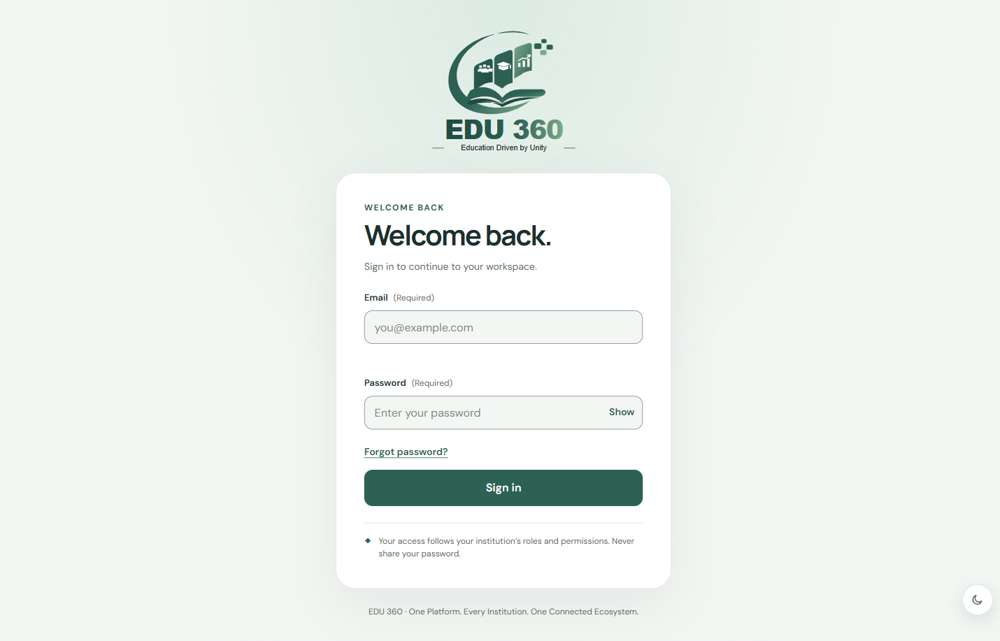
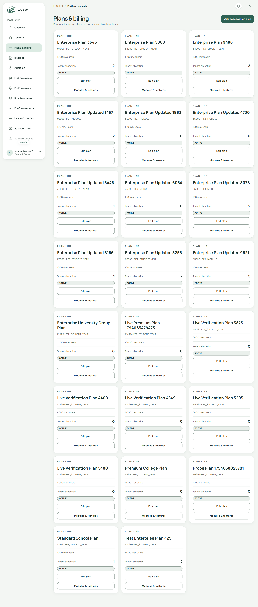
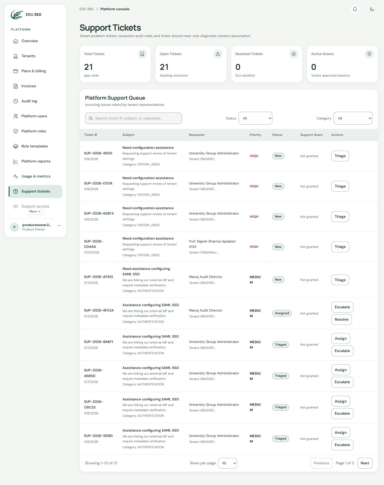
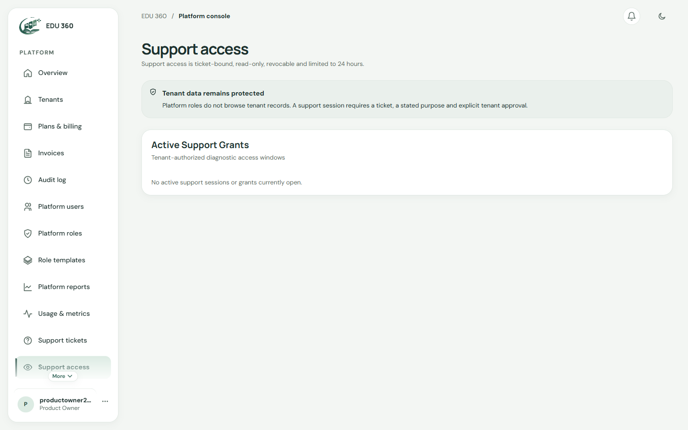
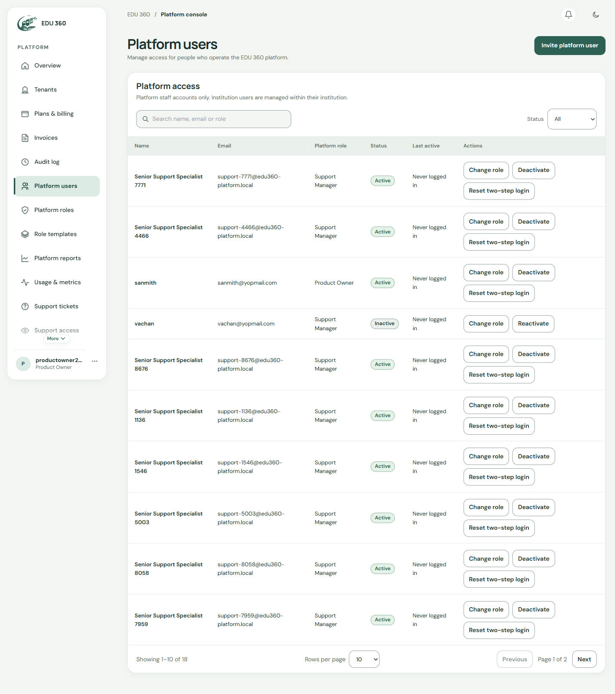
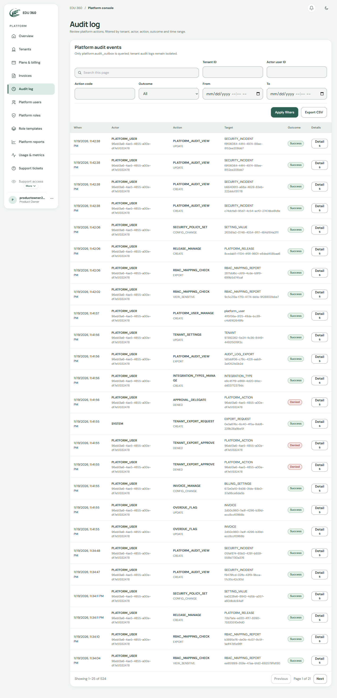
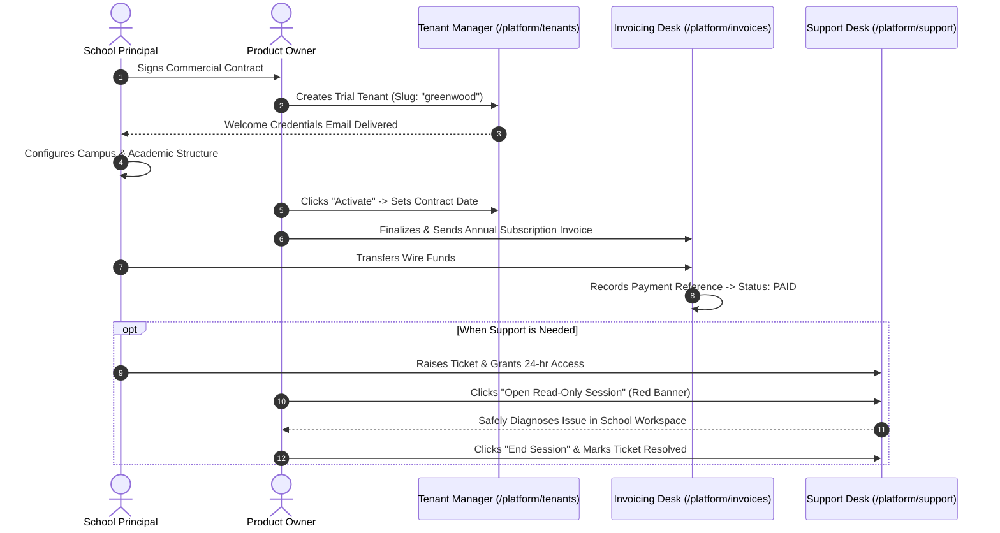

# EDU360 Platform Console — Illustrated End-to-End User Manual

**Document Version:** 4.0 (Exhaustive Master Edition)  
**Target Audience:** Product Owners, Platform Operators, Administrators, Billing Managers, Support Managers, and Compliance Officers  
**Source of Truth:** Live UI Screenshots from `app/edu360-playwright-audit.mjs` & Component Analysis

---

## Table of Contents
1. [Visual System Architecture & Navigation](#1-visual-system-architecture--navigation)
2. [Sign-In & Global Header Controls](#2-sign-in--global-header-controls)
   - [2.1 Login Screen (`/login`)](#21-login-screen-login)
   - [2.2 Platform Notification Bell & Real-Time Alerts](#22-platform-notification-bell--real-time-alerts)
   - [2.3 Profile Menu, Session Switcher & Sign Out](#23-profile-menu-session-switcher--sign-out)
3. [Operations & Administration Screens](#3-operations--administration-screens)
   - [3.1 Executive Platform Overview (`/platform`)](#31-executive-platform-overview-platform)
   - [3.2 Tenant Management & School Directory (`/platform/tenants`)](#32-tenant-management--school-directory-platformtenants)
   - [3.3 Commercial Subscription Plans (`/platform/plans`)](#33-commercial-subscription-plans-platformplans)
   - [3.4 Invoicing, Payments & AR Lifecycle (`/platform/invoices`)](#34-invoicing-payments--ar-lifecycle-platforminvoices)
   - [3.5 Support Ticket Desk & Triage (`/platform/tickets`)](#35-support-ticket-desk--triage-platformtickets)
   - [3.6 Governed Read-Only Support Access (`/platform/support`)](#36-governed-read-only-support-access-platformsupport)
4. [Deep-Dive on Tenant Modals & Sub-Dialogs](#4-deep-dive-on-tenant-modals--sub-dialogs)
   - [4.1 Feature Entitlement Editor (Plan vs. Tenant Overrides)](#41-feature-entitlement-editor-plan-vs-tenant-overrides)
   - [4.2 Tenant Compliance & Data Protection Modal](#42-tenant-compliance--data-protection-modal)
   - [4.3 Real-Time Tenant Usage Modal](#43-real-time-tenant-usage-modal)
   - [4.4 Tenant Branding Modal (Logos & Hex Themes)](#44-tenant-branding-modal-logos--hex-themes)
   - [4.5 Tenant Settings Modal (Time Zones & Custom Domains)](#45-tenant-settings-modal-time-zones--custom-domains)
   - [4.6 Tenant Lifecycle Action Modals (Suspend, Reactivate, Archive, Delete)](#46-tenant-lifecycle-action-modals-suspend-reactivate-archive-delete)
5. [Team Governance & Access Control](#5-team-governance--access-control)
   - [5.1 Platform Users & Staff Directory (`/platform/users`)](#51-platform-users--staff-directory-platformusers)
   - [5.2 Live Platform Roles & Step-In Simulation (`/platform/roles`)](#52-live-platform-roles--step-in-simulation-platformroles)
   - [5.3 Role Templates Engine (`/platform/role-templates`)](#53-role-templates-engine-platformrole-templates)
6. [Analytics, Maintenance & System Health](#6-analytics-maintenance--system-health)
   - [6.1 Executive Platform Reports (`/platform/reports`)](#61-executive-platform-reports-platformreports)
   - [6.2 Platform Usage Analytics (`/platform/usage-counts`)](#62-platform-usage-analytics-platformusage-counts)
   - [6.3 Disaster Recovery & Backup Health (`/platform/backup-status`)](#63-disaster-recovery--backup-health-platformbackup-status)
   - [6.4 Third-Party Integration Types (`/platform/integration-types`)](#64-third-party-integration-types-platformintegration-types)
   - [6.5 Maintenance Windows & Release Announcements (`/platform/releases`)](#65-maintenance-windows--release-announcements-platformreleases)
7. [Security & Legal Compliance](#7-security--legal-compliance)
   - [7.1 Security Policy & Multi-Factor Authentication (`/platform/security-policy`)](#71-security-policy--multi-factor-authentication-platformsecurity-policy)
   - [7.2 Immutable Audit Trail (`/platform/audit`)](#72-immutable-audit-trail-platformaudit)
   - [7.3 GDPR Data Protection Workspace (`/platform/data-protection`)](#73-gdpr-data-protection-workspace-platformdata-protection)
   - [7.4 RBAC Mapping Integrity Check & CSV Export](#74-rbac-mapping-integrity-check--csv-export)
8. [Visual Master Business Workflows](#8-visual-master-business-workflows)
9. [Cross-Reference: The Customer / University Portal Side](#9-cross-reference-the-customer--university-portal-side)

---

## 1. Visual System Architecture & Navigation

The **EDU360 Platform Console** provides unified management across the entire SaaS educational software ecosystem.

```mermaid
flowchart TD
    Console([EDU360 Platform Console])
    
    subgraph 1. Customer Operations
        Console --> Tenants["Tenants (/platform/tenants)"]
        Console --> Plans["Plans (/platform/plans)"]
        Console --> Billing["Invoices (/platform/invoices)"]
    end
    
    subgraph 2. Customer Service & Support
        Console --> Tickets["Tickets (/platform/tickets)"]
        Console --> SupportAccess["Support Access (/platform/support)"]
    end
    
    subgraph 3. Team & Permissions
        Console --> Users["Users (/platform/users)"]
        Console --> Roles["Roles (/platform/roles)"]
        Console --> Templates["Role Templates (/platform/role-templates)"]
    end
    
    subgraph 4. Business Intelligence & Compliance
        Console --> Reports["Reports (/platform/reports)"]
        Console --> Usage["Usage Counts (/platform/usage-counts)"]
        Console --> Backups["Backup Status (/platform/backup-status)"]
        Console --> Security["Security Policy (/platform/security-policy)"]
        Console --> Audit["Audit Log (/platform/audit)"]
        Console --> DPO["Data Protection (/platform/data-protection)"]
    end
```

---

## 2. Sign-In & Global Header Controls

### 2.1 Login Screen (`/login`)

#### What You See:
* **Branded Login Card:** Centered authentication card with the official EDU360 mark and system title.
* **Input Fields:** Username / Work Email and Password.
* **Actions:** **Sign In** button and **Forgot Password** self-service recovery link.

#### How It Works:
1. Enter your work credentials.
2. Click **Sign In**.
3. Keycloak validates your credentials and checks your assigned platform role.
4. You are automatically routed to the **Executive Platform Overview** (`/platform`).

---

### 2.2 Platform Notification Bell & Real-Time Alerts

Located in the top header bar across every screen in the console:
* **Live Counter Badge:** Displays the count of unread operational notifications.
* **Auto-Polling:** Background poller checks for new alerts every 30 seconds.
* **Notification Types:**
  * *High-Priority Support Tickets:* When a school submits a Critical or High-priority ticket.
  * *Overdue Invoices:* When an invoice passes the 15-day grace period.
  * *Maintenance Notices:* Upcoming downtime reminders.
* **Actions:** Clicking any alert marks it as read and immediately opens the relevant screen.

---

### 2.3 Profile Menu, Session Switcher & Sign Out
* Located at the far right of the top header.
* Shows your full name, avatar, and assigned role badge.
* Click to open options:
  * **View Profile:** Inspect active session details, last login timestamp, and IP address.
  * **Sign Out:** Securely terminates your token session with Keycloak.

---

## 3. Operations & Administration Screens

### 3.1 Executive Platform Overview (`/platform`)

#### What You See:
* **Adaptive Dashboard:** The view automatically adjusts depending on who logs in:
  * *Product Owner:* Focuses on tenant growth, MRR trends, renewals, and ticket escalations.
  * *Billing Manager:* Focuses on draft invoices, overdue collections, and payments.
  * *Platform Admin:* Focuses on active accounts, error rates, and system uptime.
* **Metric Cards:**
  * **All Tenants:** Total customer accounts across live and trial stages.
  * **Active:** Fully provisioned live schools currently operating.
  * **In Trial:** Newly registered schools evaluating the platform.

---

### 3.2 Tenant Management & School Directory (`/platform/tenants`)

#### What You See:
* **Header Action:** **"Create trial tenant"** button to onboard new institutions.
* **Search & Filters:** Instant keyword search (by School Name or Tenant ID) and status filter dropdown (`All`, `Active`, `Trial`, `Suspended`, `Archived`).
* **Tenants Table Columns:**
  * **Institution:** School Name and unique tenant ID.
  * **Type & Plan:** Subscription tier (*Starter*, *Standard*, *Enterprise*).
  * **Status & Trial Countdown:** Displays live status and remaining trial days.
  * **Open Gates:** Onboarding checklists (*Pending Gates* vs. *Complete*).
  * **Action Controls:** Row-level action buttons (**Activate**, **Suspend**, **Reactivate**, **Setup**) and the ellipsis dropdown menu (`...`).

---

### 3.3 Commercial Subscription Plans (`/platform/plans`)

#### What You See:
* **Action Button:** **"+ Create New Plan"** to introduce new commercial offerings.
* **Plans Registry Table:**
  * **Plan Code & Display Name:** Identifiers like `STARTER`, `STANDARD`, `ENTERPRISE`.
  * **Capacity Limits:** Maximum allowed enrolled students, staff accounts, and storage quotas (GB).
  * **Pricing & Billing Cycle:** Annual and monthly subscription prices.

---

### 3.4 Invoicing, Payments & AR Lifecycle (`/platform/invoices`)

#### What You See:
* **Header Action:** **"+ Create Invoice"** to draft a new bill.
* **Status Filter Tabs:** Filter between `All`, `Draft`, `Sent`, `Paid`, `Overdue`, and `Void`.
* **Invoices Table Columns:**
  * **Invoice Number:** e.g., `INV-2026-081`.
  * **Tenant:** School name and billing contact.
  * **Amount & Currency:** Total billable amount.
  * **Due Date:** Due date (automatically set to 15 days from dispatch).
  * **Status Badge:** Visual indicator of invoice stage.
  * **Action Buttons:** **Record Pay**, **Finalize & Send**, **Flag Review**, and **View PDF**.

---

### 3.5 Support Ticket Desk & Triage (`/platform/tickets`)

#### What You See:
* **Search & Filters:** Search box (Ticket ID, School, Requester Name), Status dropdown (`All`, `NEW`, `TRIAGED`, `ASSIGNED`, `ESCALATED`, `RESOLVED`), and Category filter.
* **Tickets Table:**
  * **Ticket Number:** e.g., `SUP-1042`.
  * **Priority Badge:** `LOW`, `MEDIUM`, `HIGH`, `CRITICAL`.
  * **Category:** `BILLING`, `ACADEMIC`, `BUG`, `STUDENT_RECORDS`, `OTHER`.
  * **Action Buttons:** **Triage**, **Escalate**, **Resolve**, and **Assume Support Session**.

---

### 3.6 Governed Read-Only Support Access (`/platform/support`)

#### What You See:
* **Security Notice:** Informs operators that all support sessions are strictly ticket-bound, read-only, and fully audited.
* **Active Grants Table:**
  * **Ticket Number:** Associated customer ticket (`SUP-...`).
  * **School:** Institution name that granted access.
  * **Time Remaining:** Expiration countdown (grants last 1 to 24 hours).
  * **Action Button:** **"Open read-only session"**.

---

## 4. Deep-Dive on Tenant Modals & Sub-Dialogs

### 4.1 Feature Entitlement Editor (Plan vs. Tenant Overrides)
Accessed via: `/platform/tenants` $\rightarrow$ row menu $\rightarrow$ **Features**, or from `/platform/plans`.
* **Module & Feature Matrix:** Displays all system modules (*Online Fee Collection*, *Transport*, *Hostel*, *Biometrics*) and individual sub-features.
* **The Product Owner Rule:** Enabling a feature beyond what the customer's plan includes is **strictly restricted to the Product Owner**. If a non-PO operator tries to enable an out-of-plan feature, the editor blocks it with: *"Beyond the plan — Product Owner only."*
* **Tenant-Level Overrides:** Allows granting a customer an experimental module without altering the base plan for other schools.

---

### 4.2 Tenant Compliance & Data Protection Modal
Accessed via: `/platform/tenants` $\rightarrow$ row menu $\rightarrow$ **Compliance**.
Has three operational tabs:
1. **Export Requests Tab:** Displays previous data export archives for this school. Click **Request Export** to generate a fresh encrypted archive.
2. **Retention Policies Tab:** View mandatory retention months per data classification:
   * `STRUCTURE`: Departments, campus setups.
   * `ATTENDANCE`: Student and teacher attendance logs.
   * `GRADES`: Transcripts and examination marks.
   * `FEES`: Financial receipts and payment histories.
   * *Adjustment:* Request to adjust retention months with a mandatory justification reason.
3. **Deletion Requests Tab & Safeguards:**
   * **Exact Name Match Safeguard:** To prevent accidental deletion, the operator must type the school's exact name into a confirmation field.
   * **Retention Waiver Option:** Under rule PD-7, the Product Owner can waive the mandatory retention waiting period before permanent purge by checking **"Waive statutory retention wait"** and providing a legal waiver reason.

---

### 4.3 Real-Time Tenant Usage Modal
Accessed via: `/platform/tenants` $\rightarrow$ row menu $\rightarrow$ **Usage**.
* Shows live consumption figures against hard caps:
  * **Enrolled Students:** Current active students vs. Plan Cap.
  * **Staff & Faculty Accounts:** Active teachers vs. Plan Cap.
  * **Storage Space:** Gigabytes consumed by document uploads and grade archives.

---

### 4.4 Tenant Branding Modal (Logos & Hex Themes)
Accessed via: `/platform/tenants` $\rightarrow$ row menu $\rightarrow$ **Branding**.
* **School Crest / Logo Upload:** PNG/SVG upload to brand the customer's header bar and printed reports.
* **Primary Color Hex:** Brand theme color (e.g., `#0F172A`).
* **Accent Color Hex:** Accent highlight color (e.g., `#2563EB`).

---

### 4.5 Tenant Settings Modal (Time Zones & Custom Domains)
Accessed via: `/platform/tenants` $\rightarrow$ row menu $\rightarrow$ **Settings**.
* **Time Zone:** Select local time zone (e.g., `Asia/Kolkata`) for accurate class timetables and attendance timestamps.
* **Data Region:** Compliant storage region (`IN`, `US`, `EU`).
* **Custom Domain:** Enter the school's private portal URL (e.g., `portal.greenwood.edu`).
* **Analytics Opt-Out:** Toggle customer participation in anonymous macro performance benchmarking.

---

### 4.6 Tenant Lifecycle Action Modals (Suspend, Reactivate, Archive, Delete)
* **Suspend Modal:** Requires a reason (e.g., *Unpaid invoice INV-2026-081*). Immediately redirects school users to a polite payment notice upon login.
* **Reactivate Modal:** Requires a reason (e.g., *Wire payment cleared*). Restores full operational access instantly.
* **Archive Modal:** Confirms placing the tenant into long-term read-only dormancy.
* **Delete Modal:** Initiates permanent database destruction once approved by the Data Protection Officer.

---

## 5. Team Governance & Access Control

### 5.1 Platform Users & Staff Directory (`/platform/users`)

#### Inviting a Team Member:
1. Click **+ Invite Team Member**.
2. Enter the employee's name, email, and assign their business role.
3. The employee receives an invitation link requiring immediate password configuration and MFA enrollment.

---

### 5.2 Live Platform Roles & Step-In Simulation (`/platform/roles`)

#### The Step-In Simulation Tool:
* Click **Step In** next to any role (e.g., *Junior Support*).
* Your view is immediately constrained to that role's exact permissions, allowing you to test security boundaries without logging out. Click **Exit Step-In** to return to your normal view.

---

### 5.3 Role Templates Engine (`/platform/role-templates`)

#### Locked Templates:
* The Data Protection Officer template is permanently **LOCKED** (cannot be altered) under GDPR compliance rules to ensure privacy approvals stay with a legally accountable person.

---

## 6. Analytics, Maintenance & System Health

### 6.1 Executive Platform Reports (`/platform/reports`)

#### Available Reports:
1. **Platform Overview:** Global tenant adoption and capacity utilization.
2. **Billing & Revenue:** Monthly Recurring Revenue (MRR), Annual Recurring Revenue (ARR), outstanding balances, and **contracts due for renewal in 30, 60, or 90 days**.
3. **Support & SLA:** Ticket resolution averages, first-response SLA compliance, and escalation volumes.

---

### 6.2 Platform Usage Analytics (`/platform/usage-counts`)

Shows combined, anonymous usage statistics computed during the nightly platform rollup without exposing individual school records.

---

### 6.3 Disaster Recovery & Backup Health (`/platform/backup-status`)

* **Last Backup & Outcome:** Verifies daily database snapshots completed successfully.
* **Restorable Window:** Point-in-time recovery range (e.g., 30-day restore availability).
* **Automated Restore Tests:** Results of weekly automated recovery drills.

---

### 6.4 Third-Party Integration Types (`/platform/integration-types`)

* Register integration categories (Payment Gateways, SMS Providers, Biometric Devices) and transition statuses between `ALLOWED`, `DEPRECATED`, and `DISABLED`.

---

### 6.5 Maintenance Windows & Release Announcements (`/platform/releases`)

* Schedule upcoming downtime and broadcast announcements across all customer portals.

---

## 7. Security & Legal Compliance

### 7.1 Security Policy & Multi-Factor Authentication (`/platform/security-policy`)

* Toggle mandatory two-factor authenticator app sign-in across all platform staff and school admins. Set session timeout rules.

---

### 7.2 Immutable Audit Trail (`/platform/audit`)

* Searchable log of every administrative action with actor, timestamp, IP address, and old vs. new values. Exportable to CSV.

---

### 7.3 GDPR Data Protection Workspace (`/platform/data-protection`)

* Review and approve data export archives, deletion requests, and retention schedules.

---

### 7.4 RBAC Mapping Integrity Check & CSV Export
Located inside `/platform/data-protection` $\rightarrow$ **RBAC Mapping Check**:
* An automated compliance tool that verifies role separation rules across all tenants.
* Displays Scope, Tenant, Role, Action Code, and Verification Result.
* Click **Download RBAC Mapping Report** to generate a full CSV compliance audit package for external regulators.

---

## 8. Visual Master Business Workflows

---

## 9. Cross-Reference: The Customer / University Portal Side

While this manual covers the **Platform Console** for SaaS operators, schools have their own dedicated **University Portal** (`/university/*`):
* **Institutions & Campuses (`/university/institutions`):** Configuring multi-campus branches.
* **Staff Directory (`/university/staff`):** Faculty and non-academic HR records.
* **User Accounts (`/university/users`):** Provisioning teacher and student logins.
* **Academic Assignments (`/university/setup/...`):** Mapping HODs, Mentors, and Class Teachers.
* **Calendar & Working Days (`/university/setup/calendar-events`, `/weekly-off`):** Setting terms, holidays, and weekends.
* **Term Lock (`/university/setup/term-lock`):** Freezing completed terms to protect grade integrity.
* **Student Login Switch (`/university/setup/student-login`):** Emergency toggle for student self-service access.
* **Customer Support Desk (`/support`):** Where the school raises tickets and grants governed support access.

---

*Manual maintained by the EDU360 Platform Operations & Product Governance Team.*  
*Visual screenshots automatically audited and verified via `app/edu360-playwright-audit.mjs`.*
