# EDU360 Platform Console — The Zero-Knowledge Operator's Manual

**Document Version:** 5.0 (Beginner-Friendly Operational Manual)  
**Target Reader:** Anyone joining the company as Product Owner, Platform Administrator, Operations Specialist, or Billing/Support Agent with **zero prior knowledge** of this software.  
**Written in Plain English:** No developer code, no technical jargon, full real-world step-by-step explanations.

---

## Table of Contents
1. [The Big Picture: What is EDU360?](#1-the-big-picture-what-is-edu360)
   - [The "Apartment Building" Analogy (Multi-Tenancy Explained)](#the-apartment-building-analogy-multi-tenancy-explained)
   - [The Two Worlds: Platform Console vs. School Portals](#the-two-worlds-platform-console-vs-school-portals)
2. [Getting Started & The Screen Layout](#2-getting-started--the-screen-layout)
   - [Signing In (`/login`)](#signing-in-login)
   - [The Top Bar & The Notification Bell](#the-top-bar--the-notification-bell)
   - [The Left-Hand Navigation Menu](#the-left-hand-navigation-menu)
3. [Screen-by-Screen Guided Manual](#3-screen-by-screen-guided-manual)
   - [Screen 1: Platform Overview & Daily Cockpit (`/platform`)](#screen-1-platform-overview--daily-cockpit-platform)
   - [Screen 2: Tenants Directory & School Onboarding (`/platform/tenants`)](#screen-2-tenants-directory--school-onboarding-platformtenants)
   - [Screen 3: Subscription Plans & Student Limits (`/platform/plans`)](#screen-3-subscription-plans--student-limits-platformplans)
   - [Screen 4: Invoices, Billing & Payment Processing (`/platform/invoices`)](#screen-4-invoices-billing--payment-processing-platforminvoices)
   - [Screen 5: Support Tickets Desk (`/platform/tickets`)](#screen-5-support-tickets-desk-platformtickets)
   - [Screen 6: Governed Read-Only Support Access (`/platform/support`)](#screen-6-governed-read-only-support-access-platformsupport)
   - [Screen 7: Platform Staff Directory (`/platform/users`)](#screen-7-platform-staff-directory-platformusers)
   - [Screen 8: Live Platform Roles & The "Step-In" Simulator (`/platform/roles`)](#screen-8-live-platform-roles--the-step-in-simulator-platformroles)
   - [Screen 9: Role Templates (`/platform/role-templates`)](#screen-9-role-templates-platformrole-templates)
   - [Screen 10: Executive Reports & Revenue Analytics (`/platform/reports`)](#screen-10-executive-reports--revenue-analytics-platformreports)
   - [Screen 11: Usage Analytics (`/platform/usage-counts`)](#screen-11-usage-analytics-platformusage-counts)
   - [Screen 12: Disaster Recovery & Backup Health (`/platform/backup-status`)](#screen-12-disaster-recovery--backup-health-platformbackup-status)
   - [Screen 13: Third-Party Integrations (`/platform/integration-types`)](#screen-13-third-party-integrations-platformintegration-types)
   - [Screen 14: Maintenance Windows & Release Announcements (`/platform/releases`)](#screen-14-maintenance-windows--release-announcements-platformreleases)
   - [Screen 15: Security Policy & Two-Factor Authentication (`/platform/security-policy`)](#screen-15-security-policy--two-factor-authentication-platformsecurity-policy)
   - [Screen 16: Platform Audit Trail (`/platform/audit`)](#screen-16-platform-audit-trail-platformaudit)
   - [Screen 17: Data Protection & Legal Privacy Workspace (`/platform/data-protection`)](#screen-17-data-protection--legal-privacy-workspace-platformdata-protection)
4. [Master Real-World Business Plays](#4-master-real-world-business-plays)
5. [Emergency & Troubleshooting Guide](#5-emergency--troubleshooting-guide)

---

## 1. The Big Picture: What is EDU360?

Imagine you run a software company that sells school management systems to hundreds of different schools, colleges, and universities worldwide. 

Each school needs to manage its students, teachers, grades, attendance, exam reports, and fee collections.

### The "Apartment Building" Analogy (Multi-Tenancy Explained)
To understand how EDU360 works, think of an **Apartment Building**:
* **The Entire Building is EDU360:** All servers, software code, and infrastructure belong to your company.
* **Each Apartment is a "Tenant" (a School):** Greenwood High School lives in Apartment 101. St. Mary's College lives in Apartment 102.
* **Total Privacy:** The teachers and students of Greenwood High School only have keys to Apartment 101. They can *never* see inside Apartment 102. Their student files and grades are completely isolated.
* **You are the Building Manager:** You work in the building's **Main Management Office**. This office is the **Platform Console**. You don't teach students; your job is to manage the apartments—give out keys to new schools, charge rent (subscription invoices), fix issues when they call, and ensure the building stays secure and backed up.

### The Two Worlds: Platform Console vs. School Portals
1. **The Platform Console (`/platform/*`):** This is where **YOU** work. Only your company's internal staff (Product Owners, Support Agents, Billing Managers, System Admins) can log in here. Customers (principals, teachers, parents) can never access this console.
2. **The School Portal (`/university/*`):** This is where **CUSTOMERS** work. The principal, teachers, and students log into their own school's portal (e.g., `greenwood.edu360.com`) to do their daily schoolwork.

---

## 2. Getting Started & The Screen Layout

### Signing In (`/login`)


#### What is this screen for?
The front door to the software.

#### Step-by-Step:
1. Open your browser and go to your company's platform URL.
2. Enter your work email address in the **Username or email** box.
3. Enter your password in the **Password** box.
4. Click the blue **Sign In** button.
5. If your account has Two-Factor Authentication enabled, open your phone's authenticator app (e.g., Google Authenticator), check the 6-digit code, type it in, and press enter.

#### What happens next?
* The system checks your identity and looks up your job role.
* Because you are platform staff, it immediately takes you to the **Platform Overview Dashboard** (`/platform`).

---

### The Top Bar & The Notification Bell

Once logged in, look at the very top of your screen:
* **The Bell Icon (Notifications):** This bell automatically rings (updates) every 30 seconds.
  * If a red dot appears with a number like `[ 3 ]`, it means something urgent happened: a customer just submitted a high-priority ticket, an invoice is overdue, or a scheduled maintenance window is approaching.
  * Click the bell to open the drawer, read the alert, and click on it to jump straight to the issue.
* **Your Profile (Top Right):** Shows your name and role badge (e.g., `Product Owner`).
  * Click your name to view your active login details or to click **Sign Out** when you leave your desk.

---

### The Left-Hand Navigation Menu

On the left side of your screen is your master menu. Clicking any item takes you to that specific department:
* **Overview:** The high-level dashboard.
* **Tenants:** The list of all customer schools.
* **Plans:** The subscription tiers you sell.
* **Invoices:** Billing, payments, and invoices.
* **Tickets:** Customer support issues.
* **Support Access:** Stepping inside a customer's school to fix issues safely.
* **Staff & Roles:** Who on your internal team has access to this console.
* **Reports:** Revenue charts and business metrics.
* **Observability (Backups & Usage):** Checking system health and daily database copies.
* **Security & Data Protection:** Legal privacy, GDPR compliance, and security rules.

---

## 3. Screen-by-Screen Guided Manual

---

### Screen 1: Platform Overview & Daily Cockpit (`/platform`)

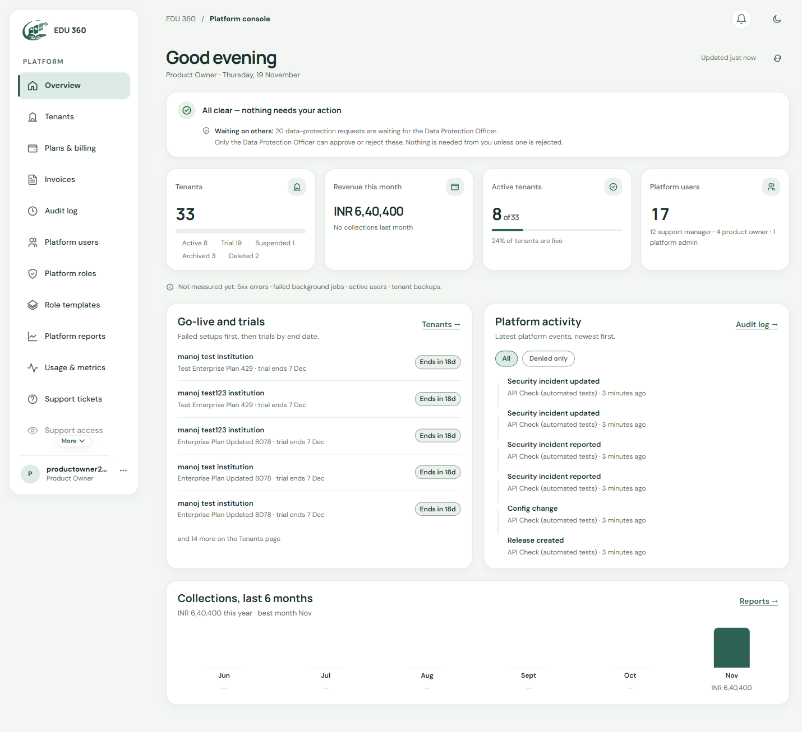

#### What is this screen for?
This is your morning homepage. It gives you a 10-second summary of how the entire company is performing today without digging into spreadsheets.

#### Visual Tour:
* **Top Metric Cards:**
  * **All Tenants:** Total number of schools on the platform.
  * **Active:** Schools currently paying and running live.
  * **In Trial:** Prospective schools testing out the platform on a 30-day evaluation.
* **Role-Adaptive Workspace:** 
  * If you are logged in as the **Product Owner**, you will see monthly revenue summaries, accounts up for renewal, and customer escalations.
  * If you are the **Billing Manager**, you will see how much uncollected cash is waiting in draft or overdue invoices.
  * If you are the **Platform Admin**, you will see system uptime, database backup confirmations, and server health.

#### Step-by-Step Action:
* **How to inspect a problem area:** Click on any of the metric cards (for example, click the **In Trial** card). The screen will immediately jump you to the Tenants list filtered to show only trial schools.

---

### Screen 2: Tenants Directory & School Onboarding (`/platform/tenants`)

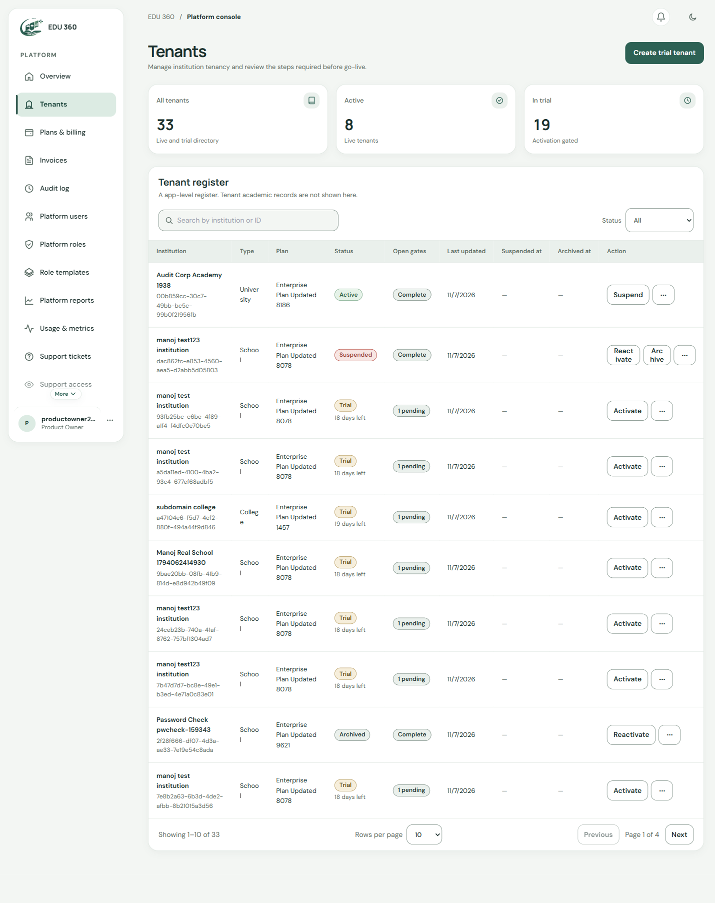

#### What is this screen for?
This is your master customer database. Every school that uses EDU360 is listed here. You use this screen to add new schools, change their subscription packages, or temporarily turn off their access if they don't pay.

#### Key Real-World Workflows:

#### Workflow A: How to Onboard a New School (30-Day Trial)
1. In the top right corner, click the blue button: **"Create trial tenant"**.
2. A pop-up form appears asking for details:
   * **Institution Name:** Type the school's full official name (e.g., `Greenwood International School`).
   * **Domain Slug:** Type a single lowercase word with no spaces (e.g., `greenwood`). This becomes their website address: `greenwood.edu360.com`.
   * **Initial Plan:** Choose their evaluation package (e.g., *Standard Plan*).
   * **Admin Email:** Type the email of the school principal or IT lead (e.g., `principal@greenwood.edu`).
3. Click **Provision Tenant**.
4. **What happens immediately:**
   * Behind the scenes, the system builds an isolated database schema for Greenwood High.
   * A pop-up box appears on your screen titled **Tenant Credentials Notice** displaying a temporary password.
   * An automated welcome email is sent to the principal with their login link.
   * Greenwood High now appears in your table with a status badge of **Trial (30 days left)**.

#### Workflow B: How to Activate a School from "Trial" to "Live Paid Customer"
When the school signs their contract and pays:
1. Find the school in the list (use the search box at the top).
2. On their row, click the button: **Activate**.
3. Select their purchased subscription plan (e.g., *Standard Plan — Annual*).
4. Enter their contract start date.
5. Click **Confirm Activation**.
6. **What happens immediately:**
   * The status changes from **Trial** to **Active**.
   * The trial countdown timer disappears.
   * The school administrator now has full, unrestricted permanent access.

#### Workflow C: How to Upgrade a School's Plan Mid-Year
If a school had 500 students and now needs 1,500 students:
1. Find the school in the table.
2. On the far right of their row, click the three dots (`...`) to open the action menu.
3. Click **Change plan**.
4. Select the new higher tier (e.g., *Enterprise Plan*).
5. Look at the **Effective** option:
   * Select **NOW** if they need extra capacity immediately.
   * Select **RENEWAL** if the change should only take effect next year.
6. Click **Apply Plan Change**.
7. **What happens immediately:**
   * If you chose **NOW**, the system automatically calculates how many days are left in their year and automatically creates a pro-rata draft invoice for just the difference!
   * The school's student limit increases instantly so their teachers can continue enrolling children without getting blocked.

#### Workflow D: What to Do If a School Refuses to Pay (Suspending an Account)
1. On the school's row, click **Suspend**.
2. A modal pops up asking for a reason: Type `Non-payment of Invoice INV-2026-081`.
3. Click **Confirm Suspension**.
4. **What happens immediately:**
   * The status turns to **Suspended**.
   * When teachers or principals at that school try to log in, they see a polite screen: *"Your school subscription requires attention. Please contact school administration."*
   * **Safety Rule:** **NO DATA IS EVER LOST.** All student records, grades, and files stay 100% safe and intact in the database.
5. **How to turn them back on:** As soon as the wire transfer clears, go back to this row and click **Reactivate**. The school is back online in 1 second!

---

### Screen 3: Subscription Plans & Student Limits (`/platform/plans`)


#### What is this screen for?
Think of this like configuring phone plans (e.g., Basic, Silver, Gold). Here you define what packages you sell to schools and what limits each package has.

#### Visual Tour:
* Shows each plan side-by-side (*Starter*, *Standard*, *Enterprise*).
* Lists the caps: Maximum Students permitted, Maximum Faculty/Staff permitted, and Storage space (GB).

#### How to Add a New Plan:
1. Click **+ Create New Plan**.
2. Type a **Plan Code** (e.g., `CAMPUS_PRO`) and a customer-friendly **Display Name** (e.g., *Campus Professional*).
3. Set the hard boundaries:
   * **Max Students:** e.g., `1,500`. (If a school reaches 1,500 students, the system will prevent them from adding student #1,501 until they upgrade).
   * **Max Staff:** e.g., `100`.
   * **Storage Quota:** e.g., `50 GB`.
4. Enter the annual price (e.g., `$4,500`).
5. Click **Save Plan**.
6. **What happens immediately:** This new package is now instantly available when onboarding new schools or processing upgrades.

---

### Screen 4: Invoices, Billing & Payment Processing (`/platform/invoices`)

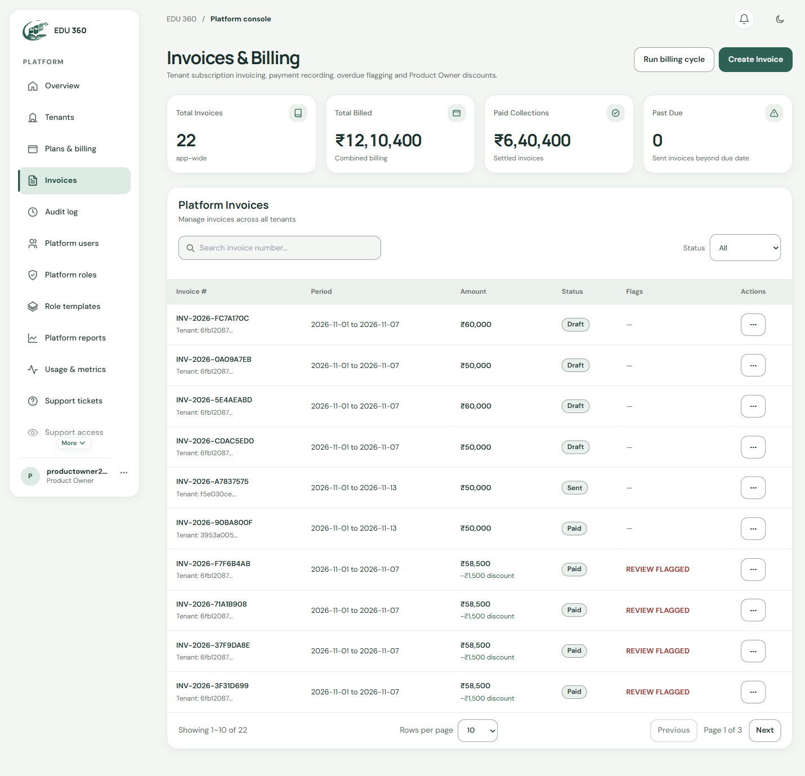

#### What is this screen for?
This is where your company manages accounts receivable—issuing bills to schools, sending reminders, and recording wire transfers when money hits your company bank account.

#### Visual Tour:
* **Status Filter Tabs:** Click these tabs at the top to see:
  * **Draft:** Invoices being prepared that the customer hasn't seen yet.
  * **Sent:** Bills dispatched to schools with an active countdown.
  * **Paid:** Cleared payments.
  * **Overdue:** Bills that have passed their 15-day due date without payment.

#### How to Create and Send a Bill:
1. Click **+ Create Invoice**.
2. Select the customer school from the dropdown.
3. Click **Add Line Item**:
   * Description: `Annual Subscription Fee - Standard Plan (2026-2027)`.
   * Amount: `$3,500.00`.
4. Click **Create Draft**.
5. Review the invoice details.
6. When ready, click **Finalize & Send**.
7. **What happens immediately:**
   * The status turns from **Draft** to **Sent**.
   * The system automatically calculates a due date exactly **15 days** from today.
   * An official PDF invoice is generated and emailed to the school's finance contact.

#### How to Record That a School Has Paid:
Schools usually pay by Bank Wire (NEFT/RTGS/ACH) or Corporate Cheque.
1. When your finance department confirms the funds arrived in your bank account, find the school's invoice in this table.
2. Click the button: **Record Pay**.
3. In the pop-up:
   * **Payment Mode:** Choose *Bank Transfer*, *Credit Card*, or *Cheque*.
   * **Reference Number:** Type the bank transaction ID (e.g., `UTR984729184`).
   * **Payment Date:** Select today's date.
4. Click **Confirm Payment**.
5. **What happens immediately:**
   * The invoice badge turns green: **PAID**.
   * A digital receipt is automatically recorded and emailed to the school.

#### The 15-Day Overdue Automation:
* If a school does not pay within 15 days of receiving the invoice, the system automatically flips the status badge to red: **OVERDUE**.
* The Billing Manager clicks **Flag Review** on that row.
* This immediately flags the customer on the Product Owner's dashboard so you can decide whether to grant a grace extension or suspend their account.

---

### Screen 5: Support Tickets Desk (`/platform/tickets`)


#### What is this screen for?
When a school principal or teacher has an issue (e.g., *"Our gradebook won't download"* or *"How do we add a new semester?"*), they submit a ticket. This screen is your customer service desk where all tickets arrive.

#### Visual Tour:
* Shows every ticket with its number (`SUP-1042`), the school's name, the person who submitted it, and the subject.

#### Step-by-Step Ticket Handling:
1. **Triaging a New Ticket:**
   * When a ticket arrives with status **NEW**, click **Triage**.
   * Set **Priority:** Choose `LOW`, `MEDIUM`, `HIGH`, or `CRITICAL` (use Critical only if an entire school cannot log in or record attendance).
   * Set **Category:** Choose `ACADEMIC`, `BILLING`, `BUG`, or `OTHER`.
   * Click **Save Triage**. The status changes to **TRIAGED** and it enters your team's queue.
2. **Escalating a Bug to Developers:**
   * If the ticket is a real software defect that you cannot fix through configuration, click **Escalate**.
   * Choose **Escalate To:** `ENGINEERING` or `RELEASE_MANAGER`.
   * Type an **Escalation Note** describing the steps to reproduce the bug.
   * Click **Confirm Escalation**. The engineering lead is automatically notified.
3. **Resolving the Ticket:**
   * When the issue is fixed, click **Resolve**.
   * Type a friendly **Resolution Note** explaining the answer (e.g., *"We have corrected your semester dates. You can now download your grade reports."*).
   * Click **Mark Resolved**.
   * **What happens immediately:** The school administrator receives an email and in-app alert saying their ticket has been resolved with your exact explanation.

---

### Screen 6: Governed Read-Only Support Access (`/platform/support`)


#### What is this screen for?
Suppose a teacher calls and says: *"My student John Doe's marks are calculating as 82% instead of 88%."* 
You cannot see their screen from your console. But you also cannot just ask them for their personal password (that is illegal under student data privacy laws). 

**Support Access** is your company's safe solution: The school administrator generates a temporary digital visitor pass that lets you step inside their school workspace to diagnose the problem.

#### The Golden Rules of Support Access:
1. **You cannot break anything:** The session is strictly **READ-ONLY**. Every Save, Edit, and Delete button is hidden. Even if someone tried to modify data, the server blocks it with `403 Support Read-Only`.
2. **You cannot give yourself access:** The school administrator must actively go to their own `/support` screen and click **Grant Access**.
3. **Every view is logged:** The system records every single page you look at in the permanent audit trail so the customer has 100% proof you only looked at the relevant issue.

#### How to Use It Step-by-Step:
1. Ensure the school administrator has clicked **Grant Access** for ticket `SUP-1042`.
2. Open `/platform/support`.
3. You will see the school's active grant with a countdown timer (e.g., *Expires in 4 hours*).
4. Click the button: **Open read-only session**.
5. **What happens immediately:**
   * A new browser tab opens into Greenwood High's school portal.
   * At the very top of the screen is a bright **RED BAR**:
     ```
     [!] READ-ONLY SUPPORT SESSION | Ticket SUP-1042 | Ends in 58 mins   [ End Session ]
     ```
   * You can click into their gradebook, inspect John Doe's marks, and discover that the teacher accidentally set the final exam weight to 30% instead of 40%.
6. **Leaving the session:** Click the white **End Session** button in the red bar (or simply close the tab).
7. **What happens immediately:** Your temporary token is destroyed instantly. You can no longer access their portal. Go back to your ticket desk and reply to the teacher explaining the grading weight mistake.

---

### Screen 7: Platform Staff Directory (`/platform/users`)


#### What is this screen for?
Managing your coworkers' access to the Platform Console.

#### How to Add a New Employee:
1. Click **+ Invite Team Member**.
2. Type their **Full Legal Name** and **Work Email** (must be an `@edu360.com` company address).
3. Select their job role from the dropdown:
   * *Product Owner*
   * *Billing Manager*
   * *Support Manager*
   * *Security Admin*
4. Click **Send Invitation**.
5. **What happens immediately:** The employee receives a welcome email with a one-time activation link to create their password and configure their authenticator app (MFA).

#### How to Remove an Employee Who Leaves the Company:
1. Find their name in the table.
2. Click **Deactivate**.
3. Their session tokens are revoked within 1 second. They can no longer log in.

---

### Screen 8: Live Platform Roles & The "Step-In" Simulator (`/platform/roles`)

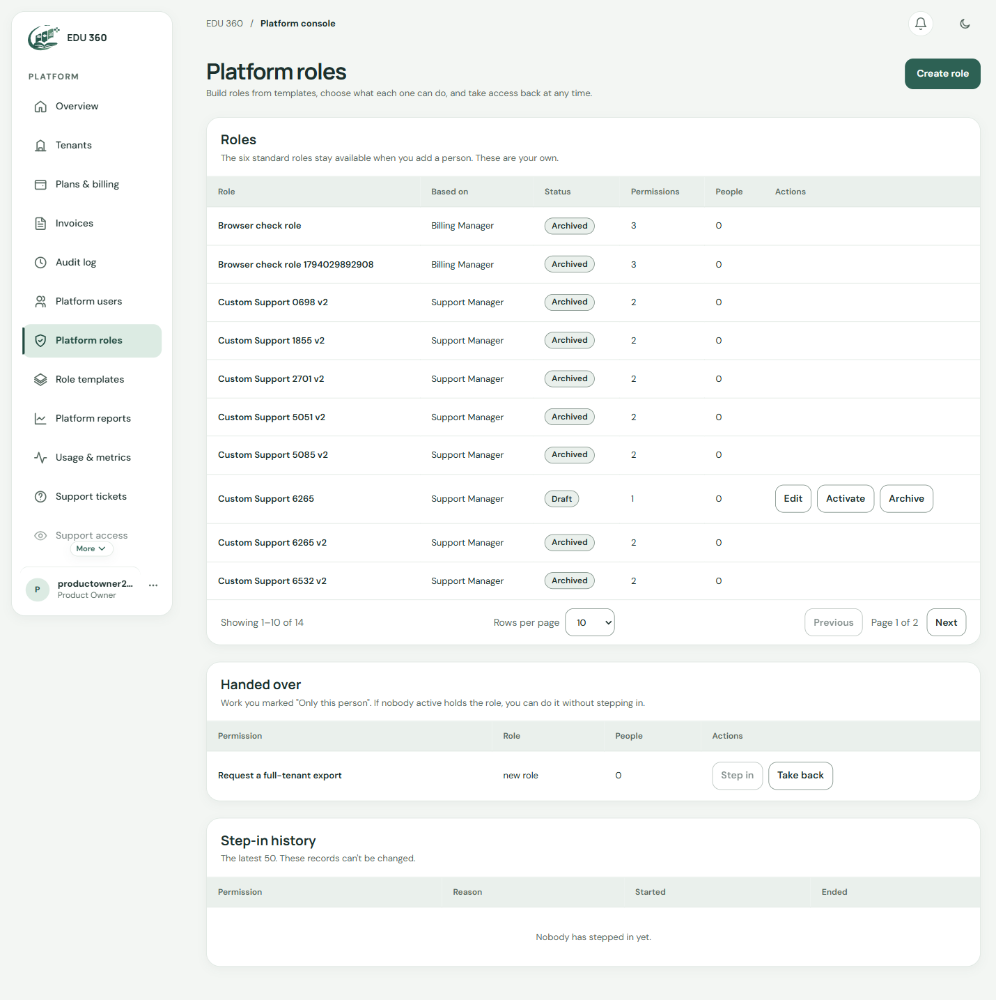

#### What is this screen for?
Controlling exactly what permissions each job role possesses, and testing those permissions.

#### The "Step-In" Simulator Tool (A Product Owner's Superpower):
Suppose you want to hire a temporary intern as a Support Agent, but you want to be 100% certain they cannot see your company's bank invoices or delete customer accounts.
1. Find the **Support Agent** role in the table.
2. Click the button: **Step In**.
3. **What happens immediately:**
   * Your browser screen refreshes.
   * You are now "pretending" to be a Support Agent without logging out!
   * Notice that the **Invoices** menu and the **Delete** buttons have completely vanished from your sidebar!
   * A floating notification at the bottom reminds you: *"Stepped in as: Support Agent"*.
4. When you are satisfied that the role is safe, click **Exit Step-In** to return to your normal Product Owner account.

---

### Screen 9: Role Templates (`/platform/role-templates`)

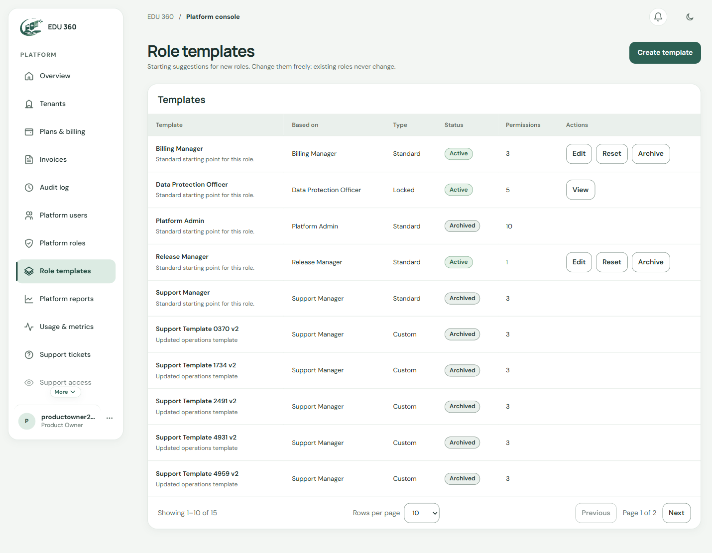

#### What is this screen for?
Think of a Role Template as a **cookie cutter**. It is a standardized blueprint used whenever you create new specialized job roles in the future.

#### The Legal Rule About Locked Templates:
In this table, you will see that the **Data Protection Officer (DPO)** template has a badge that says **LOCKED**.
* **Why?** Under European and international student privacy laws (GDPR/FERPA), legal approvals for permanently deleting student data or exporting whole databases must remain with an officially certified human compliance officer. The system locks this template so nobody can accidentally weaken or tamper with these legal duties.

---

### Screen 10: Executive Reports & Revenue Analytics (`/platform/reports`)

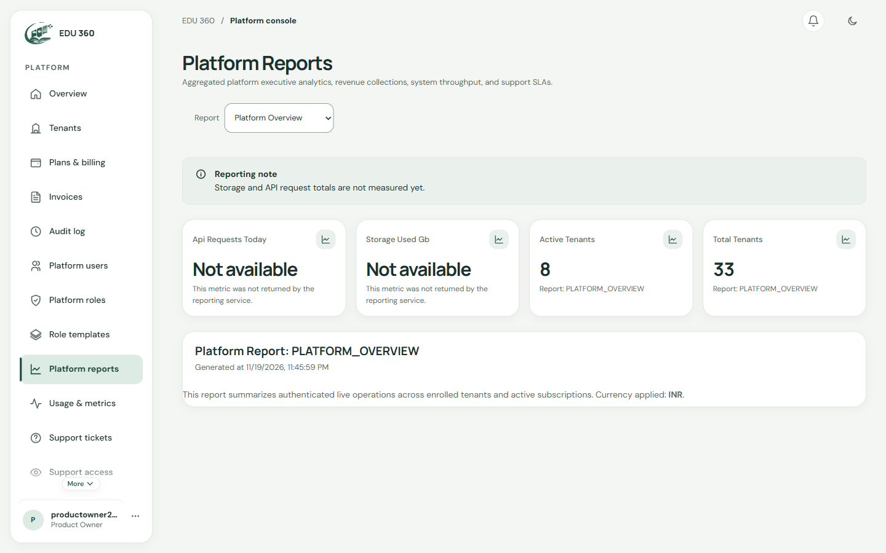

#### What is this screen for?
Financial and operational business intelligence for company executives.

#### How to View Different Reports:
Use the **Report** dropdown at the top to choose:
1. **Billing & Revenue:**
   * **MRR (Monthly Recurring Revenue):** How much subscription money you make every month.
   * **ARR (Annual Recurring Revenue):** Your annual run-rate.
   * **Upcoming Renewals (Crucial!):** Lists every school whose annual contract expires in the next 30, 60, or 90 days. This gives your sales team time to reach out and renew the contract before it lapses!
2. **Support & SLA:**
   * Shows how many hours it takes your team on average to answer tickets and how many customer issues are currently waiting for replies.
3. **Platform Overview:**
   * Total student headcount across all customer schools combined.

---

### Screen 11: Usage Analytics (`/platform/usage-counts`)

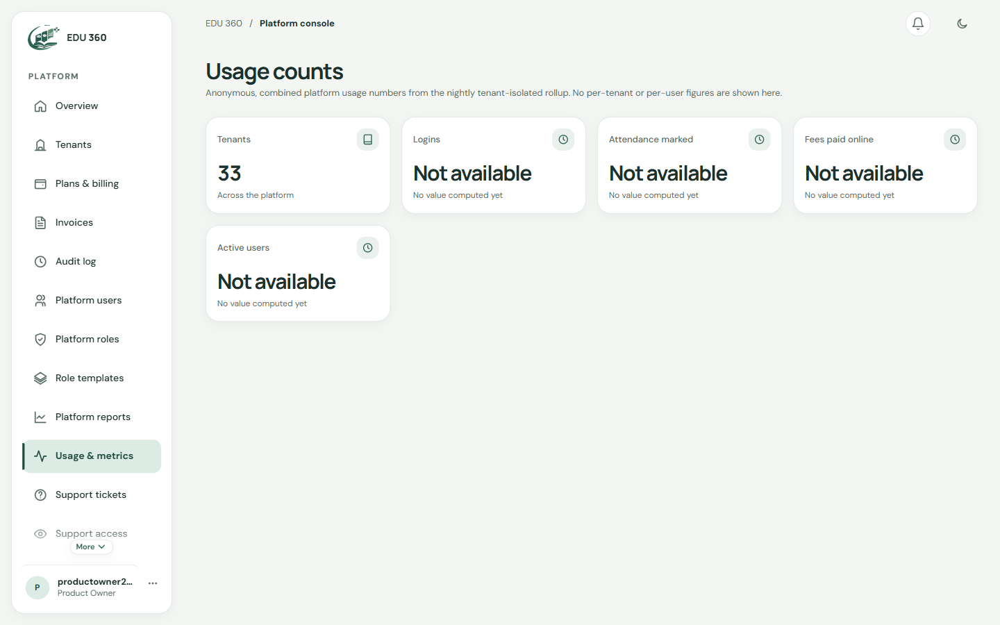

#### What is this screen for?
Every night at midnight, the system runs an automated platform-wide count. It counts how many total students, teachers, classes, and attendance records exist across the entire platform.

#### Privacy Guarantee:
Notice there are no school names or student names here. This screen shows only combined numbers (e.g., `Total Students: 124,500`) to let your executive board track company growth without exposing any confidential school data.

---

### Screen 12: Disaster Recovery & Backup Health (`/platform/backup-status`)

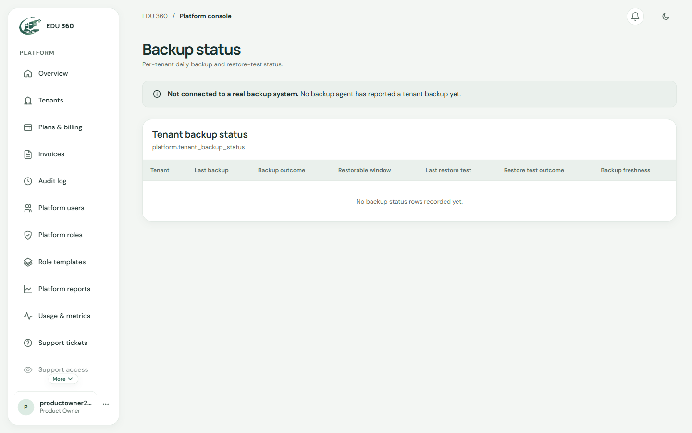

#### What is this screen for?
Peace of mind. If a tornado hits the data center or a server hard drive fails, you need to know that your customers' data is backed up safely.

#### What to Check:
* Look at the **Backup Outcome** column: It should display green: **SUCCESS**.
* Look at **Restorable Window**: Displays **Past 30 Days**. This means you can roll back a school's database to any exact minute in the past month if an emergency occurs.
* Look at **Last Restore Test**: Confirms that the automated system completed a test boot-up drill this week to guarantee the backup files are healthy.

---

### Screen 13: Third-Party Integrations (`/platform/integration-types`)

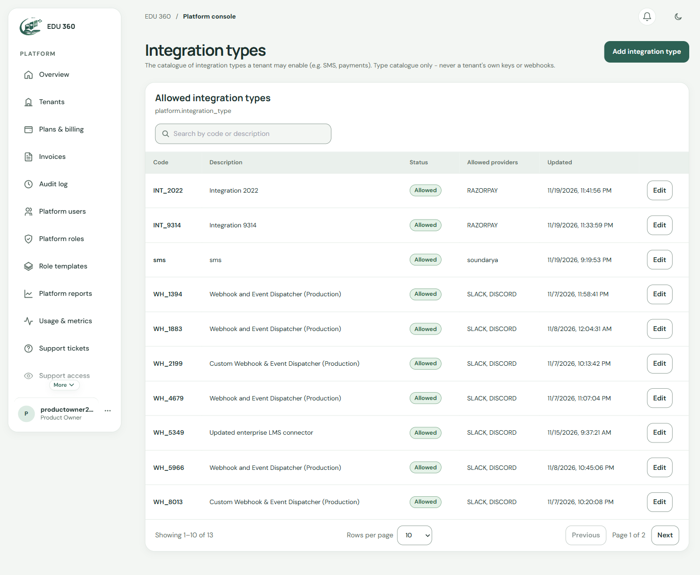

#### What is this screen for?
Managing approved external software vendors that schools can connect to EDU360:
* **Payment Gateways:** Stripe, Razorpay (for parents paying school fees online).
* **SMS Providers:** Twilio (for texting emergency alerts to parents).
* **Hardware Biometrics:** Fingerprint attendance scanners at school gates.

---

### Screen 14: Maintenance Windows & Release Announcements (`/platform/releases`)

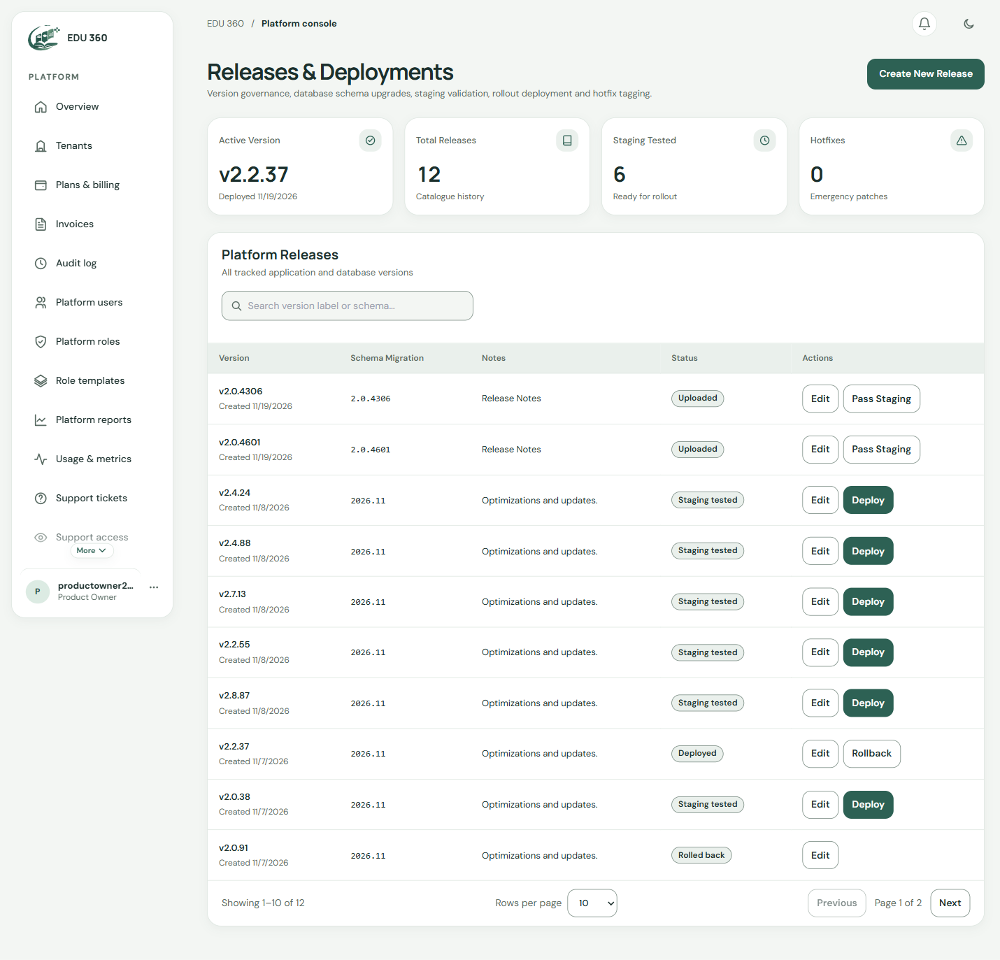

#### What is this screen for?
When your engineering team needs to upgrade database servers on Saturday night, the system might be temporarily unavailable for 30 minutes. You use this screen to warn schools in advance so principals and teachers don't panic.

#### How to Schedule an Alert:
1. Click **+ Schedule Downtime**.
2. Pick the date and time (e.g., `Saturday 28 Nov, 02:00 AM UTC`).
3. Set expected duration (e.g., `30 minutes`).
4. Type a friendly message: *"We are performing a scheduled performance upgrade. The portal will be offline for approximately 30 minutes."*
5. Click **Publish Announcement**.
6. **What happens immediately:** A non-intrusive banner appears across every school dashboard and login screen, keeping customers informed and happy.

---

### Screen 15: Security Policy & Two-Factor Authentication (`/platform/security-policy`)

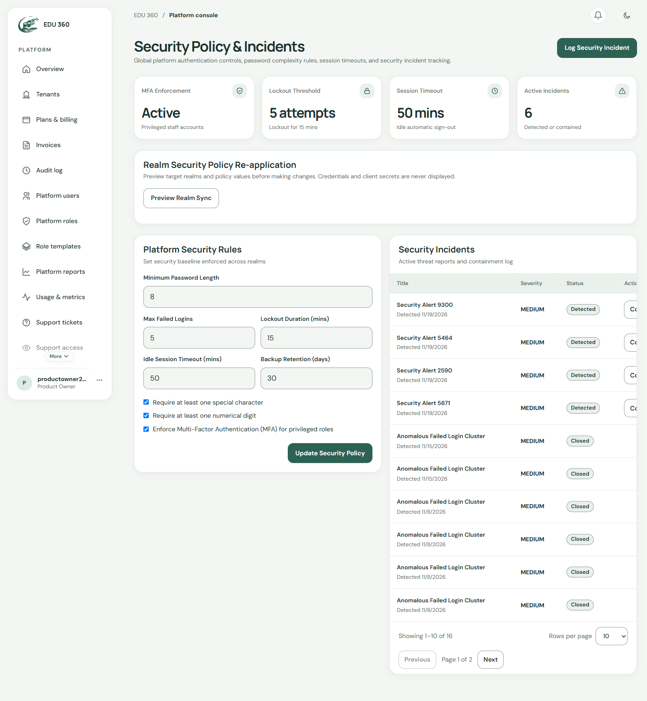

#### What is this screen for?
Setting company-wide cybersecurity rules.
* **Enforce MFA:** Turn this switch ON to require all platform operators and school principals to use authenticator apps when logging in.
* **Session Inactivity Timeout:** Set to `30 minutes`. If an employee leaves their laptop unlocked at a coffee shop, the console automatically locks itself after 30 minutes of inactivity.

---

### Screen 16: Platform Audit Trail (`/platform/audit`)


#### What is this screen for?
The **Black Box Flight Recorder** of the platform. Every time an employee changes a plan, suspends a school, opens a support session, or marks an invoice as paid, an immutable record is permanently stamped here.

#### How to Use It:
* Suppose a principal calls asking: *"Why was our portal changed from Standard to Enterprise yesterday?"*
* Type the school name in the search box.
* You will immediately see: `2026-11-20 14:10:02 | Actor: sarah.j@edu360.com | Action: PLAN_CHANGED | IP: 192.168.1.42`.
* You can click **Export Audit CSV** to download a verified report for legal or compliance auditors.

---

### Screen 17: Data Protection & Legal Privacy Workspace (`/platform/data-protection`)

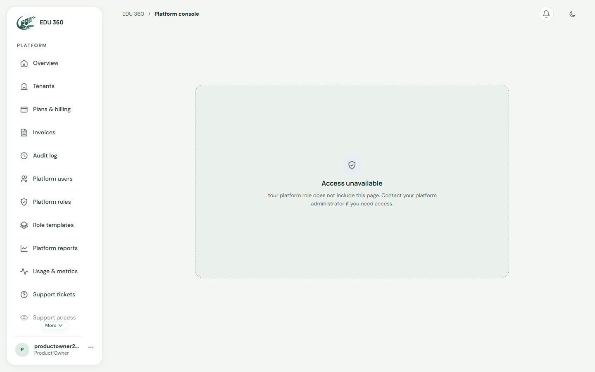

#### What is this screen for?
Owned by the **Data Protection Officer (DPO)** to comply with global student privacy laws (GDPR in Europe, FERPA in the USA).

#### The Two Main Tasks:
1. **Exporting Customer Data:** If a school decides to switch software and requests a copy of all their records, click into **Export Requests** $\rightarrow$ click **Approve**. The system bundles all their student marks and attendance into a secure, encrypted zip file for download.
2. **Deleting Customer Data (The Safeguard):** Under privacy laws, a customer can request the "Right to be Forgotten" (complete erasure). Because deleting a school's database is irreversible, the system forces the operator to **type out the school's exact name** before the delete button will even turn blue!

---

## 4. Master Real-World Business Plays

Here is how you handle common real-world situations from start to finish:

### Playbook 1: A School Signs a New Contract
1. Go to `/platform/tenants` $\rightarrow$ click **Create trial tenant**.
2. Enter their school name and slug $\rightarrow$ copy their temporary credentials and send them the welcome pack.
3. Once they confirm their setup, click **Activate** on their row.
4. Go to `/platform/invoices` $\rightarrow$ click **+ Create Invoice** $\rightarrow$ select the school, enter the annual fee, and click **Finalize & Send**.
5. When they wire the funds, open the invoice $\rightarrow$ click **Record Pay** $\rightarrow$ enter the bank transaction number. **Done!**

---

### Playbook 2: A Teacher Reports an Urgent Grading Issue
1. Open `/platform/tickets` $\rightarrow$ find their ticket.
2. Click **Triage** $\rightarrow$ set Priority to **HIGH**.
3. Ask the school principal to go to their own `/support` page and click **Grant 24-hr Support Access**.
4. Go to `/platform/support` $\rightarrow$ click **Open read-only session**.
5. Diagnose the grading discrepancy in their portal under the safety of the **Red Read-Only Banner**.
6. Close the session $\rightarrow$ return to `/platform/tickets` $\rightarrow$ click **Resolve** $\rightarrow$ type the explanation to the teacher. **Done!**

---

### Playbook 3: An Invoice is Overdue by 20 Days
1. You see a notification on the **Bell Icon** that Greenwood High is overdue.
2. Go to `/platform/invoices` $\rightarrow$ review the overdue bill.
3. Call or email the school's billing department giving them a 48-hour final notice.
4. If no response after 48 hours: Go to `/platform/tenants` $\rightarrow$ find Greenwood High $\rightarrow$ click **Suspend** $\rightarrow$ reason: `Overdue payment on INV-2026-081`.
5. The school is safely suspended without losing any data.
6. When the wire transfer arrives: Open the invoice $\rightarrow$ click **Record Pay** $\rightarrow$ return to `/platform/tenants` $\rightarrow$ click **Reactivate**. **Done!**

---

## 5. Emergency & Troubleshooting Guide

#### "I clicked a button and got an error: 403 Forbidden!"
> **What it means:** Your user account does not have permission for that sensitive action (e.g., only a Billing Manager can mark invoices paid, and only the Product Owner can suspend schools). Check with your Platform Administrator.

#### "I opened a Support Session, but none of the Save buttons work!"
> **What it means:** This is working exactly as intended! Support Access is strictly **Read-Only** to protect your company from liability. You are there to inspect and diagnose, not to alter customer data.

#### "A school says they cannot add any more students!"
> **What it means:** They have hit their purchased plan quota (e.g., 500 students). Go to `/platform/tenants` $\rightarrow$ open their row menu $\rightarrow$ click **Change plan** $\rightarrow$ upgrade them to the next tier effective **NOW**.

---

*Manual maintained by the EDU360 Product & Platform Operations Team.*  
*Written for everyday operational excellence.*
