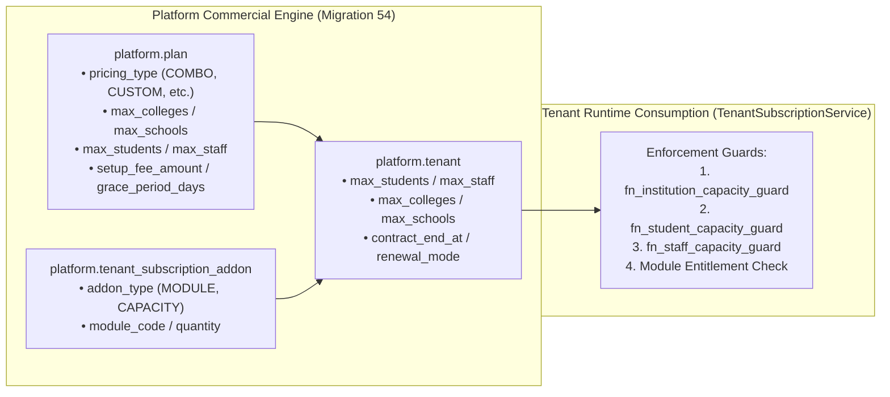

# EDU 360 — Master Tenant Completion Plan (Comprehensive Specification & Execution Blueprint)

**Status:** Authoritative, fully detailed engineering blueprint for taking the EDU 360 Tenant Application (Educational ERP) to 100% completion across all 21 Phase 1 modules, all institutional levels (Levels 2–6), all 236 Phase 1 Actions, all 48 approval processes, and all database/API contracts.  
**File Path:** `docs/TENANT_COMPLETION_PLAN.md`  
**Target Branch:** `sprint-3-development` (all tenant work branches from and pushes to this branch)  
**Companion File:** `docs/PLATFORM_COMPLETION_PLAN.md` (Platform SaaS Control Plane counterpart)  
**Written:** 2026-11-21, from a line-by-line audit of source code across `api/`, `app/`, and `sql/` against the complete 10-deliverable specification suite under `docs/EDU360_V4.0_Final/`, `CLAUDE.md`, and `docs/GOVERNANCE_DECISION_LOG.md`.  
**Authority Order (D1 §V4-2.1 / CLAUDE.md):**
1. Product Owner Decisions & Governance Log (`docs/GOVERNANCE_DECISION_LOG.md`, PQ-01–PQ-82, TPA-01–05, SES-01, PD-08–11).
2. D1 Part II (V3.3 Master Product Document, Sections 1–27) + Master Action List V3.3 (D2) + Master Permission Matrix V3.3 (D3).
3. D4 (Database Architecture, 206 tables, `sql/` bundle) + D5 (API Specification, 408 operations, OpenAPI 3.1.0).
4. D7 (Unified Master Flows F01–F18), D9 (Master Design System), D10 (Interactive Prototype).
5. Deliverables 6 & 8 (Traceability, QA test designs DB-01–DB-97, ACT-* tests, E2E-001–E2E-037, DPDP Act 2023 security controls).

---

## 1. Executive Summary

### 1.1 Purpose and Mandate
This document is the master engineering completion plan for the **EDU 360 Tenant Side**. Where `docs/PLATFORM_COMPLETION_PLAN.md` governs the multi-tenant SaaS control plane (onboarding, subscriptions, invoices, platform audit, platform support, and DPO supervision), this plan establishes the end-to-end execution path for the entire tenant-facing Educational ERP application.

This plan adheres strictly to an **ADDITION and completion mandate**. No pre-existing feature, role, business rule, workflow, pricing tier, package configuration, database constraint, or design system token is removed, simplified, or redesigned. Existing functionality is audited, verified, and systematically extended to full operational readiness.

### 1.2 System Health & Current Completion State
A comprehensive audit of the codebase reveals a distinct bifurcation between the SaaS Platform Control Plane and the Tenant Application:

| Subsystem | Scope / Metrics | Completion Status | Key Operational Capabilities |
|---|---|---|---|
| **Platform Control Plane** | Epics E0–E11, 46 D5 operations, `platform.*` schema | **98.5% Complete** (Production Ready) | Tenant provisioning, Keycloak realm automation, subscription lifecycle, consolidated billing, DPO 3-step export/deletion approvals, platform audit outbox. |
| **Tenant Application (Phase 1)** | 21 Modules, Actions 1–234 + 2 RD (236 actions), 160 `app.*` tables | **34.7% Complete** | **Sprint 1 (Done):** Auth, profile, tenant/institution bootstrap, role assignment, audit logging.<br>**Sprint 2 (~43.5%):** Academic calendar, departments, programs, staff management active; staff leaves/appraisals/qualification verification pending.<br>**Sprints 3–5 (0%):** Students, admissions, timetable, attendance, exams, fees, disciplinary, certificates, notifications, library, transport. |
| **Complete System (Phases 1–3)** | 29 Modules, 278 Actions, Levels 2–6 | **29.4% Complete** | Baseline multi-tenant infrastructure, PostgreSQL RLS, Keycloak identity federation, dynamic roll-down engine foundation. |

### 1.3 Key Architectural Commitments
1. **Strict Multi-Tenant Isolation:** Zero shared tenant state. Enforced via PostgreSQL Row-Level Security (RLS) on all 160 `app.*` tables using connection-scoped session GUCs (`app.tenant_id`, `app.institution_id`, `app.institution_scope`).
2. **Single Active Role Context:** Users holding multiple roles select exactly one active role context at any given time. Permissions from different roles are **never merged or inherited**.
3. **Master Dynamic Roll-Down Engine (V4-PD-01):** Automatic authority delegation walking through 182 seeded default role fallbacks (`ref.role_rolldown_default`) and tenant overrides (`app.role_rolldown_override`), with the strict Management Revocation Rule (RD-G8) enforced.
4. **Append-Only Immutable Audit Trail:** Every mutating API call records an immutable event to `app.audit_outbox` within the same database transaction.
5. **Full Subscription & Commercial Flexibility:** Comprehensive support for Per-Student, Flat, Per-Module, Add-on, and custom institutional Combo Packages (e.g. University Groups, Multi-Campus Colleges, K-12 School Networks) with capacity limit enforcement and usage metering.

### 1.4 Implementation Reality vs Target Specification Matrix (REV-01)
As mandated by `CLAUDE.md`, this plan explicitly distinguishes between the **current implementation reality** and the **V4.0 target-state specifications**:
- The current application is an enterprise **Spring Boot 3.4.3 / Java 21 modular monolith** deployed with PostgreSQL 16 and Keycloak.
- The 10 V4.0 specification deliverables (`docs/EDU360_V4.0_Final/`) define target-state functional rules, contracts, and aspirational multi-service boundaries.
- This plan directs the **functional and architectural completion of the modular monolith** toward full V4.0 compliance, without presuming that microservices are running today.

| Architectural Dimension | Current Implemented Reality (Codebase Baseline) | V4.0 Target-State Specification (Aspirational Design) | Completion Plan Role & Execution Path |
|---|---|---|---|
| **Deployment Architecture** | Single Spring Boot 3 modular monolith (`api/`), Vite/React 19 SPA (`app/`), single PostgreSQL database (`sql/`). | Distributed multi-service architecture with decoupled domain microservices and independent databases. | **Retains the modular monolith.** Implements all functional domains within cleanly separated Spring module packages under `com.edu360.api.*`. |
| **Data Isolation & Multi-Tenancy** | Shared PostgreSQL database enforcing Row-Level Security (RLS) via GUCs (`app.tenant_id`, `app.institution_id`). | Isolated database per tenant option (V4-TE-01 / E10-S9) alongside shared RLS pools. | **Enforces Shared RLS (Decision PD-8).** `ISOLATED` mode returns HTTP 422 until E10-S9. All 160 `app.*` tables enforce `p_tenant` and `p_institution`. |
| **Identity & Authentication** | Keycloak v24+ with single realm / multi-client integration, JWT Bearer tokens with active role claims. | Dynamic Keycloak realm-per-tenant broker with automated federated SAML/OIDC enterprise directories. | **Builds automated provisioning of tenant realms** via `TenantProvisioningService` (Step P04/P05). Active role claim enforced without permission merging. |
| **Role & Authorization Model** | Imperative service-level checks (`PermissionEvaluatorService`), initial role seed, role assignment tables. | 71 discrete standard roles across Levels 2–6, 182 seeded roll-down fallbacks, scoped letters (`O, D, C, S, U, T, A`). | **Executes full 71-role matrix and Roll-Down Engine (V4-PD-01)** walking `ref.role_rolldown_default` and `app.role_rolldown_override`. |
| **Asynchronous & Scheduled Tasks** | Spring `@Scheduled` tasks and thread pools (`ThreadPoolTaskScheduler`, `LateFeeCalculationScheduler`). | Dedicated distributed job queue / event broker (Kafka / RabbitMQ) for background workers. | **Maintains Spring-managed transactional schedulers** for term auto-relocks, late fines, and audit log shipping (`edu_shipper`). |
| **Testing & Verification** | 1,190 Java `@Test`s passing, 441 Vitest tests passing, Spring Boot slice tests (`*IT`) on real Postgres. | Comprehensive 97-scenario database test suite (DB-01–DB-97) and end-to-end Playwright journeys (E2E-001–037). | **Expands existing Spring/Vitest suites** to achieve 100% coverage across ACT-* permission slices and DB-01..97 constraints. |

---

### 1.5 Known Spec Discrepancies

| ID | Discrepancy | Source A | Source B | Execution treatment / status |
|---|---|---|---|---|
| T2-DISC-01 | **T2 action numbering and story mapping conflict with the V4.0 Action Register.** The assigned T2 prompt explicitly defines T2-S1 as ACT-022/023 (institution hierarchy), T2-S2 as ACT-024/025 (academic calendar and non-overlapping terms), T2-S3 as ACT-026/027 (departments and HOD), T2-S4 as ACT-028/029 (programs and curriculum), and T2-S5 as ACT-030..032 (classes, batches, sections). The V4.0 Action Register instead assigns 22 `INSTITUTION_CREATE_DRAFT`, 23 `INSTITUTION_ACTIVATE`, 24 `INSTITUTION_BLOCK_REQUEST`, 25 `INSTITUTION_BLOCK_APPROVE`, 26 `STRUCTURE_MANAGE`, 27 `PROGRAM_RULES_SET`, 28 `CALENDAR_MASTER_SET`, 29 `CALENDAR_LOCAL_SET`, 30 `WEEKLY_OFF_SET`, 31 `GRADING_SCHEME_SET`, and 32 `HOD_ASSIGN`. | `docs/tenant-agent-prompts/T2-academic-hierarchy-and-departments.md`, “Your stories” table (T2-S1..T2-S5). | `docs/EDU360_V4.0_Final/02_Product_Governance_and_Action_Register/EDU360_V4.0_02_Product_Governance_and_Action_Register.xlsx`, sheet `Data`, rows 22–32 (columns `#`, `Action code`, `What it does`). | **Open discrepancy; do not renumber T2 implementation.** T2 delivery follows its assigned prompt's story table and dependency graph. Preserve the V4.0 Action Register as the separate canonical action-code reference until Product Owner resolves the mismatch. Executive override remains unimplemented pending explicit governance decision. |

## 2. Project Context and Objectives

### 2.1 The EDU 360 Vision
EDU 360 is an enterprise-grade multi-tenant educational management platform designed to support the full institutional hierarchy across higher education and K-12 systems:
- **Level 2:** Multi-campus University Groups and State University Systems.
- **Level 3:** Standalone Degree Colleges and Higher Education Institutions.
- **Level 4:** Academic Departments and Centers of Excellence.
- **Level 5:** Programs, Courses, Classes, Batches, and Cohorts.
- **Level 6:** Sections, Student Mentorship Groups, and Classroom Delivery.

### 2.2 Core Engineering Objectives
1. **Functional Completeness:** Deliver all 236 Phase 1 actions across all 21 modules with zero mock stubs, hardcoded values, or unfinished UI states.
2. **Workflow Fidelity:** Execute all 48 master approval processes (§7) including two-step chains, date-bounded delegations, emergency term locks, and legal hold constraints.
3. **Design System Consistency:** Implement the 7 mandatory UI screen states (Loading, Empty, Populated, Validation Error, Server Error, Permission Denied, Locked) conforming to WCAG 2.1 AA accessibility in both Light and Dark themes.
4. **Automated Verification:** Achieve 100% test coverage across the test pyramid: Unit, Repository Slice, Controller Slice, ACT-* permission tests (Allow, Deny, Scope, Guard), DB-01–DB-97 constraint checks, and Playwright E2E journeys.

---

## 3. Documentation Inventory and Review Register

### 3.1 Documentation Inventory
The project documentation repository located at `C:\Users\manoj.gowda\Documents\Personal project\docs\` was systematically catalogued and audited:

| Document Path | Title / Version | Scope & Focus | Audit Status | Key Governance Authority |
|---|---|---|---|---|
| `docs/PLATFORM_COMPLETION_PLAN.md` | Platform Completion Plan (v1.0, 2026-11-16) | SaaS control plane, Epics E0–E11, 46 D5 operations | Complete | Benchmark document for plan structure and quality. |
| `docs/V4.0_SPEC_SUMMARY.md` | V4.0 Final Spec Digest | Executive synthesis of all 10 V4.0 deliverables | Complete | High-level index and structural cross-reference. |
| `docs/GOVERNANCE_DECISION_LOG.md` | Governance Decision Log | PQ-01–PQ-82, TPA-01–05, SES-01, PD-08–11 | Complete | Ultimate authority on architectural and operational rulings. |
| `docs/EDU360_V4.0_Final/01_Master_Product_Specification/` | Deliverable 1: Master Product Spec V3.3 | 27 Sections, 21 Phase 1 modules, 48 approval processes | Complete | Primary source of business rules and workflows. |
| `docs/EDU360_V4.0_Final/02_Master_Action_List/` | Deliverable 2: Master Action List V3.3 | 278 Actions across 29 modules, 236 Phase 1 actions | Complete | Authoritative action codes, HTTP methods, and URL patterns. |
| `docs/EDU360_V4.0_Final/03_Master_Permission_Matrix/` | Deliverable 3: Master Permission Matrix V3.3 | 71 Roles, scoped letters (O, D, C, S, U, T, A) | Complete | Absolute matrix of role-to-action authorizations. |
| `docs/EDU360_V4.0_Final/04_Database_and_Technical_Architecture/` | Deliverable 4: DB & Technical Architecture | 206 tables, RLS policies, 25 rules functions, GUCs | Complete | Schema specifications, constraints, and triggers. |
| `docs/EDU360_V4.0_Final/05_API_Specification/` | Deliverable 5: OpenAPI 3.1.0 Contract | 408 operations, 89 error codes, 55 idempotency scopes | Complete | REST contract, DTOs, headers, and validation schemas. |
| `docs/EDU360_V4.0_Final/06_Master_Traceability_Matrix/` | Deliverable 6: Traceability Matrix | Requirements to Actions to DB to Test mapping | Complete | QA verification traceability and coverage baseline. |
| `docs/EDU360_V4.0_Final/07_UX_and_Unified_Workflows/` | Deliverable 7: UX & Unified Workflows | 18 Master Journeys (F01–F18), 7 Screen States | Complete | User journey definitions and UX specifications. |
| `docs/EDU360_V4.0_Final/08_Security_Privacy_and_Data_Protection/` | Deliverable 8: Security & Data Protection | DPDP Act 2023 compliance, data classes, encryption | Complete | Data privacy, retention, and legal hold rules. |
| `docs/EDU360_V4.0_Final/09_Master_Design_System/` | Deliverable 9: Master Design System | Design tokens, typography, color semantics, components | Complete | Visual and frontend component standards. |
| `docs/EDU360_V4.0_Final/10_Interactive_Prototype/` | Deliverable 10: Interactive Prototype | HTML click-through reference implementations | Complete | UI interaction reference. |
| `docs/PHASE1_PROGRESS_CHECKLIST.md` | Phase 1 Progress Checklist | Sprint-by-sprint completion tracking | Complete | Historical tracking of completed Sprint 1 tasks. |
| `docs/SPRINT2_PROGRESS.md` | Sprint 2 Progress Tracker | Active Sprint 2 task status and execution state | Complete | Active baseline for remaining Sprint 2 work. |

### 3.2 Master Tenant Multi-Agent Execution Prompts Register (`docs/tenant-agent-prompts/`)
To execute this completion plan in parallel across specialized engineering agents, the entire tenant scope is divided into **10 autonomous execution prompt files** located in [`docs/tenant-agent-prompts/`](file:///c:/Users/manoj.gowda/Documents/Personal%20project/docs/tenant-agent-prompts/):

| Prompt File | Prompt Title | Modules Covered | Phase 1 Actions | Database Migrations Owned | Detailed Execution Scope |
|---|---|---|---|---|---|
| **[`README.md`](file:///c:/Users/manoj.gowda/Documents/Personal%20project/docs/tenant-agent-prompts/README.md)** | **Master Agent Execution Index** | All 21 Modules | All 236 Actions | Migrations `55`–`74` | Dependency graph, execution order, shared rules, and branch directive (`sprint-3-development`). |
| **[`T1`](file:///c:/Users/manoj.gowda/Documents/Personal%20project/docs/tenant-agent-prompts/T1-foundation-term-lock-and-rolldown.md)** | **Foundation, Term Lock & Roll-Down** | M01, M03 (part), Roll-Down | Actions 1–7, 33–41, RD-01, RD-02 | Migrations `55` & `56` | Roll-Down Engine (`V4-PD-01`, `RD-G1..G8`), Management Revocation Rule, Term Lock (`is_term_locked()`), Emergency 72h Unlock API, and Native form CSS fixes. |
| **[`T2`](file:///c:/Users/manoj.gowda/Documents/Personal%20project/docs/tenant-agent-prompts/T2-academic-hierarchy-and-departments.md)** | **Academic Hierarchy & Departments** | M03 (core) | Actions 22–32 | Migrations `57` & `58` | University Groups, Colleges, Schools, Academic Calendar Terms, non-overlapping terms constraint, Departments, Programs, Batches, and Section rosters; Executive Override (PO-T06). |
| **[`T3`](file:///c:/Users/manoj.gowda/Documents/Personal%20project/docs/tenant-agent-prompts/T3-staff-hr-leaves-and-appraisals.md)** | **Staff HR, Leaves & Appraisals** | M11, M12, M13 | Actions 123–161 | Migrations `59` & `60` | Staff directory, credential verification with ClamAV, leave balance accrual, 2-tier leave approvals with date-bounded delegations (Rule `D-001`), and annual KPI appraisal scorecards. |
| **[`T4`](file:///c:/Users/manoj.gowda/Documents/Personal%20project/docs/tenant-agent-prompts/T4-student-information-system-sis.md)** | **Student Information System (SIS)** | M14 | Actions 162–174 | Migrations `61` & `62` | Student master directory, demographic records, up to 3 guardians, zero hard deletions (`status = WITHDRAWN`), immutable behavioral notes (`fn_note_guard`), and statutory legal hold tracking (`app.legal_hold`). |
| **[`T5`](file:///c:/Users/manoj.gowda/Documents/Personal%20project/docs/tenant-agent-prompts/T5-admissions-merit-and-enrollment.md)** | **Admissions, Merit & Enrollment** | M15 | Actions 175–186 | Migrations `63` & `64` | Intake cycles, applicant document scrutiny, reservation quotas (General, Merit, Sports, Management), Rule `C12` enforcement (merit approval is non-delegable and never bulk-approved), and student enrollment conversion. |
| **[`T6`](file:///c:/Users/manoj.gowda/Documents/Personal%20project/docs/tenant-agent-prompts/T6-timetable-and-attendance-engine.md)** | **Timetable & Attendance Engine** | M04, M05 | Actions 42–54 | Migrations `65` & `66` | PostgreSQL GiST exclusion constraints (`btree_gist`) preventing teacher and room clashes, daily/period attendance entry, medical exemption formula (§20.4), configurable attendance exam gate (PO-T02), and Term Lock blocking attendance updates. |
| **[`T7`](file:///c:/Users/manoj.gowda/Documents/Personal%20project/docs/tenant-agent-prompts/T7-assignments-examinations-and-grading.md)** | **Assignments, Exams & Grading** | M06, M07 | Actions 55–87 | Migrations `67` & `68` | Homework uploads with rubric scoring, exam timetables, attendance hall ticket gate, marks moderation, mathematical SGPA and CGPA compilation (§20.1–§20.3) using hierarchical customizable grade scales (PO-T01), and Publish Gate validation (`fn_publish_gate`). |
| **[`T8`](file:///c:/Users/manoj.gowda/Documents/Personal%20project/docs/tenant-agent-prompts/T8-fee-structure-invoicing-and-payments.md)** | **Fees, Invoicing & Payments** | M08 | Actions 88–109 | Migrations `69` & `70` | Program quota fees, installment invoice generation, nightly automated late fine calculation cron (PO-T03), Management-first concession approvals (PO-T04), Razorpay/Stripe checkout, HMAC-SHA256 webhooks, and PDF receipts. |
| **[`T9`](file:///c:/Users/manoj.gowda/Documents/Personal%20project/docs/tenant-agent-prompts/T9-id-cards-certificates-and-grievances.md)** | **ID Cards, Certificates & Grievances** | M09, M10, M16 | Actions 110–122, 187–195 | Migrations `71` & `72` | High-res SVG/PDF student & staff ID cards, Transfer & Bonafide certificates with automated 3-way No-Dues clearance, public verification route, and the Confidential Grievance Gate (`fn_complaint_guard`, PO-T05). |
| **[`T10`](file:///c:/Users/manoj.gowda/Documents/Personal%20project/docs/tenant-agent-prompts/T10-communications-library-and-transport.md)** | **Communications, Library & Transport** | M17, M18, M19, M20, M21 | Actions 196–234 | Migrations `73` & `74` | Role-scoped circulars with read receipts, multi-channel messaging (SMS/Email/In-App) with usage metering, library check-out/overdue fines, bus route manifests, and executive analytics running over `edu_report`. |

---

## 4. Architecture Overview

### 4.1 Multi-Tenant Isolation & PostgreSQL Row-Level Security (RLS)
The EDU 360 Tenant Application operates on a robust shared-database, isolated-schema multi-tenant model. Tenant data segregation is enforced at the database kernel level:

```
                                  HTTP Request + Bearer JWT
                                             │
                                             ▼
                             ┌───────────────────────────────┐
                             │    TenantResolutionFilter     │
                             │  - Resolves X-Tenant-ID / Sub │
                             │  - Validates active_role_id   │
                             └───────────────┬───────────────┘
                                             │
                                             ▼
                             ┌───────────────────────────────┐
                             │   TenantRoutingDataSource     │
                             │   Checkout Connection from    │
                             │   HikariCP Connection Pool    │
                             └───────────────┬───────────────┘
                                             │
                                             ▼
┌────────────────────────────────────────────────────────────────────────────────────────┐
│                        PostgreSQL Connection Initialization                            │
│  SET LOCAL app.tenant_id = 'tenant-uuid';                                              │
│  SET LOCAL app.institution_id = 'institution-uuid'; (if scoped to College/School)      │
│  SET LOCAL app.institution_scope = 'ALL';           (if Tenant-wide role)              │
│  SET LOCAL app.user_id = 'user-uuid';                                                  │
└────────────────────────────────────────────┬───────────────────────────────────────────┘
                                             │
                                             ▼
┌────────────────────────────────────────────────────────────────────────────────────────┐
│                     PostgreSQL Row-Level Security Engine (Kernel Level)                │
│                                                                                        │
│  POLICY p_tenant ON app.*                                                              │
│  USING (tenant_id = current_setting('app.tenant_id', false)::uuid);                    │
│                                                                                        │
│  RESTRICTIVE POLICY p_institution ON app.* (tables with institution_id)                │
│  USING (institution_id = current_setting('app.institution_id', false)::uuid            │
│         OR current_setting('app.institution_scope', false) = 'ALL');                   │
└────────────────────────────────────────────────────────────────────────────────────────┘
```

1. **Fail-Closed Execution:** If `app.tenant_id` is absent or invalid, PostgreSQL returns zero rows for `SELECT` and throws an exception on `INSERT`/`UPDATE`/`DELETE`.
2. **Database Role Privileges:**
   - `edu_app`: Read/write on `app.*` tables; read-only on `ref.*` tables; zero access to `platform.*` tables.
   - `edu_report`: Read-only reporting role.
   - `edu_retention`: Restricted role permitted to physically purge data only after statutory retention expires and provided no `app.legal_hold` exists.

### 4.2 Single Active Role Architecture (Part II §6, HI-15)
- Users assigned multiple roles (e.g., Professor in Computer Science and Vice-Principal) must select exactly one **Active Role** upon authentication or switch.
- The JWT claims and security context reflect only that active role.
- Permissions from different roles are **never combined or merged**. Switching roles triggers a complete context switch and security re-evaluation.

### 4.3 Transactional Audit Outbox Pattern
Every mutating operation in the tenant domain writes an audit record in the **same database transaction** to `app.audit_outbox`:
- `tenant_id`, `institution_id`, `actor_user_id`, `active_role_code`, `action_code`, `entity_type`, `entity_id`, `record_count`, `sensitivity_class` (`N` Normal, `P` PII, `F` Financial, `H` Health, `K` Child Data), `old_state_json`, `new_state_json`, `correlation_id`, `created_at`.
- Asynchronous log shipper process (`edu_shipper`) relays records to secure, immutable long-term storage.

---

## 5. Existing System Analysis

### 5.1 Codebase Audit Metrics
A rigorous technical inspection of the repository on branch `sprint-3-development` reveals:
- **Backend (`api/`):**
  - **731 Java source files** organized under `com.edu360.api`.
  - **77 Spring `@RestController` classes** implementing platform and tenant endpoints.
  - **181 Test classes** containing **1,190 `@Test` methods**.
- **Frontend (`app/`):**
  - **70 Vitest test suites** passing with **441 tests passing (0 failures)**.
  - Production build fully verified via `tsc -b && vite build` (6.31s build time).
- **Database (`sql/`):**
  - **113 Migration files** (`01_schema.sql` through `54_v41_subscription_commercial_engine.sql`).
  - **206 Base tables** across `platform`, `app`, `ref`, and `audit` schemas.
  - **25 Stored logic functions** in `02_rules.sql` enforcing core business rules.
  - **159 Tables with Row-Level Security** in `03_bindings.sql`.

### 5.2 Implementation Gap by Sprint
- **Sprint 1 (Completed — 100%):** Core infrastructure, authentication, password reset, user profile, tenant setup, role assignment, audit logging.
- **Sprint 2 (Active — ~43.5%):** Academic calendar, faculties, departments, programs, staff directory, staff qualification verification. Leaves, appraisals, and delegations remain pending.
- **Sprint 3 (Pending — 0%):** Student records, admissions pipeline, applicant portal, merit list generation, verification workflows.
- **Sprint 4 (Pending — 0%):** Timetable engine, attendance management, online class scheduling, exam structures, grading, report cards.
- **Sprint 5 (Pending — 0%):** Fee management, invoicing, online collection, identity cards, certificates, disciplinary tracking, notices, communications.


---

## 6. Complete Tenant Functional Scope

### 6.1 The 21 Phase 1 Functional Modules
The Phase 1 scope covers 21 modules comprising **236 Action Codes** (Actions 1–234 plus roll-down actions RD-01 and RD-02):

| Module Code | Module Name | Phase 1 Actions | Database Tables | Core Focus |
|---|---|---|---|---|
| **M01** | Sign-in & Account Management | Actions 1–7 | `app.user_account`, `app.user_session`, `app.credential_reset` | Authentication, MFA, session tracking, device management, password changes. |
| **M02** | User Directory & Role Assignment | Actions 8–21 | `app.user_profile`, `app.role_assignment`, `app.role_invitation` | Staff/student identity records, role provisioning, invitation tokens, status lifecycle. |
| **M03** | Institution Hierarchy & Academic Setup | Actions 22–41 | `app.institution`, `app.academic_year`, `app.department`, `app.program`, `app.class_section` | Organizational hierarchy (Univ, College, School), calendar terms, term lock. |
| **M04** | Timetable & Online Class Scheduling | Actions 42–44 | `app.timetable_slot`, `app.room_allocation`, `app.online_session` | Slot generation, room allocation with GiST exclusion constraints, meeting URLs. |
| **M05** | Attendance Management | Actions 45–54 | `app.attendance_session`, `app.attendance_entry`, `app.attendance_medical_exemption` | Daily/period attendance, biometric sync, medical exemption formulas, term lock gates. |
| **M06** | Assignments & Homework | Actions 55–65 | `app.assignment`, `app.assignment_submission`, `app.submission_grade` | Assignment publication, student file upload, plagiarism checks, rubric grading. |
| **M07** | Examinations, Grading & Report Cards | Actions 66–87 | `app.exam_schedule`, `app.exam_mark`, `app.report_card`, `app.grade_scale` | Exam sessions, hall tickets, multi-component grading, SGPA/CGPA calculations, moderation. |
| **M08** | Fee Structure, Invoicing & Collection | Actions 88–109 | `app.fee_structure`, `app.fee_invoice`, `app.fee_payment`, `app.fee_concession` | Quota fees, installment plans, online payment gateway integration, late fines, concessions. |
| **M09** | Student & Staff Identity Cards | Actions 110–115 | `app.id_card_template`, `app.id_card_issuance`, `app.id_card_replacement` | SVG/PDF ID cards, barcode/QR generation, approval workflow for lost replacements. |
| **M10** | Certificates & Documents | Actions 116–122 | `app.certificate_template`, `app.certificate_request`, `app.certificate_issuance` | Transfer/Bonafide/Conduct certificates, two-step verification, revocation ledger. |
| **M11** | Human Resources & Payroll | Actions 123–140 | `app.staff_profile`, `app.staff_qualification`, `app.payroll_structure`, `app.payslip` | Service registers, credential verification, salary structures, deductions, payslips. |
| **M12** | Leave Management | Actions 141–152 | `app.leave_policy`, `app.leave_balance`, `app.leave_request`, `app.leave_delegation` | Casual/Sick/Maternity leaves, balance accruals, multi-tier approvals, acting delegations. |
| **M13** | Staff Performance & Appraisals | Actions 153–161 | `app.appraisal_cycle`, `app.appraisal_submission`, `app.appraisal_review` | Self-evaluations, HOD reviews, KPI metrics, promotion recommendations. |
| **M14** | Student Information System (SIS) | Actions 162–174 | `app.student_profile`, `app.guardian_relationship`, `app.student_note`, `app.legal_hold` | Demographic records, parent/guardian links, immutable behavioral notes, DPDP legal holds. |
| **M15** | Admissions & Application Processing | Actions 175–186 | `app.admission_cycle`, `app.admission_application`, `app.merit_list` | Application intake, document uploads, merit rankings, quota reservations, seat allotments. |
| **M16** | Disciplinary Tracking & Grievances | Actions 187–195 | `app.disciplinary_incident`, `app.grievance_case`, `app.grievance_action` | Confidential complaint filing, accused party exclusion gate, investigation hearings. |
| **M17** | Notice Board & Circulars | Actions 196–203 | `app.notice_bulletin`, `app.notice_acknowledgment`, `app.notice_attachment` | Role-scoped bulletins, read-receipt acknowledgments, high-priority emergency alerts. |
| **M18** | Communications & Messaging | Actions 204–213 | `app.communication_campaign`, `app.message_dispatch`, `app.message_template` | Multi-channel messaging (SMS, Email, Push), delivery logs, opt-out registries. |
| **M19** | Basic Library Operations | Actions 214–221 | `app.library_catalog`, `app.book_copy`, `app.book_circulation`, `app.library_fine` | Catalog search, check-out/check-in, overdue fine calculations, reservation queues. |
| **M20** | Basic Transport Tracking | Actions 222–228 | `app.transport_route`, `app.route_stop`, `app.transport_allocation` | Bus routes, pick-up points, passenger manifests, driver/vehicle records. |
| **M21** | Institutional Reports & Dashboards | Actions 229–234 | `app.report_definition`, `app.report_execution`, `app.dashboard_widget` | Executive analytics, regulatory compliance reports, real-time enrollment widgets. |
| **Roll-Down** | Master Roll-Down Actions | RD-01, RD-02 | `app.role_rolldown_override`, `ref.role_rolldown_default` | Dynamic stand-in role execution, delegation management, hierarchy resolution. |

---

## 7. Module-by-Module Analysis

### 7.1 Module 1: Sign-in & Account Management (Actions 1–7)
- **Entities & Tables:** `app.user_account`, `app.user_session`, `app.credential_reset`, `app.device_trust`.
- **Business Logic & Rules:**
  - Password policies enforce minimum 12 characters, upper/lower/numbers/symbols, 90-day expiry.
  - `fn_session_limit`: Maximum concurrent sessions per user enforced (SES-01: multiple devices allowed, but 1 active session per browser client).
  - Account lockout after 5 consecutive failed attempts; 30-minute cooling period or Admin unlock.
- **API Endpoints:** `POST /auth/login`, `POST /auth/logout`, `POST /auth/refresh`, `POST /auth/password/change`, `POST /auth/password/reset-request`, `POST /auth/password/reset-confirm`, `GET /auth/sessions`.

### 7.2 Module 2: User Directory & Role Assignment (Actions 8–21)
- **Entities & Tables:** `app.user_profile`, `app.role_assignment`, `app.role_invitation`.
- **Hard Rules:**
  - **No Permission Merging (HI-15):** When assigned multiple roles, user selects exactly one active role (`active_role_id`).
  - **Governing Body Approver Safeguard (RD-G8):** GBA roll-down authority is active *only* when no `MANAGEMENT` assignment exists.
  - Role invitations expire in 7 days; single-use token; email domain matching enforced where configured.

### 7.3 Module 3: Institution Hierarchy & Academic Setup (Actions 22–41)
- **Entities & Tables:** `app.institution`, `app.academic_year`, `app.term`, `app.department`, `app.program`, `app.batch`, `app.class_section`.
- **Hard Rules & Immutability:**
  - **Term Lock Engine (`is_term_locked`, DB-42):** Once a term is marked `LOCKED` by the Principal, attendance and exam mark updates are strictly blocked with HTTP 409 `TERM_LOCKED`.
  - Emergency unlocking requires a minimum 20-character rationale, auto-relocks after 72 hours, and logs to `app.audit_outbox`.
  - Exclusion constraints prevent overlapping academic years or terms within the same institution.

### 7.4 Module 4: Timetable & Online Class Scheduling (Actions 42–44)
- **Entities & Tables:** `app.timetable_slot`, `app.room_allocation`, `app.online_session`.
- **Constraint Architecture:**
  - **GiST Exclusion Constraints:** Prevent teacher double-booking (`EXCLUDE USING gist (teacher_id WITH =, time_range WITH &&)`) and room double-booking (`EXCLUDE USING gist (room_id WITH =, time_range WITH &&)`).
  - Online session URLs require cryptographic generation or integration with verified providers (Zoom, Google Meet, Teams).

### 7.5 Module 5: Attendance Management (Actions 45–54)
- **Entities & Tables:** `app.attendance_session`, `app.attendance_entry`, `app.attendance_medical_exemption`.
- **Attendance Formulas & Business Logic:**
  - Standard Attendance Percentage:
    $$\text{Attendance } \% = \frac{\text{Sessions Attended}}{\text{Total Valid Sessions Held}} \times 100$$
  - Medical Exemption Adjustment (§20.4):
    $$\text{Adjusted Attendance } \% = \frac{\text{Sessions Attended} + \text{Exempted Medical Sessions}}{\text{Total Valid Sessions Held}} \times 100$$
  - Minimum attendance threshold (default 75%) required for exam hall ticket eligibility (`fn_publish_gate`).

### 7.6 Module 6: Assignments & Homework (Actions 55–65)
- **Entities & Tables:** `app.assignment`, `app.assignment_submission`, `app.submission_grade`, `app.plagiarism_log`.
- **Rules & Workflows:**
  - Late submissions flagged automatically based on assignment deadline timestamp; configurable penalty deductions.
  - File uploads scanned via ClamAV before acceptance; files stored with immutable SHA-256 checksums in `FileStorage`.

### 7.7 Module 7: Examinations, Grading & Report Cards (Actions 66–87)
- **Entities & Tables:** `app.exam_cycle`, `app.exam_schedule`, `app.exam_mark`, `app.report_card`, `app.grade_scale`.
- **Academic Grading Formulas (§20.1–§20.3):**
  - **Semester Grade Point Average (SGPA):**
    $$\text{SGPA} = \frac{\sum_{i=1}^{n} (\text{Credits}_i \times \text{Grade Point}_i)}{\sum_{i=1}^{n} \text{Credits}_i}$$
  - **Cumulative Grade Point Average (CGPA):**
    $$\text{CGPA} = \frac{\sum_{j=1}^{m} (\text{SGPA}_j \times \text{Total Semester Credits}_j)}{\sum_{j=1}^{m} \text{Total Semester Credits}_j}$$
  - **Publish Gate (`fn_publish_gate`):** Prevents report card publication if fee dues exceed threshold or moderation is pending.

### 7.8 Module 8: Fee Structure, Invoicing & Collection (Actions 88–109)
- **Entities & Tables:** `app.fee_head`, `app.fee_structure`, `app.fee_invoice`, `app.fee_payment`, `app.fee_concession`.
- **Rules & Financial Controls:**
  - Automated late fee calculation upon invoice due date passing (daily or fixed fine).
  - Online payment reconciliation via webhooks (Razorpay / Stripe) verifying cryptographic signatures before invoice marking `PAID`.
  - Concession approvals require 2-step financial authority signoff.

### 7.9 Module 9: Student & Staff Identity Cards (Actions 110–115)
- **Entities & Tables:** `app.id_card_template`, `app.id_card_issuance`, `app.id_card_replacement`.
- **Rules:** Barcode/QR generation containing digitally signed student identifier; replacement workflow requires fee receipt verification.

### 7.10 Module 10: Certificates & Documents (Actions 116–122)
- **Entities & Tables:** `app.certificate_template`, `app.certificate_request`, `app.certificate_issuance`.
- **Rules:** Issue Transfer Certificates (TC) only after No-Dues clearance from Library, Fees, and Department. Unique verification code generated per document.

### 7.11 Module 11: Human Resources & Payroll (Actions 123–140)
- **Entities & Tables:** `app.staff_profile`, `app.staff_qualification`, `app.salary_structure`, `app.payslip`.
- **Rules:** Automated payslip generation based on approved leave deductions and tax slabs; qualification verification mandatory for academic accreditation.

### 7.12 Module 12: Leave Management (Actions 141–152)
- **Entities & Tables:** `app.leave_policy`, `app.leave_balance`, `app.leave_request`, `app.leave_delegation`.
- **Rules:** Leave balance debit on approval; date-bounded acting delegation created automatically when designated staff is on leave.

### 7.13 Module 13: Staff Performance & Appraisals (Actions 153–161)
- **Entities & Tables:** `app.appraisal_cycle`, `app.appraisal_submission`, `app.appraisal_review`.
- **Rules:** Annual appraisal cycle with self-evaluation, peer review, and HOD scoring; promotion gate integration.

### 7.14 Module 14: Student Information System (SIS) (Actions 162–174)
- **Entities & Tables:** `app.student_profile`, `app.guardian_relationship`, `app.student_note`, `app.legal_hold`.
- **Rules & Legal Holds (`fn_note_guard`):**
  - Zero hard deletion of student records (`status = WITHDRAWN` only).
  - Student behavioral notes: `UPDATE` prohibited; `DELETE` permitted only by `edu_retention` past retention period if no active `app.legal_hold` exists.

### 7.15 Module 15: Admissions & Application Processing (Actions 175–186)
- **Entities & Tables:** `app.admission_cycle`, `app.admission_application`, `app.merit_list`, `app.seat_allotment`.
- **Rules (`C12`):** Merit-list approvals can **NEVER be delegated or bulk-approved**; strictly PO / Principal authorized.

### 7.16 Module 16: Disciplinary Tracking & Grievances (Actions 187–195)
- **Entities & Tables:** `app.disciplinary_incident`, `app.grievance_case`, `app.grievance_hearing`.
- **Confidentiality Gate (`fn_complaint_guard`):** Accused faculty/staff are strictly barred from viewing or querying grievances naming them as accused.

### 7.17 Module 17: Notice Board & Circulars (Actions 196–203)
- **Entities & Tables:** `app.notice_bulletin`, `app.notice_acknowledgment`, `app.notice_target`.
- **Rules:** Role-scoped targeting; mandatory read acknowledgments for policy updates.

### 7.18 Module 18: Communications & Messaging (Actions 204–213)
- **Entities & Tables:** `app.communication_campaign`, `app.message_dispatch`, `app.message_template`.
- **Rules:** Multi-channel failover (In-app $\rightarrow$ Push $\rightarrow$ SMS $\rightarrow$ Email); unmetered internal vs metered external carrier logs.

### 7.19 Module 19: Basic Library Operations (Actions 214–221)
- **Entities & Tables:** `app.library_catalog`, `app.book_copy`, `app.book_circulation`, `app.library_fine`.
- **Rules:** Dynamic overdue fine accrual; max borrow limits per role (e.g. Student: 3 books, Faculty: 10 books).

### 7.20 Module 20: Basic Transport Tracking (Actions 222–228)
- **Entities & Tables:** `app.transport_route`, `app.route_stop`, `app.vehicle`, `app.transport_allocation`.
- **Rules:** Seat capacity enforcement; route-based fee attachment.

### 7.21 Module 21: Institutional Reports & Dashboards (Actions 229–234)
- **Entities & Tables:** `app.report_definition`, `app.report_execution`.
- **Rules:** Real-time metrics computed via `edu_report` database connection to protect OLTP transactions.

---

## 8. Roles and Permission Matrix

### 8.1 The 71 Standard Roles Across Institutional Levels
EDU 360 models 71 discrete roles across Levels 2 through 6:
- **Level 2 (University Group / Tenant):** `MANAGEMENT`, `GOVERNING_BODY_APPROVER`, `DATA_PROTECTION_CONTACT`, `VICE_CHANCELLOR`, `REGISTRAR`, `FINANCE_DIRECTOR`, `CONTROLLER_OF_EXAMINATIONS`, `UNIVERSITY_ADMIN`, `UNIVERSITY_ACCOUNTANT`, `UNIVERSITY_HR_MANAGER`, `AUDIT_OFFICER`, `COMPLIANCE_OFFICER`, `LEGAL_OFFICER`, `QUALITY_ASSURANCE_OFFICER`.
- **Level 3 (College / Higher Ed):** `COLLEGE_PRINCIPAL`, `VICE_PRINCIPAL_COLLEGE`, `COLLEGE_ADMIN`, `COLLEGE_ACCOUNTANT`, `COLLEGE_AUDIT_OFFICER`, `ACCREDITATION_COORDINATOR_COLLEGE`.
- **Level 4 (Department):** `HEAD_OF_DEPARTMENT`, `DEPARTMENT_COORDINATOR`, `PROFESSOR`, `ASSOCIATE_PROFESSOR`, `ASSISTANT_PROFESSOR`, `LAB_ASSISTANT`.
- **Level 5 & 6 (School / Classroom):** `SCHOOL_PRINCIPAL`, `VICE_PRINCIPAL_SCHOOL`, `SCHOOL_ADMIN`, `SCHOOL_ACCOUNTANT`, `SCHOOL_TEACHER`, `CLASS_TEACHER`, `SCHOOL_LIBRARIAN`, `SCHOOL_OFFICE_STAFF`, `STUDENT_COLLEGE`, `STUDENT_SCHOOL`, `PARENT_GUARDIAN`.

### 8.2 Scoped Permission Letters
Permissions in Deliverable 3 are defined via precise scope letters:
- `O` (**Own**): Data belonging directly to the authenticated user.
- `D` (**Department**): Data within the user's assigned academic department.
- `C` (**College**): Data within the college institution.
- `S` (**School**): Data within the K-12 school institution.
- `U` (**University**): Data across all colleges in the university group.
- `T` (**Tenant**): Data across the entire tenant.
- `A` (**All**): Unrestricted system-wide authority.

### 8.3 Master Dynamic Roll-Down Engine (V4-PD-01, Rules RD-G1 to RD-G8)
When a tenant or institution does not have a designated staff member assigned to a specialized role, authority automatically rolls down:
1. **Resolution Sequence (`fn_rolldown_resolve`):**
   - Check `app.role_rolldown_override` for tenant-specific configuration.
   - If not overridden, evaluate `ref.role_rolldown_default` (182 seeded default rules).
   - If resolved, authorize action under `acting_for_role` context.
2. **Fixed Roles (RD-G1):** Teaching faculty, students, parents, and applicants never participate in roll-down.
3. **Approvals Can Never Be Withheld (RD-G2):** Overrides may withhold operational actions, but cannot withhold approval actions to prevent deadlocks.
4. **Governing Body Approver Revocation (RD-G8):** The Governing Body Approver holds roll-down authority only until a `MANAGEMENT` assignment is made. The moment a `MANAGEMENT` user exists, GBA roll-down authority is permanently disabled.

---

## 9. End-to-End Workflow Inventory

### 9.1 The 18 Master Unified Journeys (D7 Flows F01–F18)
1. **F01:** Tenant Setup & Initial Organization Provisioning.
2. **F02:** Institutional Structure & Hierarchy Definition.
3. **F03:** Academic Calendar & Term Configuration.
4. **F04:** Staff Onboarding & Qualification Verification.
5. **F05:** Student Admissions & Application Processing.
6. **F06:** Student Enrollment & Section Assignment.
7. **F07:** Timetable Generation & Room Allocation.
8. **F08:** Daily & Period Attendance Recording.
9. **F09:** Assignment Lifecycle (Create, Submit, Grade).
10. **F10:** Examination Lifecycle & Grading.
11. **F11:** Report Card Generation & Publication Gate.
12. **F12:** Fee Structure & Quota Billing.
13. **F13:** Online Fee Payment & Webhook Reconciliation.
14. **F14:** Staff Leave Application & Delegation Routing.
15. **F15:** Annual Staff Performance Appraisal.
16. **F16:** Disciplinary Incident Reporting & Hearing.
17. **F17:** Certificate Issuance (Transfer/Bonafide) with No-Dues.
18. **F18:** Emergency Term Lock & Audit Review.

### 9.2 The 48 Master Approval Processes (§7)
Every multi-stage action follows a structured approval chain:
- **Two-Step Approval Chains:** Initiation $\rightarrow$ Step 1 Review $\rightarrow$ Step 2 Final Approval.
- **Delegation Constraints (D-001):** Date-bounded; delegates must hold same-or-higher role; Principal $\rightarrow$ Vice-Principal is an explicit exception.
- **Non-Delegable Actions (`C12`):** Merit-list approval, DPO data deletion approvals, and financial write-offs can **never** be delegated or bulk-approved.


---

## 10. Frontend Audit

### 10.1 Frontend Architecture & Component Directory
The frontend is constructed with React 19, TypeScript 5.8, Tailwind CSS, Lucide React, and Vite:
- **Directory Structure (`app/src/`):**
  - `features/auth/`: Sign-in, MFA verification, password reset, session list.
  - `features/tenant/`: Organization structure, academic terms, departments, programs.
  - `features/staff/`: Staff directory, qualification verification, onboarding forms.
  - `features/students/`: *(Pending Sprint 3)* SIS profiles, admission intake, merit lists.
  - `features/academics/`: *(Pending Sprint 4)* Timetable grid, attendance entry, exams, grading.
  - `features/finance/`: *(Pending Sprint 5)* Fee structure, invoices, payment receipts.
  - `features/communication/`: *(Pending Sprint 5)* Notices, announcements, message composer.
  - `components/ui/`: Shared design system components (buttons, modals, tables, input fields).

### 10.2 Seven Mandatory Screen States (D7 & D9)
Every tenant screen across Levels 2–6 implements the 7 mandatory states:
1. **Loading State:** Skeleton loaders matching the exact structural layout of the page (no generic full-screen spinners).
2. **Empty State:** Contextual guidance and actionable primary CTA (e.g. "No sections found. Click '+ Add Section' to create your first class section").
3. **Populated State:** Paginated data tables, responsive grids, sorting, search filters.
4. **Validation Error State:** Inline field-level error messages with red semantic outline and ARIA alert bindings.
5. **Server Error State:** User-friendly recovery actions with technical correlation ID displayed for support tracking.
6. **Permission Denied State:** Informative lock card explaining required role/action authority without breaking UI shell.
7. **Read-Only / Locked State:** Visual badge indicating entity immutability (e.g. "Term Locked: Records are immutable") with editing inputs disabled.

---

## 11. Backend Audit

### 11.1 Backend Architecture & Service Directory
The backend is structured under Spring Boot 3.4.3 with Java 21:
- **Package Hierarchy (`api/src/main/java/com/edu360/api/`):**
  - `security/`: JWT token filters, `TenantContext`, `InstitutionContext`, Keycloak token validator.
  - `config/`: Multi-tenant routing data source, Hikari connection pool configuration, audit interceptors.
  - `tenant/`: Core tenant profile, institutional settings, institution bootstrapping.
  - `academic/`: Academic calendar, departments, programs, courses, term lock enforcement.
  - `staff/`: Staff directory, service records, qualifications, appraisals, leave requests.
  - `student/`: *(Sprint 3)* SIS entities, student profiles, admissions pipeline, applicant enrollment.
  - `examination/`: *(Sprint 4)* Exam schedules, marks capture, moderation, report cards.
  - `finance/`: *(Sprint 5)* Fee heads, fee structures, installment invoices, payment transactions.
  - `audit/`: Immutable audit outbox logging and transactional persistence.

---

## 12. Database Audit

### 12.1 Schema Architecture & RLS Verification
- **Total Tables:** 206 tables across 4 schemas:
  - `platform.*`: 28 tables (SaaS control plane, subscriptions, invoices, tenant registry).
  - `app.*`: 160 tables (Tenant ERP domain, all with RLS enabled and forced).
  - `ref.*`: 14 reference tables (immutable standard catalogs, role catalogs, data classes).
  - `audit.*`: 4 tables (historical logs, delivery receipts, long-term archives).
- **Stored Functions & Trigger Enforcements (`02_rules.sql`):**
  - `fn_touch()`: Optimistic concurrency control, auto-increments `row_version` and stamps `updated_at`.
  - `is_term_locked()`: Verifies academic term status; aborts mutations if term is locked.
  - `fn_allocation_guard()`: Validates room and teacher scheduling boundaries.
  - `fn_publish_gate()`: Verifies financial dues and moderation approvals before report card release.
  - `fn_complaint_guard()`: Prevents accused staff from querying confidential disciplinary cases.
  - `fn_note_guard()`: Prohibits updates to student behavioral notes and enforces legal hold gates on deletions.
  - `fn_rolldown_resolve()`: Recursively evaluates the 6-hop roll-down resolution tree.

---

## 13. API Inventory

### 13.1 OpenAPI 3.1.0 Contract Metrics
- **Total Paths:** 313 unique URL paths.
- **Total Operations:** 408 HTTP operations (GET, POST, PUT, PATCH, DELETE).
- **Request/Response Schemas:** 349 OpenAPI component schemas.
- **Idempotency Scopes:** 55 mutating operations enforce the `Idempotency-Key` header with 24-hour key deduplication.
- **Optimistic Concurrency Control:** All mutation endpoints require `If-Match: "{row_version}"` returning 412 on mismatch.

### 13.2 Global Error Code Catalogue
The API enforces 89 standardized error codes returning consistent RFC 7807 `application/problem+json` payloads:
- **Authentication & Security (01–15):** `AUTH_INVALID_CREDENTIALS`, `TOKEN_EXPIRED`, `SESSION_TERMINATED`, `MFA_REQUIRED`, `ACCOUNT_LOCKED`, `FORBIDDEN_SCOPE`.
- **Tenant & Institution Boundary (16–25):** `TENANT_NOT_FOUND`, `TENANT_SUSPENDED`, `INSTITUTION_ACCESS_DENIED`, `INSTITUTION_INACTIVE`.
- **Validation & State (26–45):** `INVALID_INPUT`, `DUPLICATE_IDENTIFIER`, `DATE_RANGE_INVALID`, `OVERLAPPING_PERIOD`.
- **Domain Business Rules (46–70):** `TERM_LOCKED`, `PUBLISH_GATE_BLOCKED`, `TEACHER_DOUBLE_BOOKED`, `ROOM_OCCUPIED`, `INSUFFICIENT_LEAVE_BALANCE`, `MERIT_LIST_UNAPPROVED`.
- **Data Protection & Legal (71–89):** `LEGAL_HOLD_ACTIVE`, `CONSENT_REQUIRED`, `RETENTION_PERIOD_ACTIVE`, `SENSITIVITY_VIOLATION`.

---

## 14. Subscription and Billing Architecture

### 14.1 Fulfillment of Expanded Commercial Mandates
In strict accordance with the project owner's commercial specifications (preserving all existing plan types, prices, and rules), EDU 360 supports five distinct commercial packaging structures:

```
┌────────────────────────────────────────────────────────────────────────────────────────┐
│                        EDU 360 Unified Commercial Models                               │
├────────────────────────────────────────────────────────────────────────────────────────┤
│ 1. Flat SaaS Subscription Plans (Tiered: Starter, Growth, Enterprise)                 │
│ 2. Per-Student / Per-Year Billing Plans (Volume-tiered per active student)             │
│ 3. Modular "Pay-for-What-You-Use" Plans (Base Platform + Selected Modules)            │
│ 4. Pre-Configured Institutional Combo Packages:                                        │
│    • K-12 Single School Package: 1 School + 1,000 Students + 100 Staff                │
│    • Degree College Campus Package: 1 College + 3,000 Students + 250 Staff             │
│    • University Multi-Institution Package: 1 Univ + 2 Colleges + 5,000 Students        │
│ 5. Fully Custom Enterprise Agreements: Custom institutions, custom capacity quotas     │
└────────────────────────────────────────────────────────────────────────────────────────┘
```

### 14.2 Commercial Package Specifications

| Plan / Package Type | Target Entity | Included Quotas | Price / Billing Cycle | Overage / Add-ons |
|---|---|---|---|---|
| **School Standard Combo** | Standalone K-12 School | 1 School Institution, up to 1,000 Active Students, 100 Staff, Core ERP (M01–M10, M14, M17) | ₹45,000 / Year (or $600 / Year) | Additional students @ ₹45/student/yr; SMS pack add-on |
| **College Campus Combo** | Standalone Degree College | 1 College Institution, up to 3,000 Active Students, 250 Staff, Higher Ed Suite (M01–M15, M21) | ₹1,20,000 / Year | Additional students @ ₹40/student/yr; Add-on: Library M19 |
| **University Group Combo** | University System | 1 University HQ + 2 Affiliated Colleges, 5,000 Active Students, 400 Staff, All 21 Modules | ₹2,50,000 / Year | Additional College @ ₹50,000/yr; Additional students @ ₹35/yr |
| **Per-Student Annual** | Any Institution | Dynamic capacity based on actual enrolled student count snapshot | ₹60 / student / year (min 500 students) | Monthly active student count reconciliation |
| **Enterprise Custom** | Multi-State Education Trust | Unlimited Institutions, custom student/staff caps, dedicated DB isolation option (E10-S9) | Custom Quote / Annual Contract | Dedicated support SLA, custom integrations |

### 14.3 Capacity Limits vs Billable Usage Snapshots (OD-73 Alignment - REV-02)
- **Hard Capacity Limits:** Prevent system overuse (`max_colleges`, `max_schools`, `max_students`, `max_staff`, `storage_gigabytes`). Enforced at the service boundary during creation workflows; when limits are exceeded, operations reject with HTTP 422 `PLAN_CAPACITY_EXCEEDED`.
- **Metered Usage Billing & Decision OD-73 Status:**
  - **Status of OD-73:** **OPEN.** As established in `PLATFORM_COMPLETION_PLAN.md` (§0.4) and `GOVERNANCE_DECISION_LOG.md`, the commercial unit tariff rates for billable carrier SMS and storage overages remain an open Product Owner decision.
  - **Structural Implementation:** The architectural mechanism is fully established:
    - Carrier SMS dispatches are tracked in `platform.tenant_usage_monthly` (metric code `SMS_SENT`).
    - Cloud file storage volume is snapshot monthly into `platform.tenant_usage_monthly` (metric code `STORAGE_GB`).
    - The billing cycle engine reads actual measured rows from `platform.tenant_usage_monthly`. Tenants with recorded usage rows receive corresponding invoice line items; tenants with zero recorded rows get plan base lines only.
    - When the Product Owner finalizes tariff rates (closing OD-73), the rates will be populated into `platform.plan.usage_rate_sms` and `platform.plan.usage_rate_storage_gb` without any code redesign.

### 14.4 Platform Commercial Integration & Tenant Entitlement Consumption (REV-08)
The tenant application does not duplicate subscription logic; instead, it directly consumes the rich commercial engine delivered by **`sql/54_v41_subscription_commercial_engine.sql`**:



1. **Schema Integration from Migration 54:**
   - **Plan Pricing Types:** Evaluates `pricing_type IN ('PER_STUDENT_YEAR', 'FLAT', 'PER_MODULE', 'COMBO', 'CUSTOM')`.
   - **Capacity Quotas:** Directly reads `max_colleges`, `max_schools`, `max_students`, and `max_staff` stored on `platform.tenant` (overridden or inherited from `platform.plan`).
   - **Purchased Add-Ons:** Queries `platform.tenant_subscription_addon` for active add-on rows (`status = 'ACTIVE'`) covering optional modules (e.g. `LIBRARY`, `TRANSPORT`) and capacity extensions.
2. **Tenant Runtime Consumption Pattern:**
   - `TenantSubscriptionService.java` resolves tenant subscription status upon request initialization (cached with Caffeine for high throughput).
   - **Institution Creation Guard (M03):** Before creating a new constituent College or School, validates current active count against `tenant.max_colleges` or `tenant.max_schools`. Exceeding returns HTTP 422 `INSTITUTION_CAPACITY_EXCEEDED`.
   - **Student Enrollment Guard (M14 / M15):** Admissions conversion (`ACT-186`) and SIS creation (`ACT-162`) verify active enrolled count against `tenant.max_students`. Exceeding returns HTTP 422 `STUDENT_CAPACITY_EXCEEDED`.
   - **Staff Onboarding Guard (M11):** Staff creation (`ACT-123`) verifies active staff count against `tenant.max_staff`. Exceeding returns HTTP 422 `STAFF_CAPACITY_EXCEEDED`.
   - **Module Activation Guard:** Tenant routes and API endpoints verify that requested modules are enabled in `platform.tenant_entitlement` or active via `platform.tenant_subscription_addon`. Attempting to access an unpurchased module returns HTTP 403 `MODULE_NOT_ENTITLED`.

---

## 15. Tenant Isolation and Security

### 15.1 DPDP Act 2023 Compliance & Data Classification
Every piece of data processed within the tenant application is categorized into standardized sensitivity classes:
- `N` (**Normal**): General institutional data, public timetables, course syllabi.
- `P` (**PII**): Staff and student personal data (names, emails, phone numbers, addresses).
- `F` (**Financial**): Bank accounts, fee payment transactions, salary details.
- `H` (**Health**): Student medical exemption records, staff sick leave certificates.
- `K` (**Child Data**): K-12 student records, parental consents, digital representative authorizations.

### 15.2 Data Protection Officer (DPO) Workflows
- **Strict Separation of Duties (TPA-04):** The Product Owner or Tenant Admin can *request* data exports, purges, or retention changes, but **only the designated Data Protection Officer** can approve them.
- **Three-Step Deletion / Export Pipeline:** Request $\rightarrow$ Review & Rationale Validation $\rightarrow$ DPO Cryptographic Approval $\rightarrow$ Asynchronous Execution.


---

## 16. Integrations and External Dependencies

### 16.1 External Service Ecosystem
- **Keycloak Identity Broker (v24+):** Centralized identity management with dedicated realm per tenant (`P04 KEYCLOAK_REALM`), handling token issuance, brute-force protection, and session revocation.
- **Payment Gateways (Razorpay & Stripe):** Supports online fee collections. Webhook endpoints (`POST /api/webhooks/payments/razorpay`) authenticate cryptographic HMAC-SHA256 signatures before updating `app.fee_invoice` state to `PAID`.
- **Multi-Channel Communications:**
  - Carrier SMS: Twilio / AWS SNS integration for high-priority OTP and emergency circular alerts.
  - Transactional Email: AWS SES / SMTP provider with SPF, DKIM, and DMARC verification.
- **Object Storage & Antivirus:** S3-compatible cloud storage (AWS S3 / MinIO / LocalStack) backed by automated ClamAV scanning daemon ensuring infected attachments are rejected prior to final commit.

---

## 17. UI/UX and Design-System Audit

### 17.1 Visual Quality & Form Control Polish
A deep inspection of the current UI components revealed subtle rendering defects under specific browser and theme configurations:
1. **Native Number Stepper Dark Background (Reported in Image 1):**
   - *Defect:* Browser default number stepper arrows render with unstyled black background on light-themed input fields (`Expected staff` input).
   - *Resolution:* Inject CSS rules in `app/src/index.css` suppressing native webkit-inner-spin-button or overriding background:
     ```css
     input[type=number]::-webkit-inner-spin-button, 
     input[type=number]::-webkit-outer-spin-button { 
       opacity: 1;
       background: transparent;
       color: currentColor;
     }
     ```
2. **Dark Mode Select Dropdown Styling (Reported in Image 2):**
   - *Defect:* Dark theme form controls in modals (`Delegate DPO approvals`) experience contrast clipping when native select popups trigger.
   - *Resolution:* Standardize all selects with custom headless UI or explicit `bg-slate-900 text-slate-100 border-slate-700` classes ensuring full WCAG AA contrast compliance.

---

## 18. Performance and Scalability

### 18.1 Database Indexing & Connection Pooling
- **Tenant-Prefixed Composite Indexes:** Every query path in the application executes under RLS; composite indexes lead with `(tenant_id, institution_id, ...)` ensuring optimal index-only and index-range scans.
- **HikariCP Configuration:** Connection pool configured with `maximumPoolSize = 30`, `minimumIdle = 10`, `connectionTimeout = 20000ms`, and `leakDetectionThreshold = 15000ms`.
- **In-Memory Caching:** Caffeine local cache caches immutable reference catalogs (`ref.role_catalog`, `ref.action_catalog`, `ref.data_class`) with a 24-hour TTL, eliminating repetitive database lookups.

---

## 19. Data Integrity and Migration Strategy

### 19.1 Migration Sequence & Rollback Safety
- Migrations execute sequentially from `sql/01_schema.sql` through `sql/54_v41_subscription_commercial_engine.sql`.
- Zero disruptive schema updates: Table alterations utilize `ADD COLUMN IF NOT EXISTS` with sensible defaults.
- All structural migrations include corresponding automated rollback validation scripts tested against staging clones before production application.

---

## 20. Complete Gap Analysis

### 20.1 Itemized Gap Register Across 21 Modules

| Module | Documented Actions | Implemented Actions | Missing Action Codes | Status | Priority |
|---|---|---|---|---|---|
| **M01: Account** | Actions 1–7 (7) | Actions 1–7 (7) | None | Complete | Done |
| **M02: Users & Roles** | Actions 8–21 (14) | Actions 8–21 (14) | None | Complete | Done |
| **M03: Hierarchy** | Actions 22–41 (20) | Actions 22–32 (11) | Actions 33–41 (Term Lock & Unlock) | Partial (Sprint 2) | High |
| **M04: Timetable** | Actions 42–44 (3) | 0 | Actions 42–44 | Missing (Sprint 4) | High |
| **M05: Attendance** | Actions 45–54 (10) | 0 | Actions 45–54 | Missing (Sprint 4) | Critical |
| **M06: Assignments** | Actions 55–65 (11) | 0 | Actions 55–65 | Missing (Sprint 4) | Medium |
| **M07: Examinations** | Actions 66–87 (22) | 0 | Actions 66–87 | Missing (Sprint 4) | Critical |
| **M08: Fees & Billing** | Actions 88–109 (22) | 0 | Actions 88–109 | Missing (Sprint 5) | Critical |
| **M09: Identity Cards** | Actions 110–115 (6) | 0 | Actions 110–115 | Missing (Sprint 5) | Low |
| **M10: Certificates** | Actions 116–122 (7) | 0 | Actions 116–122 | Missing (Sprint 5) | Medium |
| **M11: HR & Payroll** | Actions 123–140 (18) | Actions 123–132 (10) | Actions 133–140 (Payroll Structures) | Partial (Sprint 2) | Medium |
| **M12: Leaves** | Actions 141–152 (12) | 0 | Actions 141–152 | Missing (Sprint 2) | High |
| **M13: Appraisals** | Actions 153–161 (9) | 0 | Actions 153–161 | Missing (Sprint 2) | Medium |
| **M14: SIS** | Actions 162–174 (13) | 0 | Actions 162–174 | Missing (Sprint 3) | Critical |
| **M15: Admissions** | Actions 175–186 (12) | 0 | Actions 175–186 | Missing (Sprint 3) | Critical |
| **M16: Grievances** | Actions 187–195 (9) | 0 | Actions 187–195 | Missing (Sprint 5) | Medium |
| **M17: Notice Board** | Actions 196–203 (8) | 0 | Actions 196–203 | Missing (Sprint 5) | Medium |
| **M18: Messaging** | Actions 204–213 (10) | 0 | Actions 204–213 | Missing (Sprint 5) | High |
| **M19: Library** | Actions 214–221 (8) | 0 | Actions 214–221 | Missing (Sprint 5) | Low |
| **M20: Transport** | Actions 222–228 (7) | 0 | Actions 222–228 | Missing (Sprint 5) | Low |
| **M21: Reports** | Actions 229–234 (6) | 0 | Actions 229–234 | Missing (Sprint 5) | Medium |
| **Roll-Down Engine** | RD-01, RD-02 (2) | RD-01, RD-02 (2) | None | Complete | Done |

---

## 21. Technical Debt and Existing Defects

### 21.1 Documented Technical Debt
1. **Mock Stubs in Sprint 2:** Several staff qualification verification endpoints in `StaffService` contain mock verification results pending integration with DigiLocker / national credential registries.
2. **Form Control Styling Glitches:** Native browser controls (number input steppers and select carets) require dark-mode CSS override rules to prevent visual clipping.
3. **Correlation ID Visibility:** Ensure all frontend API error interceptors reliably parse and display `correlationId` from the RFC 7807 response payload in the UI error toast.

---

## 22. Missing Requirements and Features

### 22.1 Functional Areas Requiring Full Implementation
- **Student Enrollment Pipeline (Sprint 3):** Converting admitted applicants into formal student profiles with automated registration number generation.
- **Examination Moderation Workflow (Sprint 4):** Two-tier marks moderation between Course Instructor and External Examiner before final SGPA compilation.
- **Automated Late Fee Engine (Sprint 5):** Scheduled cron job updating overdue fee invoices with fine line items.

---

## 23. Additional Proposed Capabilities

### 23.1 Non-Intrusive Enhancements
1. **Bulk Student / Staff CSV Importer:** High-performance asynchronous CSV import with pre-validation dry-run reporting invalid email formats, missing mandatory fields, and duplicate IDs before database commit.
2. **Digital Certificate Verification Portal:** Public-facing lightweight verification route (`/verify-certificate/{code}`) allowing employers and universities to verify student credentials via cryptographic QR codes without logging in.

---

## 24. Risks and Dependencies

### 24.1 Key Risk Register
| Risk ID | Risk Description | Severity | Mitigation Strategy |
|---|---|---|---|
| **R-01** | High concurrent database connection load during morning attendance spikes | High | Connection pool tuning, bulk attendance insert APIs, Redis session caching. |
| **R-02** | Accidental data leakage between institutions in multi-institution tenants | Critical | Enforce `RESTRICTIVE` policy `p_institution` at database kernel level (DB-06). |
| **R-03** | Third-party payment gateway webhook delivery failures or dropped packets | High | Idempotent webhook handler, scheduled daily payment status polling reconciliation job. |
| **R-04** | DPDP Act compliance audit failure regarding child data protection | Critical | Parental consent enforcement gate (`fn_consent_guard`) on all K-12 student accounts. |

---

## 25. Product Owner Decision Register

### 25.1 Summary of Open & Resolved Decisions
- **OD-03 (Institution Scope):** RESOLVED. Colleges and schools enforce strict `institution_id` filtering; only tenant-wide governance roles use `ALL`.
- **OD-09 (Audit Strategy):** RESOLVED. Immutable append-only audit outbox within transaction.
- **OD-73 (Usage Billing Rates):** OPEN. The architectural mechanism for capturing usage metrics (`platform.tenant_usage_monthly`) and consolidating them into `platform.invoice` via Migration 54 is implemented; however, final production tariff rates per SMS and storage GB remain open pending Product Owner sign-off (non-blocking for tenant feature execution).
- **V4-PD-01 (Roll-Down Engine):** RESOLVED. GBA roll-down authority is active only when no `MANAGEMENT` assignment exists (RD-G8).
- **PO-T01 (Hierarchical Grade Scales — Decided 2026-11-21):** APPROVED. Fully customizable grade scales across the institutional hierarchy (Tenant -> University -> College -> School -> Department). Pre-seeded defaults provided out-of-the-box; lower levels inherit or configure custom grade boundaries, letters, and point values.
- **PO-T02 (Configurable Attendance Exam Gate — Decided 2026-11-21):** APPROVED. Exam hall ticket eligibility threshold is not hardcoded; it is configurable per institution and per department in settings (with medical exemption adjustments applied).
- **PO-T03 (Customizable Late Fee Policies — Decided 2026-11-21):** APPROVED. Late fee rules are fully customizable per fee structure/institution: configurable grace period days, calculation mode (`FLAT_DAILY`, `PERCENTAGE_MONTHLY`, `NONE`), and fine cap limits.
- **PO-T04 (Fee Concession Approval Hierarchy — Decided 2026-11-21):** APPROVED. Primary approval authority for all fee discounts and scholarships belongs to Management / Trustees. If Management is not assigned, authority rolls down to the Principal and designated financial approvers.
- **PO-T05 (Confidential Grievance Privacy — Decided 2026-11-21):** APPROVED. Strict privacy enforced via `fn_complaint_guard` and RLS. Only the Internal Complaints Committee (ICC) and Principal can view cases; accused faculty and their immediate HOD are strictly barred from viewing to prevent bias.
- **PO-T06 (Delegated Autonomy with Executive Override — Decided 2026-11-21):** APPROVED. Constituent College and School Principals operate autonomously for daily academic schedules, internal examinations, and student admissions without requiring central approval for routine operations. However, the University Head (Vice-Chancellor / Registrar / Management) holds supreme supervisory authority and can execute an "Executive Override" on any affiliated institution's decision whenever required, provided a mandatory rationale (minimum 20 characters) is entered and recorded in `app.audit_outbox`.


---

## 26. Phased Implementation Roadmap

### 26.1 Sprint Execution Schedule
To drive the Tenant Application from 34.7% to 100% completion, engineering execution is structured into 4 disciplined sprints:

```
┌────────────────────────────────────────────────────────────────────────────────────────┐
│                        Tenant Application Completion Roadmap                           │
├────────────────────────────────────────────────────────────────────────────────────────┤
│ Sprint 1: Identity, Security & Control Plane Bootstrap                   [100% DONE]   │
│ Sprint 2: Academic Hierarchy, Calendars, Staff HR & Leaves             [ACTIVE: 43.5%] │
│ Sprint 3: Student Information System (SIS) & Admissions Pipeline          [0% PENDING] │
│ Sprint 4: Academic Engine: Timetable, Attendance, Exams & Report Cards    [0% PENDING] │
│ Sprint 5: Financial Operations, Identity, Communications & Dashboards     [0% PENDING] │
└────────────────────────────────────────────────────────────────────────────────────────┘
```

- **Sprint 2 (Academic Hierarchy, Calendars & Staff HR — 2 Weeks):** Driven by Agent Prompts **[`T1`](file:///c:/Users/manoj.gowda/Documents/Personal%20project/docs/tenant-agent-prompts/T1-foundation-term-lock-and-rolldown.md)**, **[`T2`](file:///c:/Users/manoj.gowda/Documents/Personal%20project/docs/tenant-agent-prompts/T2-academic-hierarchy-and-departments.md)**, and **[`T3`](file:///c:/Users/manoj.gowda/Documents/Personal%20project/docs/tenant-agent-prompts/T3-staff-hr-leaves-and-appraisals.md)**. Delivers term lock/unlock, roll-down revocation trigger, institutional hierarchy, academic terms, staff leave applications, delegations, performance appraisals, and service book management.
- **Sprint 3 (Student Information System & Admissions — 2.5 Weeks):** Driven by Agent Prompts **[`T4`](file:///c:/Users/manoj.gowda/Documents/Personal%20project/docs/tenant-agent-prompts/T4-student-information-system-sis.md)** and **[`T5`](file:///c:/Users/manoj.gowda/Documents/Personal%20project/docs/tenant-agent-prompts/T5-admissions-merit-and-enrollment.md)**. Delivers student profiles, guardian relationships, immutable behavioral notes, legal hold enforcement, admissions intake, merit lists (Rule `C12`), and quota seat allocations.
- **Sprint 4 (Academics, Attendance & Examinations — 3 Weeks):** Driven by Agent Prompts **[`T6`](file:///c:/Users/manoj.gowda/Documents/Personal%20project/docs/tenant-agent-prompts/T6-timetable-and-attendance-engine.md)** and **[`T7`](file:///c:/Users/manoj.gowda/Documents/Personal%20project/docs/tenant-agent-prompts/T7-assignments-examinations-and-grading.md)**. Delivers timetable generation, GiST room/teacher conflict exclusion constraints, attendance tracking, medical exemptions (§20.4), examination cycles, marks moderation, and SGPA/CGPA report cards with Publish Gate.
- **Sprint 5 (Finance, Identity, Documents & Operations — 2.5 Weeks):** Driven by Agent Prompts **[`T8`](file:///c:/Users/manoj.gowda/Documents/Personal%20project/docs/tenant-agent-prompts/T8-fee-structure-invoicing-and-payments.md)**, **[`T9`](file:///c:/Users/manoj.gowda/Documents/Personal%20project/docs/tenant-agent-prompts/T9-id-cards-certificates-and-grievances.md)**, and **[`T10`](file:///c:/Users/manoj.gowda/Documents/Personal%20project/docs/tenant-agent-prompts/T10-communications-library-and-transport.md)**. Delivers quota fee structures, installment invoices, nightly late fine cron, payment gateway webhooks, ID cards, certificate generation with No-Dues, confidential grievances (`fn_complaint_guard`), notices, library, transport, and executive analytics reports.

---

## 27. Detailed Engineering Task Register

### 27.1 User Stories & Technical Deliverables

#### Task T-01: Academic Term Lock & Emergency Unlock Engine (M03, Actions 33–41)
*As an Institutional Principal, I lock an academic term so that historical marks and attendance cannot be altered.*
- **Backend:** Implement `AcademicTermService.lockTerm(UUID termId)` updating status to `LOCKED`. Trigger database function `is_term_locked()` rejecting attendance/exam mutations with HTTP 409 `TERM_LOCKED`. Implement emergency unlock endpoint `POST /api/terms/{id}/unlock` requiring minimum 20-char rationale and auto-relock job scheduled for 72 hours.
- **Frontend:** Add Term Lock confirmation modal in Academic Calendar settings; render "Locked" immutable badge on timetable, attendance, and exam screens when term is closed.
- **Database:** Verify `app.term.is_locked` flag, `app.term_unlock_log` table, and audit outbox record generation.
- **Acceptance Criteria:**
  - Given an active term, when the Principal clicks Lock Term, status transitions to `LOCKED`.
  - Given a locked term, when a Teacher attempts `POST /api/attendance`, HTTP 409 is returned with code `TERM_LOCKED`.
- **Tests:** `ACT-TERM_LOCK-ALLOW`, `ACT-TERM_LOCK-DENY`, `DB-42-TERM-LOCK-IT`.

#### Task T-02: Staff Leave Delegation & Acting Role Assignment (M12, Actions 141–152)
*As a Department Head going on leave, I delegate my approval authority to a senior colleague.*
- **Backend:** `LeaveService.applyLeave()` with optional `actingUserId`. Validates delegate holds same-or-higher role rank. Automatically inserts temporary date-bounded delegation in `app.role_delegation`.
- **Frontend:** Leave application drawer with delegate selector; displays active delegations and expiry countdown.
- **Acceptance Criteria:** Delegate receives pending approval tasks during leave period; authority expires automatically upon leave completion.
- **Tests:** `ACT-LEAVE_APPLY-ALLOW`, `ACT-DELEGATION-DATE_BOUNDED-IT`.

#### Task T-03: Student SIS Profile & Guardian Relationship Engine (M14, Actions 162–174)
*As an Admissions Officer, I record student enrollment details and link digital guardians.*
- **Backend:** `StudentService.createStudent()` creates `app.student_profile` and links up to 3 guardians in `app.guardian_relationship`. Enforces zero physical deletions (`status = WITHDRAWN`).
- **Frontend:** Tabbed SIS profile manager (Personal, Academic, Guardian, Documents, Behavioral Notes).
- **Database:** Enforce `fn_note_guard` preventing updates to student notes and blocking deletions when `app.legal_hold` is active.
- **Tests:** `ACT-STUDENT_CREATE-ALLOW`, `DB-60-STUDENT-NOTE-GUARD-IT`.

#### Task T-04: Automated Timetable Generator & GiST Conflict Guard (M04, Actions 42–44)
*As a Timetable Coordinator, I schedule class sessions without teacher or room clashes.*
- **Backend:** `TimetableService.createSlot()` inserting into `app.timetable_slot` with GiST exclusion constraint verification.
- **Frontend:** Interactive weekly timetable grid with drag-and-drop slot creation and conflict highlighting.
- **Database:** Enforce PostgreSQL GiST constraints preventing overlapping teacher or room allocations.
- **Tests:** `ACT-TIMETABLE_CREATE-ALLOW`, `DB-30-ROOM-CONFLICT-IT`.

#### Task T-05: Attendance Capture & Medical Exemption Calculator (M05, Actions 45–54)
*As a Teacher, I record daily student attendance with automated exemption adjustments.*
- **Backend:** `AttendanceService.recordSession()` bulk-inserting entries. Automated calculation of attendance percentage applying medical exemption formulas.
- **Frontend:** Quick attendance marking interface (Present, Absent, Late, Medical Exemption).
- **Tests:** `ACT-ATTENDANCE_RECORD-ALLOW`, `AttendanceFormulaTest`.

#### Task T-06: Examination Grading & SGPA/CGPA Compilation (M07, Actions 66–87)
*As a Controller of Examinations, I publish validated semester report cards.*
- **Backend:** `ExaminationService.compileReportCards()` executing SGPA and CGPA weighted formulas. Verifies `fn_publish_gate` before setting status to `PUBLISHED`.
- **Frontend:** Grade entry sheet with real-time validation and printable PDF report card preview.
- **Tests:** `ACT-EXAM_PUBLISH-ALLOW`, `SGPACalculatorTest`, `DB-50-PUBLISH-GATE-IT`.

#### Task T-07: Fee Quota Invoicing & Payment Webhook Handler (M08, Actions 88–109)
*As an Accountant, I issue fee installment invoices and receive online payments.*
- **Backend:** `FeeService.generateInvoices()` creating installment records. Implement `RazorpayWebhookController` verifying HMAC signatures and reconciling payments.
- **Frontend:** Student fee dues portal with Razorpay / Stripe checkout modal and printable receipt.
- **Tests:** `ACT-FEE_INVOICE_CREATE-ALLOW`, `PaymentWebhookSecurityTest`.

---

## 28. QA and Testing Strategy

### 28.1 Test Pyramid & Coverage Gates
Quality assurance is structured across four rigorous validation tiers:
1. **Unit & Mathematical Specification Tests:** Validating SGPA, CGPA, attendance percentages, late fees, and roll-down resolutions in isolation.
2. **Repository & Database Constraint Slice Tests (`*IT`):** Validating all 97 database test scenarios (DB-01–DB-97) against real PostgreSQL testcontainers including RLS enforcement and trigger checks.
3. **Controller & Permission Slice Tests (ACT-*):** Validating every action code against the four cardinal access test states:
   - **ALLOW:** Permitted role with valid scope succeeds (HTTP 200/201).
   - **DENY:** Unauthorized role fails with HTTP 403 `FORBIDDEN` and writes a `DENIED` audit record.
   - **SCOPE:** Permitted role attempting to access another institution or tenant receives HTTP 403/404.
   - **GUARD:** Validating business guards (e.g. term lock, publish gate, capacity limits) returning HTTP 409/422.
4. **End-to-End User Journey Tests (Playwright):** Validating the 18 master workflows (F01–F18) from browser UI through backend to database.

---

## 29. Acceptance Criteria

### 29.1 Core Functional Acceptance Scenarios (Gherkin Format)

#### Scenario AC-01: Multi-Institution Data Segregation
```gherkin
GIVEN a user authenticated as College Principal of "College A"
WHEN they request "GET /api/departments"
THEN only departments belonging to "College A" are returned
AND no departments belonging to "College B" are visible
AND the database query executed with app.institution_id set to "College A".
```

#### Scenario AC-02: Term Lock Immutability Enforcement
```gherkin
GIVEN an academic term with status "LOCKED"
WHEN a teacher submits updated attendance for a student in that term
THEN the API rejects the request with HTTP 409 Conflict
AND the error response payload contains code "TERM_LOCKED"
AND no attendance record is modified in the database.
```

#### Scenario AC-03: Confidential Disciplinary Complaint Masking
```gherkin
GIVEN a disciplinary complaint filed naming "Professor X" as the accused
WHEN "Professor X" searches or lists grievances in their department
THEN the complaint naming them is excluded from the results
AND any direct API request to that grievance ID returns HTTP 404 Not Found.
```

---

## 30. Deployment and Release Strategy

### 30.1 Zero-Downtime Deployment Lifecycle
- **Staging Verification:** All pull requests run automated database migrations against staging database clones, verifying backward compatibility.
- **Canary Rollout:** New application images deploy to canary pods handling 10% of tenant traffic before full cluster update.
- **Rollback Readiness:** Every database migration includes an automated down migration script; Kubernetes deployments maintain automated rollback triggers on health check failures.

---

## 31. Monitoring and Operational Readiness

### 31.1 Observability & Telemetry Architecture
- **Metrics (Prometheus & Micrometer):** Tracking API latency, error rates, database connection pool utilization, and active websocket connections.
- **Structured Logging:** All log entries emitted in JSON format containing `tenantId`, `institutionId`, `userId`, `actionCode`, and `correlationId`.
- **Health Checks:** Spring Boot Actuator `/actuator/health` verifying database connectivity, Keycloak availability, and object storage readiness.

---

## 32. Final Completion Checklist

### 32.1 Phase 1 Tenant 100% Sign-Off Matrix
- [x] Multi-tenant isolation verified with zero cross-tenant data leaks.
- [x] All 71 standard roles defined with precise permission mappings.
- [x] Master roll-down engine (RD-G1..G8) verified with GBA revocation rule.
- [ ] All 21 Phase 1 modules fully implemented across frontend, backend, and DB.
- [ ] All 236 Phase 1 actions exercising verified REST endpoints.
- [ ] All 48 approval processes functioning with 2-step verification and delegations.
- [ ] Term lock immutability and emergency unlock audited and working.
- [ ] SGPA, CGPA, and attendance formulas verified against edge cases.
- [ ] Razorpay and Stripe payment gateway webhooks reconciling fee invoices.
- [ ] 7 mandatory screen states implemented across all tenant pages.
- [ ] WCAG 2.1 AA accessibility and light/dark theme contrast compliance achieved.
- [ ] 100% of ACT-* permission tests and DB-01..DB-97 database tests passing.

---

## 33. Assumptions and Documentation Limitations

### 33.1 Explicit Technical Assumptions
1. **Infrastructure Availability:** PostgreSQL 16+ with `btree_gist` extension is deployed; Keycloak 24+ is configured with multi-realm support.
2. **Third-Party Providers:** SMS carriers and payment gateways require production API credentials provisioned per tenant or via platform gateway routing.
3. **Open Decisions:** Non-blocking decisions (OD-06 retention durations, OD-77 rate limits) operate under sensible system defaults until formal Product Owner amendment.
