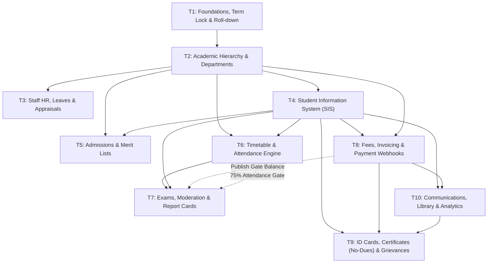

# EDU 360 — Tenant Agent Prompts Master Index

This directory contains the complete multi-agent execution prompt suite for taking the **EDU 360 Tenant Application (Educational ERP)** to 100% completion.

It mirrors and expands upon the platform prompt structure in \`docs/agent-prompts/\`, dividing all 21 Phase 1 modules, all 236 Phase 1 actions, and all 48 approval processes into **10 autonomous, highly detailed agent chat prompts (T1 to T10)**.

---

## 1. Prompt Inventory & Module Mapping

| Prompt File | Prompt Name | Modules Covered | Phase 1 Actions | Database Migrations Owned | Core Focus |
|---|---|---|---|---|---|
| **[T1](file:///c:/Users/manoj.gowda/Documents/Personal%20project/docs/tenant-agent-prompts/T1-foundation-term-lock-and-rolldown.md)** | Foundation, Term Lock & Roll-Down | M01, M03 (part), Roll-Down | Actions 1–7, 33–41, RD-01, RD-02 | Migrations \`55\` & \`56\` | Roll-Down Engine (\`V4-PD-01\`), Term Lock (\`is_term_locked()\`), 72h unlock, native number stepper & dark select UI polish. |
| **[T2](file:///c:/Users/manoj.gowda/Documents/Personal%20project/docs/tenant-agent-prompts/T2-academic-hierarchy-and-departments.md)** | Academic Hierarchy & Departments | M03 (core) | Actions 22–32 | Migrations \`57\` & \`58\` | University, College, School setup; academic calendars, non-overlapping terms, departments, programs, sections. |
| **[T3](file:///c:/Users/manoj.gowda/Documents/Personal%20project/docs/tenant-agent-prompts/T3-staff-hr-leaves-and-appraisals.md)** | Staff HR, Leaves & Appraisals | M11, M12, M13 | Actions 123–161 | Migrations \`59\` & \`60\` | Staff directory, qualification verification, leave balance accruals, delegations (Rule \`D-001\`), KPI appraisals. |
| **[T4](file:///c:/Users/manoj.gowda/Documents/Personal%20project/docs/tenant-agent-prompts/T4-student-information-system-sis.md)** | Student Information System (SIS) | M14 | Actions 162–174 | Migrations \`61\` & \`62\` | Student profiles, up to 3 guardians, immutable notes (\`fn_note_guard\`), DPDP legal hold (\`app.legal_hold\`), zero hard delete. |
| **[T5](file:///c:/Users/manoj.gowda/Documents/Personal%20project/docs/tenant-agent-prompts/T5-admissions-merit-and-enrollment.md)** | Admissions, Merit & Enrollment | M15 | Actions 175–186 | Migrations \`63\` & \`64\` | Intake cycles, document upload with ClamAV, quota reservations, non-delegable merit approval (\`C12\`), student conversion. |
| **[T6](file:///c:/Users/manoj.gowda/Documents/Personal%20project/docs/tenant-agent-prompts/T6-timetable-and-attendance-engine.md)** | Timetable & Attendance Engine | M04, M05 | Actions 42–54 | Migrations \`65\` & \`66\` | GiST exclusion constraints for teacher/room clashes, daily/period attendance, medical exemptions (§20.4), term lock gate. |
| **[T7](file:///c:/Users/manoj.gowda/Documents/Personal%20project/docs/tenant-agent-prompts/T7-assignments-examinations-and-grading.md)** | Assignments, Exams & Grading | M06, M07 | Actions 55–87 | Migrations \`67\` & \`68\` | Homework, exam schedules, 75% attendance hall ticket gate, SGPA/CGPA formulas (§20.1–§20.3), publish gate (\`fn_publish_gate\`). |
| **[T8](file:///c:/Users/manoj.gowda/Documents/Personal%20project/docs/tenant-agent-prompts/T8-fee-structure-invoicing-and-payments.md)** | Fees, Invoicing & Payments | M08 | Actions 88–109 | Migrations \`69\` & \`70\` | Quota fees, installment invoices, nightly late fine cron, 2-step concessions, Razorpay/Stripe HMAC webhooks. |
| **[T9](file:///c:/Users/manoj.gowda/Documents/Personal%20project/docs/tenant-agent-prompts/T9-id-cards-certificates-and-grievances.md)** | ID Cards, Certificates & Grievances | M09, M10, M16 | Actions 110–122, 187–195 | Migrations \`71\` & \`72\` | SVG/PDF ID cards, Transfer Certificates with No-Dues clearance, confidential grievance gate (\`fn_complaint_guard\`). |
| **[T10](file:///c:/Users/manoj.gowda/Documents/Personal%20project/docs/tenant-agent-prompts/T10-communications-library-and-transport.md)** | Communications, Library & Transport | M17, M18, M19, M20, M21 | Actions 196–234 | Migrations \`73\` & \`74\` | Role-targeted circulars, multi-channel messaging, library circulation, bus route seat allocation, executive KPI dashboards. |

---

## 2. Dependency Graph & Execution Sequence

---

## 3. Reserved Database Migration Ranges
Each chat owns an isolated, non-overlapping range of migration numbers to ensure zero merge conflicts:
- **T1:** Migrations \`55\` & \`56\`
- **T2:** Migrations \`57\` & \`58\`
- **T3:** Migrations \`59\` & \`60\`
- **T4:** Migrations \`61\` & \`62\`
- **T5:** Migrations \`63\` & \`64\`
- **T6:** Migrations \`65\` & \`66\`
- **T7:** Migrations \`67\` & \`68\`
- **T8:** Migrations \`69\` & \`70\`
- **T9:** Migrations \`71\` & \`72\`
- **T10:** Migrations \`73\` & \`74\`

Every migration must include its corresponding rollback (\`NNr_\`) and test verification (\`NNt_\`) script registered in \`sql/run_all.sh\`.
